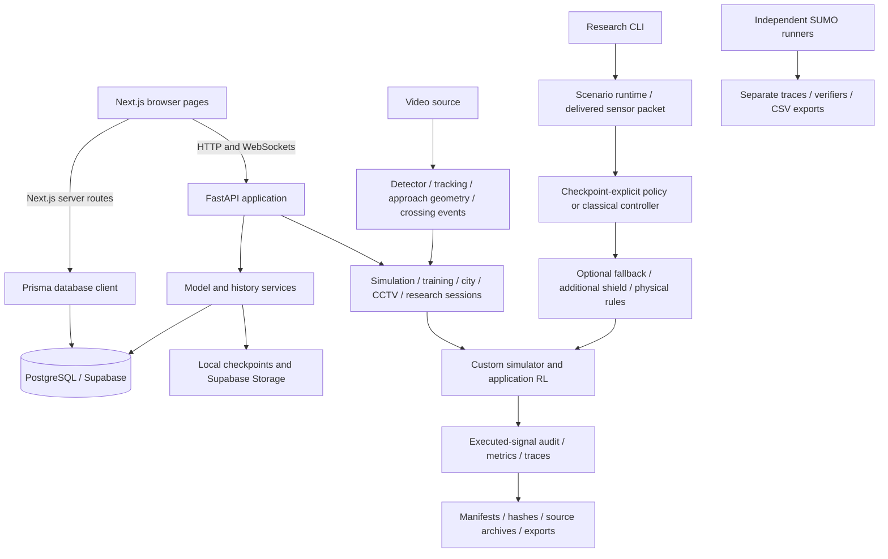
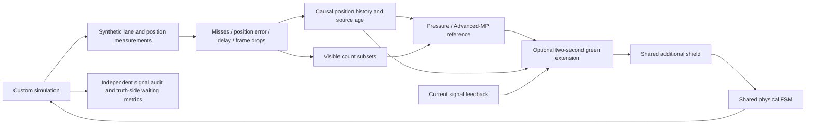

# FlowSync: application, architecture and research reference

<a id="top"></a>

Updated 2026-10-31, Asia/Kolkata. This is the maintained project reference. Code defines executable behavior; experiment manifests, source archives and frozen protocols define historical evidence. Root community/security policies retain their own administrative purpose. Other dated research documents are preserved records, not alternative current guides.

FlowSync is a simulation application and experimental traffic-control research platform. Its implementation combines established methods with project-specific integration, diagnostics and evidence tooling. **Algorithmic or architectural novelty is not established merely by that combination.** The attribution and novelty assessment in sections 14–15 distinguishes existing techniques, local adaptations and unverified historical claims.

This reference describes the actual application first. Separate experiment results begin at section 17. Camera accuracy, physical signal operation, hardware latency, public production hardening and complete application/headless parity remain unestablished. Research-only training and diagnostics do not automatically change application defaults or promote models.

## Contents

- [1. Project scope and ownership](#1-project-scope-and-ownership)
- [2. Current system architecture](#2-current-system-architecture)
- [3. Frontend pages and state flow](#3-frontend-pages-and-state-flow)
- [4. API, WebSockets and service lifecycle](#4-api-websockets-and-service-lifecycle)
- [5. Custom simulation mechanics](#5-custom-simulation-mechanics)
- [6. Policy architecture and inference](#6-policy-architecture-and-inference)
- [7. Training, demonstrations and version compatibility](#7-training-demonstrations-and-version-compatibility)
- [8. Research observation and data boundary](#8-research-observation-and-data-boundary)
- [9. Supervision, shielding and physical transitions](#9-supervision-shielding-and-physical-transitions)
- [10. Camera and digital-twin workflow](#10-camera-and-digital-twin-workflow)
- [11. Model, history and persistence workflow](#11-model-history-and-persistence-workflow)
- [12. Recording, replay, telemetry and exports](#12-recording-replay-telemetry-and-exports)
- [13. Offline experiment and evidence workflow](#13-offline-experiment-and-evidence-workflow)
- [14. Technique attribution and primary references](#14-technique-attribution-and-primary-references)
- [45. Methodology contracts, parameter provenance and implementation audit](#45-methodology-contracts-parameter-provenance-and-implementation-audit)
- [15. Novelty assessment independent of measured performance](#15-novelty-assessment-independent-of-measured-performance)
- [16. Maintained documentation and verification boundary](#16-maintained-documentation-and-verification-boundary)
- [17. Current Status and Evidence Authority](#17-current-status-and-evidence-authority)
- [18. Current Repository and Research Organization](#18-current-repository-and-research-organization)
- [19. Audited Execution, Sensing and Controller Boundaries](#19-audited-execution-sensing-and-controller-boundaries)
- [20. Current RL Architecture, Observation Versions and Learning Repairs](#20-current-rl-architecture-observation-versions-and-learning-repairs)
- [21. Audited Training and Evaluation History](#21-audited-training-and-evaluation-history)
- [22. Action Labels, Calibration and Future-Arrival Diagnostics](#22-action-labels-calibration-and-future-arrival-diagnostics)
- [23. Upstream Demand, Spatial Pilot and Input-Use Diagnosis](#23-upstream-demand-spatial-pilot-and-input-use-diagnosis)
- [24. Teacher Alignment and Horizon Sensitivity](#24-teacher-alignment-and-horizon-sensitivity)
- [25. Reproducibility, Parent Checkpoints and Experimental Separation](#25-reproducibility-parent-checkpoints-and-experimental-separation)
- [26. Application, API, Storage and Integration Status](#26-application-api-storage-and-integration-status)
- [27. Installation, Operations, Security and Open-Source Conventions](#27-installation-operations-security-and-open-source-conventions)
- [28. Verification and Quality Gates](#28-verification-and-quality-gates)
- [29. Paper Scope, Novelty and Remaining Requirements](#29-paper-scope-novelty-and-remaining-requirements)
- [30. Evidence and Maintenance Index](#30-evidence-and-maintenance-index)
- [31. Independent SUMO Architecture and Execution Contracts](#31-independent-sumo-architecture-and-execution-contracts)
- [32. SUMO Future-Arrival Panel and Action Diagnosis](#32-sumo-future-arrival-panel-and-action-diagnosis)
- [33. Executed SUMO Classical Baselines](#33-executed-sumo-classical-baselines)
- [34. Total-Count Ablation and Waiting Distribution](#34-total-count-ablation-and-waiting-distribution)
- [35. Initial-Phase and Horizon Robustness](#35-initial-phase-and-horizon-robustness)
- [36. Paper Evidence Map and Reporting Boundaries](#36-paper-evidence-map-and-reporting-boundaries)
- [37. Episode-level switch-margin calibration](#37-episode-level-switch-margin-calibration)
- [38. Decision-cadence opportunity prerequisite](#38-decision-cadence-opportunity-prerequisite)
- [39. Supervised count-restoration pilot](#39-supervised-count-restoration-pilot)
- [40. On-policy PPO with frozen count restoration](#40-on-policy-ppo-with-frozen-count-restoration)
- [41. Source-timed arrival-window architecture](#41-source-timed-arrival-window-architecture)
- [42. Arrival reference-gap and service audit](#42-arrival-reference-gap-and-service-audit)
- [43. Receding arrival decisions: frozen cadence experiment](#43-receding-arrival-decisions-frozen-cadence-experiment)
- [44. Independent SUMO sensing-fault study](#44-independent-sumo-sensing-fault-study)

## 1. Project scope and ownership

FlowSync has three execution paths: the interactive Next.js/FastAPI application, the audited custom-simulator research CLI, and independent SUMO diagnostics. They share selected code, but have different sensor boundaries, configurations and evidence contracts. A feature existing in one path does not make it available in another.

| Location | Owns |
| --- | --- |
| [client/src/app](client/src/app/) | Pages and server-side Next.js routes. |
| [client/src/components](client/src/components/) | Application controls, charts, research inspectors and rendered scenes. |
| [client/src/hooks](client/src/hooks/), [stores](client/src/store/), [types](client/src/types/) | HTTP/WebSocket lifecycle, frontend state and wire contracts. |
| [server/app/main.py](server/app/main.py) | API lifespan, shared application objects and route registration. |
| [server/app/simulation](server/app/simulation/) | Custom traffic motion, arrival generation, signals and city simulation. |
| [server/app/controllers](server/app/controllers/) | Controller proposals, fallback supervision, additional shield and physical FSM. |
| [server/app/rl](server/app/rl/) | Policy network, replay, agent, observations and application trainer. |
| [server/app/realworld](server/app/realworld/) | Experimental video/detection/counting and digital-twin utilities. |
| [research](research/) | Headless training/evaluation, sensor faults, bounded studies, verification and exports. |
| [results](results/) | Local experimental artifacts. Most are ignored and absent from a fresh clone. |

Work continues on `main`. Keep code fixes and documentation tasks in focused commits. Preserve existing environments, checkpoints, data and source archives.

## 2. Current system architecture



The arrows describe implemented ownership and message flow, not an asserted common numerical runtime. The interactive research WebSocket still has a legacy session loop. It does not use all repaired scenario/sensor/replay semantics of `research/experiments/engine.py`. SUMO runs outside the web service and is not an application simulator switch.

## 3. Frontend pages and state flow

| Page | Function and current boundary |
| --- | --- |
| `/`, `/dashboard` | Project entry and application/database summaries. Persistence requires configured backend/database services. |
| `/simulation` | Interactive single-junction simulation, controls, scenarios, training/model interactions and telemetry. Uses application contracts. |
| `/city` | Separate multi-intersection visualization and comparison flow. No validated city-level learned contribution follows. |
| `/realworld` | Experimental video, counting, ROI and digital-twin controls. No physical traffic-cabinet actuation. |
| `/research` | Backend controller availability and recorded application-run catalog. No embedded publication benchmark table. |
| `/research/experiment`, `/research/compare` | Legacy live-session visualization and classical comparisons. Checkpoint-free learned control is rejected. |
| `/research/replay`, `/research/runs/[id]` | Recorded application bundle replay/details. Offline SUMO gzip traces use their dedicated tools rather than this format. |

React components render hooks/store data. TanStack Query handles application data fetching; Zustand stores maintain live simulation/research state. Research history is bounded at 300 frames for live charts. A stored replay may have its own full frame array. React Three Fiber/Three.js render the scene; geometry/interpolation is presentation, not an independent dynamics engine.

Backend packets are the authority for controller availability, frame identity and measurements. Research export helpers use actual frame fields, preserve zero values and leave missing measurements/provenance unknown. CSV escapes quoted labels and spreadsheet formula prefixes; LaTeX escapes identifiers and contains only the recorded controller row. Export before a single-run frame arrives is disabled. Changing the current UI selection cannot relabel an older frame's exported controller, scenario or seed.

## 4. API, WebSockets and service lifecycle

FastAPI registers simulation, training, metrics, analytics, CCTV and research routers and WebSocket endpoints. The detailed route inventory is in section 26. Next.js `/api/episodes`, `/api/models`, `/api/simulations` and `/api/metrics` execute server-side database access through Prisma. Browser calls to FastAPI use `NEXT_PUBLIC_FASTAPI_HTTP_URL` and `NEXT_PUBLIC_FASTAPI_WS_URL`.

At startup, the backend creates separate simulation and training agents/environments, a trainer, and city objects. Startup attempts to load application-compatible v6/v4 checkpoints from the configured model service. Missing cloud configuration or a failed load is not evidence that trained weights are present. Model identity must come from actual loaded checkpoint metadata, not an episode label.

WebSocket hooks connect, process frames and dispatch explicit start/pause/resume/stop/speed/replay commands. The research hook shares a connection across consumers. An acknowledged start/frame updates execution state and frame identity. Reconnects, queued commands and timeout messages are application behavior, not research replication guarantees.

`GET /research/runtime` exposes `interactive_legacy`, simulation-only scope, available live controllers and lack of audited headless parity/checkpoint integration. `GET /research/controllers` supplies `available_live` and an unavailability reason per controller. Both single and paired live sessions reject unsupported learned controllers before constructing a model or starting an environment. Unknown scenarios and noise presets fail explicitly. The application training/model flow is separate and retains its version restrictions.

The old `/research/summary` now returns `historical_invalid` with empty benchmark/statistical objects. Original retired files remain preserved. A successful file read from `results/final` cannot validate old checkpoint-free comparisons.

## 5. Custom simulation mechanics

The actual custom simulator uses normalized lane positions, simplified spacing/signal/turn rules and discrete time. [Vehicle.tick](server/app/simulation/vehicle.py) switches between fixed normalized free speed `0.12` and stopped motion, incrementing waiting when movement is blocked. [Intersection.tick](server/app/simulation/intersection.py) determines permission and spacing and advances those vehicles. This is **not an implementation of the IDM acceleration differential equation**. Earlier physical acceleration/deceleration constants and calibrated-microscopic claims are withdrawn.

Four phases map to `0=NS straight/right`, `1=EW straight/right`, `2=NS left`, `3=EW left` in [traffic_signal.py](server/app/simulation/traffic_signal.py). Right-turn and left-yield rules are simplified. App emergency/scenario hooks do not provide validated emergency or pedestrian safety. The independent SUMO network instead has two straight-only phases and cannot share these four-action labels without an explicit adapter.

Operator and emergency requests now enter the same executed signal FSM through `request_phase`. They wait for minimum green and preserve an already committed yellow/all-red target. Priority requests precede operator requests; ordinary policy proposals remain per-tick requests. Emergency handling no longer resets the physical phase/color/timer directly. This repairs simulated transition authority; field emergency preemption remains unvalidated. Exact timing defaults and their separate runtime meanings are recorded in section 45.

The spawner creates requested traffic under declared profiles and retains entry backlog when insertion is blocked. Backlog visibility differs by experiment and sensor configuration. Historical movement counts can include vehicles already past the stop line; the explicitly upstream getter has different semantics. Source/runtime configuration must identify which is used. Incident capacity is represented by a discharge-headway surrogate, not a calibrated incident traffic model.

## 6. Policy architecture and inference

The shared dueling network has two 256-unit feature layers, LayerNorm and ReLU, then 128-unit value/advantage heads producing one value and four advantages. The masked combination is described in section 20. It is a project adaptation of established dueling architecture, not a newly invented DQN family.

Inference encodes the checkpoint's observation version, supplies a valid-action mask, evaluates Q values without training gradients and selects an allowed action. D3QN uses a two-second policy hold cadence within 0.1-second simulation ticks. The audited research path records checkpoint metadata/SHA-256 and sets evaluation mode. The website requires a successfully loaded compatible checkpoint before AI operation; it does not inherit the research path's full provenance contract. The research runner requires a trained checkpoint unless an explicit mechanics-only untrained override is given.

Inputs are numeric traffic features rather than raw CCTV pixels. Observation widths 28/36/48/64 are versioned sensor encodings, detailed in section 20. A 14-dimensional camera-state builder is a separate application utility and is not the later research policy's automatic input contract.

## 7. Training, demonstrations and version compatibility

The agent uses Double-DQN targets, prioritized replay, importance weights, Smooth L1 TD loss, Adam and an optional demonstration margin term. The application trainer is [server/app/rl/trainer.py](server/app/rl/trainer.py); the audited headless trainer is [research/training/train_policy.py](research/training/train_policy.py). They are different collection/integration paths.

Demonstrations are transitions collected from a teacher such as Max-Pressure. Imitation updates teach teacher actions; TD warmup fits value targets; online RL subsequently gathers and learns from its own trajectories. Checkpoint metadata and logs distinguish these stages. Teacher-assisted training is related to DQfD; this repository does not claim a faithful reproduction of its complete algorithm.

Research v5 fixes repeated switch charging and stores completed decision-to-decision macro transitions, dropping the incomplete final transition. The application path retains v4 reward/replay differences. Variable-duration discounting uses the elapsed decision interval. Input/reward compatibility must be checked together; matching network dimensions alone is insufficient. No automatic website migration or research-checkpoint promotion occurred.

Application resume and fine-tuning use staged, version-compatible checkpoint loading with exact slot selection and actual trained-episode metadata. Resume starts with fresh replay; fine-tuning also resets optimizer state and child counters. Saved milestones publish a separate inference snapshot and matching model identity after checkpoint writes return. Captured inference agents retain their prior tensors.

## 8. Research observation and data boundary

The headless custom path executes scenario/demand → simulator → delivered synthetic sensor packet → observed context/features → controller proposal → optional fallback → optional shield → physical transition → executed lamps. Truth is permitted for rewards and evaluation metrics. It must not replace noisy delivered controller inputs.

The observed context supplies delivered movement/outgoing counts, masks, forecasts, frame age/availability and phase-service timers. Spatial v9 adds delivered upstream movement counts and matched zero-spatial controls. Temporal v8 adds history and matched zero-history controls. Expansion starts new input columns at zero so initial parent Q values match; that is an initialization/control technique rather than evidence of a new representation theory.

Faults include binomial misses, positive/ghost counts, bursts, jitter, swaps, latency and packet drops. Spatial faults partition delivered counts under documented assumptions. These are synthetic stress models, not empirically fitted CCTV error distributions. All experiment decisions must be tied to their frozen source/configuration and sensor adapter.

## 9. Supervision, shielding and physical transitions

FlowSync-UQ wraps D3QN with observed-feature uncertainty, hysteretic authority selection and an optional additional rule shield. The supervisor uses distinct enter/recover thresholds and dwell/recovery rules to reduce authority oscillation. Max-Pressure supplies the fallback proposal. A score indicating sensor error does not directly estimate whether fallback improves traffic control.

The additional shield enforces configured service/timing rules; the physical FSM enforces green/clearance transitions separately. Bare D3QN still has physical minimum-green and clearance. Removing the shield is therefore not an ablation that removes all physical safeguards. Phase-service timers differ from individual accumulated vehicle waiting.

The default uncertainty score is a weighted heuristic sigmoid. The fitted research calibration standardizes seven features and uses constrained logistic regression to predict synthetic count-error events. It does not validate the historical universal `T=1.2` temperature-scaling claim or a camera-accuracy probability. Thresholds and calibration hashes are experiment-specific. The actual fitted code is [calibrate_uncertainty.py](research/calibration/calibrate_uncertainty.py).

Rule checks, test coverage and finite lamp audits do not amount to formal synthesis/model checking of an all-state safety specification. They do not establish collision freedom, pedestrian safety or real cabinet readiness. The generic shielding literature is related work; its theorems are not inherited by this implementation.

## 10. Camera and digital-twin workflow

The actual orchestrator is [cctv_pipeline.py](server/app/realworld/pipeline/cctv_pipeline.py). It extracts a frame, runs Ultralytics YOLO detection in a worker thread, updates tracks, assigns exclusive image-direction proxies, smooths counts, annotates and broadcasts/logs the result. Configured pipeline rate is separate from measured end-to-end latency. Stream resolution and latest-frame buffering do not guarantee zero capture/network/decoding delay.

The default detector family is YOLOv8n, with local production/pretrained paths and optional upstream weight fallback. This is third-party software/model use, not a FlowSync detector architecture. Record actual weight identity, dataset/model provenance and upstream licensing separately from this repository's source license.

Detector class mapping now comes from the loaded model's declared label names, including explicitly selected or swapped models. Model/device/path/taxonomy publish together only after successful loading; inference uses that captured model/taxonomy pair. `USE_ONNX` prefers an existing configured ONNX artifact when no explicit path is supplied, then the usual production/pretrained fallback applies. Neither format preference nor structural label compatibility establishes accuracy or a CPU speedup. Section 45 records active tracker defaults separately from unused tracking declarations.

[VehicleTracker.update](server/app/realworld/pipeline/vehicle_tracker.py) greedily associates nearest previous centroids within an 80-pixel distance and prunes tracks after more than three seconds in its supplied observation clock. Recorded files use decoder video-position time; live sources use monotonic receipt time, not a measured camera capture clock. Missing/nonadvancing file times invalidate association rather than borrowing processing time. Track IDs are local to each tracker/session. Section 10.6 documents this clock repair and its reproducible diagnostic. The tracker does **not** execute ByteTrack's two-stage association, despite legacy comments. ByteTrack is related work only until its implementation is actually wired. Likewise, detector IDs or time since first sighting do not automatically provide calibrated individual stopped waiting.

Without a supplied geometry configuration, the counting path uses bottom-centre locations and assigns the dominant displacement from the image centre to at most one direction. Centre/diagonal ties and invalid locations remain unassigned. This repairs the historical counter's two-to-four assignments per box. With a supplied configuration, the pipeline assigns boxes to explicitly configured approach regions instead (section 10.1). The legacy `*_straight` keys remain compatibility slots for approach totals, not measured turning movements. Legacy ROI/homography utilities exist separately; the current orchestrator does not apply a homography. Smoothed/last-good image-proxy counts and confidence heuristics remain estimates. Configured region occupancy uses current detections without last-good imputation.

`CCTVFrame.observation_contract` reports detected, assigned and unassigned box counts, unavailable movement information and missing control inputs. The current pipeline has no loaded control-policy inference path or live signal feedback. Optional recorded signal annotations are attached separately as `recorded_signal` (section 10.4). Controller output fields remain empty observations/Q values and null phase, policy confidence and waiting measurements. The former queue-times-2.5 waiting estimate has been removed. The frontend displays these limitations instead of a default green, numerical Q vector or apparent policy confidence.

First track sightings retain `turn:null` and explicit provenance: image-direction proxy, unobserved turn and processing-cadence timestamp proxy. Track IDs no longer generate fictional turns. Empty recordings remain empty. [arrival_contract.py](server/app/realworld/digital_twin/arrival_contract.py) checks required replay fields and rejects these incomplete sightings before simulation state changes. The recorder publishes `replay_inputs_complete` and a reason; the UI disables replay and automatic count injection for incomplete sessions. Field completeness does not establish measured-camera validity for legacy or manually supplied events. The digital twin remains experimental simulation, not calibrated equivalence to a real intersection. Recorded footage and ground-truth traffic labels were not supplied for validation. Section 36.7 records the synthetic contract and frozen-model diagnostic.

### 10.1 Optional camera approach geometry

The camera pipeline accepts `camera_geometry_v1` configurations through the **Approach geometry** JSON-file input on `/realworld`. This is user-supplied image geometry, not automatic calibration or an accuracy certificate. [calibration.py](server/app/realworld/models/calibration.py) defines immutable validated configurations; [camera_geometry.py](server/app/realworld/pipeline/camera_geometry.py) applies them. This path does not call the legacy `ROIManager`, whose first-match overlapping-region behavior is unsuitable for explicit ambiguity reporting.

Each configuration binds a camera ID to the exact source path/URL and reference frame dimensions. It defines one to four named approaches, each with a strictly convex polygon of 3–16 distinct normalized `(x,y)` vertices in boundary order and a two-point stop line on one boundary edge. Coordinates use the original image origin at top left, with x increasing rightward and y downward. The polygon must describe the upstream road area; mathematical validation cannot establish that the user selected the correct road or stop line. Clockwise and counterclockwise ordering are accepted. Concave/self-crossing/zero-area polygons, overlapping interiors, duplicate approach names, nonfinite/out-of-range coordinates and degenerate/off-boundary stop lines are rejected. Shared region edges are permitted; detections on a shared boundary remain ambiguous and unassigned. No homography, world-distance estimate or inferred intersection orientation is introduced.

Workflow:

1. Select/upload the intended video. Copy the exact **Source** displayed below the calibration input.
2. Define upstream polygons and stop-line endpoints on a reference frame, normalize coordinates by its width/height, and save the JSON. The example below is synthetic; replace every geometry/source/dimension value using the intended camera. There is no graphical polygon editor yet.
3. Import the JSON. `POST /cctv/calibration/validate` validates it and returns canonical JSON, a SHA-256 identity and source. Invalid input blocks Start. Changing the source requires removing or reloading the configuration.
4. Start processing. `/ws/cctv` accepts `start_processing.payload.calibration_json` and validates it again before replacing an active session. Source and decoded video dimensions must match. Configured polygons and orange stop lines are overlaid on the video for review.
5. Inspect configured approach counts and unassigned/ambiguous boxes. Completed/stopped sessions retain the exact configuration and hash; each frame and track-sighting event records the hash. Restarting processing creates a new session ID instead of overwriting the previous session.

```json
{
  "schema_version": "camera_geometry_v1",
  "camera_id": "example_camera",
  "source": "REPLACE_WITH_EXACT_SELECTED_SOURCE",
  "frame_width": 1000,
  "frame_height": 1000,
  "approaches": [
    {
      "approach": "north",
      "vertices": [[0.1, 0.1], [0.4, 0.1], [0.4, 0.6], [0.1, 0.6]],
      "stop_line": [[0.1, 0.6], [0.4, 0.6]]
    }
  ]
}
```

Assignment uses the detected box's bottom centre. Only a unique containing region receives one count; outside/invalid points and shared-boundary ambiguity receive none. A frame-size mismatch or unavailable detector assigns no boxes and emits an explicit unavailable status. There is no fallback to image-direction guesses or retained counts in this configured path. Unconfigured approaches are absent from `geometry_observation.approach_counts` and displayed as unavailable, not measured zero. Normalized geometry is nevertheless bound to exact dimensions to prevent silent reuse after resizing/cropping; a moved camera or same-size crop cannot be detected by this check and requires operator review. Geometry comparisons use a numerical tolerance of `1e-9` in normalized coordinates, not a physical localization-error bound.

`CCTVFrame.geometry_observation` carries status, configured approaches, approach counts, assigned/unassigned/ambiguous counts and `calibration_sha256`. `observation_contract.count_semantics` becomes `configured_approach_region`; movement availability remains false and control remains unavailable. Legacy twelve-slot counts place each approach total in its `*_straight` compatibility slot for existing charts/recorders. This does **not** observe straight-going vehicles. Occupancy includes moving vehicles in the region; it does not itself measure a stopped queue, intended turns or discharge rates. Stop lines constrain and visualize the region boundary; recorded-video crossing inference is a separate output described in section 10.2. First track sightings keep unknown turns and processing-cadence timing, so they remain ineligible for calibrated replay. Live signal feedback and trained camera-policy integration are still missing; optional recorded signal timelines are described in section 10.4.

This is an engineering prerequisite for a labeled-video study, not a new controller or algorithmic novelty claim. Source matching and hashes establish configuration identity, not geographic truth or camera accuracy. Preserve source-access credentials separately where possible; recorded configuration includes the source string. Real recorded-camera labels, movement counts, phase observations and independent error/performance measurements remain necessary.

Verification on October 29: **59 focused backend tests passed**, including 19 new geometry/API/pipeline/recorder/WebSocket tests; these overlap earlier test totals. The frontend's five tests, type checking, lint and production build pass. A Chromium workflow used a synthetic video and supplied detections through the actual upload API, geometry validation, WebSocket handler, video reader, pipeline and session recorder. Invalid geometry blocked Start. Two of five supplied boxes were assigned, three were unassigned, including one shared-boundary ambiguity. The recorded configuration/hash survived processing, replay remained incomplete, and no uncaught browser exception occurred. This checks integration, not detector accuracy, real-camera counting or controller performance. Existing dependency and chart-sizing build warnings remain. No frozen experiment artifact or trained checkpoint was modified.

### 10.2 Recorded-video stop-line crossings

[stop_line_crossings.py](server/app/realworld/pipeline/stop_line_crossings.py) adds inferred **discharge** events for configured approaches. It does not relabel first camera sightings as arrivals, infer turns or supply incoming demand to the simulator. This distinction matters: traffic crossing a stop line has already been affected by the existing signal controller. Reusing those discharges as exogenous arrivals would conflate demand with service.

For local recorded video, `VideoProcessor.source_time_s` reads `CAP_PROP_POS_MSEC` after decoding the delivered frame, converts milliseconds to seconds, and accepts only finite nonnegative, strictly advancing values (zero is permitted initially). It does not derive source timing from processing-loop count or substitute FPS when timestamps fail. OpenCV documents this property as video-file position and cautions that property behavior depends on the backend/device layers; see the [official video I/O property reference](https://docs.opencv.org/4.13.0/d4/d15/group__videoio__flags__base.html). Monotonicity is a validity check, not proof of timestamp accuracy. Live streams currently expose no suitable source clock and therefore emit an unavailable crossing status. Existing frame `timestamp_ms` remains processing wall time; first-sighting `time_s` remains a cadence proxy. Neither is used as the new crossing clock.

The crossing rule is deterministic and conservative:

- A uniquely assigned upstream detection arms a track for its configured stop line. The polygon interior determines upstream direction, independent of endpoint ordering or camera orientation.
- Consecutive processed observations of that track must move from more than two pixels upstream to more than two pixels downstream. The connecting segment must intersect the finite stop line at least two pixels from either endpoint. Small movements inside the two-pixel band do not immediately count; the upstream anchor may bridge that band for at most one second.
- An event requires at most one second between anchor and current observation and at most 80 pixels of bottom-centre displacement. These fixed engineering thresholds are not calibrated localization-error bounds or tuned performance gains. Pixel thresholds are resolution-dependent.
- A missing/duplicate track observation, skipped processed frame, invalid geometry, unavailable detector or nonadvancing/missing source time breaks pending evidence. Large gaps or displacements cannot generate a crossing. At most one event is emitted per `(track_id, approach)` during a pipeline session, suppressing boundary oscillation duplicates.

Each `StopLineCrossing` preserves track ID, approach, configuration hash, bracketing frame IDs, source-time interval, normalized intersection point, `estimated_time_s`, `turn:null` and `event_semantics:"inferred_stop_line_discharge"`. The estimate linearly interpolates the two observed bottom-centre positions. It is not an exact camera exposure/crossing timestamp, confidence interval, physical ground-contact measurement or motion-model validation. Bracketing frames can span an intermediate neutral-band observation.

`CCTVFrame.crossing_observation` reports availability, current decoder position, the fixed thresholds, cumulative per-approach counts, events emitted on that frame and the last event for display. The UI shows these under **Stop-line crossings**, including the last event's time interval. Unavailable states retain explicitly labeled historical session totals; they do not assert that zero vehicles crossed during a missing observation. The recorder stores the events separately as `stop_line_crossings` in the session and twin-data payloads. Replay validation explicitly rejects discharge events even if someone supplies otherwise complete arrival fields. Crossing observations do not supply turns, signal phase or upstream entry demand. Signal phase may be supplied separately through a recorded timeline (section 10.4); replay and learned signal recommendations remain unavailable.

Tracker repairs preserve the detector-unavailable flag in the tracked packet and expire stale tracks before association, preventing a nearby detection from reviving a track older than three processing-wall-clock seconds. Tracking remains the existing greedy centroid heuristic, not ByteTrack or a calibrated identity system. Identity swaps, duplicate detector boxes with different IDs, reidentification after occlusion, missed crossings at the two-hertz pipeline cadence and incorrect camera geometry can still cause errors. The maximum-gap/displacement rules deliberately abstain from some true crossings. No real-camera precision/recall or throughput accuracy is established.

The implementation uses established segment intersection, hysteresis, tracking and interpolation techniques; it is an observable-data prerequisite, not a new controller or a novelty claim. Verification includes a generated MJPEG clip with a white rectangle moving across the configured line, decoded by the real `VideoProcessor` and detected by a deterministic threshold fixture. Six source observations at 0, 0.5, 1, 1.5, 2 and 2.5 seconds produce one inferred crossing, estimated at 1.25 seconds within the [1, 1.5] observation interval, without wall-clock sleeps. The recording retains that event while replay remains incomplete. This is a controlled integration fixture, not a YOLO benchmark or a real traffic result. Reproduce the committed behavior tests with:

```bash
PYTHONDONTWRITEBYTECODE=1 OMP_NUM_THREADS=1 MKL_NUM_THREADS=1 \
  server/venv/bin/python -m pytest server/tests/realworld/test_stop_line_crossings.py \
  --no-cov -p no:cacheprovider -q
```

Crossing verification on October 29: **78 focused backend tests passed**, including 19 crossing/timing/tracker tests; counts overlap the earlier calibration suite. Five frontend tests, TypeScript, lint and the production build passed. A Chromium check exercised video upload, geometry validation, actual decoding/tracking, crossing display and recording with the synthetic clip and threshold detector. It displayed and saved one crossing estimated at 1.25 seconds in [1, 1.5], kept replay incomplete, and raised no uncaught browser exception. Existing dependency and chart-sizing build warnings remain. No real footage, YOLO accuracy, hardware latency, signal actuation or traffic-delay improvement was evaluated.

### 10.3 Crossing evaluation against labeled video

[evaluate_crossings.py](research/cv/evaluate_crossings.py) compares recorded discharge events with separately supplied annotations. It requires a saved session, the original video bytes, an annotation JSON and a matching-protocol JSON. Local-file recording now fingerprints the video with SHA-256 when opening it; `SessionRecorder` saves that value as `source_video_sha256`. Live sources have no file fingerprint. Old sessions without this identity are rejected by this evaluator: do not retrofit a hash and present it as original capture provenance. Hashing at opening binds recorded metadata to those bytes, but does not continuously attest that a file remained immutable during processing. Source files must be kept unchanged.

Annotations identify the video hash and calibration hash, declare `origin` (`human` or `synthetic_fixture`), a data role (`calibration`, `development` or `held_out`), labeling method and time resolution. A role is an annotator declaration; software cannot establish that a supposedly held-out clip was never inspected. Every label needs a unique event ID, approach and time in the same video-position coordinate system used by the pipeline. Labels must come from reviewing the video independently of predictions, not copying exported events. Field validation cannot certify annotation correctness or independence.

Specify exhaustive, nonoverlapping **[start, end)** windows per approach. Every real crossing in each window must be labeled, including crossings during detector/timing outages. Windows must fit within the recorded source-time extent and configured approaches. Unlabeled time is not assumed to contain no crossings. Predictions outside scored windows are retained as unscored indices. The report exposes available/unavailable crossing-frame counts and the largest gap between available source timestamps. `scored_approach_seconds` sums window duration across approaches and is not unique wall-clock duration or a count of independent samples.

Matching operates separately within each approach/window, using the protocol's fixed absolute time tolerance. It maximizes the number of one-to-one matches, then minimizes total absolute timing error, with deterministic tie handling. The implementation uses a sorted dynamic program; a two-million-cell budget per window bounds computation. Declare shorter windows before evaluation if needed. The tolerance and window choices should be frozen before examining results, with labeling resolution justified separately. Saving/hashing a protocol does not itself prove preregistration.

Outputs include matched prediction/annotation IDs, every unmatched event, per-window and aggregate TP/FP/FN, precision, recall, F1, matched-event timing MAE and signed bias. A positive bias means the predicted crossing is later. Ratios with zero denominators are `null`; timing metrics are `null` without matches. Timing error is conditional on successful matching and must be read alongside misses and extras. A wrong approach becomes a miss/extra only where both relevant approaches are exhaustively scored. Time/approach matching in dense traffic does not establish vehicle identity, detector-box precision, tracking IDF1 or turn accuracy.

Before scoring, the evaluator reconstructs cumulative counts and the session-level event list from frame events, checks duplicate track/approach events, calibration identity and bracketing frame times, and rejects inconsistencies. It also requires the video hash to agree with both session and annotations. It does not independently rerun detection or establish the accuracy of recorded geometry. Every report copies the exact session, annotations and protocol, records their hashes, saves the evaluator and model-schema sources, and records Python/Pydantic versions. Output directories must be new. Verification recomputes matching and checks inputs, report and archived/current source identity; historical reports require their saved code/runtime. The original video is hashed but not copied into the report directory.

Example protocol (the tolerance is illustrative, not a tuned or validated recommendation):

```json
{"schema_version":"crossing_evaluation_v1","protocol_id":"clip-study-01","match_tolerance_s":0.25}
```

Start annotations as a **draft**, replace hashes/extent/method from the actual study, add independently reviewed events, and only mark `exhaustive:true` once review is complete. The following draft deliberately fails evaluation:

```json
{
  "schema_version": "crossing_annotations_v1",
  "video_sha256": "REPLACE_WITH_RECORDED_VIDEO_HASH",
  "calibration_sha256": "REPLACE_WITH_RECORDED_CALIBRATION_HASH",
  "origin": "human",
  "split": "development",
  "annotation_method": "REPLACE_WITH_REVIEW_METHOD_AND_ANNOTATOR_RECORD",
  "time_resolution_s": 0.04,
  "windows": [{"window_id":"north-01","approach":"north","start_s":0,"end_s":30,"exhaustive":false}],
  "events": []
}
```

An event has the shape `{"event_id":"vehicle-001","approach":"north","time_s":12.4}`; its time must be labeled, not inferred from this example. Session paths are under `data/sessions` relative to the backend working directory. With actual files prepared, run from the repository root:

```bash
PYTHONDONTWRITEBYTECODE=1 server/venv/bin/python -m research.cv.evaluate_crossings \
  --session /path/to/session.json --video /path/to/unchanged-clip.mp4 \
  --annotations /path/to/annotations.json --protocol /path/to/protocol.json \
  --output results/crossing_evaluation/clip_study_01

PYTHONDONTWRITEBYTECODE=1 server/venv/bin/python -m research.cv.evaluate_crossings \
  --verify results/crossing_evaluation/clip_study_01 --video /path/to/unchanged-clip.mp4
```

The final local mechanics check is `results/crossing_evaluation/synthetic_final_20261029/`, with source fixture files in `results/crossing_evaluation/fixture_20261029/`. The earlier `synthetic_20261029/` report remains a development snapshot. A generated rectangle trajectory and analytic crossing label were specified before inference. The actual decoder, threshold detector fixture, tracker, crossing pipeline and recorder produced one match, no misses/extras and zero matched timing error. CLI verification reconstructs the final report. These numbers describe one deliberately simple synthetic fixture; they are **not** camera precision/recall evidence or a new independent traffic experiment. `annotation_origin:synthetic_fixture`, `publication_ready:false` and `policy_promoted:false` remain explicit. No labeled real footage has been supplied, and no model was trained or promoted. These local artifacts remain outside Git under the existing results policy.

Evaluation verification on October 29: **99 focused backend tests passed**, including exhaustive small-panel matching comparisons, greedy-matching counterexamples, empty denominators, wrong video/configuration hashes, inconsistent stored events, incomplete/overlapping windows, out-of-window predictions, output overwrite prevention and report tampering. A complete detector outage with valid decoder timestamps retains the labeled window and records its events as misses; it is not silently excluded. Tests also cover actual video decoding, fingerprinted recording and evaluator integration. The CLI report verifier passed. These tests overlap earlier totals. No frontend files changed in this evaluation step, and no new frontend build or real-camera trial is claimed.

**Legacy CV evidence correction.** [validate_perception_quality.py](research/cv/validate_perception_quality.py) previously drew random values around hard-coded regime scores and described them as 1,000 manually annotated real-world frames. It now fails explicitly before writing any report. Its historical outputs cannot support measured perception or ByteTrack claims. [validation_tool.py](research/cv/validation_tool.py) previously treated equal aggregate counts as object matches, returned an unmeasured 0.35-second arrival error and substituted correlation 0.70 when insufficient data existed. It now returns only supplied paired-count errors and a computed correlation when eligible supplied confidences/data exist; object precision/recall/F1, lane-assignment accuracy and arrival timing are `null`. Missing correlation is `null` rather than invented. The count helper assumes omitted movement keys are zero and is not an exhaustive camera annotation protocol. Existing saved files were preserved. Use the new event evaluator for crossing labels; broader detection/tracking validation still needs corresponding labeled boxes and identities.

### 10.4 Recorded signal timelines

[signal_timeline.py](server/app/realworld/models/signal_timeline.py) imports annotated or previously synchronized signal logs for a recorded video. It does not recognize lamps, read a live signal cabinet, generate a phase plan or execute signal commands. The timeline is tied to the video's SHA-256 identity and the `video_position_seconds` timebase. Source timestamps come from the same decoder-position path used for crossing events. A controller log must already be aligned to that video axis; no automatic clock-offset estimation or synchronization guarantee is provided.

The supported mapping is explicitly `flowsync_four_phase_v1`: 0 = NS straight, 1 = EW straight, 2 = NS left, 3 = EW left. The annotation author must establish that this mapping fits the intersection. It does not represent arbitrary concurrent movements, pedestrian phases, permissive-right behavior or all real cabinet phase plans. Unsupported states must be marked unknown rather than forced into an inaccurate phase ID. The input's `origin` is a declaration (`human_annotation`, `synchronized_controller_log` or `synthetic_fixture`), not proof of field validity.

Intervals are finite, nonnegative, ordered, nonoverlapping and half-open **[start, end)**, with states `green`, `yellow`, `all_red` or `unknown`. Green/yellow require an integer phase ID 0–3; all-red/unknown require no phase. Empty/reversed intervals, unsupported phase values, nonfinite times and overlapping intervals are rejected. Adjacent intervals describing the same state/phase must be merged so they cannot reset the elapsed-time origin. Gaps are permitted and remain gaps. This structural validation does not certify legal phase transitions, minimum-green/clearance durations, absence of lamp conflicts or real-world safety; imported observations are not rewritten to mimic the simulator FSM.

`onset_observed` defaults to false. Set it true only when the actual beginning of the indicated state is known at `start_s`. In particular, a clip that starts during green must not invent green onset at video time zero. `state_elapsed_s` is emitted only with an explicitly observed onset; `green_elapsed_s` additionally requires a green state. Neither service history for all four phases nor starvation/vehicle-waiting timers are initialized to zero. `time_resolution_s` records annotation resolution, not a confidence interval or an accuracy guarantee.

Example synthetic timeline; replace the video hash and intervals with actual independent annotations before using a real clip:

```json
{
  "schema_version": "recorded_signal_v1",
  "video_sha256": "REPLACE_WITH_THE_EXACT_VIDEO_SHA256",
  "timebase": "video_position_seconds",
  "phase_mapping": "flowsync_four_phase_v1",
  "origin": "synthetic_fixture",
  "annotation_method": "Example intervals only; not measured traffic signal data.",
  "time_resolution_s": 0.1,
  "segments": [
    {"start_s":0,"end_s":1,"state":"green","phase":0,"onset_observed":false},
    {"start_s":1,"end_s":1.5,"state":"yellow","phase":0,"onset_observed":true},
    {"start_s":1.5,"end_s":2,"state":"all_red","onset_observed":true},
    {"start_s":2,"end_s":3,"state":"green","phase":1,"onset_observed":true},
    {"start_s":4,"end_s":5,"state":"unknown"}
  ]
}
```

On `/realworld`, upload/select the recorded clip, then import this JSON under **Recorded signal timeline**. Obtain the video identity with `sha256sum /path/to/clip.mp4`, or from `source_video_sha256` in a recording of those unchanged bytes. Geometry and timeline uploads use the shared [CameraConfigInput](client/src/components/realworld/CameraConfigInput.tsx) component, with distinct endpoints and validation. `POST /cctv/signal-timeline/validate` checks the format and returns canonical JSON and its hash. The initial upload message says **timeline format checked**; it does not assert that the video identity or physical signal labels are correct. At Start, the WebSocket validates `signal_timeline_json`, rejects live sources, fingerprints the selected file, and rejects a different hash before replacing an active session. Changing the source requires removing or reloading attached configurations. The timeline is optional and does not require approach geometry merely to display its annotations.

`CCTVFrame.recorded_signal` carries status (`available`, `unknown`, `gap`, `source_timing_unavailable` or `video_mismatch`), timeline identity/origin, video time, state, phase and nullable elapsed times. Lookup uses interval boundaries without extrapolation or carrying a previous state through a gap. The recorder stores the original normalized timeline and `signal_timeline_sha256`, alongside frame-level lookups. The UI labels this **Recorded signal state**, separate from **Signal recommendation unavailable**. Existing `signal_phase`, `signal_phase_name`, Q values and policy-confidence fields remain controller outputs and are not populated from annotations. Missing-input reporting still includes complete signal timing/service history, movement counts, downstream coverage and compatible policy integration. Neither learned inference nor arrival replay is enabled by supplying the timeline.

This fills a recorded-observation interface gap using standard interval lookup and provenance checks. It is not a new controller, novelty claim, timing-accuracy result or deployment certification. Real signal labels/logs, mapping verification, independent synchronization/error checks and movement observations are still needed before a camera-input shadow-policy study.

In particular, the research policy's `phase_starvation_times` are **continuous observed movement demand without service**, reset when demand disappears or that phase receives green (`ObservedState.build`). They are not simply time since the last green. A signal timeline alone cannot reconstruct those inputs: valid movement-demand history is also required. No camera adapter currently substitutes signal ages for these demand-dependent timers.

Timeline verification on October 29: **120 focused backend tests passed**, including 21 timeline schema/lookup/API/pipeline/recorder/WebSocket cases. Counts overlap earlier suites. Five frontend tests, TypeScript checking, lint and the production build passed. A Chromium workflow using a synthetic video, threshold detections and supplied timeline rejected a wrong video hash, displayed a partial green with unknown onset, retained yellow/all-red/green/unknown/gap observations in the saved session, and left controller output fields null. No uncaught browser exception occurred. This is application integration verification, not real lamp recognition, synchronization accuracy or field control validation. Existing dependency and chart-sizing build warnings remain.

### 10.5 Movement-label evaluation and when predictions become available

[evaluate_movements.py](research/cv/evaluate_movements.py) adds an offline evaluation workflow for straight, left, right and U-turn labels. It reuses the crossing evaluator's video/calibration checks, event reconstruction, exhaustive windows and frozen approach/time matching protocol. The application now supports optional **retrospective crossing-to-exit labels**, described in section 10.7. Its original recorded crossing `turn` values remain `null`; later outcomes are separate events. Legacy `*_straight` count slots are approach totals and are never converted into turn predictions. Supporting U-turn labels does not add a U-turn phase, policy input or supported physical movement to the controller.

The input annotation schema is `movement_annotations_v1`. It has the same video/calibration identities, origin, declared data role, annotation method, time resolution and exhaustive windows as crossing annotations. Every event additionally requires an explicit `turn`: `straight`, `left`, `right`, `u_turn` or `null`. Unknown turns require a nonblank `unknown_reason`; known turns must not include one. Label approach and crossing time independently of predictions, then follow that same vehicle to its destination where visible. A vehicle that disappears before its exit is known stays unknown. Do not label all northbound detections straight or drop unobservable destinations from the crossing inventory. Which exits are visible and which labels remain unknown can affect interpretation; the evaluator does not establish unbiased camera coverage or annotation correctness.

Example event entries, to be placed inside the full annotation object described in section 10.3 with the new schema version:

```json
[
  {"event_id":"vehicle-001","approach":"north","time_s":12.4,"turn":"left"},
  {"event_id":"vehicle-002","approach":"north","time_s":14.2,"turn":null,"unknown_reason":"Vehicle exits the image before its destination can be determined."}
]
```

Without `--predictions`, the evaluator uses an explicit **crossing-only abstaining baseline**. Each crossing has an unknown turn and becomes available at its later bracketing frame, not at the interpolated earlier crossing time. Retrospective outcomes are imported only through the prediction-file interface; section 10.7 describes the recorded-session exporter. No weights or labels are generated by this baseline.

A future classifier can supply a separate JSON with schema `movement_predictions_v1`. It must identify the exact original session bytes (`session_sha256`), video bytes (`video_sha256`) and calibration (`calibration_sha256`), declare `origin` (`model` or `synthetic_fixture`), and describe `producer_id` and `producer_method`. Its `events` must contain exactly one row for **every** index in the session's `stop_line_crossings`, including crossings outside scored windows and explicit abstentions. Each row contains `prediction_index`, nullable `turn` and `available_time_s`. Duplicate/missing/extra indices and different source identities are rejected. A standalone row looks like `{"prediction_index":0,"turn":"left","available_time_s":15.8}`. This is a file interface for evaluating a separately implemented producer, not an automatic turn-inference feature or permission to use human annotations as predictions.

Availability uses video-position seconds. It must be at or after the crossing's later bracketing frame and within the recorded source-time extent. The report preserves each matched prediction's availability and its delay from the estimated crossing, with mean/maximum delay for classified matches having known truth. These values are producer declarations: `availability_times_verified:false` remains explicit. They do not measure wall-clock processing latency or prove that a model used only earlier frames. A turn inferred after reaching an exit is retrospective discharge information. It cannot be inserted into the policy's earlier queued-movement state as if it were observable before discharge. The evaluator neither populates queued-movement inputs nor enables camera control/replay.

Matching does **not** consult turn labels. It first fixes the existing maximum-cardinality, minimum-time-error approach/window matches, then scores turns on those pairs. A wrong turn cannot obtain a better match by swapping vehicle labels. Dense same-approach traffic can still make time-based identity assignment ambiguous; this is not ground-truth identity matching or tracking validation.

The report contains aggregate and per-approach summaries, all matched labels/predictions, the full crossing report, and a confusion table. Rows distinguish the four known turns and unknown truth; columns distinguish the four predictions, abstention and missed crossing. Metrics distinguish:

- **Classification coverage:** classified matches / matches with known turn truth. This excludes crossings that were never detected.
- **Accuracy among classified known matches:** correct / classified matches with known truth. It can be perfect even when many vehicles are missed or receive no turn prediction.
- **Correct-turn fraction of all known labels:** correct / all known-turn annotations, including missed crossings and abstentions in the denominator. This measures successful recovery of known labels; it does not penalize extra predictions, so read it alongside crossing precision and unmatched-prediction counts.
- **Unknown truth and unmatched predictions:** unknown labels stay in the confusion table but never become accuracy targets. Unmatched predictions are listed separately with per-turn and abstention counts. Predictions outside labeled windows remain unscored in the nested crossing report.

Ratios with zero denominators remain `null`. Frame/event counts are not independent camera or traffic replicates. The tool supplies no confidence interval, automatic promotion, novelty judgment or real-world readiness decision. A declared held-out split is not verified independence. Classifier outputs, labels, tolerance and windows must be fixed independently of scoring if the evaluation is intended to support a confirmatory claim.

Run with a fingerprinted session, independently reviewed movement annotations and the existing crossing protocol format:

```bash
PYTHONDONTWRITEBYTECODE=1 server/venv/bin/python -m research.cv.evaluate_movements \
  --session /path/to/session.json --video /path/to/unchanged-clip.mp4 \
  --annotations /path/to/movement-annotations.json --protocol /path/to/protocol.json \
  --output results/movement_evaluation/clip_study_01

# Add --predictions /path/to/movement-predictions.json to evaluate a future producer.
PYTHONDONTWRITEBYTECODE=1 server/venv/bin/python -m research.cv.evaluate_movements \
  --verify results/movement_evaluation/clip_study_01 --video /path/to/unchanged-clip.mp4
```

Output directories must be new. Reports archive exact input JSONs, the evaluator and its crossing/model dependencies, input/source hashes and Python/Pydantic versions. Original video bytes are hashed, not copied. Verification reconstructs scoring from the stored inputs with matching current source/runtime; it does not rerun detection or attest prediction availability. Existing crossing evaluation schemas, reports and runtime camera contracts remain unchanged.

Verification on October 29: **147 focused backend tests passed**, including **27 movement-evaluation cases** covering missing crossings, abstentions, incorrect/swapped turns, unknown truth, empty denominators, unmatched/unscored predictions, complete detector outage, wrong evidence identities, incomplete/duplicate prediction rows, invalid availability times, output overwrite prevention and report tampering. Totals overlap earlier suites. The actual CLI and verifier also ran against the previously decoded synthetic rectangle recording, producing `results/movement_evaluation/synthetic_20261029/` with annotations in `results/movement_evaluation/fixture_20261029/`. Its one crossing matched, but its destination exit is absent: the annotation and prediction both remain unknown, and turn accuracy is `null`. This reuses existing mechanics data; it is not a new independent traffic sample, turn-recognition result or real-camera experiment. Artifacts remain local/ignored. No frontend files changed, and no new browser/build run is claimed for this offline evaluator.

### 10.6 Tracking clock and session identity repair

The camera tracker previously used `time.time()` for expiry and track age. This coupled recorded-video identity to detector/computer speed: more than three seconds of processing between nearby video observations expired a track before association. Its ID allocator was also class-global, and resetting one instance reset the allocator used by other active sessions. These are implementation defects, separate from the statistical accuracy of the centroid association method.

The tracker now requires an explicit `observation_time_s` on every update. `CCTVPipeline` snapshots the decoder's video-position time immediately after reading a file frame and supplies it to tracking, crossings and recorded-signal lookup. Live tracking instead receives monotonic time sampled after frame receipt; it still has no validated source-video timestamp for crossing inference. A single tracker must retain one timebase. Existing wall-clock frame/transport timestamps retain their separate meaning. The standalone synthetic profiling caller also supplies monotonic processing time explicitly; this migration does not validate that profiler as a physical camera-to-signal benchmark.

For a recorded file, a missing, nonfinite, negative, repeated or backward timestamp clears pending track association. The detections remain available for instantaneous counts, but their IDs are null and no new track-sighting event is emitted. Association resumes with fresh IDs when valid source time advances beyond the previous accepted timestamp. There is no substitution using nominal FPS, detector runtime or wall time. The explicit `reset()` method clears association and the clock watermark without recycling IDs within that instance; a new session/tracker starts its own allocation at 1. Track numbers therefore require session identity when combining recordings. Resetting one tracker cannot corrupt another's IDs. Expiry remains more than three observation-seconds; exactly three seconds retains a track if the distance match succeeds. The separate crossing engine still applies its stricter one-second continuity rule.

Internal `TrackState.first_seen_ms`/`last_seen_ms` now use the supplied observation clock converted to milliseconds. The existing `wait_time_seconds` field remains a first-sighting-age heuristic updated on a low-motion observation, **not** accumulated physical stopped waiting. It does not become a calibrated delay metric through the clock correction. Pixel displacement thresholds, greedy matching, occlusion/reidentification failures and track swaps remain limitations.

[audit_tracking_clock.py](research/audits/audit_tracking_clock.py) reproduces the defect against the exact tracker source at commit `0918643`, SHA-256 `892276c3bbf90abac0dc5320ce18f85db63a27841fc101e560c9ac8107223276`. It executes that frozen tracker and the corrected tracker against identical synthetic boxes, calibration and downstream crossing code. This isolates the tracker change; it is not a rerun of the entire historical application. Two box bottom-centres move from `(250,580)` to `(250,620)` across a horizontal stop line at y=600. Their video times are 0 and 0.5 seconds except in the explicit video-gap control.

| Case | Old tracker IDs / crossings | Corrected IDs / crossings |
| --- | --- | --- |
| Processing timestamps 10 and 10.1 s; video gap 0.5 s | `[1,1]` / 1 | `[1,1]` / 1 |
| Processing timestamps 10 and 14 s; same video observations | `[1,2]` / 0 | `[1,1]` / 1 |
| Processing clock moves backward, 10 to 1 s; same video observations | `[1,1]` / 1 | `[1,1]` / 1 |
| Video gap increases to 4 s while processing gap remains 0.1 s | `[1,1]` / 0 | `[1,2]` / 0 |

The recorded result is `results/tracking_clock/synthetic_20261029/`. The output stores the complete event rows, case clocks, calibration, frozen baseline source, current dependency sources and hashes, and Python/Pydantic versions. It is local/ignored. The audit uses supplied boxes and injected clocks: it performs no detector inference, decoder execution, traffic simulation or physical actuation, and injects delays rather than measuring runtime. The recovered crossing in the slow-processing case demonstrates a deterministic mechanics correction, not a camera-accuracy percentage, traffic-delay gain or new controller algorithm. The four cases share a constructed trajectory and are not independent traffic replicates.

```bash
PYTHONDONTWRITEBYTECODE=1 server/venv/bin/python -m research.audits.audit_tracking_clock \
  --output results/tracking_clock/new_diagnostic

PYTHONDONTWRITEBYTECODE=1 server/venv/bin/python -m research.audits.audit_tracking_clock \
  --verify results/tracking_clock/new_diagnostic
```

Creation requires the baseline Git revision and a new output directory. Verification uses the saved baseline bytes, checks the fixed baseline hash, re-executes all eight baseline/corrected tracker-crossing cases, and checks report/source reconstruction against the current implementation/runtime. Historical archives/results/checkpoints are preserved.

Verification on October 29: **162 focused backend tests passed**, including **15 new tracking-clock cases**. They cover actual `CCTVPipeline` execution under fast/slow/backward processing clocks, expiry boundaries, missing/repeated/backward video time, recovery, session isolation, live monotonic receipt time and preserved observation-only outputs. The suite also includes the existing actual-decoder recording test. The diagnostic CLI and its verifier passed. Totals overlap earlier suites. No frontend source changed, and no browser/build or real-camera trial is claimed for this repair.

### 10.7 Retrospective crossing-to-exit turn observations

[TrajectoryTurns](server/app/realworld/pipeline/trajectory_turns.py) links an inferred stop-line crossing to later observations of the same track inside a configured exit region. It assigns the user-configured turning label after two consecutive exit observations. This is a deterministic tracking/geometry method, with no learned turn-classifier weights. It can provide observed departure composition for subsequent evaluation; it does not reveal a vehicle's intended turn while that vehicle is waiting upstream.

The existing `camera_geometry_v1` JSON accepts an optional `exits` list of up to four regions. Each region has a unique `exit_id`, a strictly convex normalized polygon and a `turns_from` mapping from configured approach names to `straight`, `left`, `right` or `u_turn`. For example, add this field to a complete geometry object only after reviewing its video geometry:

```json
"exits": [
  {"exit_id":"south_departure","vertices":[[0.1,0.64],[0.4,0.64],[0.4,0.9],[0.1,0.9]],
   "turns_from":{"north":"straight"}}
]
```

These coordinates are illustrative. The mapping must describe the actual road directions and allowed interpretation for that camera. The software does not derive physical turn direction from image axes or prove that a supplied label is correct. Missing approach mappings remain unmapped. Exit interiors must not overlap approach interiors or other exits. Shared exit edges are allowed structurally, but a tracked point contained by more than one exit is ambiguous. Source/frame-size binding and all existing approach validation still apply. Approach-only JSON remains accepted and retains its original canonical SHA-256 identity: the empty `exits` field is omitted from canonical hashing. Configurations with exits include those definitions in their hash. Older software that rejects the additive field must be upgraded before using such configurations.

On `/realworld`, import the combined JSON through **Approach geometry**. The video shows exit polygons in purple with their IDs. The stop-line panel adds **Observed departures**, showing labeled, pending and unresolved totals and the last outcome with its availability time. Approach occupancy and the legacy twelve count slots retain their existing meanings; `movement_counts_available` remains false for policy inputs. Signal recommendations remain unavailable.

A candidate begins only after the crossing engine emits an event. Entering an exit without a prior crossing does not create a turn label. The association requires a unique track ID in every processed observation, consecutive frame IDs, advancing source-video timestamps with gaps no greater than one second, and bottom-centre movement no greater than 80 pixels per observation. Two consecutive observations in the same uniquely containing exit confirm a label. Leaving the exit before confirmation resets that confirmation. A candidate expires after more than fifteen video-seconds from its estimated crossing. These fixed engineering bounds have not been tuned or validated for real cameras, perspective, resolution or vehicle speed.

Lost/changed/duplicate IDs, unavailable detector/geometry/timestamps, excessive displacement, missing frame/time continuity, ambiguous exits, missing mappings and timeout leave the turn unknown. Loss terminates the candidate; a later reappearance does not reconstruct the missing trajectory. Candidates still pending when recording stops also remain unknown in evaluation export. A crossing remains recorded even when its turn cannot be recovered. Centroid association can still swap two nearby vehicles while preserving an apparently continuous ID, so these guards do not establish true vehicle identity or calibrated correctness.

`CCTVFrame.trajectory_observation` records status, thresholds, pending/labeled/unresolved counts, new outcome events and the last outcome. Sessions configured with exits also carry `trajectory_detection`: the full post-tracking detection packet, including tracked boxes, dimensions, frame identity and detector-availability flag. `SessionRecorder` preserves these packets with the frame observations and session-level `trajectory_turns` list. Approach-only sessions leave this optional evidence field null. The added box evidence increases recording size; base64 frame images remain excluded from session JSON. Each outcome identifies the track, original crossing frame, approach, calibration hash, outcome frame, nullable turn/exit, availability time and reason. Confirmed outcomes use `event_semantics:retrospective_crossing_to_exit` and `reason:exit_confirmed`. The original stop-line event is never rewritten. Availability is the source timestamp of the second confirming observation, not the earlier crossing estimate or a processing-latency measurement. Live sources without validated advancing video timestamps cannot create these trajectories. Arrival replay explicitly rejects these departure events even if someone supplies otherwise complete arrival fields.

[export_trajectory_predictions.py](research/cv/export_trajectory_predictions.py) converts a completed recording into the existing movement-prediction format. It first validates the recorded crossing/count structure, then **re-executes approach assignment, stop-line crossing and exit-confirmation rules** using each saved tracked detection and source-video timestamp. Reconstructed crossing and trajectory observations must exactly match every stored observation, including cumulative counters, thresholds, pending/terminal states, events and last outcome. The aggregate turn list must agree with the reconstructed frame events. This checks the actual confirmation path rather than accepting a plausible final label merely because its time and configured exit agree. It writes one prediction for every crossing, including abstentions for unresolved/unfinished candidates. Those abstentions are reported at the recorded endpoint. The exact session bytes, source video hash and calibration hash bind the sidecar to its recording. The producer ID is `continuous_crossing_exit_v1`; `origin:model` identifies the automated producer within the existing schema and does not imply a trained neural turn classifier. The exporter refuses to overwrite its output.

The exporter requires tracked detection evidence for every processed trajectory frame and rejects older outcome-only recordings that lack it. Record a new session instead of retrofitting inputs into a historical capture. Such older recordings and evaluation reports remain preserved under their original implementation. Replay reconstructs the rule decisions from stored inputs; it does not rerun YOLO or the centroid tracker, decode the original video, establish that a track ID refers to the same real vehicle, or attest that the supplied capture timestamps and road mapping were correct. The movement evaluator therefore keeps `availability_times_verified:false`. Independent labels must come from reviewing video rather than copying these outputs. Coordinated fabrication of consistent input/output files cannot be detected by deterministic replay alone; hashes bind the files that were evaluated, rather than proving field capture authenticity.

```bash
PYTHONDONTWRITEBYTECODE=1 server/venv/bin/python -m research.cv.export_trajectory_predictions \
  --session /path/to/completed-session.json --output /path/to/new-predictions.json

PYTHONDONTWRITEBYTECODE=1 server/venv/bin/python -m research.cv.evaluate_movements \
  --session /path/to/completed-session.json --video /path/to/unchanged-clip.mp4 \
  --annotations /path/to/independent-movement-labels.json --protocol /path/to/frozen-protocol.json \
  --predictions /path/to/new-predictions.json --output results/movement_evaluation/new_exit_study
```

This task belongs to established movement-counting/trajectory-analysis work. The [2020 AI City Challenge's official Track 1 description](https://www.aicitychallenge.org/2020-challenge-tracks/) explicitly evaluates counts by predefined traffic movement, including left/right/through traffic. Chang et al.'s [CVPR Workshops 2020 paper](https://openaccess.thecvf.com/content_CVPRW_2020/html/w35/Chang_AI_City_Challenge_2020_-_Computer_Vision_for_Smart_Transportation_CVPRW_2020_paper.html) describes detection/tracklet association followed by movement-zone matching. These are related-work precedents, not implementations reproduced or results inherited here. FlowSync's present implementation uses its own simple centroid/crossing/exit rules and explicit timing/abstention/evidence interfaces. This feature does not establish a novel turn-recognition algorithm or a new signal controller.

Verification on October 29: **189 focused backend tests passed**, including **27 trajectory cases** covering configured label mappings, two-frame confirmation, no-crossing exits, lost IDs, clock/frame gaps, displacement, timeout, shared-boundary ambiguity, unsupported mappings, geometry rejection, canonical-hash compatibility, replay rejection, actual video decoding/recording, incomplete clips, export consistency and evaluator reconstruction. Totals overlap earlier suites. Frontend typechecking, lint, five behavior tests and the production build passed. A Chromium workflow with an actual decoded synthetic video and threshold-detector fixture displayed and persisted a label at 3.0 s while retaining the original 1.25 s crossing, kept controller outputs null, retained signal gap/unknown semantics and produced no uncaught browser exception. The synthetic mapping was supplied by the fixture; this is integration verification, not a measurement of physical turn-recognition accuracy. Existing dependency/chart-sizing warnings remain.

Local artifacts are `results/trajectory_turns/mapped_exit_fixture_20261029/`: a generated rectangle recording, saved session, supplied mapped labels, exported predictions, evaluator report and additional implementation snapshots with hashes. CLI export and report reconstruction passed for its original outcome-only implementation at `f68adfc`. The subsequent evidence-recording fixture is `results/trajectory_turns/evidence_fixture_20261029/`; its session additionally preserves tracked boxes and its exporter reconstructs both rule engines before producing predictions. CLI export and evaluator reconstruction also passed for that fixture. The **189-test** focused suite passed again with stronger rejection checks for absent input evidence, wrong frame identity, altered counters, lost track IDs and a removed confirming observation. The incomplete-clip case still exports an abstention. Counts overlap the preceding run. This follow-up changes backend recording/export only; no new frontend build/browser trial is claimed beyond the earlier UI check.

These fixtures check the configured mapping, later availability and evidence reconstruction, not whether an arbitrary image-space mapping describes a real road. Browser assets/results remain under `/tmp/flowsync-turn-check/`. Neither fixture is an independent traffic experiment or field study. No real-camera movement accuracy, new policy, control benefit or deployment readiness has been established. Historical result directories/checkpoints remain preserved; strict source verifiers for older reports require their original archived code/runtime after schema-source changes.

## 11. Model, history and persistence workflow

FastAPI model/history services use Supabase API/Storage and local `server/models` checkpoints. Next.js server routes use Prisma/PostgreSQL for application views. `model-checkpoints` is the configured checkpoint bucket, not an automatically provisioned public dataset. Credentials remain private and server-only secrets must never enter `NEXT_PUBLIC_` variables.

Training emits episode progress and checkpoints; saving metadata or uploading a file is distinct from successfully loading it into inference. Model ID, checkpoint episode, observation/reward version and file hash identify what ran. Original selected parents and their lineage remain fixed for controlled research. Website episode labels, latest timestamps and a best-model label cannot replace that identity.

HTTP and simulation-WebSocket loading now require an exact requested checkpoint slot. A missing requested slot fails instead of loading a nearby episode. With no explicit slot, selection prefers slot zero, then the highest numbered slot. The loaded file must record its actual trained episode and compatible website v6/v4 schemas. Both simulation/training agents are staged before HTTP publication; malformed or incompatible state leaves the old model intact. Slot zero is displayed as **Selected checkpoint**, not proof of held-out validation; its legacy `is_best` field remains a slot designation. Discovery/listing no longer uploads local checkpoints implicitly. These changes do not certify complete concurrent-user, browser or cloud-storage behavior.

Database migrations/reset utilities affect user data and are not part of routine verification. A fresh checkout lacks the local historical checkpoints/results. It must not silently substitute random weights for missing trained evidence.

## 12. Recording, replay, telemetry and exports

Interactive run bundles use metadata/metrics JSON and trajectory JSONL. Replay reads recorded frames and supports pacing, pause and seek without recreating physics. A replay confirms access to stored telemetry, not an independent rerun. Its original runtime/model identity may be missing or historical and must remain unverified where absent.

The provenance drawer and snapshot exporter now use one shared helper, [research-data.ts](client/src/lib/research-data.ts). They export the frame's own IDs and canonical metric fields. Only a 64-hex checkpoint SHA-256 is presented as a hash. Legacy model-name strings are not promoted to hashes. No fabricated commit, timestamp, CRN trace or comparison baseline is added.

Paired rendering consumes actual phase, FSM, mean waiting, queue integral, throughput and vehicles. Missing p95, per-direction queues, service rate and camera confidence are not synthesized from those fields. Application backend camera latency/track-confidence placeholders have been removed and report unknown when no measurement exists. Classical telemetry identifies the actual controller and sends no invented Q-value vector; the Q panel shows that no learned values are reported. Light rendering understands backend `GREEN/YELLOW/RED` and historical clearance labels.

## 13. Offline experiment and evidence workflow

Headless tools freeze configuration, scenarios, source/checkpoint identities, controls, endpoint and seed roles before collecting outcomes. Output directories preserve metrics, events, traces and source archives. Verifiers reconstruct saved structures, arithmetic and physical rules; evidence exporters produce data-derived tables/figures. A process exit code or complete coverage is not a passing performance screen.

Independent SUMO uses an isolated pinned environment, generated network and TraCI stepping. The custom policy is not transferred automatically. Source replay replaces a snapshot method that failed continuation equality in the tested setup. Whole-run classical/component studies and their provenance contracts are documented in sections 31–35. These completed collections are closed.

## 14. Technique attribution and primary references

Primary sources below were checked on 2026-10-25. This is implementation attribution and targeted related-work checking, not an exhaustive systematic novelty review. A conceptual method citation does not prove code was copied from that source; no complete line-by-line external code-origin audit has been established.

| Technique / implementation | Source to acknowledge | What FlowSync actually uses or adapts |
| --- | --- | --- |
| Deep Q-learning, replay and target network; `dqn_agent.py`, `dqn_network.py` | Mnih et al., [Playing Atari with Deep Reinforcement Learning, 2013](https://arxiv.org/abs/1312.5602). | Foundational DQN design. FlowSync uses numeric traffic inputs and fully connected networks rather than that paper's pixel pipeline. |
| Double-DQN targets; `dqn_agent.py` | Van Hasselt, Guez and Silver, [Deep Reinforcement Learning with Double Q-learning, AAAI 2016](https://arxiv.org/abs/1509.06461). | Online masked action selection with target-network evaluation. Established method. |
| Dueling value/advantage architecture; `dqn_network.py` | Wang et al., [Dueling Network Architectures for Deep Reinforcement Learning, ICML 2016](https://proceedings.mlr.press/v48/wangf16.html). | Value/advantage heads; local implementation adds valid-action centering and traffic encodings. The combination does not establish new dueling theory. |
| Priority replay and importance weighting; `replay_buffer.py` | Schaul et al., [Prioritized Experience Replay, ICLR 2016](https://arxiv.org/abs/1511.05952). | Sum-tree proportional replay, priorities and bias-correction weights. Project defaults are not universal values prescribed by the paper. |
| Demonstration replay, imitation/margin warm start | Hester et al., [Deep Q-learning from Demonstrations, AAAI 2018](https://research.google/pubs/deep-q-learning-from-demonstrations/). | Related demonstration-assisted TD and margin learning. Teacher-generated data and this loss schedule are local adaptations, not full DQfD replication. |
| Queue-differential pressure; `max_pressure.py`, SUMO policies | Varaiya, [Max pressure control of a network of signalized intersections, 2013, author publication record](https://people.eecs.berkeley.edu/~varaiya/publications.html). | A declared movement/destination pressure variant with finite timing and sensor constraints. No automatic inheritance of a network stability theorem. |
| Spatial running/queued demand and pressure representations | Zhang et al., [Expression might be enough, ICML 2022](https://proceedings.mlr.press/v162/zhang22ah.html). | Close prior work defining Advanced-MP/Advanced-XLight. FlowSync's upstream counts/zero-input controls are not faithful implementations of those methods. |
| Safety shielding as a research concept | Alshiekh et al., [Safe Reinforcement Learning via Shielding, AAAI 2018](https://ojs.aaai.org/index.php/AAAI/article/view/11797). | Related intervention concept. FlowSync's programmed rules/FSM are not the paper's synthesized temporal-logic shield or its guarantee. |
| Confidence calibration and temperature scaling | Guo et al., [On Calibration of Modern Neural Networks, ICML 2017](https://proceedings.mlr.press/v70/guo17a.html). | Calibration terminology/related work. Current fitted synthetic-error calibration is multifeature logistic regression, not demonstrated classifier temperature scaling. |
| Camera object detection | [Ultralytics YOLOv8 documentation](https://docs.ultralytics.com/models/yolov8/). | Uses Ultralytics inference/training/export APIs and external weights. Ultralytics states there is no formal YOLOv8 research paper; do not invent one. |
| Multi-object tracking comparison | Zhang et al., [ByteTrack, ECCV 2022](https://arxiv.org/abs/2110.06864). | Related method only. Current tracker uses centroid distance and cannot be described as ByteTrack. |
| Movement-specific camera counting | [AI City Challenge 2020 Track 1](https://www.aicitychallenge.org/2020-challenge-tracks/) and [Chang et al., CVPR Workshops 2020](https://openaccess.thecvf.com/content_CVPRW_2020/html/w35/Chang_AI_City_Challenge_2020_-_Computer_Vision_for_Smart_Transportation_CVPRW_2020_paper.html). | Established task and related movement-zone/tracklet approach. FlowSync implements a simpler retrospective crossing/exit rule; no reproduced challenge method or inherited accuracy. |
| External microscopic simulation | Lopez et al., [Microscopic Traffic Simulation using SUMO, ITSC 2018, official citation](https://sumo.dlr.de/docs/Publications.html). | SUMO/TraCI/sumolib 1.24.0 in independent studies. Krauss driving belongs to SUMO, not FlowSync's custom simulator. |

The software stack also needs acknowledgement where relevant: [Next.js](https://nextjs.org/docs), [React](https://react.dev/), [FastAPI](https://fastapi.tiangolo.com/), [PyTorch](https://pytorch.org/docs/stable/index.html), [React Three Fiber](https://r3f.docs.pmnd.rs/), [Zustand](https://zustand.docs.pmnd.rs/), [Prisma](https://www.prisma.io/docs) and [Supabase](https://supabase.com/docs) are existing frameworks/services. REST, WebSockets, finite-state machines, smoothing, hysteresis, seeded paired comparison and file hashes are established engineering techniques. Their use is legitimate with accurate attribution and applicable licenses, but is not a new algorithm claim.

The October 31 source audit removed unsupported FPA-DQN/“3DQN 2025”/“3DQN-PER” attribution from the active shared learning descriptions and corrected Fixed/Actuated descriptions. The implementation provides a preset fixed schedule, simple gap-out control and the established RL mechanisms above. Historical source snapshots can retain the old wording; it is not bibliographic evidence. The PER priority offset is a local choice, and ONNX export has no established universal speedup. Dataset/weight/dependency licenses remain separate from academic method citations and the repository's MIT source license. Section 45 records the source-grounded equations, constants and review mechanism.

## 15. Novelty assessment independent of measured performance

| Item | Current assessment |
| --- | --- |
| D3QN, PER, demonstrations and masked inference | Established mechanisms assembled/adapted for traffic. No first-use or new network-family claim. |
| UQ-triggered fallback, dwell/recovery and rule guards | Existing broad ideas. FlowSync implements a specific observed-feature integration; novelty of that integration is unestablished. |
| Next.js/FastAPI/3D dashboard and storage architecture | Project engineering and product functionality. A useful application architecture does not by itself supply research novelty. |
| Versioned observation controls, strict provenance, saved-state audits and paired branching | Concrete repository-specific implementation work that can support a reproducible systems/empirical description. Whether the exact contribution is distinct enough for a venue still requires comparison. |
| Separation of numerical sensitivity, action change, future-stable advantage and full-run benefit | A candidate empirical framing and tool workflow. These distinctions are not claimed as newly discovered concepts. |
| Camera-to-signal cyber-physical operation | Proposed future integration, not demonstrated operation or a present contribution. |

The architecture is a legitimate implementation of identifiable components, with the compatibility gaps described here. It cannot be certified novel by naming the combination FlowSync-UQ. Existing related-work records in `research/docs/papers/` include RESCO, LibSignal and close traffic-control methods. A full-text uncertainty-gated DQN lead remains unresolved. A defensible paper must identify a precise distinction, acknowledge these precedents and support that distinction with implementation/evidence. Neither attractive workflow diagrams nor removing unfavorable results creates novelty.

## 16. Maintained documentation and verification boundary

`CONTENT.md` is the sole maintained application/architecture/research reference. README is a short entry point. CONTRIBUTING, SECURITY, CODE_OF_CONDUCT, LICENSE and CITATION retain their native community, legal or citation functions. Dated protocols, audits, outcomes and manuscripts remain immutable evidence records where required by verifiers and saved source hashes. Their old links/commands are historical and do not create current launch instructions.

Redundant setup, architecture, package README and index guides are consolidated here. Setup/configuration/operations are in section 27; repository ownership/command discovery in section 18; scientific status and evidence limits in sections 17–36. Optional detector utilities are `scripts/download_datasets.py`, `merge_datasets.py`, `train_yolo.py`, `validate_model.py`, `export_model.py` and `calibrate_flow.py`. The Colab notebook is optional detector training, not traffic-policy training. Weights, datasets, secrets and notebook outputs require separate provenance/access.

The frontend now has behavior tests for real snapshot identity, missing data, genuine SHA-256 versus legacy labels, safe CSV/LaTeX and backend controller availability. Backend tests cover live learned-control rejection, strict scenarios, runtime metadata, retired summaries and a successful two-tick classical stream. These are engineering checks, not new control experiments. Remaining integration work includes migrating learned live research control to a checkpoint-aware observed runtime, complete socket/persistence/model lifecycle browser tests and independent camera/simulator validation. No complete production or end-to-end parity claim follows from this update. The final verification scope is recorded in section 28.

---

<a id="17-current-status-and-evidence-authority"></a>
## 17. Current Status and Evidence Authority

### 17.1 What the project currently establishes

FlowSync combines a Next.js application, FastAPI services, simulation and RL components, and a separately audited headless research workflow. The implemented research contribution so far is experimental infrastructure and a reproducible record of controller evaluations, implementation repairs and failed learning hypotheses. The original objective remains a learned controller with a reproducible advantage over strong classical control and a distinct, defensible research contribution. That objective is **not achieved**.

The scope is simulation only. No measured intersection counts/timings or recorded camera footage have been supplied for independent validation. The custom simulator, synthetic perception faults and simulated lamp audits cannot establish field accuracy, hardware latency, collision safety or readiness to operate a traffic cabinet.

| Topic | Current evidence status |
| --- | --- |
| Learned policies versus Fixed | Audited comparisons show lower mean stopped delay in the reported panels. This does not establish an advantage over stronger classical methods. |
| Learned policies versus Max-Pressure | Reliable superiority remains unestablished across the audited experiments. |
| FlowSync-UQ versus its shielded D3QN policy | No reliable added control benefit established, including when fallback actually activates. |
| Online RL after warm start | Often degrades or fails to improve the frozen parents. More episodes have not resolved this. |
| On-policy PPO with frozen restoration | Six 90-episode workers and 270 evaluations complete after audited interruption recovery. Fixed episode-90 restored PPO fails; unchanged restored parents and equally informed pressure have lower mean delay (section 40). |
| Source-timed arrival extension | Implemented and audited over 180 full runs. Mean delay improves 4.73% over its age-gated Advanced-MP reference but is 1.31% worse than the strongest native pressure comparator; component/tail/case-loss requirements fail (section 41). No novelty/superiority claim or learning promotion. |
| Extra temporal/spatial inputs | Implemented with matched controls; both completed pilots fail their continuation screens. |
| Arrival service and cadence diagnosis | All 27 credited service events in the original panel occur within the chosen holds. A matched all-visible pressure control exposes a 0.483 s cadence penalty on those consumed cases (section 42). The subsequent 198-run receding-decision experiment completes but fails: faster decisions worsen the window rule's mean delay by 5.51% and do not establish an interval-model benefit (section 43). |
| Independent SUMO sensing faults | The new fixed-delay/missed-detection interface passes a 24-run mechanics smoke plus a historical-loop anchor: 20,000 signal samples, exact repeats/Fixed invariance and successful saved-data replay (section 44). The frozen 72-episode full study is ready for the user to run; it has not run yet. |
| Upstream-only pressure teacher | Implemented, but the targeted teacher prerequisite and horizon diagnostic fail to justify replacement/training. |
| Independent SUMO action labels | Six-state, 204-branch panel is complete. Four states have both delay-gain signs across future arrivals; single-future and mean-eight selectors choose the same one-state benefit. No added averaging or learned-policy benefit. |
| Executed SUMO classical control | Forty-five-run comparison establishes a stronger pressure reference in the tested setup. Removing outgoing subtraction worsens mean/tail waiting while raising completed trips. |
| SUMO phase/horizon robustness | Twenty-four runs on six further traffic seeds retain the aggregate waiting/throughput trade-off under both starting greens and 180/360-second measurements. This component series is closed. |
| Simulated signal behavior | Zero measured conflict/clearance violations on specified audited samples; coverage is finite and experiment-specific. |
| Real cameras, edge devices and real signal operation | Tooling/proposals exist; corresponding validation and operational readiness are unestablished. |
| Research/UI equivalence | Shared components and selected tests exist; complete end-to-end equivalence remains open. |
| Publication/novelty | Dated writing assets and evidence exports exist. No justified readiness percentage, accepted novelty claim or superiority paper result. |
| Model promotion | No recent candidate automatically promoted, uploaded to Supabase or installed as a website default. |

### 17.2 Evidence hierarchy and historical material

Read the [current research status](research/RESEARCH_STATUS.md) and [evaluation audit](research/EVALUATION_AUDIT.md) before using an older table or launch instruction. For a particular experiment, read its frozen protocol, recorded manifest/configuration/checkpoint/source hashes, raw measurements and matching results note together. A summary is useful for navigation; its filename does not certify its claims.

`results/final/`, `results/tables/`, the original manuscript assets and the superseded design narrative contain historical material that predates the audited fixes. Preserve them for traceability, but do not cite their numbers as validated research. The corrected experiments below are distinct panels; their means must not be pooled merely because each reports seconds.

The custom-simulator input-use, teacher-alignment and horizon diagnostics are complete. Subsequent independent SUMO branch, classical, component and robustness studies are also complete, as detailed in sections 31–35. The October 29 switch-margin pilot failed its fitting prerequisite (section 37), and the decision-cadence diagnostic failed its opportunity-coverage prerequisite (section 38). The subsequent supervised count-restoration pilot passed its reconstruction prerequisite, reducing probe count MAE by 61–65%, but failed its matched control screen (section 39). The October 30 on-policy PPO comparison also fails at its fixed endpoint after verified recovery from a server restart (section 40). The later source-timed arrival-extension architecture is implemented; its 180-run headroom/component screen also fails (section 41). These scientific panels are complete; the interrupted original PPO directory remains an unsealed historical prefix. The frozen recipes are closed. A chronological note proposing one of these investigations is not a current instruction to run it again. Completed outcomes supersede historical “ready to run” text.

<a id="18-current-repository-and-research-organization"></a>
## 18. Current Repository and Research Organization

### 18.1 Top-level ownership

| Location | Current responsibility |
| --- | --- |
| `client/` | Next.js pages, API routes, components, hooks, Zustand stores, types and Prisma schema. |
| `server/app/` | FastAPI application, HTTP/WebSocket handlers, services, simulation, controllers, RL and experimental camera tooling. |
| `server/tests/` | Backend and headless research regression tests. |
| `research/` | Maintained headless commands, shared execution/sensing, bounded pilots, diagnostics and research documentation. |
| `results/` | Local experiment outputs, raw metrics, checkpoints/provenance references, traces and generated evidence. Most artifacts are ignored and absent from a fresh clone. |
| `CONTENT.md` | Maintained setup, architecture, workflow, attribution, evidence and limits. Redundant guide directories are removed. |
| `scripts/` | Repository checks and remaining project utilities; the old all-in-one reproduction command is retired. |
| `.github/workflows/`, `Makefile` | Automated checks and common developer commands. |
| Root community files | README, contribution/security/conduct guidance, software citation metadata and license. |

The architecture, setup, frontend/backend ownership and artifact policy are consolidated in this reference. Frozen experiment records retain their own provenance and do not override current application instructions.

### 18.2 Research packages after cleanup

The formerly flat research scripts have been grouped by responsibility. Maintained Python tools use package imports and module entry points. The root package contains discovery rather than a large collection of standalone experiment scripts.

| Package | Contents and role |
| --- | --- |
| [training](research/training/) | Research training, parent initialization/expansion, randomized demand and lineage support. |
| [evaluation](research/evaluation/) | Checkpoint-explicit replicate evaluation, development validation and selection support. |
| [audits](research/audits/) | Training/replay drift, observation/action/input use, label stability, teacher/horizon diagnostics and saved SUMO evidence verification. |
| [pilots](research/pilots/) | Preparation, bounded controlled experiments, SUMO collection runners and fixed-endpoint comparators. |
| [pilots/launchers](research/pilots/launchers/) | Saved shell recipes; completed failed recipes remain historical, not recommended jobs. |
| [datasets](research/datasets/) | Action-label collection code. Generated datasets stay under `results/`. |
| [policies](research/policies/) | Research correction models, additional observed-input baselines and pure SUMO count policies. |
| [experiments](research/experiments/) | Custom execution engine, observed-state runtime, paired branching and shield adapter; separate SUMO classical/component runtimes. |
| [noise](research/noise/) and [observation](research/observation/) | Synthetic delivery/fault boundary and observation support. |
| [calibration](research/calibration/) and [uncertainty](research/uncertainty/) | Fitting/calibration, uncertainty estimation and fallback-benefit experiments. |
| [scenarios](research/scenarios/) and [manifests](research/manifests/) | Scenario files, schema/loader and declared experimental input lists. |
| [analysis](research/analysis/) | Statistical summaries, grouped feature/model comparisons, SUMO trace/axis/endpoint measurements and reporting. |
| [evidence](research/evidence/) | Provenance-checked tables/figures, teacher/SUMO exports, manuscript numerical auditing and closed-study CSV export. |
| [profiling](research/profiling/) and [cv](research/cv/) | Profiling, camera input audits and labeled crossing evaluation; optional dependencies may be required. The legacy random CV report generator is disabled. |
| [legacy](research/legacy/) | Earlier exploratory runners/configuration and deliberately retired figure entry points. |
| [docs](#30-evidence-and-maintenance-index) | Protocols, results, audits, workflow guides and paper drafts in separate indexed collections. |

Dated documents retain their original filenames under `research/docs/{protocols,results,audits,guides,papers}/`. The cleanup relocated 64 research files into packages and grouped the research records; it also consolidated duplicated/outdated project guides and removed unused starter assets and duplicate package-manager configuration. Recorded results, checkpoints, data and source archives were preserved.

### 18.3 Command discovery and archived paths

Run maintained commands from the repository root using `python -m research` or a full module path. The discovery command displays help without loading Torch, optional vision packages or a model. Its aliases are:

| Alias after `python -m research` | Maintained module |
| --- | --- |
| `train` | `research.training.train_policy` |
| `evaluate` | `research.evaluation.evaluate_replicates` |
| `validate` | `research.evaluation.evaluate_validation` |
| `audit-training` | `research.audits.audit_training_results` |
| `audit-spatial` | `research.audits.audit_spatial_inputs` |
| `verify-spatial` | `research.audits.verify_spatial_input_audit` |
| `compare-spatial` | `research.pilots.compare_spatial_pilot` |
| `compare-temporal` | `research.pilots.compare_temporal_pilot` |
| `compare-updates` | `research.pilots.compare_update_pressure_pilot` |
| `export-paper` | `research.evidence.build_paper_evidence` |
| `export-teachers` | `research.evidence.export_teacher_evidence` |

Other tools remain available through their full module names, such as `research.audits.audit_teacher_alignment`. Scenario IDs resolve through the shared manifest loader relative to its source location; they no longer depend on an incidental current directory. Package initializers avoid starting experiments or loading optional dependencies.

Saved source ZIPs retain the original layout, commands and hashes used when an experiment ran. Reorganization does not rewrite those archives. An exact live-source verification can legitimately reject the reorganized implementation; reproduce against the archived source and recorded environment when exact provenance is required. Updating a path in maintained documentation is different from changing frozen evidence.

<a id="19-audited-execution-sensing-and-controller-boundaries"></a>
## 19. Audited Execution, Sensing and Controller Boundaries

### 19.1 What an audited decision executes

The research path is: scenario/demand → simulation → delivered synthetic sensor packet → observed controller features/context → policy proposal → optional uncertainty fallback → optional additional shield → shared physical signal transition rules → executed lamps. A separate signal audit samples executed state after each simulation tick. Truth can score outcomes and training rewards; it must not secretly replace faulty observations in masks, pressure, forecasts or adaptive decisions.

The main implementations are [engine.py](research/experiments/engine.py), [runtime.py](research/experiments/runtime.py), [fault_injector.py](research/noise/fault_injector.py) and the [controller package](server/app/controllers/). Learned proposals respect their trained decision interval, rather than being recomputed at every 0.1-second simulator tick. The reference decision interval is two seconds; actual macro-actions can span physical transitions.

The **additional shield** is distinct from the **physical FSM**. Bare D3QN still retains minimum-green and clearance enforcement. Disabling a shield in an ablation does not allow arbitrary incompatible lamps or remove common physical transition time. Intervention counters, blocked proposals, fallback activations and executed signal violations describe different events and must be reported separately.

### 19.2 Confirmed evaluation defects and repairs

The original 2,040-run headless experiment ran successfully but constructed randomly initialized learned controllers rather than loading the intended trained policy. Its saved outputs remain at `results/headless/final_20_seed/` and `results/headless.zip`; learned-policy performance conclusions from that experiment are invalid.

The subsequent audited path repairs the following:

1. **Checkpoint authority:** Require an explicit compatible checkpoint, seed before construction, load strictly, enter inference mode and record metadata/SHA-256. Omit plain DQN unless supplied its own compatible trained weights.
2. **Decision cadence:** Match the trained two-second decision schedule instead of querying the policy every simulator tick.
3. **Executed demand:** Apply incident capacity changes, direction-specific bursts and approach-specific turns. Reject unsupported configurations and hash what actually executed. Incidents use a discharge-headway surrogate rather than a validated physical road blockage.
4. **Observed inputs:** Rebuild masks, movement pressure, forecasts and adaptive context from delivered measurements. Fixed remains sensor-independent by design.
5. **Fault realism within the synthetic model:** Use binomial missed detections, packet latency/drop behavior, corrupted outgoing/arrival counts and realized-fault telemetry. Correct uncertainty residual units and propagate observable age.
6. **Authority and timing:** Expose fallback/shield ablations, isolate hidden watchdog authority, correct phase timer indices/intervention counters, measure actual green and preserve minimum-green priority.
7. **Execution evidence:** Audit executed conflicts/clearance on each tick; preserve coverage counts, events, optional trajectories, configuration/source/checkpoint provenance and paired arrival hashes.

### 19.3 Current classical-controller meaning

Max-Pressure is a deterministic queue-balancing controller, requiring no RL training. In this implementation, movement pressure is the positive part of normalized incoming demand minus the associated outgoing count:

$$P_m=\max\left(0,\frac{q_{\mathrm{in},m}}{C_{\mathrm{in}}}-\frac{q_{\mathrm{out},d(m)}}{C_{\mathrm{out}}}\right),\qquad P_p=\sum_{m\in\mathcal M_p}P_m.$$

It chooses a phase with highest summed pressure, preserving the current phase on a positive tie or when every pressure is zero. If switching is unavailable, it holds. The common physical/shield rules still apply. In the audited path its incoming/outgoing context comes from delivered sensing. See [max_pressure.py](server/app/controllers/max_pressure.py).

The phase indices are **0 = north/south straight, 1 = east/west straight, 2 = north/south left, 3 = east/west left**. The original section 4 action table has a different historical ordering and must not be used to decode current checkpoints or traces. Right turns and permissive movement handling follow simulator rules; four actions do not imply twelve separately protected movements.

Greedy responds to observed demand; Actuated uses its configured demand/timing logic; Fixed follows its configured schedule. The repository's names/metadata do not certify compliance with Webster/NEMA engineering designs. The implemented Max-Pressure is not Advanced-MP, Advanced-XLight or switching-curve MP. The additional upstream-only variant changes delivered incoming-demand semantics; it is not a faithful reproduction of those research baselines.

### 19.4 Fault and safety interpretation

The fault injector exposes 13 presets and supports missed detections, bursts, false positives/jitter, lane swaps, latency and drops with corresponding delivered outgoing/arrival context. Their names and parameters are read from the actual executed configuration. Synthetic scenarios are not calibrated real-camera error distributions.

Zero measured lamp conflict/clearance violations describe sampled simulated states under the implemented audit. They do not measure collisions, pedestrian safety, cabinet faults or all possible trajectories. Phase-service starvation counters describe time since service of a phase; they do not directly bound every vehicle's accumulated waiting time. A shield can protect service/tails while increasing mean delay through additional switches and clearance losses.

<a id="20-current-rl-architecture-observation-versions-and-learning-repairs"></a>
## 20. Current RL Architecture, Observation Versions and Learning Repairs

### 20.1 Source ownership and network

The shared RL implementation is under [server/app/rl](server/app/rl/), including `dqn_agent.py`, `dqn_network.py`, `replay_buffer.py`, `observations.py`, `hyperparams.py` and the application `trainer.py`. Research collection/training lives separately in [research/training/train_policy.py](research/training/train_policy.py).

The dueling network maps the checkpoint's input width through **256 → LayerNorm → ReLU → 256 → LayerNorm → ReLU**. Each value/advantage head has a 128-unit hidden layer; outputs are one state value and four action advantages. With a validity mask it centers advantages over valid actions:

$$Q(s,a)=V(s)+A(s,a)-\frac{\sum_{b\in\mathcal V(s)}A(s,b)}{|\mathcal V(s)|}.$$

Without a supplied mask the network retains a backward-compatible all-action mean. Training/inference callers must supply the correct mask; network shape alone does not establish the correct semantics. The shared agent uses masked Double-DQN targets, prioritized replay, importance-weighted TD loss and a demonstration margin term. Target synchronization copies weights explicitly; the old universal Polyak-update description does not describe this path.

Shared defaults include gamma 0.99 per two-second reference interval, batch size 128, replay capacity 100,000, PER alpha 0.6 and priority epsilon 0.01. Shared `HyperParams` uses learning rate 3e-4 and maximum green 40 seconds. A recorded research run may explicitly override these settings, including learning rate, updates per episode, episode horizon and target synchronization. Do not infer a saved experiment's settings from today's defaults or the old equation catalog.

### 20.2 Current observation schema

| Version | Dimensions | Added information / control |
| --- | ---: | --- |
| `v6_28dim_smdp` | 28 | Historical base sensor features. |
| `v7_36dim_observed` | 36 | v6 plus four delivered outgoing counts and four phase-service timers. |
| `v8_64dim_temporal` | 64 | v7 plus lagged delivered counts, frame age and availability flags. |
| `v8_64dim_zero_history` | 64 | Same architecture/delivery as temporal; zero only its added 28 inputs. |
| `v9_48dim_spatial` | 48 | v7 plus twelve delivered upstream movement-count features. |
| `v9_48dim_zero_spatial` | 48 | Same architecture/delivery as spatial; zero only its added twelve inputs. |

The base 28 features are movement counts at indices 0–11; current phase one-hot at 12–15; elapsed-phase time, transition flag, aggregate pressure and maximum phase-service timer at 16–19; and eight EWMA forecast features at 20–27. Counts use `tanh(count / 15)`, rather than the old fixed-capacity division. The audited runtime reconstructs the base features from delivered sensing rather than handing a clean environment observation to a noisy controller.

v7 encodes outgoing counts with the same tanh scale and clips phase-service times after division by 45 seconds. v8 uses delivered count lags at ten and thirty ticks (one and three seconds at 10 Hz), normalized age and lag/age availability flags. History resets every episode, uses delivered packets each tick and does not interpolate a missing lag. v9 features occupy indices 36–47 in canonical movement order. [observations.py](server/app/rl/observations.py) defines the exact version/schema contract and strict validation.

Temporal/spatial initializers expand compatible v7 parent input matrices with zero columns and retain the rest of the parameters. Both expanded arms initially reproduce parent Q values/actions. Shape/metadata changes cause checkpoint file hashes to differ even when initial outputs agree. The matched controls isolate added information at inference while keeping architecture and delivery machinery equal; they are not smaller networks.

### 20.3 Reward and replay corrections

The [learning update audit](research/docs/audits/LEARNING_UPDATE_AUDIT_20261015.md) confirms two defects repaired for the research path:

- Legacy v4 charged one physical switch three times. Research reward `v5_single_switch_delay` charges once at GREEN → YELLOW. A blocked request incurs no switch charge. Correcting reward accounting does not change the corresponding physical trajectory.
- End-of-horizon replay previously bootstrapped an incomplete macro-action using an intermediate state. The research collector now stores completed decision-to-decision transitions, counts/drops the final incomplete transition and uses the correct successor state/mask.

For a completed transition lasting $\tau$ seconds, the bootstrap multiplier is $\gamma^{\tau/\Delta_{\mathrm{decision}}}$. The online network chooses a valid next action and the target network evaluates it:

$$a^*=\arg\max_{a\in\mathcal V(s')}Q_\theta(s',a),\qquad y=r+(1-d)\gamma^{\tau/\Delta_{\mathrm{decision}}}Q_{\theta^-}(s',a^*).$$

Numerical checks cover masking, variable-duration discounts and terminal handling. Added telemetry includes reward components, dropped partial ticks, sampled demonstration fraction, importance weights, discounts, targets, raw/weighted TD losses, margin loss, gradients and weight changes. Inspected replay capacity was not exhausted; demonstration eviction did not explain those batches' degradation.

### 20.4 Demonstrations, warm start and optimizer interpretation

Demonstration collection records transitions from a teacher such as Max-Pressure. Imitation updates train action preferences; TD warmup learns values before online RL. Benefits from these stages must be separated from improvements caused by subsequent online interaction. Some selected parents came from warmup because later online learning was worse.

Negative Q values are compatible with negative delay-based returns. Falling importance-weighted loss is not proof that raw TD prediction or traffic control improves. Finite, nonzero gradients show updates occurred; they do not establish that the optimizer produces useful decisions. The later fixed-replay and input-use diagnostics make these distinctions explicit. No single causal optimizer defect has been established as the explanation for all failed learning experiments.

These research fixes and observation versions do **not** automatically migrate the website trainer/inference stack. Preserve checkpoint/reward/observation compatibility and validate that integration separately.

---

<a id="21-audited-training-and-evaluation-history"></a>
## 21. Audited Training and Evaluation History

### 21.1 Corrected reference panels

Each row below is a separate experiment. Different demand panels, episode horizons, sensing conditions and supervision invalidate direct comparisons between their absolute means. Training seeds identify policy replicates; traffic seeds identify randomized arrivals. Selection/validation outcomes are development evidence rather than independent confirmation.

| Experiment | Recorded outcome and interpretation |
| --- | --- |
| First corrected frozen evaluation | 2,000 runs, three trained replicates and twenty paired traffic seeds. Clean delay means: Max-Pressure 11.944, Greedy 12.199, D3QN 13.123, UQ 13.262, Fixed 15.786, Actuated 17.709 seconds. No strong-baseline superiority. |
| Domain-randomized training `domain_rCXu3gDe` | Three 900-episode online runs, each with 200 demos, 2,000 imitation and 500 TD warmup updates. Selected validation mean about 2.5% better than Max-Pressure; warmup selected in two seeds. Selection is not a fresh test. |
| Frozen domain evaluation | 2,000 runs. Clean means: Max-Pressure 11.781, D3QN 11.918, Greedy 12.123, UQ 12.560, Fixed 15.212, Actuated 18.165 seconds. Across all ten conditions, UQ adds about 0.559 seconds relative to D3QN. |
| Supervisor validation ablation | 540 runs. Disabling the wrapper reproduces D3QN; the shield raises mean delay while sometimes improving tails. Fallback-only worsens mixed-fault delay. |
| Shield-aware training `shield_mW0ZwjUP` | Three completed 900-episode runs. Matched shield-only validation worsens from 10.7845 to 10.8781 seconds. No promotion. |
| v5 learning pilot `pilot_v5_kbW0lsY3` | Research reward/replay repairs; selected frozen parents used in later controlled pilots. Their identities are fixed in section 25. |
| Matched-shield frozen evaluation | 2,800 runs; strongest audited frozen reference, detailed below. |

### 21.2 Strongest frozen reference: matched supervision

Artifact: `results/replicate_evaluation/matched_shield_v5_20261015`. The panel includes three selected policy replicates, twenty traffic seeds **81001–81020**, seven clean scenario templates and three additional sensing conditions. See the [matched-shield protocol](research/docs/protocols/MATCHED_SHIELD_PROTOCOL_20261015.md) and [audited manuscript scaffold](research/docs/papers/PAPER_DRAFT_AUDITED_20261016.md).

| Controller | All-condition mean stopped delay per arrived vehicle (s) |
| --- | ---: |
| Max-Pressure | 11.514 |
| Bare D3QN | 11.528 |
| Greedy | 11.725 |
| Max-Pressure + additional shield | 11.953 |
| D3QN + additional shield | 12.004 |
| Full FlowSync-UQ | 12.019 |
| Fixed | 15.496 |
| Actuated | 16.463 |

The primary matched-shield saved-delay estimate is **−0.050 seconds**, with a descriptive crossed-bootstrap 95% interval **[−0.219, 0.125]**. The UQ increment relative to shielded D3QN saves **−0.015 seconds**, interval **[−0.104, 0.071]**. Positive saved delay would favor the candidate. Neither interval establishes superiority; spanning zero also does not establish equivalence.

Fallback was active: **306 activations and 260,298 ticks across 600 UQ runs**. Its lack of added benefit cannot be attributed to a disabled component. Anti-starvation accounts for **892 of 896 D3QN shield interventions**. The uncertainty calibration detects synthetic count error; it does not estimate whether a particular backup action improves traffic.

All **4,340,000 executed signal samples** have zero measured conflict/clearance violations. This is finite simulated-lamp evidence, not collision testing or real-world safety certification.

### 21.3 Controlled learning and replay diagnostics

| Experiment | Outcome | Decision |
| --- | --- | --- |
| Intervention audit | 36 rollouts and 65 short paired branches show service-protection/efficiency trade-offs. Fallback helps some states and hurts others. | Investigate intervention benefit rather than assume every override is helpful. |
| Benefit gate | 216 source rollouts, 270 validation runs. Vetoes all 106 validation entry evaluations and exactly matches shield-only behavior. | No useful selective fallback benefit. |
| Margin release `margin_release_6usc2j0j` | Relaxing imitation margin worsens common episode-90 mean delay by 5.33%. A small selected-best gain comes from one seed. | Failed fixed-endpoint screen. |
| Expanded development validation | 330 runs. Candidate and parents both about 11.497 seconds, matched-shield Max-Pressure 11.436, bare Max-Pressure 11.245. | No established improvement. |
| Temporal pilot `temporal_v8_fc758xbz` | All six runs complete ninety episodes and 2,880 updates. Temporal endpoint delay 11.217 versus control 11.070 seconds. | Failed. |
| Training-drift audit | 72 training-only rollouts show online learning can worsen even recorded training configurations. Raw loss, gradient and weight telemetry added. | No single optimizer defect established. |
| Update pressure `update_pressure_5qyi9cmv` | Four versus 32 updates per episode. Low-update delay 10.852 seconds, control 11.109, unchanged parents 10.841. | Helps a degrading control, but fails parent/tail constraints. |
| Fixed-replay diagnostic | Fitting Q-target MAE falls 11.020 → 1.313; excluded-training-episode MAE rises 10.745 → 12.648. | Better fitting error does not establish generalization or traffic benefit. |
| Broader replay diagnostic | Excluded prediction MAE improves to 11.759 but remains worse than unchanged parents' 10.745. | Failed continuation. |

The fixed/broader replay values are **Q-target prediction errors**, not seconds of traffic delay. These findings motivate checking actual decisions and excluded data rather than extending the same training recipe. Their protocols/results are indexed in [research/docs](#30-evidence-and-maintenance-index).

<a id="22-action-labels-calibration-and-future-arrival-diagnostics"></a>
## 22. Action Labels, Calibration and Future-Arrival Diagnostics

### 22.1 Hindsight availability versus learned improvement

Most action-ranking experiments freeze the original DQN weights and fit a small research correction model. They are not new end-to-end DQN training. A simulator can reveal an alternative action that helps under one realized future without making that choice predictable from the delivered state or reliably beneficial under another future.

Branch delay savings use **vehicle-seconds** of stopped waiting over the branch horizon. They are different from full-run seconds per arrived vehicle, Q-target MAE and optimizer loss. Alternatives/futures at one gate are correlated. A positive fitting-fold result is not an excluded-probe or full-run controller win.

| Stage | Dataset or diagnostic | Measured outcome |
| --- | --- | --- |
| All-action feasibility | Eighteen training sources, 45 decision points and 135 paired forty-second branches. | Thirteen points have an alternative satisfying joint delay/throughput/endpoint-wait conditions. This is hindsight availability. |
| Action-ranking pilot | 72 label sources and 168 validation runs. | Parent 12.814 seconds; point-only correction 12.726; uncertainty-supervised primary 12.815; shielded Max-Pressure 12.979; bare Max-Pressure 12.493; Greedy 12.145. The primary fails; a favorable ablation does not replace it. |
| Bootstrap uncertainty audit | Excluded-seed alternative predictions. | Simultaneous lower-bound coverage only 24.8%. Ensemble spread is not a calibrated error bound. |
| Broader action dataset | `results/action_rank_dataset/broader_20261020T134122Z`: 648 sources, 1,944 gates, 5,707 branches. | 216 fitting, 360 calibration, 72 probe sources; all complete. 3,060,400 signal samples with zero measured violations. |
| Group calibration | Three ridge models fitted/frozen before calibration, then frozen before probe. | Joint alternative coverage 99.21%, but whole-seed coverage fails in two parents. Calibrated models make zero probe corrections. Point-only changes thirteen actions: seven qualified benefits, five harmful, one neither. Continuation fails. |
| Richer observed features | 36 fitting-only grouped fits. | Full-state delay prediction MAE 35.851 versus compact 33.342 vehicle-seconds, 7.53% worse. Harmful changed choices increase from 18/47 to 64/121. Failed. |

Broader role seeds are **95001–95006 fitting**, **95101–95110 calibration** and **95201–95202 probe**. Inspecting probe outcomes consumes them for later model decisions; they cannot become a fresh confirmation panel after tuning.

### 22.2 Unobserved future-arrival sensitivity

`results/arrival_label_stability/panel_20261021T063020Z` contains eighteen sources, 54 gates and 125 alternatives, each tested under eight additional futures. Delay gain changes sign in **75/125 alternatives**. Original choices are harmful in **108/168 future cases**, and only **3/21 original choices** qualify in at least six futures. This panel demonstrates substantial dependence of short-horizon action labels on future arrivals absent from the observed state.

The next [averaged-label experiment](research/docs/results/AVERAGED_LABEL_RESULTS_20261021.md) freezes choices using eight futures **before** evaluating eight separate futures. Artifact: `results/averaged_action_labels/panel_20261021T091742Z`. Selection, smoke and evaluation future keys are separated; full evaluation uses IDs 8–15 and the earlier mechanics smoke uses 100–107.

| Frozen hindsight choice | Changed gates / 54 | Mean branch delay saved (vehicle-seconds) | Harmful changed cases |
| --- | ---: | ---: | ---: |
| Single-future choice | 21 | −1.975 | 102/168 (60.71%) |
| Mean of eight futures | 9 | +1.071 | 28/72 (38.89%) |

Means include unchanged cases, with equal source weighting. The mean-eight choice improves the predefined label-quality screen and justifies a bounded learned-model pilot. It remains simulator hindsight with material harmful cases, not a deployable policy or established full-run gain. The experiment records 666,000 signal samples with zero measured violations.

### 22.3 Learned averaged labels and exact reproduction

`results/averaged_label_model/pilot_20261021T095353Z` completes 72 fitting and 36 excluded-probe sources, fitting six models. Fitting traffic seeds are **96301–96304** and probe seeds **96401–96402**. The mean-eight model makes **zero corrections across 72 probe gates and 576 future cases**. The single-future model changes one gate, with five good and three harmful future cases and aggregate throughput loss. The continuation screen fails.

The user-run repeat `results/averaged_label_model/pilot_20261021T114544Z` matches all **thirteen output hashes** exactly. It demonstrates deterministic reproduction, not new independent data or an improved policy. Running it again is unnecessary.

The observed-input audit reproduces exact refits and predictions and independently replays six original source/branch cases. That is not a claim that every source and future trajectory was independently rerun during postprocessing. See the [learned-model result](research/docs/results/AVERAGED_LABEL_MODEL_RESULTS_20261021.md).

### 22.4 Joint-benefit classification follow-up

`results/joint_benefit_comparison/grouped_20261021` compares twelve fitting-only whole-traffic-seed folds and 24 models. Classification acts more often but **adds 1.067 vehicle-seconds of branch delay**, with **353/616 harmful changed cases (57.31%)**. The matched regressor saves **1.165 vehicle-seconds**, with **8/48 harmful changed cases (16.67%)**.

The classifier fails. The fitting-fold regressor result does not overturn its already failed excluded-probe test. Changing an objective to obtain more actions is not useful when the extra actions worsen joint outcomes. See the [joint-benefit results](research/docs/results/JOINT_BENEFIT_RESULTS_20261021.md).

<a id="23-upstream-demand-spatial-pilot-and-input-use-diagnosis"></a>
## 23. Upstream Demand, Spatial Pilot and Input-Use Diagnosis

### 23.1 Historical counts and the unsupported empty-phase explanation

`Intersection.get_movement_queues()` historically counts non-passed vehicles that have already crossed the stop line but remain in the scene. At free speed they can remain counted for about 4.8 seconds after crossing. The added `get_upstream_movement_counts()` explicitly counts vehicles at/before the stop line while retaining the same optional backlog assumption. Old getters/defaults and checkpoint inputs were preserved.

The [upstream observation audit](research/docs/results/UPSTREAM_OBSERVATION_RESULTS_20261021.md) exactly reproduces eighteen original sources, 21,600 ticks and 314 policy gates. Discharged vehicles contribute to historical counts on **15,511 ticks**; phantom phase demand appears at **65 gates**. However, **no mask differs and no switch targets an upstream-empty phase**. The proposed empty-phase-switch explanation is unsupported.

Changing only teacher demand semantics changes Max-Pressure proposals at **80/314 gates**, from historical holds to upstream-only switches. These proposal differences do not establish better traffic: switching introduces clearance cost. Subsequent teacher diagnostics test that distinction directly.

### 23.2 Spatial sensing implementation

The v9 packet adds twelve delivered upstream movement counts to v7. Both treatment and control have 48 network inputs, checkpoint-driven sensor selection, identical delivery machinery and zero-column parent initialization. The control zeros only the extra network inputs. Missing, malformed, nonfinite or inconsistent packets fail validation; clean truth is not silently substituted under noisy sensing.

The joint count-partition adapter applies missed detections, burst loss, lane swaps and shared latency/drop behavior to aggregate/upstream information together. Upstream counts are bounded by reconstructed aggregate counts. Ghosts and positive jitter use a documented **Bernoulli(0.5) upstream-location assignment assumption**, rather than measured spatial error calibration. The aggregate fault RNG sequence is preserved: **1,300 frames across all thirteen presets** match the committed pre-change injector exactly.

Masks and the additional shield continue to use historical **delivered** demand. This experiment tests added policy information; it is not a wholesale replacement of demand semantics. An upstream-only Max-Pressure baseline reads the same delivered spatial packet and supports matched-shield evaluation. It has not won a new frozen final benchmark.

### 23.3 Mechanics smoke

`results/research_training/spatial_smoke_20261021` uses two arms, 24 paired demos and one online episode each. Each arm collects 317 transitions and performs four updates. Weights remain finite and change; added columns remain zero for control and move for spatial. Expanded initial models exactly match the parent metrics.

Across 84 evaluations and 100,800 signal samples, both trained arms average **7.7011 seconds** stopped delay versus parent **7.6738 seconds**. Zero measured signal violations and working gradients establish mechanics on that smoke, not learning superiority.

### 23.4 Completed spatial learning pilot: failed

Artifact: `results/research_training/spatial_v9_k2bg79oc/comparison.json`. Independent recomputation exactly matches the saved comparison. All six workers complete ninety online episodes, 24 demos and 360 optimizer updates, without budget stops. Both arms use policy-training seeds 101/202/303, paired randomized exogenous inputs, shield on and fallback off.

The recorded settings are learning rate 1e-4, four updates per episode, target synchronization every 25 updates, constant imitation margin weight 0.5 and 1,200 ticks per episode. This fine-tuning pilot has no imitation/TD warmup stage. Validation at initial/warmup/30/60/90 uses three existing templates, development traffic seeds **21001/21002**, and clean/mixed sensing faults. Reusing these cells is not a fresh generalization test.

The primary endpoint is episode 90 for every worker:

| Configuration | Mean delay (s) | Mean within-run p95 (s) | Mean passed vehicles |
| --- | ---: | ---: | ---: |
| Original parents | 10.841389 | 37.035417 | 89.472222 |
| Retrained zero-spatial control | 10.783722 | 39.115139 | 89.972222 |
| Spatial-input learner | 10.840583 | 37.775694 | 89.694444 |

Spatial delay is **0.5273% worse than control** and only **0.00743% better than parents**. Against control, seed 101 improves 1.904%, seed 202 worsens 0.857% and seed 303 worsens 2.706%. Lower spatial p95 than control does not offset worse p95 than parents and lower throughput than control.

The frozen screen requires at least 2% aggregate delay improvement against **both** references, no seed more than 1% worse than either, no aggregate p95/throughput loss against either, complete runs and zero measured signal violations. It fails. Completed candidates have zero measured violations, but that does not satisfy the performance requirements.

`comparison_available` and `primary_endpoint_complete` are true. `primary.continue_to_expanded_validation`, `publication_ready` and `automatic_promotion` are false. Process/comparator status zero means execution and auditing succeeded, not that the performance screen passed. **Do not rerun, expand or promote this recipe.** See [spatial results](research/docs/results/SPATIAL_INPUT_RESULTS_20261021.md).

### 23.5 Input-use and action-choice diagnosis

The bounded [spatial input audit](research/docs/audits/SPATIAL_INPUT_AUDIT_RESULTS_20261022.md), artifact `results/spatial_input_audit/pilot_20261022`, completes 27 training-configuration rollouts, 36 scheduled branch gates and 44 distinct twenty-second action branches. Sources have 1,200 ticks each. It records 41,200 lamp samples and zero measured violations. All nine selected demos reproduce their logged reward, delay and shield counts. Online sources evaluate deterministic final policies on recorded randomized training configurations; they are not replays of the original exploratory action sequences.

The spatial input columns are learned: episode-90 L2 norms are **0.489672, 0.349071 and 0.419477**, with maximum absolute weights **0.027395, 0.022301 and 0.028500** for seeds 101/202/303. Initial and control columns remain zero. Yet zeroing spatial features at the same delivered state changes **none of the episode-90 policy's 320 inspected proposals**:

| State distribution | Gates | Nonzero spatial input gates | Mean maximum absolute Q change | Mean range of valid-action Q changes | Mean valid-action margin | Proposal changes |
| --- | ---: | ---: | ---: | ---: | ---: | ---: |
| Control-policy states | 110 | 107 | 0.861657 | 0.098035 | 2.224985 | 0 |
| Spatial-policy states | 108 | 106 | 0.863911 | 0.099808 | 2.170554 | 0 |
| Teacher states | 102 | 100 | 0.623707 | 0.098285 | 2.269435 | 0 |

Most input-induced Q movement is shared across actions; relative rankings are less sensitive on this panel. These are descriptive means, not per-state bounds. Q magnitudes are not delay seconds. There are no final changed proposals for the shield to suppress. Episode 30 has a few proposal changes that survive the shield; episode 60 has none on these panels.

Different arm checkpoints still differ through their shared weights/replay. Zeroing inputs at inference cannot undo their effects on learning gradients or targets, so this diagnostic does not prove the inputs were irrelevant during training. It establishes neither universal representation adequacy nor that spatial information is useless.

At the scheduled branch gates, natural/zero-input actions coincide and their branches match. Historical/upstream teachers also coincide at all scheduled branch gates; their outcomes duplicate the same action. Across all sampled gates there are **41 teacher disagreements** (14 control, 14 spatial, thirteen teacher states), and the final spatial policy chooses the historical teacher's action in every one. None of these disagreement gates was in the preselected branch panel; its outcomes cannot assess the specific upstream-teacher substitution.

On teacher trajectories, historical-teacher agreement rises from **95/102 initial to 101/102 final gates**. This is consistent with retaining teacher choices, not a causal demonstration-loss ablation. Recorded optimizer fields are finite with nonzero gradients; declining weighted TD loss coexists with less favorable raw loss in some seeds. Each episode stores the **last** update's diagnostics, not all four updates.

Separate verification reproduces all **5,120 saved network scores**, weight analysis, teacher proposals and the report from raw records. It does not independently rerun every trajectory. No disconnected input, zero-initialization defect, inference-input mismatch or shield suppression of every changed action was reproduced. No specific optimizer repair or longer training run is justified by this audit alone. The subsequent teacher prerequisite is already complete and failed, as recorded next.

---

<a id="24-teacher-alignment-and-horizon-sensitivity"></a>
## 24. Teacher Alignment and Horizon Sensitivity

### 24.1 Fixed upstream-teacher prerequisite

After the input-use audit, a new protocol tested whether upstream-only teacher choices were actually better at the observed disagreement states. This prerequisite had to pass before any conditional teacher-training pilot. The completed result is [teacher alignment and horizon sensitivity](research/docs/results/TEACHER_ALIGNMENT_RESULTS_20261022.md); the frozen designs are the [teacher plan](research/docs/protocols/SPATIAL_TEACHER_ALIGNMENT_PLAN_20261022.md) and [separate horizon protocol](research/docs/protocols/TEACHER_HORIZON_PROTOCOL_20261022.md).

`results/teacher_alignment/pilot_20261022` exactly replays nine recorded spatial-policy training configurations, including observations, masks, Q values, teacher proposals, reward/delay/throughput, shields and arrival hashes. Seven gates qualify under the frozen first-two-disagreements/remaining-horizon rule: five from parent 101, one from 202 and one from 303. Sources with no eligible gate remain included. Choice records and future RNG keys are frozen before collection.

At all seven gates, the policy and historical teacher hold while the upstream teacher requests an immediate switch. Policy and historical-teacher branches therefore duplicate one action, rather than supplying two independent baselines. All arms retain the same continuation policy, delivered sensing, shield, macro-action schedule and physical FSM.

Two eight-future sets give 56 paired gate/future cases each and 224 distinct twenty-second action branches:

| Future set | Mean delay saved by upstream choice (vehicle-seconds) | Mean throughput gained (vehicles) | Mean endpoint maximum accumulated wait saved (s) | Joint non-harmful cases / 56 |
| --- | ---: | ---: | ---: | ---: |
| First | −6.623214 | −1.071429 | +2.791071 | 24 |
| Separate check | −5.339286 | −0.946429 | +3.016071 | 21 |

The candidate reduces endpoint maximum wait but worsens delay and throughput. Under the predefined joint condition **35/56 check cases are harmful**; this is not the same as counting only cases with strictly increased delay. Only **two of seven gates** are jointly non-harmful in at least six of eight check futures and strictly beneficial in at least one. Parent 303 has no qualifying gate. The full continuation screen fails, with `continue_to_learning_pilot: false`.

The check candidate adds **0.357143 physical switches per branch** on average. Undiscounted training reward worsens by **0.659179**, and reward/delay-gain directions disagree in only **2/56 cases**. This panel does not establish a reward-direction defect. Earlier switching and clearance cost are plausible explanations, but counts alone do not isolate their causal contribution.

All **55,600 signal samples** have zero measured violations. Frozen choices, sources, inputs/outputs and archived-source hashes verify; independent raw-outcome aggregation matches the report. This is bounded seen-training-state evidence, not a full-run controller comparison.

### 24.2 Separate fixed-prefix horizon diagnostic

After seeing the failed twenty-second prerequisite, a separate protocol asked whether a longer horizon recovers the cost of switching. The primary endpoint is fixed at sixty seconds, with no best-horizon selection. It cannot replace the failed screen or convert inspected futures into new confirmation.

`results/teacher_horizon/pilot_20261022` extends the same 224 branches to sixty seconds. Every twenty-second prefix matches exactly, including arrivals, reward components, switches and endpoint wait. All nine sources also replay exactly. The extension records **145,200 lamp samples** with zero measured violations; overlapping trajectories must not be added as independent performance/safety samples.

| Future set | Twenty-second delay saved (vehicle-seconds) | Sixty-second delay saved (vehicle-seconds) | Sixty-second throughput gained |
| --- | ---: | ---: | ---: |
| First | −6.623214 | +4.430357 | −0.196429 |
| Separate check | −5.339286 | −5.137500 | −0.428571 |
| Both, descriptive | −5.981250 | −0.353571 | −0.312500 |

The favorable first-set mean at sixty seconds does not persist in the separate set, and throughput falls in both. Every policy-replicate mean is negative in the separate set: **−3.6400, −6.7375 and −11.0250 vehicle-seconds**. Pooling both sets gives no mean delay benefit. `continue_to_training` remains false.

These are seven correlated states with unequal coverage across three policy replicates. Fifty-six future cases are not 56 independent intersections or training runs. Both future sets had already been inspected at twenty seconds when the extension was chosen. The longer-horizon result is exploratory sensitivity analysis; it supports no significance, full-run gain or generalization claim.

### 24.3 Decision and scientific interpretation

**Stop the immediate upstream-teacher alignment recipe.** Do not launch its conditional ninety-episode training plan, select only the two favorable gates, relax the failed screen or report the first future set's positive sixty-second mean as success. The original spatial policy also remains failed and unpromoted.

The reproducible finding is that additional geometric observations can move Q magnitudes without changing final actions, and fixed alternative choices at fixed observed states can change apparent benefit with arrival future and horizon. This distinguishes hindsight availability, stable action benefit, observed-input learnability and closed-loop improvement. It is a candidate methods/failure-analysis narrative, not a demonstrated breakthrough or superior learned controller.

Generated CSV/PNG/SVG evidence and hashes are in `results/paper_evidence/teacher_diagnostics_20261022`. The [dated manuscript addendum](research/docs/papers/PAPER_ADDENDUM_OBSERVATION_AND_TEACHERS_20261022.md) keeps this development evidence separate from the earlier frozen manuscript tables. Exporting a figure does not create new evaluation samples.

<a id="25-reproducibility-parent-checkpoints-and-experimental-separation"></a>
## 25. Reproducibility, Parent Checkpoints and Experimental Separation

### 25.1 Frozen policy parents

Later controlled pilots inherit the selected **v7 observations / research v5 reward** parents below, all selected under `d3qn_shield`. Paths are relative to `results/research_training/pilot_v5_kbW0lsY3/`:

| Policy-training seed | Checkpoint | SHA-256 |
| --- | --- | --- |
| 101 | `seed_101/checkpoint_warmup.pt` | `1cd49647546e2f68763524d5a26028ea4c3dfc8d0ec9e713d0a3a1119884a725` |
| 202 | `seed_202/checkpoint_50.pt` | `a91e038dbe9cdb1d2ce35a36ff40a1fa245bc4cbc8480fe9b74f22d5082d7dc4` |
| 303 | `seed_303/checkpoint_100.pt` | `e0b830b43d6023f859bae07e2e7b45f5b46393adebb20a1bd0ec951d62d1e052` |

`results/research_training/update_pressure_5qyi9cmv/batch_manifest.json` also records those selections. Retain all three parents. A best new seed/checkpoint cannot silently replace one. Expanded v9 files have different shapes/metadata and hashes despite initial output parity.

The historical 1,000-episode checkpoint is `server/models/76734963-e987-4024-aaa0-d21c048194c5/checkpoint_1000.pt`, SHA-256 `4784798d2bc2daf53804f433ae366ba74b5132b82e53291993d073cfe8ff1ea1`. It uses v6 observations/v4 reward. Its training/evaluation separation is not independently established, and it is not the parent of the latest spatial pilot. A website episode label must not be used to infer lineage.

### 25.2 Seed roles and consumed panels

| Role | Known identifiers | Interpretation |
| --- | --- | --- |
| Policy-training replicates | 101, 202, 303 | Distinct training randomness, not the paired traffic seeds. |
| Used development traffic | 21001–21005, 24001–24005, 25001/25002 | Already inspected. Latest spatial validation reuses 21001/21002. |
| Frozen domain evaluation | 61001–61020 | Already inspected final panel; cannot be reused as fresh confirmation. |
| Frozen matched-shield evaluation | 81001–81020 | Already inspected final panel; retain the original protocol/results. |
| Broader action-label roles | 95001–95006 fitting; 95101–95110 calibration; 95201–95202 probe | Roles declared before collection; inspected probes are consumed. |
| Learned averaged-label roles | 96301–96304 fitting; 96401–96402 probe | Excluded-probe result failed; selecting a new model from it consumes its independence. |
| Spatial mechanics smoke | 97301/97302 | Development/mechanics, not final confirmation. |
| SUMO future source states | 109001/109002, 109101/109102, 109201/109202 | Six consumed source states in three demand families; futures are paired within source and split by selection/check role. |
| SUMO classical/count cases | 110001–110005, 110101–110105, 110201–110205 | Fifteen consumed schedules; count ablation reuses the classical schedules and references. |
| SUMO robustness traffic | 112001/112002, 112101/112102, 112201/112202 | Six further consumed schedules, each with both starts and overlapping 180/360 s endpoints. |
| SUMO mechanics-only seeds | 108001 and feasibility futures; 109901, 110901, 112901 | Separate mechanics/repeat/prefix checks, not scientific-panel traffic replicates. |

The early 1101-series seed manifest remains application/historical metadata; it does not describe every later research panel. Earlier inspected final panels are also consumed. Fresh confirmation requires freezing development choices first and then using an independent declared test, rather than relabelling a seen template/seed.

### 25.3 Required artifact contents and metric definitions

Preserve protocol, executed configuration hashes, checkpoint identities/metadata, source hashes/archives, dependency provenance, paired arrival hashes, raw metrics, events, optional trajectories, signal-audit coverage, training logs and the full common checkpoint curve. Write new output directories. A missing local artifact is not permission to construct a randomly initialized substitute. Missing/incompatible weights or packets should fail explicitly.

The custom simulator's primary delay measure is accumulated **stopped waiting per arrived vehicle over a finite horizon**, including vehicles still present/backlogged. It is not trip travel time or delay only among discharged vehicles. The reported aggregate p95 averages within-run percentiles; it is not a percentile of one pooled vehicle population. Mean passed vehicles is a horizon count; it is not automatically vehicles/hour without the relevant duration. SUMO uses a separate explicitly requested-vehicle denominator and network-exit completion metric, detailed in section 31.5. Do not pool these measures.

Branch vehicle-seconds saved, endpoint accumulated-wait reduction, throughput change, Q-target MAE, calibrated coverage and optimizer loss have separate units/interpretations. State gates, branch alternatives, multiple futures and individual lamp frames are correlated. Do not inflate the effective sample size or add overlapping signal coverage as independent observations.

A screen must retain every training replicate, fixed endpoint, original parent, unfavorable scenario and required tail/throughput constraint. Give classical methods matched sensing and supervision. Do not replace the primary result with a winning ablation, selected checkpoint, best horizon or favorable future set. An interval spanning zero establishes neither superiority nor equivalence.

### 25.4 Safe inspection commands

The following use the existing historical environment and either show help or inspect an existing comparison; they start no training job:

```bash
PYTHONDONTWRITEBYTECODE=1 server/venv/bin/python -m research --help
PYTHONDONTWRITEBYTECODE=1 server/venv/bin/python -m research train --help
PYTHONDONTWRITEBYTECODE=1 server/venv/bin/python -m research evaluate --help
PYTHONDONTWRITEBYTECODE=1 server/venv/bin/python -m research compare-spatial \
  results/research_training/spatial_v9_k2bg79oc
```

For a fresh environment use `server/.venv/bin/python`, as described below. Help/inspection of an installed module does not establish exact reproduction of a frozen experiment under different dependencies/source. The spatial, averaged-label and upstream-teacher batches already have completed outcomes; this reference intentionally provides no new long-training command for those failed recipes.

<a id="26-application-api-storage-and-integration-status"></a>
## 26. Application, API, Storage and Integration Status

### 26.1 Application responsibilities

`client/src/app/` contains the home/dashboard, simulation, real-world, city and research pages, including experiment/comparison/replay/run-detail views. Components render simulation and explainability data; hooks and stores manage connections/history. Next.js server routes use Prisma for application data. FastAPI owns live simulation/training/city/CCTV/research sessions and model/history services.

The application and audited research trainer share components but have different integration paths. The research v5 reward/replay corrections and v7/v8/v9 encodings are not a certified website migration. UI controller labels, displayed episode totals and a successful build do not prove which weights execute or that the noisy-input boundary matches the audited runtime.

### 26.2 Current HTTP and WebSocket entry points

FastAPI registration is in [main.py](server/app/main.py); request/response details belong to the corresponding router/models. With a configured application, `/docs` exposes its OpenAPI description and `/health` provides health status. The route inventory is:

| Route family | Examples / responsibility | Implementation |
| --- | --- | --- |
| `/simulation` | Start/stop/reset, mode/scenario, status, scenario creation/deletion and grouped scenario runs. | [simulation router](server/app/routers/simulation.py) |
| `/training` | Scenarios, start/stop/status, model listing and loading. | [training router](server/app/routers/training.py) |
| `/metrics/current` | Current application metrics snapshot. | [metrics router](server/app/routers/metrics.py) |
| `/analytics` | Dashboard summary and application benchmark data. | [analytics router](server/app/routers/analytics.py) |
| `/cctv` | Upload/video/session management, twin data and detector-model status/load. | [CCTV router](server/app/routers/cctv.py) |
| `/research` | Scenarios, controllers, seeds, noise presets, summary, runs/details and table retrieval. | [research router](server/app/routers/research.py) |
| Next.js `/api/*` | Episodes, models, simulations, metrics and keep-alive application routes. | [Next.js API directory](client/src/app/api/) |

The research HTTP endpoints include `GET /research/runtime`, `/scenarios`, `/controllers`, `/seeds`, `/noise-presets`, `/summary`, `/runs`, `/runs/{experiment_id}` and `/tables/{table_name}`. Runtime metadata marks the interactive legacy boundary and live availability. The summary endpoint returns `historical_invalid` with empty benchmark/statistical objects. Historical table retrieval does not make its claims audited. Controller capabilities describe registered software, not a guarantee of loaded trained weights.

WebSockets are mounted at `/ws/simulation`, `/ws/training`, `/ws/city`, `/ws/cctv` and `/ws/research`. Research messages use a `command` field with values including `start_experiment`, `start_paired_comparison`, `pause`, `resume`, `stop`, `set_speed`, `seek` and `replay_run`. Inputs such as `scenario_id`, controller(s), seed and `noise_preset` are top-level fields in the current handler, not the old nested `type/config` example. Live/replayed research frames use `research_frame`.

Read [research_ws.py](server/app/websockets/research_ws.py) and [research types](client/src/types/research.ts) together before integrating a client. The live handler rejects unknown scenarios/noise presets and unavailable learned controllers. Its interactive runtime remains distinct from the audited headless path despite those input checks and shared modules.

### 26.3 Persistence and model identity

The [Prisma schema](client/prisma/schema.prisma) models simulations, episodes, signal states, traffic logs, RL models and performance metrics. Backend [model_service.py](server/app/services/model_service.py) and [supabase_service.py](server/app/services/supabase_service.py) participate in model/storage workflows. Checkpoints use local `server/models/` storage and the configured Supabase `model-checkpoints` bucket. Generated research artifacts are separately preserved under `results/`.

`npm ci` generates the Prisma client; it does not apply database schema changes. SQL/scenario setup under `server/data/migrations/` and Prisma schema management are separate operations. Review changes against an existing database; use a dedicated development project for setup. Do not run reset/migration utilities as part of reading or checking this reference.

Earlier user reports included Supabase HTTP/2 `RemoteProtocolError` on model queries, training apparently stuck at zero, duplicate history and inaccurate episode/model labels. Research verification does not certify every early application issue resolved. Verify end-to-end listing, training progress, save/load/reload, history deduplication and metadata/version compatibility separately. A dashboard episode count alone is insufficient: inspect model ID, actual checkpoint metadata and SHA-256.

### 26.4 Camera and city boundaries

Camera code is organized under `server/app/realworld/{pipeline,digital_twin,training,models,utils}/`. It includes stream resolution, video processing, detection/tracking, ROI/count/state construction, session recording/replay and model training/export helpers. Vision extras and weights are optional installation/data concerns, not bundled validated field assets.

The city UI and simulation modules provide a separate network application path. Neither camera/city existence nor UI explanation panels validate the audited single-intersection demand model, camera accuracy, network generalization, physical hardware operation or research/UI equality. The camera contract now prevents incomplete sightings from becoming automatic replay inputs. Recorded-camera replay with measured movements/timing, traffic calibration, shadow recommendations and operator/intersection engineering remain future validation work.

<a id="27-installation-operations-security-and-open-source-conventions"></a>
## 27. Installation, Operations, Security and Open-Source Conventions

### 27.1 Reproducible development setup

Fresh installations target **Python 3.11**, CPU Torch **2.3.1+cpu**, matching Torchvision **0.18.1+cpu**, and NumPy **>=1.26.4,<2**. YAML is an explicit core dependency because scenario loading is used by the API as well as research. These are the current installation baseline, not the dependency provenance of every historical experiment. The existing `server/venv` Python 3.14 environment is preserved for its recorded work.

Node.js **24** is selected by `.nvmrc`, with npm 10 or newer and `client/package-lock.json` as the canonical lockfile. The application engine floor is Node 20.9. Duplicate pnpm configuration/lockfiles were removed. Use the configuration below rather than creating parallel package-manager lockfiles.

For a new checkout, from the repository root:

```bash
python3.11 -m venv server/.venv
server/.venv/bin/python -m pip install -r research/requirements.txt -r server/requirements-dev.txt
cp server/.env.example server/.env
cp client/.env.example client/.env.local
npm --prefix client ci
```

Copy the templates only when setting up new private configuration; preserve existing local files. For application-only Python dependencies use `server/requirements.txt`. Research adds its analysis/reporting dependencies through `research/requirements.txt`; optional detector training/dataset/export tools use `server/requirements-vision.txt`. Footage, datasets and model weights are not bundled. Optional camera startup may obtain upstream weights; that is separate from reproducible research checkpoints.

On Windows create the environment with `py -3.11 -m venv server/.venv` and use `server\.venv\Scripts\python.exe`. The existing `server/venv` layout remains supported; cleanup did not rename/delete research environments.

### 27.2 Configuration and startup

| Private file | Variables / purpose |
| --- | --- |
| `server/.env` | `SUPABASE_URL`, `SUPABASE_SERVICE_KEY`, `CORS_ORIGINS`, optional `SIGNAL_RED_DURATION`. Secret/service-role key aliases are also recognized by backend settings. |
| `client/.env.local` | `DATABASE_URL`, `DIRECT_URL`, `NEXT_PUBLIC_SUPABASE_URL`, `NEXT_PUBLIC_SUPABASE_ANON_KEY`, `NEXT_PUBLIC_FASTAPI_HTTP_URL`, `NEXT_PUBLIC_FASTAPI_WS_URL`. |

Backend settings load `server/.env` through an absolute path. Never put a service-role/secret key or database password in a `NEXT_PUBLIC_` variable. Public frontend environment values are embedded at build time. Hosted frontends require the correct HTTPS/WSS backend URLs and explicitly configured browser origins.

Application startup requires valid private Supabase configuration. Most research tools do not. `TrafficEnv` imports API settings lazily only when application-default red duration is needed; research scenarios that supply explicit timing do not require API credentials just to construct an environment. This preserves application settings validation while separating headless mechanics from storage credentials. Application default all-red is three seconds; a research scenario's recorded timing is authoritative for its experiment.

Run the configured services in separate terminals:

```bash
server/.venv/bin/python -m uvicorn app.main:app --app-dir server --reload --port 8000
npm --prefix client run dev
```

The UI is at `http://localhost:3000`, API documentation at `http://localhost:8000/docs` and health at `http://localhost:8000/health`. Keep the repository's `research/` directory alongside `server/`: the application imports shared research sensor/controller support.

### 27.3 Containers and hosting

The backend Docker build uses the repository root as its context so it includes research imports. The image runs as a non-root user; `.dockerignore` excludes private environment files, dependencies, local data, results and checkpoints. Supply runtime configuration separately. Optional vision tools/weights require an explicitly prepared image or installation.

`docker compose up --build server` starts the backend service only; it does not provision Supabase or start the frontend. [render.yaml](render.yaml) describes backend hosting using the supported Python baseline. Deploy the frontend from `client/` with its own environment. Container/hosting configuration has been reviewed and compose configuration parsed; a full image build and deployed end-to-end application were not established by that check.

### 27.4 Security and contributor boundaries

[SECURITY.md](SECURITY.md) describes a research prototype intended for trusted development/simulation. The service includes training, file/stream, model and database operations without a complete multi-user authentication/authorization boundary. Production-style organization and CI do not make it a publicly hardened service or certified controller.

Arbitrary HTTP origin matching was removed. Defaults allow local development origins on localhost/127.0.0.1 ports 3000/3001; hosted origins must be configured through `CORS_ORIGINS`. **CORS is not authentication.** Review access control, upload/stream handling, network exposure and storage permissions before public hosting.

Treat external checkpoint/model files as untrusted and validate known provenance before loading. Keep private keys, footage and database contents out of commits, screenshots and issues. Third-party footage/datasets/weights retain their own licensing and privacy obligations. Use private vulnerability reporting when available; the repository does not promise a response-time/support period.

The root [CONTRIBUTING.md](CONTRIBUTING.md), [CODE_OF_CONDUCT.md](CODE_OF_CONDUCT.md), [CITATION.cff](CITATION.cff) and [LICENSE](LICENSE) define contribution, community, software-citation and source-license information. Software citation metadata is not a paper DOI or peer-reviewed acceptance. `.editorconfig`, centralized ignore rules and environment examples support consistent development; generated caches, secrets, checkpoints and local results remain excluded from version control.

<a id="28-verification-and-quality-gates"></a>
## 28. Verification and Quality Gates

### 28.1 Latest recorded implementation checks

The October 25 architecture/frontend update adds real application-contract checks. Frontend snapshot tests pass for absent data, frame identity, genuine checkpoint hashes, actual violation counters, escaped export formats and controller availability. The old self-comparison test labelled frontend/headless parity was replaced by real interactive-session repeatability checks with an explicit no-parity scope. Frozen research documents and SUMO source pins remain unchanged. The broad backend/research verification passed **669 tests**, with one existing Starlette/httpx deprecation warning, in the fresh Python 3.11 environment. All **five frontend behavior tests**, ESLint, TypeScript checking and the production build pass on Node 26.8.1. Node 24 remains the declared CI baseline; remote CI was not checked.

An earlier broad backend run during repository reorganization used a fresh Python 3.11.15 environment and completed **504 tests with one existing Starlette/httpx deprecation warning in 106.23 seconds**. Later SUMO/evidence additions passed **155 targeted tests in 37.90 seconds**, checked against the staged source snapshot during the feature-by-feature main-branch commits. The later run covers the added research tools and does not replace the older broad suite or rerun frontend checks. The 504/155 counts describe earlier snapshots/subsets and must not be added to the current 669 as unique coverage.

| Check | Recorded result / practical limit |
| --- | --- |
| Current full backend/research suite | 669 passed; one dependency deprecation warning. Includes the new application-contract and real-session repeatability checks. |
| Later SUMO/evidence suite | 155 targeted tests passed; one existing dependency warning. Includes observation/proposal reconstruction, physical timing, evidence tampering, partial-output preservation, phase relabelling, endpoint hierarchy and CSV export. |
| Research tool discovery | Forty maintained tool `--help` checks passed. Help checks establish imports/argument discovery, not successful expensive execution. |
| Fresh source-only checkout | Core train/evaluate/compare help works without private API credentials or local checkpoints. Missing experimental artifacts remain missing. |
| Frontend | ESLint, TypeScript checking and production build passed. Local checks used Node 26.8.1; declared fresh/CI baseline is Node 24. Font download required network. |
| Scenario/configuration preservation | Nineteen scenario/manifest JSON/YAML files remained byte-identical across organization; frozen parent identities preserved. |
| Saved spatial comparison | Recomputed result matches the saved failed screen. This is report reproduction, not new independent evaluation. |
| Shell/container metadata | Shell syntax, YAML parsing and `docker compose config --quiet` passed. Docker image execution/build was not established. |
| Source/format hygiene | Repository checks and `git diff --check` are the maintained documentation/source-layout checks. No claim that all external links or raw datasets were fetched. |
| Integration/deployment | Remote CI completion, browser/camera end-to-end flows, real hardware and physical signal operation have not been established by these local checks. |

After the final small correction to classical controller identity and absent Q-value reporting, the twelve relevant backend session/contract tests, all five frontend tests, lint and type checking pass again. The full 669-test run and production build preceded that display correction and were not repeated.

A Chromium check against the actual research router/WebSocket verifies the overview catalog, unavailable learned options, classical single-run start/stop, paired controller defaults and a 375-pixel layout without page overflow. It reports no browser exceptions in that checked flow. Cloud application startup was isolated; database, full training/model lifecycle, camera streams and all-device visual correctness were not tested. Temporary browser-check scripts/screenshots are local verification artifacts, not a new maintained guide or scientific evaluation.

Non-blocking warnings remain: the existing Starlette/httpx deprecation, Node module-format/deprecation notices and a chart size warning during static generation. Passing compilation does not certify every external service or page.

The repository checker validates maintained local Markdown paths, dependency/lock metadata, Python syntax, research imports/package ownership, shell syntax, declared protocol paths and ignored private/generated files. Local artifact links are optional in a fresh clone; the checker does not certify their numerical contents. Obsolete design claims have been removed from this maintained reference. Frozen evidence documents retain their recorded bytes and are excluded from maintained-guide link rewriting.

### 28.2 Maintained local commands and CI

The [Makefile](Makefile) provides `check-repository`, `lint`, `typecheck`, `test`, `build`, `check`, `server` and `client`. Python selection prefers `server/.venv`, then existing `server/venv`, then `python3`; override `PYTHON` explicitly when a particular environment matters. `make check` includes repository/lint/type/test checks; production build is separate.

```bash
make check-repository
make lint
make typecheck
make test
make build
```

For changes specifically affecting spatial mechanics, an existing-environment targeted check is:

```bash
PYTHONDONTWRITEBYTECODE=1 server/venv/bin/python -m pytest \
  server/tests/test_spatial_policy.py \
  server/tests/test_spatial_pilot.py \
  server/tests/test_upstream_observation.py \
  --no-cov -p no:cacheprovider -q
```

The [GitHub Actions workflow](.github/workflows/ci.yml) runs repository checks, Node 24 frontend installation/lint/type/build, and Python 3.11 backend/research tests, with frontend snapshot tests now included. It triggers on main pushes, pull requests and manual dispatch, with read-only contents permission and cancellation of superseded jobs. Placeholder frontend environment values support build checks; they are not a provisioned database or deployed service. Configuring a workflow is distinct from observing a successful remote run.

### 28.3 Repairs made during repository preparation

Repository cleanup included more than moving files: repaired missing `Optional`/`Tuple`/`Any` imports exposed by fresh imports, explicit YAML dependency, NumPy/Torch ABI alignment, separation of optional vision dependencies, lazy simulation settings, corrected source/container context and explicit CORS origins. Maintained imports, test references, launcher paths, manifest loading and protocol/source-archive resolution were updated for package organization.

The historical all-in-one reproduction command and hard-coded figure generators now refuse to produce misleading checkpoint-free results. Their files remain for explanation/provenance. No cleanup altered old checkpoints or manufactured favorable tables. Source organization, passing tests and an open-source contribution guide improve maintainability; they do not establish the scientific objective.

<a id="29-paper-scope-novelty-and-remaining-requirements"></a>
## 29. Paper Scope, Novelty and Remaining Requirements

### 29.1 Existing writing/evidence assets

The [audited manuscript scaffold](research/docs/papers/PAPER_DRAFT_AUDITED_20261016.md) and `results/paper_evidence/audited_v5_20261016/` preserve the corrected evaluation methods/tables/figures. [build_paper_evidence.py](research/evidence/build_paper_evidence.py) verifies compatible provenance before export. The [October 22 addendum](research/docs/papers/PAPER_ADDENDUM_OBSERVATION_AND_TEACHERS_20261022.md), [teacher evidence exporter](research/evidence/export_teacher_evidence.py) and `results/paper_evidence/teacher_diagnostics_20261022/` document later input-use/teacher/horizon development findings.

The [October 23 empirical draft](research/docs/papers/PAPER_DRAFT_EMPIRICAL_20261023.md), [related-work record](research/docs/papers/EMPIRICAL_RELATED_WORK_20261023.md) and [BibTeX file](research/docs/papers/empirical_references.bib) are preserved writing assets. The [numerical auditor](research/evidence/audit_empirical_manuscript.py) produced `results/paper_evidence/empirical_audit_20261023_v3/`, recording 148 reconstructed quantities across nine panels and a hash of the draft. This checks the declared numerical ledger, not every prose claim, citation, novelty or venue fit. The draft's audit predates the later whole-run classical, count-ablation and robustness results. Those results have separate reports and closure tables and must be incorporated explicitly when the paper is written. The current project task updates this reference; manuscript writing remains stopped at the user's request.

Exporters are experiment-specific. A compatible old evaluation export does not automatically ingest every later pilot, and a generated figure is not a new experiment. Historical hard-coded figure generation is disabled. Keep the frozen manuscript panel separate from later consumed development observations and unfavorable results.

### 29.2 What novelty checking has and has not established

The [source-checked novelty triage](research/docs/papers/RESEARCH_NOVELTY_TRIAGE_20261022.md) records targeted primary-source checks, not a systematic literature review. It identifies close precedent for spatial pressure/representations (Advanced-MP/Advanced-XLight), switching-aware learned pressure control, counterfactual traffic-control methods and robustness benchmarking. The repository's baseline does not reproduce those methods merely by changing an incoming-count accessor.

A particularly close uncertainty-gated DQN bibliographic lead remains **methodologically unverified** because the primary IEEE page was inaccessible during that review. Its title/index listing is not enough to characterize its full method. Retrieve and compare it before claiming novelty. Prior papers' reported gains are not FlowSync measurements, and absence of an exact phrase match would not prove a first contribution.

The accepted paper direction is a simulation-only empirical evaluation: evaluation authority matters; count-error uncertainty differs from fallback benefit; hindsight labels can be future-sensitive; richer observed features can move Q magnitudes without changing actions; and geometric demand specificity can fail to improve closed-loop control. Independent SUMO work now replicates future-sensitive labels in a bounded setup and measures a classical waiting/throughput trade-off. This is partial external-simulator evidence, with no transferred FlowSync policy or real-demand validation. Novelty and venue fit remain open. An empirical paper does not fulfill the original superior-controller objective by changing the paper's label.

### 29.3 Outstanding scientific and application requirements

| Requirement | What remains to establish |
| --- | --- |
| Reliable control gain | A fixed-endpoint, multi-training-replicate development improvement against original parents and matched strong classical control, preserving mean/tail delay, throughput and interventions. |
| Attribution | Evidence linking a specific new mechanism to useful decisions rather than imitation, warm start, baseline mismatch or selected favorable cases. |
| Useful uncertainty | Validated selective fallback/correction benefit; detecting count error or always abstaining does not establish it. |
| Strong baselines | Equally informed/supervised classical methods and faithful relevant research baselines, rather than renaming the historical Max-Pressure. |
| Independent simulator/demand validity | Bounded SUMO 1.24.0 branch and classical/component studies are complete. FlowSync policy transfer, multi-topology/network replication, distinct demand processes and validation against measured counts/timings remain open. The same three demand families and clean deterministic-driving setup limit generalization. |
| Confirmatory testing | Freeze choices and analysis after genuine development progress, then evaluate an independent uninspected panel. Consumed final/probe data cannot be reused as fresh. |
| Statistical scope | Account for policy-training and traffic randomness, correlation among branches/futures, multiple choices and finite safety coverage. |
| Website integration | Verify observation/reward/checkpoint compatibility, training/inference behavior, model identity, persistence/history and headless/UI parity end to end. |
| Real-world progression | Recorded-camera replay, measured traffic calibration, shadow recommendations, hardware timing and intersection/operator engineering validation before signal actuation. Outside the current simulation-only scope. |
| Public deployment | Authentication/authorization, storage/upload/stream hardening and operational controls appropriate to a public service. Current organization does not certify this. |

Simulator limitations include simplified motion, backlog visibility assumptions, permissive turns, missing validated pedestrian behavior and incident capacity represented through discharge headways. Zero measured lamp conflicts do not cure these limitations. No defensible publication-ready percentage or universal superiority claim follows from current evidence.

### 29.4 Current decisions under the time constraint

The completed spatial, temporal, averaged-label, immediate upstream-teacher, October 29 switch-margin and decision-cadence recipes remain closed/failed at their respective prerequisites. The count-restoration model demonstrates a positive supervised reconstruction result, while its frozen-policy control configuration failed the declared screen; that recipe is also closed. The October 30 on-policy PPO/restoration comparison completes all six workers and fails its episode-90 screen. Its actors change decisions, so its negative result cannot be explained by unchanged weights; this does not identify a specific causal optimizer defect. The source-timed arrival-window prototype is implemented and its 180-run full-episode/component screen fails; do not use its gain over one reference to bypass stronger comparators or start training. The subsequent SUMO future, classical, count-ablation and final robustness collections are closed. Do not rerun identical batches, extend to 900/1,000 episodes, cherry-pick seeds/checkpoints, tune on previous final outcomes, loosen screens or silently replace a website default. No completed control-learning study establishes a reproducible input-delivery or reward-direction defect warranting a specific training correction. Later camera-clock and evidence repairs concern the separate CCTV observation path.

A future learned-controller experiment needs a new evidence-based mechanism, matched controls, a declared budget, fixed endpoints and continuation criteria **before** inspection. Only a passing bounded development screen justifies expanded fresh development and a later independent final test. The completed descriptive SUMO studies had no favorable-performance gate and must not be relabelled as failed execution or successful learning. The user prefers to execute long jobs; no new long command is ready or warranted. The October 31 paper-writing deadline and acceptance of an empirical evaluation make accurate methods, complete results and limitations the available evidence direction. This reference supplies project information for that writing without editing the manuscript.

<a id="30-evidence-and-maintenance-index"></a>
## 30. Evidence and Maintenance Index

### 30.1 Source-of-truth navigation

| Question | Read / inspect |
| --- | --- |
| Current research outcome | [Current evidence status](#17-current-status-and-evidence-authority), [PPO outcome](#405-completed-episode-90-result-failed), [arrival-window outcome](#417-completed-full-run-headroom-result-failed); [RESEARCH_STATUS.md](research/RESEARCH_STATUS.md) is a preserved chronological record. |
| Why the old evaluation is invalid | [EVALUATION_AUDIT.md](research/EVALUATION_AUDIT.md) |
| Current research commands/packages | [research README](#18-current-repository-and-research-organization), [command dispatcher](research/__main__.py) |
| Protocol/result/archive organization | [research documentation index](#30-evidence-and-maintenance-index) and its protocols/results/audits/papers indexes |
| Reward/replay mechanics | [learning audit](research/docs/audits/LEARNING_UPDATE_AUDIT_20261015.md), [research trainer](research/training/train_policy.py) |
| Observation versions and spatial delivery | [observation schema](server/app/rl/observations.py), [runtime](research/experiments/runtime.py), [spatial count adapter](research/noise/spatial_counts.py) |
| Spatial outcome and input-use findings | [spatial results](research/docs/results/SPATIAL_INPUT_RESULTS_20261021.md), [input-use audit](research/docs/audits/SPATIAL_INPUT_AUDIT_RESULTS_20261022.md) |
| Teacher/horizon findings | [teacher results](research/docs/results/TEACHER_ALIGNMENT_RESULTS_20261022.md), [teacher audit](research/audits/audit_teacher_alignment.py), [horizon audit](research/audits/audit_teacher_horizon.py) |
| SUMO topology, packets and physical execution | [mechanics](research/audits/sumo_branch_feasibility.py), [classical runtime](research/experiments/sumo_classical_runtime.py), [observed episode adapter](research/experiments/sumo_observed_episode.py), [section 31](#31-independent-sumo-architecture-and-execution-contracts) |
| SUMO future labels and one-state benefit | [future results](research/docs/results/SUMO_FUTURE_PANEL_RESULTS_20261023.md), [mechanism audit](research/docs/audits/SUMO_ACTION_MECHANISM_20261023.md), [section 32](#32-sumo-future-arrival-panel-and-action-diagnosis) |
| Executed classical/component results | [classical results](research/docs/results/SUMO_CLASSICAL_BASELINES_20261023.md), [count ablation](research/docs/results/SUMO_COUNT_ABLATION_20261023.md), [waiting attribution](research/docs/audits/SUMO_COUNT_TRADEOFF_20261023.md) |
| Final robustness and CSV evidence | [robustness results](research/docs/results/SUMO_ROBUSTNESS_20261023.md), [exporter](research/evidence/export_sumo_robustness.py), [section 35](#35-initial-phase-and-horizon-robustness) |
| App/headless split | [architecture guide](#2-current-system-architecture) |
| Installation/deployment | [setup guide](#27-installation-operations-security-and-open-source-conventions), [server README](#4-api-websockets-and-service-lifecycle), [client README](#3-frontend-pages-and-state-flow) |
| Local artifacts and missing fresh-clone weights | [artifact policy](#36-paper-evidence-map-and-reporting-boundaries) |
| Contribution/security/CI | [CONTRIBUTING.md](CONTRIBUTING.md), [SECURITY.md](SECURITY.md), [repository checker](scripts/check_repository.py), [workflow](.github/workflows/ci.yml) |
| Paper claims and limits | [paper index](#29-paper-scope-novelty-and-remaining-requirements), [novelty triage](research/docs/papers/RESEARCH_NOVELTY_TRIAGE_20261022.md) |

### 30.2 Maintaining this comprehensive reference

Keep a dated distinction between implemented behavior, measured outcomes, hypotheses and future requirements. Add completed failures as well as successes. Record experiment identity, role seeds, checkpoint/source provenance, endpoint, units and limitations with any new quantitative claim. Do not replace raw evidence with a copied summary or silently update an old frozen result.

Use portable repository-relative links in this document. Some earlier links named files that are absent or were only design references; those paths remain inline and explicitly historical, rather than being redirected to an unrelated file. Current source links above point to maintained implementations. Local ignored artifacts may be unavailable in a fresh clone; provide provenance and an artifact policy rather than pretending the source includes trained weights or footage.

This update covers the completed October 23 SUMO studies and their saved-data verification, documented on October 25, with the superseded design narrative preserved in Git history rather than current instructions. PR #7 merged repository cleanup into `main` at `fa96432`. Thirteen focused follow-up commits through `f7e05e0` added the SUMO studies, evidence tools and closure documentation on `main`; they preserved source bytes used by recorded experiments. The chore branch is historical and receives no further pushes. Earlier branch/commit lists and numeric tables remain historical snapshots. Updating this reference does not rerun training, migrate a database, promote a checkpoint, deploy a service or establish a new paper result.

---

<a id="31-independent-sumo-architecture-and-execution-contracts"></a>
## 31. Independent SUMO Architecture and Execution Contracts

### 31.1 Purpose and dependency boundary

The independent SUMO path checks selected empirical questions outside the custom simulator. It includes branch reconstruction, future-arrival sensitivity, whole-run classical comparisons, a count-information ablation and a final initial-phase/horizon study. It does not load, retrain or transfer a FlowSync checkpoint. These studies provide simulator replication of specific phenomena rather than independent validation of the learned controller.

[research/requirements-sumo.txt](research/requirements-sumo.txt) pins `eclipse-sumo==1.24.0`, `traci==1.24.0` and `sumolib==1.24.0`. Collection used an isolated Python 3.11.15 environment at `/tmp/flowsync-sumo-20261023`. This temporary path records the original machine setup; it is not a portable installation location. SUMO dependencies were not installed over the frozen application/research environment. Runners check package versions and locate `sumo` and `netconvert` beside the selected Python executable. SUMO imports occur inside collection functions, so saved-data verification does not require starting SUMO.

The research path is separate from FastAPI, the browser simulation, camera streams, Supabase and model-history storage. Its outputs are local research artifacts. No application route, website default, saved model or physical traffic signal changed because these experiments completed.

### 31.2 Modules and data flow

| Implementation | Responsibility |
| --- | --- |
| [sumo_branch_feasibility.py](research/audits/sumo_branch_feasibility.py) | Generate network/routes, integrate TraCI steps, manage external entry FIFO, execute the physical signal clock, save kinematics and audit executed lamps. |
| [run_sumo_future_panel.py](research/pilots/run_sumo_future_panel.py) | Freeze source states/futures, replay histories, execute paired first actions, freeze hindsight choices and collect excluded check futures. |
| [sumo_classical.py](research/policies/sumo_classical.py) | Validated `Counts` and `Clock`, clean count observation, pure halted/Fixed/pressure proposals. |
| [sumo_classical_runtime.py](research/experiments/sumo_classical_runtime.py) | Execute and reconstruct the original matched whole-episode classical comparison. |
| [sumo_observed_episode.py](research/experiments/sumo_observed_episode.py) | Callback-based policy execution and raw-trace verification for later component studies, reusing frozen physical stepping. |
| [sumo_total_count.py](research/policies/sumo_total_count.py) | Total-incoming-count proposal and selection of the declared policy callback. |
| [sumo_count_ablation.py](research/experiments/sumo_count_ablation.py) | Frozen case/reference contracts and source-hash anchors for the executed component test. |
| [sumo_robustness.py](research/experiments/sumo_robustness.py) | Frozen robustness jobs, both starting phases, reversible phase labels and pinned physical/policy dependencies. |
| [sumo_robustness_metrics.py](research/analysis/sumo_robustness_metrics.py) | Prefix/full endpoint measurements, axis attribution, paired comparisons and aggregation within traffic seeds. |
| [audits package](research/audits/) | Separate `verify_sumo_*` tools reconstruct saved coverage, requests, packets, proposals, signals, inventory and outcomes. |
| [analysis package](research/analysis/), [evidence package](research/evidence/) | Read-only attribution, tables, figures and provenance exports from completed collections. |

For whole-episode classical and component runs, the runtime performs the following operations:

1. Freeze requested arrivals and the experiment manifest before executing policies.
2. Every two seconds, build a clean count packet from the previous completed step's six-decimal vehicle snapshot and provide the current physical clock.
3. Obtain an absolute phase proposal from the selected policy. The policy receives no future schedule, demand-family label, vehicle IDs, entry backlog or outcome metric.
4. Pass the proposal to the shared physical rules, admit available requested vehicles from the external FIFO, apply lamps and advance SUMO by 0.1 seconds.
5. Record executed lamps, physical state, requests, insertions, active vehicles, completions, pending FIFO and waiting. Record packet/context/proposal at decision ticks.
6. Reconstruct the entire saved episode and paired summaries with the matching verifier before exporting evidence.

The future-branch panel uses the earlier raw edge halting API for continuation. The later whole-run policies use the declared snapshot count adapter. These boundaries are documented separately; exact equivalence at six-decimal speed-rounding boundaries is not assumed.

### 31.3 Network, motion, demand and sensing

The generated network has one four-arm junction, with arm nodes 200 m from its centre, one lane per incoming/outgoing edge and only straight movements. Connections are N→S, S→N, E→W and W→E. Edge speed is 13.89 m/s. Vehicles use SUMO's Krauss model with `sigma=0`, `speedFactor=1`, `speedDev=0`, length 5 m and minimum gap 2.5 m. Driving is deterministic under the fixed schedule; arrival schedules vary across seeds. This is a controlled generated topology, not a calibrated road intersection.

The same three demand families are used throughout this SUMO series:

| Family | Each N/S approach rate | Each E/W approach rate | Total expected requested rate |
| --- | ---: | ---: | ---: |
| Balanced | 0.20 vehicles/s | 0.20 vehicles/s | 0.80 vehicles/s |
| NS dominant | 0.30 vehicles/s | 0.10 vehicles/s | 0.80 vehicles/s |
| EW dominant | 0.10 vehicles/s | 0.30 vehicles/s | 0.80 vehicles/s |

For each 0.1-second tick and approach, a seeded Bernoulli draw uses probability `0.1 × approach_rate`. Full schedules are frozen and shared across paired policies. Insertion depends on available entrance space, so policies may admit vehicles at different times. At most one vehicle per approach enters per step, with a free entrance or the nearest existing vehicle at least 8 m from the start. Requests that cannot enter remain in the recorded external FIFO; their waiting remains part of evaluation.

For whole-run policies, the delivered packet has four incoming counts, four outgoing counts and four halted incoming counts in N,S,E,W order. Incoming counts include moving vehicles on incoming edges. Outgoing counts belong to downstream destination edges. Internal-junction vehicles are excluded from policy counts. A vehicle is halted below 0.1 m/s. The first packet is empty; each later packet derives from the preceding completed snapshot. There are no missed detections, ghost counts, latency/drop experiments or camera measurements in this series. Evaluation can inspect vehicle IDs, origins and backlog for conservation/attribution; the policies cannot.

### 31.4 Signal timing and policy definitions

Canonical SUMO phases are `0=NS` and `1=EW`, independent of the custom simulator's four-phase encoding. Decisions occur every 20 ticks. A switch requires at least 80 ticks of actual green, followed by 30 yellow ticks and 10 all-red ticks. Requests during clearance cannot retarget the pending transition. An independent audit counts actual lamp runs and checks conflicting permissions and minimum-green/clearance sequences. No additional FlowSync starvation shield or uncertainty fallback is attached to these SUMO comparisons.

Let `I_d`, `O_d` and `H_d` denote delivered incoming, outgoing and halted incoming counts for direction `d`. The implemented pressure scores are:

$$P_{NS}=\max(0,I_N-O_S)+\max(0,I_S-O_N),$$
$$P_{EW}=\max(0,I_E-O_W)+\max(0,I_W-O_E).$$

The positive part applies to each movement before summing. Equal normalization capacities cancel in this action comparison. This is the declared repository pressure variant, not Advanced-MP, Advanced-XLight or a proof of general throughput optimality.

| Policy | Proposal when switching is physically eligible |
| --- | --- |
| `halted` | Compare `H_N+H_S` with `H_E+H_W`. |
| `fixed` | Alternate after 30 seconds of actual green. Clearance is additional time. This is an untuned symmetric schedule, not Webster optimization or a measured field plan. |
| `max_pressure` | Compare `P_NS` with `P_EW`. |
| `total_incoming` | Compare `I_N+I_S` with `I_E+I_W`, including moving traffic and ignoring outgoing subtraction. |

Adaptive policies preserve the current phase on ties. All policies hold during minimum green and clearance. Whole-run proposals are supplied at every decision, unlike a branch intervention that changes only its initial action before resuming the common continuation.

### 31.5 Metrics, conservation and failure handling

At each step, stopped waiting is `0.1 × (active vehicles below 0.1 m/s + external pending requests)` in vehicle-seconds. Over an episode, each requested vehicle accumulates that quantity while stopped or pending. Zero-wait, completed and unfinished vehicles remain in the requested-vehicle denominator. Primary mean waiting is:

$$\bar{w}=\frac{\sum_{v\in R}w_v}{|R|},$$

where `R` contains arrivals requested before the endpoint. This is finite-horizon stopped waiting per requested vehicle, not completed-trip travel time. The p95 uses linear interpolation over all requested vehicles' accumulated waits; the maximum and endpoint maximum among active/pending vehicles are separate fields. Aggregate p95/max average within-run values rather than pooling all vehicles.

Completed trips exit the modeled SUMO network. They differ from custom-simulator vehicles counted as passed through the junction. Inventory reconstruction requires `requested = completed + active + external pending`, with unique IDs, valid per-approach FIFO and no unexplained disappearance. Prefix measurements count only requests due before the prefix endpoint. Collection rejects collisions, teleports and SUMO-side pending departures. A stopped-wait total must also equal its per-vehicle and axis/location partitions.

Runners refuse existing output directories, preserve partial/failing evidence and cannot certify truncated jobs as complete. Manifests pin versions, commands, schedules, source/protocol hashes and output hashes; source ZIPs preserve the executed implementation. `complete`, `comparison_complete` and `robustness_complete` describe coverage. They do not mean a favorable algorithm result, scientific novelty or publication readiness.

### 31.6 Branch reconstruction and feasibility limits

Snapshot-based attempts under `results/sumo_feasibility/smoke_20261023`, `smoke_20261023_r2` and `smoke_20261023_r3` failed continuation equality and remain preserved. Removing speed variation corrected one mismatch, but a deterministic-driving snapshot reload still diverged later at a junction. The exact unsaved cause was not isolated. This is a finding about the tested snapshot procedure, not all SUMO state persistence.

The accepted procedure reconstructs each branch by replaying its entire source history in a fresh simulation, then requires source-trace equality at six decimal digits before applying the alternate first action. `results/sumo_feasibility/replay_20261023` passed eighteen repeated rollouts across nine action/future combinations in 98.06 seconds. Its 16,340 signal samples contain overlapping histories and are mechanics coverage, not independent traffic or safety trials. The [preparation record](research/docs/results/SUMO_REPLICATION_PREPARATION_20261023.md) preserves failed attempts and the successful reconstruction boundary.

<a id="32-sumo-future-arrival-panel-and-action-diagnosis"></a>
## 32. SUMO Future-Arrival Panel and Action Diagnosis

### 32.1 Frozen design and experimental units

The [future-panel protocol](research/docs/protocols/SUMO_FUTURE_PANEL_20261023.md) asks whether a hold/switch advantage changes sign when the observed starting state is fixed and only future arrivals change. Source seeds are balanced `109001/109002`, NS dominant `109101/109102` and EW dominant `109201/109202`. Each supplies the first eligible two-second decision at or after 60 s and no later than 120 s, with actual green age at least 8 s. Gate selection is fixed by this rule before branch outcomes.

Every source has seventeen futures: one for the `single` selector, eight for the `mean8` selector and eight separate check futures. Each future executes both absolute phase requests for 40 seconds and then the same halted-count continuation from the next decision. Future keys derive from mode, source seed, role and index through SHA-256. Source histories, gates and schedules are frozen before branches, and every selector choice is frozen before any check outcome. The full design is **six source states × seventeen futures × two actions = 204 branches**. Its collection cap was 1,800 wall seconds.

Delay gain is baseline minus alternative stopped waiting in vehicle-seconds. Throughput gain is alternative minus baseline network exits. Endpoint gain is baseline minus alternative maximum accumulated waiting among active/pending vehicles, including their pre-gate history. A selector changes baseline only for mean delay saving >1 vehicle-second, nonnegative completed-trip gain and endpoint-wait saving ≥−1 s. `single` applies these constraints to one selection future; `mean8` applies them to the eight selection-future means. Both are simulator-hindsight selectors, not trained predictors. Check-case harm means delay gain <−1, any completed-trip loss or endpoint-wait gain <−1.

### 32.2 Completed outcome, including concentration

Artifact: `results/sumo_future_panel/full_20261023`. All 204 branches completed in **1,001.65 seconds**. The [results record](research/docs/results/SUMO_FUTURE_PANEL_RESULTS_20261023.md) reports all six gates:

| Source | Family | Gate (s) | Positive / negative / deadband delay check futures | Both selectors change baseline? | Selected mean saving (vehicle-seconds) |
| --- | --- | ---: | --- | --- | ---: |
| 109001 | Balanced | 68 | 8 / 0 / 0 | No | 0.000 |
| 109002 | Balanced | 68 | 5 / 1 / 2 | No | 0.000 |
| 109101 | NS dominant | 60 | 1 / 6 / 1 | No | 0.000 |
| 109102 | NS dominant | 68 | 8 / 0 / 0 | Yes | 47.725 |
| 109201 | EW dominant | 70 | 1 / 7 / 0 | No | 0.000 |
| 109202 | EW dominant | 70 | 3 / 5 / 0 | No | 0.000 |

Among 48 check-future alternatives, 26 save >1 vehicle-second, 19 lose >1 and three lie in the ±1 deadband. Four of six gates have both signs across futures. These are correlated continuations of six starting states, not 48 independent traffic replicates or a population frequency estimate.

The selectors make identical choices at every gate and change only `109102`. There, all eight check futures qualify, with mean delay saving 47.725 vehicle-seconds, zero completed-trip loss and 1.4 s endpoint-wait saving. Equally averaging all six sources gives **7.954167 vehicle-seconds saved, zero completed-trip gain and 0.233333 s endpoint-wait saving** for each selector. Eight changed cases qualify, none is harmful and forty retain baseline. Every aggregate saving comes from one state. Excluding that state leaves zero selected gain; this is descriptive concentration, not an alternate analysis chosen to improve the result.

This panel supports future-dependent labels and a favorable local example. It establishes **no added averaging benefit**, learned-control gain or whole-run superiority. Positive delay signs are not selected-policy successes. For example, source `109001` has eight positive delay gains but an alternative mean trip gain of −0.75 and endpoint-wait gain of −2 s, so the joint rule retains baseline.

### 32.3 Saved-state mechanism diagnosis

The [action-mechanism audit](research/docs/audits/SUMO_ACTION_MECHANISM_20261023.md), at `results/sumo_action_mechanism/audit_20261023_v2`, verifies the panel and examines every original gate. All six gates have eight seconds of green age, zero halted vehicles on the current green axis and stopped demand on the opposing axis. The halted-only continuation therefore proposes a switch. This gate pattern follows the selected setup and is not representative sampling of every decision state.

At `109102`, incoming NS/EW counts are **15/7**, with all fifteen NS vehicles moving; halted counts are **0/3**. Total counts preserve NS, as does pressure with scores **7/5**. Both shadow rules agree with the frozen hindsight selectors at all six states. The existing custom-code Max-Pressure proposal also agrees on these six clean count contexts. Shadow agreement is a same-state observation, not executed traffic performance.

Holding NS for one extra two-second decision interval at `109102` saves **60.2875 NS-origin vehicle-seconds** but costs **12.5625 EW-origin vehicle-seconds**, net **47.7250**. An alternate cohort partition assigns 38.6000 to vehicles already active/pending and 9.1250 to later requests. These are separate decompositions of the same total and cannot be added together.

The baseline starts yellow at the gate, gives EW green at +4 s and NS at +16 s; the hold branch shifts these events to +2/+6/+18 s. Both have four yellow onsets within the branch. The 40-second window contains 24/26 seconds of baseline/hold green because the endpoint truncates different parts of clearance. The observed benefit therefore cannot be attributed solely to avoiding clearance or assumed to persist in steady state. No rule bypass or generic advantage from holding everywhere is established.

### 32.4 Verification and export scope

The saved-data verifier passes for 4,040 source ticks and 81,600 branch ticks. It reconstructs hashes, partitions, histories, requests, first-action execution, physical timing, waiting and frozen choices. It independently reruns **zero traffic trajectories**. The [future evidence exporter](research/evidence/export_sumo_future_evidence.py) uses independent decimal arithmetic to reproduce gains/constraints, then writes 102 future-pair rows, six source rows, selector summaries and figures under `results/paper_evidence/sumo_future_20261023` with provenance.

These exports do not turn hindsight selection into an implementable camera policy. Scope remains six states, one topology, clean sensing, deterministic driving and forty-second branches. The panel is closed and its launcher is historical, not a command to repeat for a favorable outcome.

<a id="33-executed-sumo-classical-baselines"></a>
## 33. Executed SUMO Classical Baselines

### 33.1 Whole-run design

The [classical protocol](research/docs/protocols/SUMO_CLASSICAL_BASELINES_20261023.md) executes `halted`, `fixed` and `max_pressure` continuously under the packet/timing rules in section 31. Each run starts empty with NS green and lasts 180 s without warmup discard or drain extension. Fifteen frozen arrival schedules give **45 runs / 81,000 signal samples**. Collection completed in **467.89 seconds**, inside its 900-second cap.

Seeds are balanced `110001–110005`, NS dominant `110101–110105` and EW dominant `110201–110205`. These were new arrival realizations when frozen, in already known demand families/topology. They are now consumed development cases. The primary contrast is equal-case mean stopped waiting per requested vehicle for pressure versus halted, with Fixed and tail/throughput comparisons retained. There was no learning, parameter tuning or promotion gate.

### 33.2 Aggregate outcome and case-level exceptions

Artifact: `results/sumo_classical_panel/full_20261023`. The [completed result](research/docs/results/SUMO_CLASSICAL_BASELINES_20261023.md) records:

| Controller | Mean wait/requested vehicle (s) | Average within-run p95 (s) | Average within-run maximum (s) | Completed trips/run | Switch onsets/run |
| --- | ---: | ---: | ---: | ---: | ---: |
| Halted | 6.784512 | 17.974667 | 24.446667 | 95.133333 | 13.333333 |
| Fixed | 10.238577 | 32.036000 | 40.173333 | 98.666667 | 5.000000 |
| Max-Pressure | 5.935522 | 16.457000 | 21.833333 | 101.400000 | 12.600000 |

Pressure reduces aggregate mean waiting **12.5137% versus halted** and **42.0279% versus Fixed**, calculated from controller aggregate means. These are descriptive classical-policy differences in this setup. They are not D3QN/FlowSync-UQ gains or optimized-Fixed comparisons.

Against halted, pressure improves mean waiting in **14/15** cases, while p95 worsens in three and completed trips fall in one. Against Fixed, mean and p95 improve in all fifteen cases, while completed trips fall in four. These exceptions prevent an all-metric dominance claim. No population interval or significance test was specified for this bounded comparison.

### 33.3 Why moving counts and outgoing subtraction were tested separately

The [saved-data diagnosis](research/docs/audits/SUMO_CLASSICAL_DIAGNOSIS_20261023.md), at `results/sumo_classical_analysis/audit_20261023`, reconstructs all forty-five trajectories and fifteen first halted/pressure proposal splits. Each pair has identical history up to the first split. On that same state, total incoming counts agree with pressure in **14/15** cases. At the remaining source `110103`, incoming NS/EW counts are 6/4, halted counts are zero and destination subtraction gives pressure 3/4, so only pressure proposes EW.

Later outgoing information remains active. Across pressure trajectories, subtracting outgoing counts changes **73 of 377 eligible decisions**. Eligibility means green age at least 8 s. Counts are correlated observations from policy-specific trajectories, not independent samples. They support an executed component test; they cannot establish the traffic effect of a shadow proposal.

Pressure's mean raw integral saving versus halted is **120.080 vehicle-seconds per run**, partitioned as 107.733333 on incoming lanes and 12.346667 in external backlog. The primary mean-per-requested-vehicle saving is **0.848991 s** because each case is normalized before averaging. Those units and aggregation orders differ. Mean green time is 130.000 s for pressure and 126.933333 s for halted, but timing was not independently varied to isolate its causal effect.

### 33.4 Mechanics and saved-data audit

`results/sumo_classical_panel/smoke_20261023` contains six eighty-second runs on separate seed `110901`, with two repeats per policy. Repeated semantic traces match. Fixed starts yellow at 30/64 s and the next green at 34/68 s, verifying actual-green timing. Its 4,800 signal samples are mechanics coverage, not additional independent performance cases.

The full verifier reconstructs all delivered packets/proposals, physical states, paired schedules, entry FIFO, per-vehicle waiting, inventory and summaries. It reruns zero traffic. The completed classical panel is closed; the separately executed count ablation below supplies the component outcome that the shadow analysis could not.

<a id="34-total-count-ablation-and-waiting-distribution"></a>
## 34. Total-Count Ablation and Waiting Distribution

### 34.1 Controlled change and anchored references

The [count-ablation protocol](research/docs/protocols/SUMO_COUNT_ABLATION_20261023.md) removes outgoing subtraction from pressure while preserving incoming-count semantics, current-phase ties, physical timing, decision cadence, entry FIFO, schedules and metrics. The primary contrast is executed `total_incoming` versus executed pressure. Halted and Fixed remain secondary references. The packet is unchanged; the total-count policy ignores outgoing and halted fields.

`results/sumo_count_ablation/full_20261023` adds **15 new 180-second runs / 27,000 signal samples** in **165.20 seconds**, inside its 360-second cap. It reuses the complete classical **45 runs / 81,000 samples** rather than rerunning them. Protocol/source/report hashes anchor the references and reject substitution. These are the same fifteen consumed traffic cases, not independent confirmation.

### 34.2 Primary result and retained secondary outcomes

| Controller | Mean wait/requested vehicle (s) | Average within-run p95 (s) | Average within-run maximum (s) | Completed trips/run | Switch onsets/run |
| --- | ---: | ---: | ---: | ---: | ---: |
| Max-Pressure reference | 5.935522 | 16.457000 | 21.833333 | 101.400000 | 12.600000 |
| Total incoming | 6.362864 | 22.887667 | 41.886667 | 103.866667 | 8.933333 |

Removing outgoing subtraction raises mean waiting by **0.427342 s / 7.1997%** and average p95 by **6.430667 s / 39.0756%**, while completing **2.466667 more trips per run**. Final entry backlog is unchanged case by case; the extra exits reduce active inventory. Mean waiting worsens in **13/15** cases. P95 worsens in thirteen, ties in one and improves in one. Trips improve in ten, tie in two and fall in three. One case improves mean waiting without p95/trip loss. No favorable seed replaces the aggregate primary result.

| Family | Extra total-count mean wait vs pressure (s) | Extra average p95 (s) | Completed trips gained/run |
| --- | ---: | ---: | ---: |
| Balanced | +0.098995 | +0.829000 | +0.400000 |
| NS dominant | +0.401592 | +9.624000 | +4.200000 |
| EW dominant | +0.781441 | +8.839000 | +2.800000 |

Against halted, total counts reduce mean waiting by 0.421648 s but increase average p95 by 4.913 s and add 8.733333 trips. Against Fixed, they reduce mean waiting by 3.875713 s, reduce p95 by 9.148333 s and add 5.2 trips, with unfavorable individual tail/throughput cases preserved. These secondary gains do not overturn the primary pressure comparison. The [results note](research/docs/results/SUMO_COUNT_ABLATION_20261023.md) retains all cases and metrics.

### 34.3 Lower-demand axes bear the waiting cost

The [distribution audit](research/docs/audits/SUMO_COUNT_TRADEOFF_20261023.md) analyzes all **thirty stored total/pressure trajectories** at `results/sumo_count_analysis/audit_20261023` without traffic reruns or model fitting. Lower/higher demand roles follow the declared arrival rates, not measured outcomes. In every one of the ten asymmetric cases, total counts worsen lower-rate-axis mean and p95 waiting and improve higher-rate-axis mean and p95.

The following values average each case-axis statistic equally across those ten cases. They are not the overall panel mean or a pooled percentile:

| Axis role / policy | Mean wait/requested vehicle (s) | Average within-axis p95 (s) | Completed trips/run | Longest absence of green with stopped demand (s), averaged |
| --- | ---: | ---: | ---: | ---: |
| Lower rate / pressure | 4.480273 | 14.745000 | 24.5 | 16.39 |
| Lower rate / total | 14.725864 | 42.708000 | 22.7 | 49.70 |
| Higher rate / pressure | 6.696174 | 17.071000 | 74.6 | 16.00 |
| Higher rate / total | 4.457403 | 13.575000 | 79.9 | 16.00 |

Across all fifteen cases, **2,135 matched requested vehicles** contain 676 with lower accumulated waiting, 946 unchanged and 513 worse under total counts. There are 72 additional completions and 35 lost completions, net 37, matching the 2.466667 per-run gain. These correlated vehicles do not become 2,135 independent traffic replicates.

Absence of green with stopped demand is a phase-exposure duration. Its demand condition includes halted incoming vehicles or external entry backlog throughout the interval. It is not an individual wait timer or proof of no discharge during yellow. Fewer switches and longer lower-axis exposure coexist with the waiting harm, but this analysis does not isolate green allocation as the sole causal mechanism. Correct clearance timing alone does not establish an acceptable waiting distribution.

### 34.4 Compatibility checks and outcome decision

The separate smoke, `results/sumo_count_ablation/smoke_20261023`, ran one pressure anchor and two total-count repeats on the mechanics schedule. The pressure semantic trace matches the earlier classical smoke exactly; both total repeats match each other. The three eighty-second runs took 11.94 s and added 2,400 signal samples. The compatibility artifact at `results/sumo_count_ablation/compatibility_20261023` reconstructs every metric of all forty-five old classical runs without new traffic.

Full collection has only one new total-count run per case. Its `anchor_replay_verified:false` and `total_repeat_verified:false` flags are therefore expected; exact anchor/repeat checks ran in the smoke. They do not contradict a passing full verifier. Reused reference runs/samples must not be counted as new collection.

The primary waiting result is unfavorable to total counts, with a throughput gain retained. There was no binary performance-continuation gate. Retain pressure as the waiting-oriented reference and total counts as the component ablation, without policy promotion or threshold tuning. This collection and the subsequent robustness study are closed.

<a id="35-initial-phase-and-horizon-robustness"></a>
## 35. Initial-Phase and Horizon Robustness

### 35.1 Frozen variants, sample hierarchy and execution

The [final robustness protocol](research/docs/protocols/SUMO_ROBUSTNESS_20261023.md) tests the waiting/throughput trade-off with both initial greens and a longer horizon, leaving both policies and physical rules unchanged. Seeds are balanced `112001/112002`, NS dominant `112101/112102` and EW dominant `112201/112202`. These are new arrival realizations in known families/topology, not a new traffic process or a final learned-policy test.

Each of six schedules runs from empty under pressure and total counts, once starting NS and once EW: **24 runs × 360 s / 86,400 unique executed signal samples**. The main endpoint is 360 s; a predefined 180 s prefix is measured from the same trajectory. There is no warmup discard, drain extension or selection of the favorable endpoint. The two endpoints overlap.

The report averages starts within each seed before averaging seeds. There are **six traffic replicates, twelve paired seed/start contexts and twenty-four policy runs**. The asymmetric subset has four seeds/eight contexts. Frames, vehicles, starts and endpoints do not supply additional independent replicates. Only two seeds represent each demand family, so interpretation remains descriptive.

Artifact `results/sumo_robustness/full_20261023` completed in **379.23 seconds**, inside the 900-second cap. All coverage and saved-data checks pass, including canonical executed signals, observed proposals, inventory, axis partitions and endpoint summaries. This was the last planned component collection; `component_series_closed_on_completion:true` records closure.

### 35.2 Aggregate findings and explicit exceptions

The [full result](research/docs/results/SUMO_ROBUSTNESS_20261023.md) preserves both endpoints. Positive costs below mean total counts worsen waiting relative to pressure:

| Endpoint | Pressure mean wait (s) | Total mean wait (s) | Extra total mean wait (s) | Extra average p95 (s) | Completed trips gained/run |
| --- | ---: | ---: | ---: | ---: | ---: |
| 180 s prefix | 6.317717 | 6.689734 | +0.372018 | +5.475833 | +4.083333 |
| 360 s primary | 7.745665 | 8.083196 | +0.337531 | +7.378333 | +6.666667 |

At 360 s, total counts increase mean waiting **4.3577%** and average p95 **39.4995%**. Pressure/total average p95 values are **18.679583/26.057917 s**, and completed trips are **248.666667/255.333333**. Percentages compare aggregate controller means.

| Endpoint | Initial green | Extra total mean wait (s) | Extra average p95 (s) | Completed trips gained/run |
| --- | --- | ---: | ---: | ---: |
| 180 s | NS | +0.456894 | +5.725833 | +4.500000 |
| 180 s | EW | +0.287142 | +5.225833 | +3.666667 |
| 360 s | NS | +0.331630 | +7.292500 | +6.666667 |
| 360 s | EW | +0.343432 | +7.464167 | +6.666667 |

After averaging starts, mean waiting worsens for total counts in **five of six seeds at both endpoints**. At 360 s, p95 worsens in all six; trips improve in five and fall in one. Ten of twelve individual start contexts have worse mean waiting at each endpoint, and eleven have worse p95 at 360 s. There is no strict mean-wait sign reversal across the tested starts or endpoints.

The balanced family is an explicit exception to mean-wait dominance: its 360 s mean favors total counts by **0.246080 s**, while p95 worsens by **0.450000 s**. Seed `112002` favors total-count mean waiting by **0.656067 s** but worsens p95 by **0.200000 s** and loses **0.5 trips** after averaging starts. These outcomes remain visible. Pressure does not dominate every case and metric.

### 35.3 Distributional result under both variants

In all **eight asymmetric seed/start contexts**, at both endpoints, total counts worsen lower-rate-axis mean/p95 waiting and improve higher-rate-axis mean/p95. The following averages combine starts within each of the four asymmetric traffic seeds:

| Endpoint | Axis role | Pressure mean wait (s) | Total mean wait (s) | Extra total mean wait (s) | Completed trips gained/run |
| --- | --- | ---: | ---: | ---: | ---: |
| 180 s | Lower rate | 5.830394 | 14.726574 | +8.896180 | −2.625000 |
| 180 s | Higher rate | 7.069254 | 5.020584 | −2.048669 | +8.750000 |
| 360 s | Lower rate | 6.149682 | 17.153860 | +11.004178 | −5.500000 |
| 360 s | Higher rate | 8.439932 | 5.640937 | −2.798995 | +14.625000 |

At 360 s, lower-axis average p95 rises **18.434375→45.521250 s**, and higher-axis p95 falls **19.190000→15.503750 s**. Mean longest absence of green with stopped demand on the lower-rate axis rises **21.0875→51.3250 s**. Axis summaries average within-axis values and cannot be substituted for overall panel metrics.

The result survives the two tested initial phases and horizons in this panel. It does not establish all-horizon, all-network, noisy-sensor or steady-state behavior. Allocation/timing and waiting harm occur together, with no independent timing intervention proving a sole cause.

### 35.4 Initial-phase implementation and mechanics proof

To preserve the frozen engine, [sumo_robustness.py](research/experiments/sumo_robustness.py) uses a reversible binary phase mapping for EW startup. It maps phase, pending phase, action, policy clock and lamp-axis interpretation together. Counts, vehicle positions, IDs, requests, ages, waiting and physical lamps are not rotated. Saved traces and policy-facing context retain canonical `0=NS/1=EW` labels. The verifier checks the original executed lamps against canonical axes in addition to reconstructing the normalized trace.

`results/sumo_robustness/smoke_20261023` contains ten mechanics runs on separate seed `112901`: eight eighty-second runs for two starts/two policies/two repeats, plus two separate forty-second pressure prefix replays. It completed in 47.18 s with 7,200 signal samples. Repeats match exactly, and each separate short run equals the matching long-run prefix. The raw verifier passes in Python 3.11 and 3.14.

`results/sumo_robustness/canonical_check_20261023/report.json` independently reconstructs the saved mechanics using direct `Signal(phase=start,pending=start)` rather than the phase-label adapter. All 7,200 signal states and 360 delivered decisions match. This is saved-data reconstruction, not an independent rerun of SUMO dynamics or new safety coverage. The full report's `mechanics` entries say `smoke_only` because these repeat/prefix checks were not repeated in the twenty-four-run collection.

### 35.5 CSV closure export

The [closure exporter](research/evidence/export_sumo_robustness.py) verifies the full study before export, refuses smoke performance tables, rejects an existing output directory and forbids writing inside the frozen collection. It checks that input hashes remain unchanged through export. It runs no simulations, fits no model and writes no manuscript.

Artifact `results/sumo_robustness/closure_20261023` contains:

| CSV | Rows | Contents |
| --- | ---: | --- |
| `controller_summary.csv` | 4 | Both policies at both endpoints. |
| `comparison_summary.csv` | 2 | Paired aggregate differences and traffic/context counts. |
| `phase_summary.csv` | 4 | Both starts at both endpoints. |
| `family_summary.csv` | 6 | Every demand family at both endpoints. |
| `seed_summary.csv` | 12 | Every seed, averaging its starting contexts, at both endpoints. |
| `paired_contexts.csv` | 24 | Every seed/start comparison at both endpoints. |
| `axis_profiles.csv` | 96 | Each policy/seed/start/endpoint/axis profile. |
| `signal_exposure.csv` | 48 | Each policy/seed/start/endpoint signal allocation. |

The directory also contains exact collection report/manifest copies, exporter source and its own manifest with input/output hashes and verification scope. Blank lower/higher role fields for balanced demand mean not applicable, not zero. Positive saved-wait fields in CSV favor total counts; tables in this reference explicitly show extra cost where labeled. No cases or unfavorable metrics are filtered out.

**The component series is closed.** Retain pressure as the waiting-oriented baseline and total counts as a throughput/unequal-waiting ablation. No rollout expansion, DQN training, threshold tuning, checkpoint promotion, Supabase upload or application-default change follows from completion.

<a id="36-paper-evidence-map-and-reporting-boundaries"></a>
## 36. Paper Evidence Map and Reporting Boundaries

### 36.1 Evidence-backed empirical questions

The following map supports a simulation-only empirical evaluation. It is a project reference for writing, not a finished manuscript or a novelty certification.

| Question / bounded finding | Evidence and location | Limit on the claim |
| --- | --- | --- |
| Does the intended trained policy actually run? | [Evaluation audit](research/EVALUATION_AUDIT.md), strict loading/source/checkpoint manifests; sections 19–21. | The old 2,040-run checkpoint-free evaluation is invalid for learned-policy performance. Repairs establish execution authority, not a performance win. |
| Does learned control beat equally supervised strong control? | `results/replicate_evaluation/matched_shield_v5_20261015`; section 21. | Matched-shield saved delay −0.050 s, descriptive crossed-bootstrap interval [−0.219, 0.125]. Reliable superiority and equivalence are both unestablished. |
| Does uncertainty fallback add control benefit? | Same frozen reference and recorded activation/intervention audits. | UQ versus shielded D3QN saves −0.015 s, interval [−0.104, 0.071]. Count-error calibration and real fallback activation do not establish beneficial fallback decisions. |
| Do added inputs produce better control? | Spatial pilot and saved input-use/model audit; sections 23–24. | Failed fixed-endpoint screen; same-state Q sensitivity is distinct from changed actions and closed-loop gain. |
| Are hindsight action labels stable under unseen arrivals? | Custom label-stability/averaging panels in section 22 and SUMO future panel in section 32. | Signs vary in four/six SUMO gates; neither universal instability nor a population frequency follows. Futures within a gate are correlated. |
| Does future averaging supply a useful predictor/controller? | Custom excluded-probe predictor and SUMO frozen single/mean8 choices. | Custom mean-eight predictor makes zero excluded-probe corrections. SUMO selectors are identical with one favorable local source; no added averaging benefit. |
| Is halted-only control a sufficient strong reference? | Forty-five whole-run SUMO classical episodes and saved-state diagnosis; section 33. | Pressure lowers aggregate mean waiting versus halted/untuned Fixed here, with tail/throughput exceptions. This is classical evidence only. |
| What changes when outgoing subtraction is removed? | Fifteen-run executed ablation and all thirty stored total/pressure trajectories; section 34. | Mean/p95 waiting worsen while completions rise; every asymmetric case's lower-rate axis bears extra waiting. No learned mechanism is isolated. |
| Does that trade-off persist under tested starts/horizons? | Six-seed robustness, both starts and fixed endpoints; section 35. | Aggregate direction and asymmetric-axis pattern persist, with balanced/seed exceptions. Scope is small, deterministic, clean-sensing and one topology. |

The novelty records in section 29 identify related primary work and unresolved comparisons. Max-Pressure is an established baseline; engineering audits, a pressure gain over weak control or a negative ablation do not by themselves establish a new research method. Venue suitability remains a separate assessment.

### 36.2 Panels, seeds and units that must remain separate

| Evidence panel | Replication structure | Outcome units / interpretation |
| --- | --- | --- |
| Custom frozen matched-shield evaluation | Three policy-training replicates, twenty paired traffic seeds, declared scenarios/faults. | Stopped waiting per arrived vehicle; preserve the report's descriptive crossed-bootstrap method. |
| Custom development pilots/label probes | Experiment-specific training/fit/calibration/probe roles in sections 21–25. | Traffic waiting, branch vehicle-seconds, prediction MAE and optimizer loss are different metrics. |
| SUMO future panel | Six source states; seventeen futures and two actions per state; eight check futures. | Forty-second branch vehicle-seconds, network-exit gains and endpoint accumulated wait; hindsight choices. |
| SUMO classical panel | Fifteen traffic schedules, three policies, initial NS, 180 s. | Mean stopped wait/requested vehicle; equal-case averages; no training randomness. |
| SUMO count ablation | Fifteen new total-count runs on the same fifteen classical schedules. | Consumed paired development cases; reference reuse is not new replication. |
| SUMO robustness | Six further schedules; two starts/two policies; 180 s prefix and 360 s primary. | Starts averaged within seed; six traffic replicates, overlapping endpoints. |

Do not pool custom/SUMO delay means, attach the custom confidence interval to SUMO percentages, count reused references twice or treat frames/futures/vehicles as independent traffic samples. Per-axis averages and overall requested-vehicle means have different denominators. New seeds in an existing demand family establish new realizations, not measured-traffic validity or a new family.

### 36.3 Artifact inventory for writing and review

| Asset | Coverage |
| --- | --- |
| `results/paper_evidence/audited_v5_20261016/` | Provenance-checked custom frozen evaluation tables/figures. |
| `results/paper_evidence/teacher_diagnostics_20261022/` | Later custom observation/teacher/horizon diagnostics. |
| `results/paper_evidence/empirical_audit_20261023_v3/` | Numerical ledger for the preserved October 23 draft: 148 quantities across nine panels, draft hash and auditor/input/output provenance. Later whole-run SUMO studies are not automatically covered. |
| `results/paper_evidence/sumo_future_20261023/` | Independent decimal reconstruction, all future-pair/source rows, selector summaries and PNG/PDF/SVG figure. |
| `results/sumo_action_mechanism/audit_20261023_v2/` | Consumed-state inputs, waiting attribution, signal timing, figures and analysis archive. |
| `results/sumo_classical_panel/full_20261023/` and `results/sumo_classical_analysis/audit_20261023/` | All classical raw episodes, paired outcomes, first proposal splits and waiting partitions. |
| `results/sumo_count_ablation/full_20261023/` and `results/sumo_count_analysis/audit_20261023/` | New component episodes, anchored references, per-case axes, 2,135 paired-vehicle rows, signal exposure and source provenance. |
| `results/sumo_robustness/full_20261023/` and `results/sumo_robustness/closure_20261023/` | All final robustness traces/reports and eight verified CSV tables, retaining every seed/start/endpoint and exceptions. |
| `results/sumo_wait_accounting/analysis_20261027/` | Retrospective axis-weighting and disjoint-window accounting from the same robustness traces. Two 24-row CSVs, a PNG/PDF/SVG figure, exact input/output hashes and analysis source archive. No new traffic samples. See section 36.6. |
| `results/camera_boundary/final_20261027/` | Synthetic geometry contract audit and 4,104 frozen-policy evaluations of 1,368 hypothetical states. Preserved counter predecessor, full inputs/Q values/masks/proposals, ambiguity witnesses, specification and hashes. Recomputed by the audit's `--verify` mode. See section 36.7. |

Most result directories are ignored local artifacts and are absent from a fresh clone. The [artifact policy](#36-paper-evidence-map-and-reporting-boundaries) describes this boundary. Source code and Markdown summaries alone do not provide downloadable raw evidence. Artifact packaging/accessibility and final paper tables must be handled explicitly before a reproducibility claim about public availability.

The preserved empirical manuscript SHA-256 is `727f2eb184f8a84e030305e63b5621eff3888753edc6466fd9c69263101ac652`, as recorded in its v3 audit. That hash identifies one writing snapshot. It does not certify later manuscript edits, complete prose correctness or incorporation of newer experiments. Original archives, checkpoints and failed attempts remain unchanged.

### 36.4 Read-only verification commands

From the repository root, these commands reconstruct saved evidence without starting training or new traffic. The local artifact directories and anchored references must exist:

```bash
PYTHONDONTWRITEBYTECODE=1 server/venv/bin/python \
  -m research.audits.verify_sumo_future_panel \
  results/sumo_future_panel/full_20261023

PYTHONDONTWRITEBYTECODE=1 server/venv/bin/python \
  -m research.audits.verify_sumo_classical_panel \
  results/sumo_classical_panel/full_20261023

PYTHONDONTWRITEBYTECODE=1 server/venv/bin/python \
  -m research.audits.verify_sumo_count_ablation \
  results/sumo_count_ablation/full_20261023 \
  --reference results/sumo_classical_panel/full_20261023

PYTHONDONTWRITEBYTECODE=1 server/venv/bin/python \
  -m research.audits.verify_sumo_robustness \
  results/sumo_robustness/full_20261023
```

All four full verifiers passed again during this October 25 reference update. Each reports **zero independently rerun trajectories**. Saved-trace arithmetic/structural reconstruction, repeated collection traces and independent reruns of simulator dynamics are different levels of verification. The current checks establish the first, with separate mechanics repetitions recorded above; they must not be described as new independent traffic evaluations.

### 36.5 Limitations and current research decision

The combined record supports an empirical account of evaluation defects, negative learning results, future-dependent hindsight labels and observed classical waiting/throughput trade-offs. It preserves local favorable outcomes and case-level exceptions. It does not supply the originally desired superior learned controller, validated useful uncertainty supervisor, accepted novelty claim or justified publication-readiness percentage.

The completed October 23 scientific SUMO collections use one generated straight-only topology, short finite horizons, empty starts, deterministic driving, synthetic Bernoulli demand and clean sensing. Section 44 adds a separately verified mechanics path for synthetic count misses and delay; its full scientific study has not run yet. Neither path validates turns, pedestrians, network spillback, actual camera errors, empirical demand calibration or FlowSync checkpoint transfer. The custom simulator's separate motion, backlog, incident-headway and permissive-turn limitations remain. Neither simulator has been validated here against supplied real intersection measurements.

Executed conflict/clearance samples establish finite simulated lamp behavior under the declared audit. They do not prove collision freedom across all conditions, formal real-world safety, acceptable individual waiting or deployable cabinet control. Hardware latency, camera accuracy and end-to-end website equivalence remain separate open requirements.

All experiments described here retain their original outcomes and scope. The SUMO component series is closed; no new long training command is warranted. Current evidence can inform the user's empirical paper by its October 31 writing deadline, while paper drafting itself remains outside this project-only task. No model is promoted and no real-world readiness claim follows.

### 36.6 How aggregate waiting combines gains and harms

The October 27 [waiting-accounting analysis](research/analysis/analyze_sumo_wait_accounting.py) addresses two remaining interpretation questions using the closed robustness collection: how demand weighting combines unequal axis outcomes, and whether lower-demand harm continues to accumulate after the first 180 seconds. This is explicitly retrospective. The earlier aggregate and axis results were already inspected before these questions were selected. No controller, threshold, demand schedule, horizon or original result was changed.

For each paired seed/start context and cumulative endpoint, let $N_a$ be the requested vehicles on axis $a$ and $W_{c,a}$ its accumulated stopped waiting under controller $c$. External entry backlog and unfinished vehicles remain included. With total incoming counts denoted $T$ and pressure denoted $P$, the identity is:

$$
\Delta\bar{w}=\frac{\sum_a(W_{T,a}-W_{P,a})}{\sum_a N_a}
=\sum_a\frac{N_a}{\sum_b N_b}\left(\frac{W_{T,a}-W_{P,a}}{N_a}\right).
$$

Positive values mean extra waiting under total counts. The script checks paired axis denominators and conservation of waiting before evaluating the identity. It uses each context's actual requested counts, not nominal 25%/75% shares or products of panel averages. Both starts are averaged within each seed, then seeds are weighted equally. The largest numerical identity residual across all 24 endpoint contexts is below $10^{-15}$ seconds. These are ordinary weighted-mean and additive-integral identities, not new algorithms or external code implementations.

At the 360 s primary endpoint, the four asymmetric seeds give the following decomposition:

| Quantity | Value | Interpretation |
| --- | ---: | --- |
| Lower-demand requested share | 25.122948% | Mean of the actual per-seed shares. The role follows configured rates, not which axis happened to receive fewer vehicles. |
| Lower-demand mean waiting cost | +11.004178 s | Extra wait per requested lower-demand vehicle. |
| Higher-demand mean waiting cost | −2.798995 s | Saving per requested higher-demand vehicle. |
| Lower-demand contribution to overall mean cost | +2.730318 s | Axis cost multiplied by its actual requested share in each context. |
| Higher-demand contribution to overall mean cost | −2.100981 s | Offsets 76.9501% of the lower-demand contribution after aggregation. |
| Overall mean cost, asymmetric subset | +0.629337 s | Sum of the two contributions. This is not the all-six-seed mean cost of about +0.3375 s. |
| Equal-axis mean cost, asymmetric subset | +4.102592 s | Alternative descriptive weighting, giving each axis half the weight. It changes the reporting objective and is not the primary metric. |

A concrete case is seed `112101`: overall mean cost is **+0.006452 s**, while lower-demand vehicles incur **+7.769014 s** and higher-demand vehicles save **2.643269 s** on average across starts. This illustrates how a nearly unchanged overall mean can coexist with appreciable subgroup harm. All six seeds, including both balanced cases and the favorable overall result for `112002`, remain in the exports and figure. This example is selected to explain cancellation, not to replace the complete panel.

The second analysis partitions accumulated waiting into the disjoint time windows 0–180 and 180–360 s. It subtracts cumulative vehicle-seconds, not endpoint means or percentiles. Dividing a window's waiting integral by its 180 s duration gives the average number of stopped active vehicles plus pending entry requests. Vehicles can contribute to both windows, and the later window includes vehicles carried over from the earlier window. This is neither mean delay among newly arriving vehicles nor a separate rollout.

| Window | Extra lower-demand waiting inventory | Higher-demand waiting inventory change | Overall change, asymmetric seeds | Overall change, all six seeds |
| --- | ---: | ---: | ---: | ---: |
| 0–180 s | +1.795764 vehicles | −1.246597 vehicles | +0.549167 vehicles | +0.323657 vehicles |
| 180–360 s | +2.738958 vehicles | −2.230903 vehicles | +0.508056 vehicles | +0.261759 vehicles |

In both windows, all eight asymmetric seed/start contexts accumulate additional lower-demand waiting and reduced higher-demand waiting under total counts. Thus the subgroup cost is not confined to waiting accumulated in the first 180 seconds. This does not exclude lasting startup effects or establish steady state. Seed `112101` is an explicit exception to overall window deterioration: its second-half overall waiting inventory improves by **0.422778 vehicles**, while its lower-demand inventory worsens by **1.496111 vehicles**. A favorable overall window can still contain lower-demand harm.

The bounded empirical finding is that the count ablation's small aggregate waiting change combines opposing axis outcomes, and the lower-demand burden also accumulates in the later half of these runs. The accounting adds interpretability to the existing waiting/throughput trade-off. It does not establish a novel controller, a population-level fairness theorem, a causal role for destination subtraction alone or superiority of learned control. There are still six traffic seeds, four asymmetric seeds, one topology and two dependent starts per seed. No significance claim or independent confirmation is added.

The command below re-verifies all original raw traces before generating a new export. It refuses existing outputs and writes outside the frozen collection. Use a new output directory to reproduce the analysis; the recorded directory is preserved.

```bash
PYTHONDONTWRITEBYTECODE=1 server/venv/bin/python \
  -m research.analysis.analyze_sumo_wait_accounting \
  results/sumo_robustness/full_20261023 \
  --output results/sumo_wait_accounting/reproduction_20261027
```

The recorded export is `results/sumo_wait_accounting/analysis_20261027/`. `endpoints.csv` retains every seed/start at both cumulative endpoints; `windows.csv` retains every seed/start in both disjoint windows. `report.json` contains the retrospective specification, hierarchical summaries, input/output hashes, source hashes and verification scope. `analysis_source.zip` preserves the analyser and its verification dependencies. `waiting_accounting.png`, `.pdf` and `.svg` show every seed. The earlier `audit_20261027` local development export is retained but is not the cited artifact. Generated results remain local artifacts under the existing ignore policy.

The complete raw robustness verifier passed again. Eleven new arithmetic/validation tests and the related robustness/count-analysis tests passed, **51 tests total**. Checks cover demand-weighting cancellation, role assignment, missing/duplicate contexts, denominator/partition corruption, non-finite input, window subtraction and output preservation. Existing dependency deprecation warnings remain. This update runs no new simulation or training and writes no manuscript. Values reconstructed from waiting integrals can differ below one microsecond from older summaries that subtract six-decimal stored means.

### 36.7 Camera information and controller recommendation ambiguity

The [camera-boundary audit](research/cv/audit_camera_boundary.py), started October 27 and documented October 28, examines a prerequisite for the real-CCTV objective: whether the camera output preserves the information needed by the existing controller. It separates implementation defects from information that a detection pipeline has never measured. These are synthetic engineering diagnostics; no CCTV footage, detector accuracy labels, traffic rollouts or cabinet commands are involved.

**Count conservation.** The historical `QuadrantCounter` from Git revision `4e1dbe5` is archived with SHA-256 `6ae867986a5379b74b7280d79cd07a91e9e5988dbf0ac9ff859a2ec59764fb57`. The diagnostic supplies one box at each of 361 bottom-centre positions on a 19×19 grid in a 1000×1000 frame, all with supplied confidence 0.99. It exercises the actual old and corrected functions:

| Number of directional assignments for one box | Historical counter: grid cases | Corrected counter: grid cases |
| --- | ---: | ---: |
| 0 | 0 | 37 |
| 1 | 0 | 324 |
| 2 | 196 | 0 |
| 3 | 140 | 0 |
| 4 | 25 | 0 |

The correction conserves assignments and exposes ambiguity instead of duplicating boxes. The 37 centre/diagonal positions remain unassigned. This does not establish correct road assignment: image directions still need camera calibration. The supplied confidence value demonstrates that downstream bookkeeping can be wrong even when every detector output carries high confidence. These are deterministic geometry cases, not independent sampled images or a measured detection-accuracy percentage. Duplicate detector boxes, occlusion and tracking errors remain separate concerns.

**Frozen-policy input sufficiency.** The diagnostic uses all three unchanged v7/v5 parents from section 25. Its finite input specification is saved before network scores are evaluated. It assumes exact approach totals, an observed current phase and hypothetical fixed non-movement features, then varies only how each approach's vehicles split between straight and left:

| Design element | Fixed specification |
| --- | --- |
| Approach order | North, south, east, west. |
| Approach-total patterns | `[2,2,2,2]`, `[8,8,2,2]`, `[2,2,8,8]`, `[8,2,4,2]`, `[0,0,6,6]`, `[6,6,0,0]`. |
| Current phase | Each of the four phases, giving 24 aggregate-input groups. |
| Turning completions | Left fraction 0, 0.5 or 1 independently per approach; remaining vehicles straight; no right turns. Duplicate completions on zero-count approaches are removed. |
| Other features | Green age 15 s, no clearance, zero downstream counts, zero service timers and forecast features. These are hypothetical supplied values, not camera estimates. |
| Encoding and masks | Shared v7 encoder; masks reconstructed from completed movement demand with current phase retained. Raw Q ranking is also reported before action exclusion. |
| Coverage | Four positive-count patterns × 81 completions, two zero-axis patterns × 9 completions, each at four phases: 1,368 input states and 4,104 policy evaluations across three parents. |

| Controller / training seed | Groups with different masked recommendations | Groups with different raw Q argmax recommendations |
| --- | ---: | ---: |
| D3QN / 101 | 24/24 | 24/24 |
| D3QN / 202 | 24/24 | 24/24 |
| D3QN / 303 | 24/24 | 24/24 |
| Max-Pressure | 24/24 | Not applicable; no neural Q function. |

For every group, `group_results` preserves a pair of input IDs witnessing a changed masked recommendation. Both witnesses are checked through the actual `D3QNController.act` path against batch scores/proposals. Raw-Q ambiguity means changes are not explained solely by excluding actions with a demand mask. The dueling centering offset is common to all actions and cannot change their raw ordering.

A simple shared witness is input `0` versus input `80`: both have exactly two vehicles per approach and current phase NS straight. When all vehicles are straight-going, all three parents choose NS straight, action 0. When all are left-turning, all choose NS left, action 2, both before and after masking. Max-Pressure also changes from 0 to 2. Approach totals alone cannot distinguish the two inputs.

Formally, if aggregation $h$ gives $h(s_1)=h(s_2)$ while the frozen controller gives $\pi(s_1)\ne\pi(s_2)$, a deterministic function of $h(s)$ alone cannot reproduce both recommendations. This is an elementary information-loss argument, not a new theorem. Our enumerated witnesses establish it for the recorded hypothetical inputs. Their occurrence frequency and dynamic reachability in real traffic have not been established. No probability distribution is assigned to completions; 24/24 is finite diagnostic coverage, not a deployment failure-rate estimate. Agreement across sampled completions would not certify robustness over all possible hidden inputs.

The practical result is a concrete deployment requirement for these frozen models: supply measured movement information, use a validated inference model with explicit uncertainty, or train/evaluate a controller for the coarser observation contract. Higher detector confidence and switching to the current pressure fallback do not recover omitted turning information. This does not show that every aggregate-input controller must fail, that calibrated video cannot identify turns, or that different proposals have different traffic performance. The audit evaluates proposals before optional shielding and physical signal execution.

**Prior work and contribution boundary.** Missing traffic observations and vision-based RL signal control are established research topics. [Mei, Li, Shi and Wei, IJCAI 2023](https://arxiv.org/html/2304.10722v2) address intersections without sensors through state and reward imputation. Their missing-data setting and learned remedies differ from this finite audit of an existing camera/model interface. [Garg, Chli and Vogiatzis, AAMAS 2022](https://www.ifaamas.org/Proceedings/aamas2022/pdfs/p454.pdf) study visual signal control with domain randomization. Their real-image section reports attention visualization without executing control actions in that experiment. We do not reproduce either method or inherit their reported results. These primary sources were checked October 27–28; this targeted comparison is not an exhaustive novelty review.

The candidate empirical contribution is the linked, reproducible diagnosis: high-confidence boxes can violate count conservation; conserved approach totals can still omit policy-relevant movements; and software contracts can prevent those unknowns from being silently turned into apparent recommendations or calibrated replay. The exclusive assignment rule, input validation, finite completion enumeration and information-loss argument are established techniques. A publication must justify the value of this combined case study against prior work; novelty, acceptance and a superior learned controller remain unestablished.

The final local artifact is `results/camera_boundary/final_20261027/`. It contains the specification, every geometry case, every hypothetical model input, masks, pressure proposals, all learned Q values/actions, witness pairs, parent checkpoint metadata/hashes, the historical counter and source archive. The earlier `audit_20261027/` export remains a development snapshot. Verification rechecks file/source hashes and exactly recomputes all geometry, inputs, network outputs and summaries in the recorded runtime. It does not rerun vehicle dynamics or evaluate real video. Commands require the preserved local parent checkpoints:

```bash
# Historical verification: run from frozen commit 05df127 with the preserved
# local results/checkpoints and Python environment available. Current calibration
# schema changes intentionally fail the historical verifier's live-source check.
PYTHONDONTWRITEBYTECODE=1 OMP_NUM_THREADS=1 MKL_NUM_THREADS=1 \
  server/venv/bin/python -m research.cv.audit_camera_boundary \
  --verify results/camera_boundary/final_20261027

# Optional reproduction into a new directory; no training or traffic rollout.
PYTHONDONTWRITEBYTECODE=1 OMP_NUM_THREADS=1 MKL_NUM_THREADS=1 \
  server/venv/bin/python -m research.cv.audit_camera_boundary \
  --output results/camera_boundary/reproduction_20261028
```

The next real-camera evidence requires a permitted recorded intersection clip with movement/stop-line geometry, labeled movement counts or trajectories, video timestamps and signal phase/timing observations. Those data have not been supplied. A held-out clip must remain separate from calibration. Initial evaluation should measure counting/assignment/freshness errors and shadow recommendations without physical actuation. Traffic-delay or optimal-control claims then require an independently validated traffic model or appropriate field study; the current synthetic diagnostic cannot supply them.

## 37. Episode-level switch-margin calibration

### 37.1 Frozen development protocol, October 29

The new [switch-margin pilot](research/pilots/run_switch_margin_pilot.py) tests a distinct learning route: retain all three v7/v5 parent networks and fit one decision parameter from complete training episodes. Earlier observation expansions, TD-update variants and short-future correction models failed their screens. This experiment asks whether episode-level calibration of switching reluctance can improve the unchanged policies without fitting new Q targets or future-specific branch labels. A positive margin holds the current valid phase when the proposed alternative's Q advantage is no greater than that margin. It acts only at the original D3QN decision cadence; minimum-green/clearance rules and the shared additional shield remain in force. Zero margin preserves original behavior exactly, including ties. This is policy-parameter calibration, **not new DQN weight training** or the earlier imitation-loss-margin release experiment.

[switch_margin.py](research/policies/switch_margin.py) also gives Max-Pressure an analogous pressure-advantage threshold. Switching-loss-aware control is established related work; see [Max-Pressure Controller for Traffic Networks Considering the Phase Switching Loss, 2025](https://www.mdpi.com/2071-1050/17/10/4492). This pilot does not reproduce that paper's algorithm or claim thresholding as a new invention. A gain must be attributed to the calibrated policy and compared with an equally calibrated strong baseline before assessing a research contribution.

The frozen D3QN grids are **0, 0.25, 0.5, 1 and 2 in raw Q units** for each parent. Max-Pressure receives **0, 0.05, 0.1, 0.2 and 0.4 in normalized pressure units**. Numeric scales differ; each policy receives five settings and the same fitting cases. All six existing training templates run for 1,200 ticks using traffic seeds **1301001–1301006**, with clean and the pre-existing fixed mixed fault profile. Thus fitting is **four policies × five settings × twelve cases = 240 runs**. These are new assigned traffic realizations in known synthetic families, not a new independent simulator or final test. Three zero-margin D3QN controls and the zero-margin pressure control are checked against original implementations in actual closed-loop tests before collection.

For each policy, choose minimum equal-case mean delay subject to no aggregate p95 or throughput loss against its zero-margin fitting control. Ties favor smaller margins. All settings and original parents remain reported. The fitting prerequisite requires **at least two of three D3QN parents selecting a positive margin, at least 1% aggregate fitting delay gain, complete runs and zero measured signal violations**. Failure stops the recipe before development evaluation. Selection is written and frozen before any development rollout.

Only a passing prerequisite opens the fixed development panel: three existing validation templates, two traffic realizations each (seeds **1302001/1302002, 1302101/1302102, 1302201/1302202**), clean and mixed sensing, 1,200 ticks. Every parent contributes its calibrated policy, unchanged shielded parent and full FlowSync-UQ reference. Classical references are bare Max-Pressure, shielded Max-Pressure and calibrated shielded Max-Pressure. This conditional stage has **144 runs**. Its screen requires at least **2% aggregate mean-delay gain** against unchanged parents and each pressure reference, no parent more than 1% worse against any reference, no aggregate p95/throughput loss, paired arrival hashes, complete runs and zero measured violations. Full UQ remains a reported reference rather than being silently equated with the calibrated D3QN. A passing screen would justify further fresh development, not a superiority/publication claim.

The total collection cap is **600 wall seconds**, checked between atomic episodes. No old checkpoint/result is overwritten, no model is promoted, and no website default changes. A deadline stop makes the panel incomplete and ineligible to pass. The manifest records the exact plan, case configurations, faults, parent hashes, code hashes and runtime before collection; a source ZIP freezes research/application Python files. Each run retains a compressed result with sampled trajectories, events, metrics and diagnostics. Delay is the existing finite-horizon stopped-wait metric, rounded by the runner to 0.001 s; p95 is an average of within-run percentiles. Network Q units are not delay seconds. Traffic realizations are paired across controllers/fault profiles; repeated controller/training-parent rows do not create independent traffic samples.

The verifier checks all expected rows, raw-file hashes, checkpoint identity, 1,200 executed signal samples per run, arrival pairing, parameter-selection reconstruction, conditional-stage coverage and report flags against archived/current source. It does not independently rerun all trajectories. The ten-minute cap applies only to this pilot. No new long training batch is launched.

### 37.2 Completed fitting result: prerequisite failed

Artifact: `results/switch_margin/pilot_20261029/`. The complete method and protocol were committed/pushed as **`50e8fd3` before collection**. All **240 fitting runs** completed in **358.499 seconds**, producing **288,000 executed-signal samples**, with zero measured conflict/clearance violations. These samples measure simulated lamp rules, not collisions or field safety. The maximum fitting budget was not reached. The following values are equal-case mean delays in seconds on the twelve fitting cases; all grid settings are retained:

| D3QN margin (Q units) | Parent 101 | Parent 202 | Parent 303 | Pressure margin | Max-Pressure |
| ---: | ---: | ---: | ---: | ---: | ---: |
| 0 | 8.605750 | 8.729583 | 8.644417 | 0 | 9.472500 |
| 0.25 | 8.706417 | 8.801333 | 8.451583 | 0.05 | 9.292583 |
| 0.5 | 8.707167 | 9.008250 | 8.473500 | 0.1 | 9.666417 |
| 1 | 9.093250 | 9.154000 | 8.692000 | 0.2 | 9.881417 |
| 2 | 9.555833 | 10.102583 | 9.273417 | 0.4 | 11.756250 |

The selected margins are **101: 0, 202: 0, 303: 0.25, pressure: 0**. Every positive tested setting worsens mean delay for parents 101/202. Parent 303's selected setting lowers delay from **8.644417 to 8.451583 s (2.23073%)**, lowers mean within-run p95 from **28.081667 to 27.687917 s**, and raises mean passed vehicles from **43.916667 to 44.5**. Pressure margin 0.05 lowers mean delay, but increases mean p95 from 30.272083 to 30.842917 s, so it is infeasible under the frozen selection rule. It is not silently substituted as a successful primary result.

Across all three D3QN parents, the selected family changes mean fitting delay from **8.659917 to 8.595639 s**, a **0.064278 s / 0.742245%** reduction. Only one parent selects a positive margin, and the aggregate gain falls below 1%. Both fitting prerequisites therefore fail. `complete:true` and process/verifier success describe executed collection, while `stop_reason:training_prerequisite_failed`, `selection.continue_to_development:false`, `continue_to_expanded_validation:false`, `publication_ready:false` and `automatic_promotion:false` describe the scientific decision. **The conditional development/UQ/bare-pressure stage did not run.** Its 144 planned outcomes do not exist. No superiority, generalization, equivalence or newly trained network is established.

The favorable 303 effect is concentrated: only **two of twelve fitting cases** change metrics at margin 0.25; the other ten are unchanged. The EW-asymmetric clean case saves 0.084 s mean delay and passes four more vehicles, while its p95 worsens by 6.325 s. The NS-asymmetric clean case saves 2.230 s mean delay, reduces p95 by 11.05 s and passes three more vehicles. The two cases each contain one rejected switch proposal. This is selected fitting performance with correlated outcomes, not twelve independent successes or a reliable 2.23% controller advantage. No faulted case improves for this selected margin on the panel.

The mechanism actually executes. Across the full D3QN grids, recorded margin-hold counts are **80, 81 and 72** for parents 101/202/303; pressure records **6,960**. These sum rejected proposals across repeated correlated episodes and are not independent interventions or physical switches. `switch_mechanism_check.json` reconstructs sampled yellow onsets, checking that every trace spans ticks 0–1199 with sampling gaps at most 0.5 s while configured yellow duration is 2 s. For parent 101, margin 2 reduces average sampled yellow onsets from **7.5833 to 6.5833**, but increases delay from 8.605750 to 9.555833 s. Pressure margin 0.4 reduces onsets from **8.4167 to 4.6667**, but raises delay from 9.472500 to 11.756250 s. Fewer switches alone do not imply better control. This descriptive attribution does not isolate every causal delay component.

The unchanged D3QN parents also have lower mean fitting delay than pressure on these particular cases; that predates the new calibration, and their aggregate p95 is higher. This observation cannot be credited to the switch-margin technique or used to bypass its failed prerequisite. Known training families, one arrival realization per family, selection on these same outcomes and the finite empty-start horizon limit interpretation. Prior frozen evaluations remain the stronger authority for broad superiority claims.

Verification covers **10 mechanism/regression tests**, including actual zero-margin closed-loop parity for all three checkpoints and pressure, original decision cadence, masked current-phase handling, invalid margins, fitting tail constraints and deterministic tie selection. The report verifier passed all 240 raw-result hashes, expected coverage, parent hashes, arrival pairing, source archive and selection/decision reconstruction. `semantic_replay_check.json` separately reruns the first fitting case (`train_ew_asymmetric_01`, seed 1301001, clean) for parent 303 at margins 0 and 0.25: sampled trajectories (241 frames each), events and semantic result fields reproduce exactly, excluding generated IDs/timestamps and measured runtime/inference time. These two reruns establish deterministic reproduction, not new samples. The standard verifier itself reports zero independently rerun trajectories because it reconstructs from stored raw results.

Reconstruct the report without collecting new traffic:

```bash
PYTHONDONTWRITEBYTECODE=1 OMP_NUM_THREADS=1 MKL_NUM_THREADS=1 server/venv/bin/python \
  -m research.pilots.run_switch_margin_pilot --verify results/switch_margin/pilot_20261029
```

Results, selected parameters, fitting curves, compressed trajectories, semantic/mechanism checks, source ZIP and manifests remain local/ignored. Original parents are unchanged, and no policy is promoted or installed in the application. **Close this constant-margin recipe.** Do not relax its gate, select only parent 303, tune on the favorable case or expand its grid merely to search for a passing table. The desired reproducible superior learned controller remains unachieved.

## 38. Decision-cadence opportunity prerequisite

### 38.1 Frozen diagnostic protocol, October 29

[audit_decision_cadence.py](research/audits/audit_decision_cadence.py) asks whether the policy's fixed **two-second action hold** delays a useful change that its own network would propose from a newer observation. This differs from the closed constant-margin recipe: the intervention reconsiders earlier rather than requiring a larger switching advantage. The diagnostic does not retrain the network, treat Q values as calibrated future-delay savings, or increase decision frequency in a deployed controller.

All three frozen parents run the existing **moderate-balanced, NS-asymmetric and platoon-burst training templates**, paired on traffic seeds **1310001/1310002/1310003**, clean sensing and 1,200 ticks. Read-only network probes run at half-second-aligned ticks **200–600**, only when the physical decision context permits switching, the original two-second decision is not yet due, and the cached action holds the current phase. The first probe in each source that proposes a different valid phase executable under the unchanged shield becomes its sole branch gate. Sources with no eligible gate remain reported. Every source is scanned before any branch outcome, then gates and future RNG keys are frozen. Opportunity coverage must include **at least two gates per parent** across all nine sources before branching is allowed.

At each gate, eight new future-arrival streams each run a paired reference/early branch for **400 ticks (40 s)**. Reference keeps the original cached decision and deadline. Early executes the fresh observed-input proposal, resets its next decision to gate time plus two seconds, and resumes the unchanged frozen policy. Both retain identical delivered observations up to the gate, paired future arrivals, synthetic sensor rules, additional shield and physical FSM. All nine source trajectories with gates are replayed during branch collection and must exactly match their earlier action/lamp/queue traces, probe Q values, delay, throughput and arrival hashes after branch outcomes are removed. This guards against forks mutating the source trajectory.

The frozen benefit screen requires complete paired branches, mean delay saving of **at least one vehicle-second**, nonnegative aggregate throughput gain, mean endpoint maximum-wait saving at least **−1 s**, nonnegative mean delay gain for every parent, at least one gate per parent qualified in **six of eight futures**, at most **25% harmful gate/future cases**, and zero measured signal violations. A qualified case uses the existing branch definition: delay saved >1 vehicle-second, no throughput loss, and endpoint maximum wait no more than one second worse. A harmful case loses more than one vehicle-second, loses throughput, or worsens endpoint maximum wait by more than one second. These are predeclared diagnostic continuation criteria, not inferential significance tests or a change to any prior failed screen.

The collection cap is **180 wall seconds**, with up to nine unique source runs, nine source replays and **144 paired-branch trajectories** if every source has a gate. The eight futures share a gate and prefix; they are not independent intersections or training replicates. Primary aggregation weights the observed gates equally. A passing prerequisite would justify a separately frozen whole-run scheduling pilot against matched classical controllers; it would not establish a full-run gain, new DQN training, real-camera feasibility or research novelty. Failure closes this timing hypothesis on the tested panel without an expensive learning batch.

Action duration/repetition is an established research topic: Lakshminarayanan, Sharma and Ravindran, [Dynamic Action Repetition for Deep Reinforcement Learning, AAAI 2017](https://ojs.aaai.org/index.php/AAAI/article/view/10918). Their work learns repetition duration; this diagnostic reuses frozen FlowSync scores to test one earlier reconsideration and does not reproduce their architecture or Atari results. A half-second probe grid is a chosen simulation observation schedule, not a measured CCTV latency or hardware capability claim.

The manifest and source archive precede collection. Raw source scans, frozen gates/keys, complete branch outcomes and summaries retain positive and unfavorable cases. Verification checks output hashes and reconstructs eligibility, first-gate selection, future coverage, arrival pairing, gains, qualification and continuation from stored data with the archived/current implementation. It also reloads every parent checkpoint to reproduce all saved probe Q values/proposals and the shield's fresh executions. It does not independently rerun the trajectories. No validation/final-test traffic or prior favorable switch-margin cases are used. Mechanics use separate development seed **1310901**, which is not one of the nine panel sources. Intermediate source states were not necessarily sampled as decision states by the original two-second training collector; a result here cannot prove that a faster scheduler would work without matched training or whole-run evaluation.

### 38.2 Completed scan: opportunity prerequisite failed

Artifact: `results/decision_cadence/prerequisite_20261029/`. The complete method and protocol were committed/pushed as **`f9d4c04` before collection**. All **nine source runs** completed in **14.071 seconds**, with **10,800 executed-signal samples** and zero measured conflict/clearance violations. This counts sampled simulator lamps/transitions, not real-world safety or independent traffic replications. The collection cap was not reached.

| Parent | Moderate-balanced probes / gates | NS-asymmetric probes / gates | Platoon-burst probes / gates |
| --- | ---: | ---: | ---: |
| 101 | 0 / 0 | 9 / 0 | 6 / 1 |
| 202 | 0 / 0 | 0 / 0 | 0 / 0 |
| 303 | 0 / 0 | 0 / 0 | 0 / 0 |

Only **15 probe states** satisfy the predeclared cached-current-phase-hold conditions within the scheduled window. Fourteen retain the same fresh proposal. One probe, parent 101's platoon-burst source at **tick 380 (38 s)**, proposes an executable change. Parent gate counts are therefore **1/0/0**, below the requirement of at least two per parent. Zero probes in a source does not mean the controller made no decisions: those sources supplied no states matching this particular intermediate-hold predicate within ticks 200–600. Decisions during clearance, minimum-green restrictions, cached non-current proposals, already-due decisions and observations outside the scheduled window are outside this question.

The report has `complete:true`, `stop_reason:insufficient_opportunity_coverage` and `continue_to_scheduler_pilot:false`. All nine sources remain included. **No counterfactual branches, panel source replays, timing-policy optimization or whole-run scheduler comparison were executed.** Mean benefit is `null`, not zero. Freezing future keys for the lone gate does not create measured future outcomes. The diagnostic therefore establishes scarce opportunity on this small clean training panel; it does not measure the value of that lone change, prove two seconds optimal, establish global policy robustness or rule out timing effects under other demand/sensing conditions. Do not enlarge the window or choose additional scenarios after seeing these results merely to satisfy the failed screen.

The verifier passed all output/source hashes, expected source coverage and original checkpoint identities. It independently recomputed **all 15 saved network Q vectors/proposals** from the frozen weights and recorded encoded observations and reproduced their fresh shield executions. It reconstructed the gate-selection and continuation report. The verifier itself reruns zero traffic trajectories. **Eleven new checks** passed, including the early-decision schedule/mask, source isolation, future-key generation, empty/concentrated panel rejection, positive/negative screen arithmetic and actual source/fork replay on the separate mechanics seed. **Thirty-nine related branch/audit tests** also passed; these are targeted suites rather than a whole-repository test claim. Their source/future fixtures are mechanics coverage, not additions to the nine-source scientific panel. Repository checks and `git diff --check` passed. No frontend files changed.

Read-only reconstruction:

```bash
PYTHONDONTWRITEBYTECODE=1 OMP_NUM_THREADS=1 MKL_NUM_THREADS=1 server/venv/bin/python \
  -m research.audits.audit_decision_cadence --verify results/decision_cadence/prerequisite_20261029
```

The nine source records, observations/Q values, action/lamp/queue traces, frozen gate/future keys, manifest, hashes, source archive and report remain local/ignored. No checkpoint was modified, promoted or installed in the application. **Close this prerequisite without launching a timing-learning batch.** Together with the failed constant-margin fitting screen, it supplies no supported timing adjustment that can currently be credited with a reproducible learned-control advantage. The original performance objective remains unachieved.

## 39. Supervised count-restoration pilot

### 39.1 Frozen method and protocol, October 29

[count_restoration.py](research/observation/count_restoration.py) and its [bounded pilot](research/pilots/run_count_restoration_pilot.py) test a different intervention: learn to reconstruct movement counts from recent **delivered** packets before passing them to the existing controller. The D3QN weights remain frozen. This is supervised observation-model training, not a continuation of the failed timing/TD/short-future-label recipes. Count-reconstruction error is tested separately from traffic performance, because better sensing alone does not establish better control or validate uncertainty fallback.

The causal history contains the current count, lag-1/5/10 counts (0.1/0.5/1.0 s), one-second mean/maximum/minimum, observed green-service flag, observed signal age, delivered packet age/drop flag, lag-availability flags and turning-category one-hot: **17 features per movement**. No fault-profile name/parameters, clean counts, future observations, vehicle truth or hidden simulator state enter the restoration inference function. A shared **17→32→32→1 residual MLP** predicts a count correction for each movement. Its last layer starts at zero, giving identity initialization. Estimates are nonnegative, capped at the observed one-second maximum plus two, rounded to integer counts, and forced to zero when no count has been observed anywhere in that movement's history. These are engineering bounds, not calibrated uncertainty intervals or a conservation theorem. New vehicles entirely missed across the window cannot be recovered by this rule.

The noise adapter corrupts the packet first, then calls `restore_delivered` with only that packet and its delivered/physical context. It corrects the twelve movement counts while retaining delivered outgoing counts and arrival telemetry. `ObservedState` then rebuilds pressure, demand masks and phase-demand timers from the corrected counts, rather than combining corrected features with hidden clean masks. The restorer's own history stores raw delivered counts, not its preceding estimates. Historical aggregate-count semantics, including non-passed vehicles downstream of the stop line, remain unchanged; this is not the upstream-only spatial experiment. The existing fault RNG and packet-delivery process remain intact, including under identity restoration.

The fitting panel has **24 source rollouts**: all six known training templates, two traffic realizations/acting roles per template and clean/mixed sensing. Role zero uses shielded raw Max-Pressure; role one uses a round-robin unchanged D3QN parent. Fit seeds follow **1321001 + 100×template index + role index**. Current clean simulator counts are supervised labels at every fifth tick; they are used only by fitting and scoring code. Every 1,200-tick source supplies 240 labeled frames, each with twelve movement targets. This yields **5,760 fitting frames / 69,120 movement targets**, which are correlated observations, not independent traffic replications. Per-source chunks and source summaries are saved as each rollout completes.

Three restoration models use stochastic training seeds **101/202/303**, separately from traffic randomness. Each has **500 fixed Adam updates**, learning rate 0.001, minibatch 1,024, smooth-L1 loss in count units and gradient-norm clipping at five. There is no best-checkpoint or hyperparameter selection from probe outcomes. Each combines with the correspondingly identified frozen D3QN parent for the later control comparison; this paired design does not separately identify every policy/restorer interaction. A moving-average baseline is fitted on the identical labeled data using **α∈{0.2,0.5,0.8,1}**, minimum integer-count MAE and larger-α tie preference. Shared float32 arithmetic keeps fitting-bank and deployed scalar EMA calculations identical. All models, their training-data hashes and the EMA choice freeze before probe collection.

The **12 probe sources** use the same six training templates with new seeds **1322001–1322006**, clean/mixed sensing and alternating pressure/parent acting roles. They supply **2,880 frames / 34,560 movement targets**, excluded from fitting. Every restoration replicate must reduce overall count MAE by at least **10% against raw**, reduce MAE on positive-truth entries by at least **5% against raw**, improve overall MAE by at least **5% against fitted EMA**, and keep clean-input MAE at or below **0.05 counts per movement**. Complete fitting/probe sources and zero measured signal violations are required. A zero-error baseline cannot count as an error reduction. Failure closes the candidate before traffic-control comparisons; no threshold is relaxed retrospectively.

Only a passing reconstruction prerequisite opens the **108-run control panel**: three existing validation templates, new traffic seeds **1323001–1323003**, clean/mixed conditions, 1,200 ticks. Each of three D3QN parents runs raw, fitted EMA and its trained restoration model; full default raw FlowSync-UQ is retained as a separate reference. Classical methods are raw shielded pressure, EMA shielded pressure, each of the three equally informed restored-pressure variants, and bare raw pressure. The primary candidate is restored shielded D3QN; a gain cannot be silently attributed to full FlowSync-UQ or its fallback module.

On mixed faults, the frozen screen requires at least **3% aggregate mean-delay improvement versus raw and EMA D3QN**, no aggregate p95/throughput loss, and no parent more than 1% worse than its raw reference. On clean inputs it allows at most **1% aggregate mean/p95 loss** and no throughput loss versus raw D3QN. Across all control cases it additionally requires at least **2% delay improvement**, no aggregate p95/throughput loss against **raw, EMA, equally restored and bare pressure** references, complete runs, paired arrival traces and zero measured signal violations. The control panel has only one new traffic realization per already known validation template; a passing development screen would justify broader fresh evaluation, not independent confirmation or a publication-readiness claim.

Collection/training/control have a combined **600-wall-second cap**, checked between atomic simulation steps or episodes/updates. The source archive/manifest precedes collection. Raw datasets, per-source chunks, exact restoration checkpoints, fitting curves, model/data hashes, conditional control trajectories and unfavorable cases remain preserved locally. Verification checks raw/source/output hashes, reconstructs datasets from their chunks, **refits all three models exactly**, reproduces reconstruction scores, and checks conditional control coverage, applied model identities, paired arrivals and continuation. It does not redetect real video or independently rerun all traffic trajectories. Original D3QN checkpoint files and website defaults are unchanged. Separate mechanics seed **1320901** does not belong to these scientific panels.

Sensing imputation before traffic control is established related work: [Reinforcement Learning Approaches for Traffic Signal Control under Missing Data, IJCAI 2023](https://www.ijcai.org/proceedings/2023/0251.pdf), and [DiffLight: A Partial Rewards Conditioned Diffusion Model for Traffic Signal Control with Missing Data](https://arxiv.org/abs/2410.22938). The current lightweight residual model is not a reproduced implementation of either. The synthetic clean/mixed preset couples missed detections, latency and occasional ghosts; observable packet age may correlate with corruption severity. No generalization to arbitrary faults, real detector uncertainty or CCTV frame rates follows from learning this preset. The experiment uses the existing **10 Hz synthetic packet boundary**; training-label subsampling at 2 Hz does not make the deployed filter a validated 2 Hz camera pipeline. Architectural novelty and a useful uncertainty-specific contribution remain unestablished without matched empirical gains and broader comparison.

### 39.2 Completed learning result: reconstruction passed, control screen failed

Artifact: `results/count_restoration/pilot_20261029/`. Method, grids, budgets and screens were committed/pushed as **`3bfa9c7` before collection**. All **24 fitting sources, 12 excluded probe sources, 1,500 supervised optimizer updates across three new restoration networks, and 108 conditional control runs** completed in **242.491 seconds**, without a budget stop. The traffic-policy checkpoints are unchanged; the newly trained models are count-restoration networks. The fitting/probe sources account for 43,200 signal samples and control runs for 129,600, with **zero measured conflict/clearance violations across 172,800 samples**. Paired/repeated histories are coverage, not independent safety trials or field certification.

All three restorers passed the reconstruction prerequisite. Raw probe count MAE is **0.078356 counts per movement**; fitted EMA (α=0.2) gives **0.067332**. Raw positive-truth MAE is 0.187541, and EMA's is 0.156536. Exact fitted/probe frame counts match the frozen design. Positive-truth entries number **25,813 in fitting and 13,869 in probe**, within 69,120/34,560 total movement targets. The largest encoded label is thirteen counts, so this panel does not test large/saturated count values. Targets are decoded from the existing pre-corruption tanh packet using the same inverse/clipping convention as runtime; they are not an independent camera annotation dataset.

| Restorer seed | Probe count MAE | Reduction vs raw | Reduction vs EMA | Positive-truth MAE | Clean-input MAE |
| --- | ---: | ---: | ---: | ---: | ---: |
| 101 | 0.028154 | 64.07% | 58.19% | 0.056168 | 0.005093 |
| 202 | 0.030411 | 61.19% | 54.83% | 0.061504 | 0.006539 |
| 303 | 0.027228 | 65.25% | 59.56% | 0.055592 | 0.004398 |

This is a reproducible positive **state-reconstruction** result on excluded training-source trajectories under the known synthetic preset. These percentages are MAE reductions, not detector accuracy, controller efficiency percentages or independent traffic gains. Clean raw inputs already have zero reconstruction error; the nonzero clean-model errors remain below the predeclared 0.05-count limit. The 500-update models are `restorer_101.pt`, `restorer_202.pt` and `restorer_303.pt`, with full hashes and fitting-data identity in `frozen_models.json`. All three are retained; no winning seed is selected. An unseen real fault distribution or camera rate requires a new validation design.

The reconstruction success opened the entire control panel. The following are **all-condition means across the six development cases**, separate from the probe data and earlier frozen benchmark panels. D3QN means include all three parent/restorer pairs; restored-pressure means apply each same restoration model to pressure. Percentile values are averages of within-run p95 values, not pooled percentiles.

| Controller / input processing | Mean delay (s) | Mean within-run p95 (s) | Mean passed vehicles |
| --- | ---: | ---: | ---: |
| Shielded D3QN / raw | 11.664500 | 38.356389 | 89.444444 |
| Shielded D3QN / fitted EMA | 11.756556 | 37.061944 | 90.166667 |
| Shielded D3QN / learned restoration | 11.491500 | 37.823056 | 90.500000 |
| Full default raw FlowSync-UQ | 11.664500 | 38.356389 | 89.444444 |
| Shielded pressure / raw | 11.304667 | 37.700833 | 88.833333 |
| Shielded pressure / fitted EMA | 11.442500 | 35.719167 | 91.333333 |
| Shielded pressure / learned restoration | 11.330944 | 38.711111 | 90.888889 |
| Bare pressure / raw | 11.030333 | 40.043333 | 88.666667 |

On **mixed faults**, restored D3QN improves mean delay from **11.654889 to 11.443667 s (1.81231%)** against raw, and from **11.780889 to 11.443667 s (2.86245%)** against fitted EMA. Both miss the frozen 3% requirement. Mean passed vehicles rise from 88.222222 raw / 90.111111 EMA to 90.222222 restored. Mean p95 improves from 39.920556 raw to 38.878889, but is worse than EMA's 37.109444, violating the tail requirement. Parent-pair mean-delay gains versus raw are **1.3513%, 0.1059% and 4.0591%** for 101/202/303. Favorable means do not imply all tails improve: parent 202's mixed p95 rises from **38.501667 to 42.733333 s**. That unfavorable case remains included.

On clean inputs, aggregate restored D3QN delay is **11.539333 versus 11.674111 s raw**, a 1.15450% reduction; the clean p95/throughput criteria pass. This small-panel clean gain occurs despite a slight increase in count error from an originally exact input. It therefore cannot be interpreted solely as the benefit of more accurate perception. Restoration can also perturb an imperfect policy's decisions. The experiment does not isolate all causal contributions of those perturbations.

Across all cases, restored D3QN remains **1.65% slower than raw shielded pressure, 1.42% slower than equally restored pressure, 0.43% slower than EMA pressure and 4.18% slower than bare pressure** in mean delay. It also loses relevant tail/throughput contrasts. The report correctly records `complete:true`, `stop_reason:control_screen_failed`, `continue_to_expanded_validation:false`, `publication_ready:false` and `automatic_promotion:false`. Neither proximity to 3% nor a favorable individual pair substitutes for passing. The count model improves sensing and modestly improves the underlying learned controller on this panel; **it does not establish superiority over strong classical control**.

The full default UQ reference matches raw shielded D3QN in these eighteen UQ runs and records **zero fallback activations/steps** under this particular clean/mixed preset. This cannot stand in for the earlier wider frozen UQ experiment, where fallback did activate. No uncertainty-specific control benefit or benefit of restored-input full UQ was measured here. Additional-shield override counters for D3QN record fourteen raw versus twenty restored anti-starvation overrides across their respective eighteen runs; they are intervention counts, not individual vehicle-wait guarantees.

Verification passed **fourteen new restoration checks** and **seven existing fault/fairness checks**. They cover causal history, zero-support bounds, nontrivial inference independent of clean truth, exact identity packet/metadata and closed-loop parity, EMA fitting/inference arithmetic, disjoint role seeds, actual label/packet pairing, supervised weight updates, exact repeat fitting and rejection of tail trade-offs. The full artifact verifier validated source/output/checkpoint hashes, reconstructed datasets from source chunks, **refit all three 500-update networks with identical tensors/learning logs**, reproduced probe scores and confirmed all 108 raw control results, applied restoration-model identities, coverage, paired arrivals and screen reconstruction. It reruns no traffic trajectories itself.

A separate check at `results/count_restoration/pilot_20261029_checks/semantic_replay.json` reruns the **first mixed control case** (`val_oversaturated_01`, seed 1323001) for parent 101 with raw and restored inputs. All semantic results, events and sampled trajectories (**241 frames each**) reproduce exactly; generated experiment IDs/timestamps and measured wall/inference times are excluded. These two deterministic reruns are not additional independent traffic samples. No frontend integration/build or camera trial is claimed for this research-only experiment.

### 39.3 Reviewable tables, figure and current decision

[export_count_restoration.py](research/evidence/export_count_restoration.py) revalidates the frozen experiment before exporting count metrics, all 108 control cases, aggregate tables and a standalone PNG/SVG figure. The two figure panels keep count-MAE units and traffic-delay units separate. They use distinct probe/control panels, show all three restoration networks, include equally informed pressure references, start axes at zero and state that the displayed values are descriptive means without confidence intervals. The export's manifest hashes input reports, outputs and a copy of its own source. Producing these assets does not add new experimental evidence.

Final local export: `results/paper_evidence/count_restoration_final_20261029/`. The earlier `count_restoration_20261029/` export remains a development snapshot. Reconstruct the experiment or create a new export directory using:

```bash
PYTHONDONTWRITEBYTECODE=1 OMP_NUM_THREADS=1 MKL_NUM_THREADS=1 server/venv/bin/python \
  -m research.pilots.run_count_restoration_pilot --verify results/count_restoration/pilot_20261029

PYTHONDONTWRITEBYTECODE=1 OMP_NUM_THREADS=1 MKL_NUM_THREADS=1 server/venv/bin/python \
  -m research.evidence.export_count_restoration results/count_restoration/pilot_20261029 \
  --output results/paper_evidence/new_count_restoration_export
```

**Close this frozen-policy restoration control recipe without expanding or promoting it.** Preserve the positive reconstruction result and the full failed control screen together. It supports an empirical distinction between accurate state reconstruction and sufficient control benefit; it is not a new-controller breakthrough or a general theorem about perception/control. The restoration models remain available as research artifacts, while a different policy-learning hypothesis would need its own rationale, matched controls and fresh frozen protocol. The real CCTV interface still lacks validated prospective movement inputs and deployment evidence; this model is not installed in it. Code/evidence tooling is committed, while datasets, restoration weights, trajectories and figures remain local under the existing results policy. The reproducible superior-controller objective remains unachieved.

Verification on October 28: **693 backend/research tests passed**, including actual pipeline-cycle tests with supplied detections, replay rejection before worker-side mutation and input-completion/mask checks. Final review also moved rejection ahead of WebSocket task scheduling, so malformed replay cannot cancel an existing benchmark; the subsequent focused suite passed **40 tests**, including a new test through the actual WebSocket handler. These counts overlap and must not be added. Five frontend tests, TypeScript checking, lint and the production build pass. Targeted Chromium checks used the actual pipeline and recorder with synthetic supplied boxes in a temporary API harness: the unavailable-control contract appeared, unknown metrics remained unknown, incomplete replay was disabled, no simulation mutation was issued and no uncaught browser exception occurred. Incomplete sessions now avoid opening the simulation connection or rendering a misleading 3D replay. The test did not run YOLO on real footage, connect cloud storage or operate a traffic signal. Existing dependency and chart-sizing build warnings remain. The frozen-policy audit verifier reproduced all 4,104 evaluations exactly in the current runtime.

---

## 40. On-policy PPO with frozen count restoration

### 40.1 Learning hypothesis and attribution

The count restorer in section 39 improved observed-count reconstruction while its frozen D3QN controller failed the control screen. Earlier TD-update pilots also failed to improve reliably over their unchanged parents. This motivates a different learning-method comparison: optimize an explicit action policy from on-policy rollouts while keeping each restorer frozen. It does not establish that the DQN optimizer was defective, that perception is solved, or that PPO must succeed.

[Proximal Policy Optimization (Schulman et al., 2017)](https://arxiv.org/abs/1707.06347) supplies the clipped policy-gradient objective. [Generalized Advantage Estimation (Schulman et al., 2015/2016)](https://arxiv.org/abs/1506.02438) supplies the value-based advantage estimator. These are established algorithms. The project-specific work is their adapter to the audited variable-duration decisions, delivered sensor packets, additional shield and provenance workflow. This implementation is not evidence of a new algorithm or a superior controller.

### 40.2 Actor, critic and completed-macro workflow

[ppo.py](research/policies/ppo.py) copies the complete v7/v5 parent dueling network as a masked categorical actor. Its scores become **policy logits**, with fixed temperature 1; they are no longer trained or reported as Q-values. Keeping the complete actor computation preserves the parent's initial greedy decisions. The common value head is frozen; the feature layers and advantage head receive policy gradients. A separate 36–64–64–1 tanh critic starts with a zero output layer. Critic gradients cannot update the actor. No application registry, website default, Supabase upload or camera interface is changed.

[training/ppo.py](research/training/ppo.py) collects stochastic proposals using a local Torch generator, independently of traffic RNG. The additional shield filters proposals on every microtick and the existing physical FSM executes lamps. The saved action/log probability is the **proposal**, including when the shield overrides it. All policy inputs, masks and shield state come from delivered observations; simulator truth supplies the research training reward and evaluation metrics.

Only completed decision-to-decision transitions enter training. A macro reward discounts each physical-tick reward by `gamma^(elapsed_ticks/20)`. Its bootstrap discount is `gamma^(macro_ticks/20)`, and GAE's trace factor is `(gamma*lambda)^(macro_ticks/20)`, with gamma 0.99 and lambda 0.95. The final complete transition bootstraps its next decision state. A final incomplete macro is dropped and counted. GAE resets at every episode boundary. The batch keeps its original log probabilities, values and return targets fixed; stale proposal likelihoods are rejected before updating.

### 40.3 Frozen bounded development protocol

[run_ppo_restoration_pilot.py](research/pilots/run_ppo_restoration_pilot.py) contains the executable `PLAN`. All three original parents (101/202/303) and the three restorer hashes from section 39 remain fixed. Raw-input PPO is the matched control; restored-input PPO is the predefined primary. The two arms share architecture, parent weights, training randomness, exogenous episode plans and optimization settings. This compares restoration during new policy learning; neither arm re-fits the restorer.

- **Budget:** six workers, at most three processes, 600 seconds total with cooperative stops. Each has 90 episodes of 1,200 ticks, grouped in six-episode batches. A stopped worker makes the endpoint incomplete; it cannot qualify for continuation.
- **Training:** the six existing train templates are shuffled once per batch and domain-randomized using the existing training-only routine. Episode seeds are `1331001 + zero-based episode index`, paired across all workers. Known clean/mixed sensing presets alternate. These faults and families are development support, not unseen transfer.
- **Optimization:** first six episodes warm up only the independent critic (20 full-batch updates). Remaining batches use at most four clipped actor epochs and eight critic epochs each. Adam learning rates are actor 1e-4 and critic 1e-3; clipping epsilon 0.2, entropy coefficient 0.01, gradient norm cap 0.5. A sampled approximate-KL target of 0.02 can stop later actor epochs; it is not a guaranteed KL bound. Maximum per worker: 56 actor and 132 critic updates. There are no demonstrations, TD targets, target networks or experience replay in this experiment.
- **Retention:** initial, critic-warmup/episode-6, 30, 60 and 90 checkpoints; every episode/proposal summary, completed-state batch and optimizer log. No checkpoint or replicate is selected by its validation outcome. Initial and critic-warmup greedy results must match corresponding frozen parents.
- **Evaluation:** three existing validation templates, new traffic seeds `1333001 + template index`, clean/mixed conditions: six cases at each of five stages per worker (180 runs). Ninety additional runs cover each original parent raw/restored/default UQ, shielded pressure raw/EMA/restored per model, and bare raw pressure. All receive paired requested arrivals and matched sensing/shield rules where applicable. This is known-family development, not independent final confirmation.
- **Continuation:** the episode-90 restored policy across all three parents must improve mean delay at least 2% against raw PPO, original raw/restored parents, and each raw/EMA/restored shielded or bare pressure reference. No aggregate p95/throughput loss against any of those references; no replicate more than 1% worse in delay than its corresponding reference. Complete coverage, initial/warmup parity, paired arrivals and zero measured signal violations are also required. A winning intermediate checkpoint, one parent, or the raw-input ablation cannot replace a failed primary endpoint.

The runner rejects existing output directories and changed frozen checkpoints. It archives source hashes before collection. Output includes raw evaluation bundles, per-worker checkpoints and saved optimizer batches. Verification reconstructs case coverage, hashes, pairing, curves and the frozen screen; `--refit` also repeats optimizer updates from saved states/returns and compares tensors exactly. That mode does **not** rerun traffic trajectories or add independent traffic samples.

At protocol freeze, **38 focused PPO/restoration/margin tests pass, including 14 new PPO cases**. They cover all three parents' initial masked-score/action parity, hand-computed duration-aware GAE, episode boundaries, clipping gradients, stochastic masks, critic isolation, local sampling RNG, explicit checkpoint compatibility, saved-batch reconstruction, actual shield overrides retaining proposed actions, stale-likelihood rejection, and complete-replicate screening. These totals overlap earlier suites and are not additive independent coverage.

The two-arm training-only integration smoke at `results/ppo_restoration/smoke_20261030/` completed in **16.425 seconds**. With parent 101 and one training case, initial greedy policies match raw/restored parents, actor updates change weights, saved-batch optimizer replay reproduces logs and tensors exactly, and all 9,600 executed signal samples (two training rollouts plus six evaluations) have zero measured violations. The smoke does not constitute a performance screen, additional training replicates or unseen-family validation. Its dedicated traffic seed is 1330901.

This protocol and implementation were committed as `426a6dd` before panel collection. The panel is now complete and **failed** (section 40.5); do not launch another copy of this recipe. The implementation checks establish mechanics, not performance. Use the completed-artifact verification command in section 40.4 for review.

### 40.4 Recovery after an external server restart

The original `results/ppo_restoration/pilot_20261030/` process was interrupted by a server restart before sealing `report.json`. Its files remain unchanged. Two workers have complete training/evaluation bundles (101/raw and 202/raw). The 101/restored worker completed all 90 episodes and optimizer updates, with 29 of 30 evaluations saved. The other persisted prefixes are 202/restored through episode 34 (last complete update at 30) and 303/raw through episode 72; 303/restored had not started. The original directory is incomplete evidence and cannot pass the scientific screen on its own.

[recover_ppo_restoration_pilot.py](research/pilots/recover_ppo_restoration_pilot.py) freezes a **separate 300-second recovery cap**, three processes and unchanged model settings, traffic seeds, episode endpoints, controls and scientific thresholds. It creates a new directory, inventories/hashes every interrupted file, archives its own source and preserves the original source snapshot. Remaining workers are scheduled by remaining episode count; baseline jobs fill available process slots. This changes execution recovery, not the learning method or selection rule. The original run's final elapsed time was not sealed, so recovery time must be reported separately; no claim that uninterrupted execution met the original 600-second cap is justified.

Completed optimizer batches are replayed exactly to reconstruct actor/critic **and Adam state**. The local sampler is advanced using every recorded proposal's probabilities, including the dropped final macro. All reproduced sampled actions must match. Recovery rolls back an incomplete batch in the new copy to its last complete update; repeated episode summaries must match the interrupted prefix exactly and are retained as repeats, not new samples. Existing checkpoints and completed evaluations are reused. A later interruption can recover into another new directory using the same process.

Before resuming, exact reconstruction succeeded through episodes 90, 30 and 72 for the three unfinished saved workers, and all their 71 saved evaluations were readable. Two recovery tests check sampler state, corrupted-action rejection, actor/critic tensor reproduction, Adam moments and rollback before an uncommitted episode. This validates recovery mechanics; it does not establish a control benefit.

```bash
PYTHONDONTWRITEBYTECODE=1 OMP_NUM_THREADS=1 MKL_NUM_THREADS=1 server/venv/bin/python \
  -m research.pilots.recover_ppo_restoration_pilot results/ppo_restoration/recovered_20261030 --verify --refit
```

The recovery verifier also checks that the interrupted original is unchanged, verifies its preserved source and checks exact repeated-prefix summaries and sampler actions. Repeated trajectories do not increase independent sample size. Datasets, checkpoints and raw outcomes remain local under the existing results policy.

### 40.5 Completed episode-90 result: FAILED

Completed artifact: `results/ppo_restoration/recovered_20261030/report.json`. All six workers finish **90 episodes each**, retaining 540 planned training episodes, all five checkpoint stages and **270 evaluation runs**. The recovery implementation/protocol was committed as `e9fe9f2` before resuming. Recovery itself takes **120.186 seconds**, below its separate 300-second cap; the interrupted original's final wall time remains unknown. Two complete worker bundles and 71 other saved evaluations are reused. Four uncommitted-prefix episodes are repeated exactly; they add no independent samples.

Each worker completes 132 critic updates. Actor updates are 101/raw 55, 101/restored 55, 202/raw 56, 202/restored 53, 303/raw 56 and 303/restored 52; the predefined sampled-KL early stop accounts for fewer than the maximum 56. No worker is selected or discarded. The final planned records cover **648,000 training and 324,000 evaluation signal samples**, with zero measured conflict/clearance violations. These 972,000 samples are audit coverage from completed records, not independent safety trials. Replayed prefixes add repeated observations, and interrupted partial executions have no complete audit record; do not inflate the planned sample count with them.

Means below use the same six development cases, with equal weight across all three policy/restorer pairs where present. Delay is finite-horizon stopped waiting per arrived vehicle, not trip travel time. P95 is the average of within-run percentiles.

| Configuration | Mean delay (s) | Average p95 (s) | Mean passed |
| --- | ---: | ---: | ---: |
| Original D3QN, raw | 9.298667 | 31.785278 | 83.111111 |
| Original D3QN, restored | 9.056389 | 30.635556 | 83.722222 |
| PPO, raw, episode 90 | 9.542111 | 34.434444 | 82.944444 |
| **PPO, restored, episode 90 (primary)** | **9.555000** | **31.406944** | **82.222222** |
| Max-Pressure + shield, raw | 9.400333 | 30.715833 | 83.166667 |
| Max-Pressure + shield, EMA | 9.191500 | 30.819167 | 86.000000 |
| Max-Pressure + shield, restored | 8.964111 | 31.199167 | 85.333333 |
| Bare Max-Pressure, raw | 9.073333 | 30.010833 | 81.500000 |
| Default FlowSync-UQ, raw | 9.298667 | 31.785278 | 83.111111 |

The primary is **5.506% worse than its unchanged restored parents**, **6.592% worse than equally restored shielded pressure**, and **0.135% worse than raw PPO** in mean delay. It also loses throughput against those three references; its aggregate p95 improves against raw PPO but worsens against the restored parent and restored pressure. The declared screen fails. Saved flags are `complete: true`, `comparison.primary_endpoint_complete: true`, `comparison.continue_to_expanded_validation: false`, `publication_ready: false` and `automatic_promotion: false`. Successful execution is not a passed performance screen. No expanded validation, model promotion or website-default replacement follows.

| Parent / training replicate | Unchanged restored parent | PPO raw at 90 | PPO restored at 90 | Matched restored pressure |
| --- | ---: | ---: | ---: | ---: |
| 101 | 9.484000 | 10.144500 | 9.878333 | 8.866333 |
| 202 | 8.659500 | 9.162667 | 8.659000 | 9.175167 |
| 303 | 9.025667 | 9.319167 | 10.127667 | 8.850833 |

These are seconds on the same development cases. Replicate 202's restored endpoint essentially matches its already strong parent; choosing that replicate alone would not attribute its pressure comparison to new PPO learning.

| Episode | Raw PPO mean delay | Restored PPO mean delay |
| --- | ---: | ---: |
| 0 | 9.298667 | 9.056389 |
| 6, critic warmup only | 9.298667 | 9.056389 |
| 30 | 9.575222 | 9.485111 |
| 60 | 9.294167 | 9.703111 |
| **90, fixed primary endpoint** | **9.542111** | **9.555000** |

Initial and critic-warmup metrics match each corresponding parent. All planned requested-arrival hashes match across training and evaluation arms. Exact verification refits all six workers from their saved batches, reproduces optimizer logs and checkpoint tensors, reconstructs summaries from all 270 raw evaluation bundles and the failed screen, verifies the original directory is unchanged, and checks all four repeated-prefix summaries and recovered sampler actions. It performs **zero new traffic trajectory reruns**. This is deterministic evidence reconstruction, not independent confirmation. The 40 focused PPO/recovery/restoration/margin tests pass, including 16 new PPO/recovery cases; these overlap earlier totals. No frontend build, application-model integration, SUMO policy transfer or camera trial is claimed.

### 40.6 Actor-use diagnosis and reviewable evidence

[export_ppo_restoration.py](research/evidence/export_ppo_restoration.py) validates the panel and recovery provenance before exporting all cases, every checkpoint, per-condition summaries, optimizer telemetry and post-hoc training diagnostics. The final local export is `results/paper_evidence/ppo_restoration_final_20261030/`; the earlier `ppo_restoration_20261030/` directory remains a development export. It includes 270 evaluation rows, 30 per-worker checkpoint rows, 51 condition summaries, six actor-use summaries, 270 paired training-reward contrasts, and standalone PNG/SVG curves. The figure shows all three parents plus equal means, keeps axes at zero, labels the failed episode-90 endpoint and uses no confidence intervals or best-checkpoint selection. The export archives/hashes its own source and inputs. Creating an export adds no traffic evidence.

The same-state diagnosis compares initial and final actors on each worker's **recorded delivered training states and masks**. It does not rerun traffic under alternative actions, compare raw/restored actors on a common independent state distribution, or prove why control worsens.

| Worker | Recorded complete decisions | Initial/final greedy choices differ | Gate proposals overridden by shield |
| --- | ---: | ---: | ---: |
| 101 raw | 1,348 | 481 | 32 |
| 101 restored | 1,163 | 195 | 54 |
| 202 raw | 1,179 | 211 | 34 |
| 202 restored | 1,084 | 216 | 40 |
| 303 raw | 1,270 | 316 | 34 |
| 303 restored | 1,270 | 418 | 52 |

Initial/final choices differ on **16.8–35.7%** of each worker's recorded states. Thus the failed panel is not explained by unchanged actors. This does not establish that specific input features caused the changes or that a particular optimizer defect caused the negative outcome. Gate overrides differ from the separately recorded microtick shield count, and all unfinished final macro ticks remain explicitly excluded from learning.

A separate exploratory diagnostic sums all recorded full-episode reward components: **zero arithmetic reconstruction failures** across the 540 planned training records. Among 270 paired raw/restored training contrasts, the delay component never prefers the higher-delay outcome, while the complete shaped reward does so in **10/270** contrasts. These contrasts share traffic plans and training histories; they are not independent replicates. They concern **undiscounted full episodes**, whereas PPO trains discounted completed-macro GAE targets. This small post-hoc count does not prove that reward shaping caused degradation or justify selecting a new reward recipe. It is a reproducible diagnostic to examine before another training proposal, not a relaxed performance screen.

```bash
PYTHONDONTWRITEBYTECODE=1 OMP_NUM_THREADS=1 MKL_NUM_THREADS=1 server/venv/bin/python \
  -m research.evidence.export_ppo_restoration results/ppo_restoration/recovered_20261030 \
  --output results/paper_evidence/new_ppo_restoration_export
```

**Close this PPO/restoration recipe without expanding or promoting it.** The implementation and controlled negative outcome extend the empirical record; they do not establish a new controller algorithm, reliable learned superiority or real CCTV readiness. Another experiment needs a directly supported mechanism and a new frozen protocol, rather than more episodes or a favorable seed from this panel.

## 41. Source-timed arrival-window architecture

### 41.1 Research question, alternatives and ownership

The next hypothesis is that **usable timing evidence about already visible approaching vehicles** can improve a small green-extension decision beyond strong pressure control. The previous learned policies and count-restoration studies do not establish that hypothesis. This implementation first tests deterministic control headroom; it does not train another network, promise a breakthrough or declare a newly invented algorithm.

Two independent design candidates were reviewed before implementation. One proposed a 20-second visible-workload queue optimizer; the other proposed a two-second hold versus a declared pressure reference. The root review and a separate cross-review both chose the smaller extension architecture. The optimizer assumes no unseen arrivals over most of a horizon much longer than the simulator's roughly 3.5-second approach traversal. Its fluid queues, terminal penalty and future shield would add unvalidated assumptions. The chosen design retains its exact physical-timing check, explicit reference decision and atomic evidence discipline. Local design artifacts are in `results/arrival_planning_design/20261030/`; the design scores are engineering judgments, not research measurements.

| Module | Owns |
| --- | --- |
| [arrival_tracks.py](research/observation/arrival_tracks.py) | Immutable measurement/packet/state types, synthetic capture and transport, causal motion history, derived count subsets. |
| [arrival_extension.py](research/policies/arrival_extension.py) | Attributed pressure/Advanced-MP references, physical return-time helper, extension rule, cadence and diagnostics. |
| [run_arrival_window_panel.py](research/pilots/run_arrival_window_panel.py) | Scenario execution, current signal context, shared shield/FSM, truth-side metrics, frozen protocol, atomic bundles and verification. |

The public control call is `ArrivalExtension(method, timing).act(delivered_state, context)`. The controller receives no environment, scenario profile, spawner or simulator vehicle objects. Synthetic capture and offline packet replay feed the same delivery/history implementation. All state used by a method is session-local; worker processes own separate case directories.



This is a new research-only path. Archived count injectors, observation versions, checkpoints, physical simulation code and previous results are unchanged. No website registry/default, Supabase model, CCTV controller or physical-signal integration is added.

### 41.2 Novelty assessment and closest precedents

The literature check found substantial prior art. Neither arrival awareness nor information age is new on its own. These sources are precedents and attribution; their reported performance and theoretical guarantees are not FlowSync results.

| Established work | Relationship to this prototype |
| --- | --- |
| [Zhang et al., Advanced-MP / Advanced-XLight](https://arxiv.org/abs/2112.10107) | Already compares current-phase effective running demand with queued movement pressure. The new panel includes a separately labelled one-lane/movement adaptation with weights 1, 2 and 4. |
| [Wang et al., learning MP with phase-switching loss](https://xingminw.github.io/publication/2022-max-pressure/) | Already learns switching/position-weight curves and accounts for transition losses. Including clearance costs or learning pressure corrections is not a new contribution by itself. |
| [Hao and Boel, coordinated MPC with a stabilizing pressure reference](https://biblio.ugent.be/publication/01J8QHQCP55ECXP43A61ABGAAX) | Establishes prior use of predictive signal control with a pressure-based reference. This prototype does not reproduce its network model or stability proof. |
| [Tan et al., Regret-Based Max-Pressure, October 2026 preprint](https://arxiv.org/abs/2610.32290) | Already treats uncertainty through decision-relative pressure loss. A general claim of inventing decision-aware traffic uncertainty would be unsupported. Its results and guarantees are not transferred here. |
| [Yang, Ji and Wang, NITC report 1235, April 2020](https://rosap.ntl.bts.gov/view/dot/54566/dot_54566_DS1.pdf) | Uses Age of Information in a connected-vehicle signal-control system; freshness-aware control is existing work. |
| [Caltrans, Advanced Traffic Signal Control Algorithms](https://dot.ca.gov/-/media/dot-media/programs/research-innovation-system-information/documents/final-reports/ca13-2157a-finalreport-a11y.pdf) | Describes predicted platoon impacts and green extension/termination. Predicting a platoon and extending green is not an invention claim. |

**Algorithmic novelty remains unestablished.** The specific empirical question is whether source-time projection, explicit unknown/past-window rejection and conservative moving-prefix support improve complete episodes beyond the same Advanced-MP freshness gate. A gain reproduced by the age-gated reference would not establish added scheduling benefit. A gain reproduced by the point or age-ignored ablation would not establish the claimed temporal/uncertainty component. Venue-level novelty still requires broader assessment even if the bounded screen passes.

### 41.3 Measurement contract and causal data boundary

`source_timed_tracks_v1` contains session-local integer track IDs, calibrated movement-lane labels, normalized path position, capture tick, delivery tick and a calibration hash. Ticks are 100 ms in this research path. The frozen dataclasses validate IDs, movements, positions, duplicate IDs and source/control time ordering; unexpected packet fields are rejected. No velocity, simulator waiting, vehicle state, prospective `turn`, hidden backlog, demand profile or future field is captured. IDs are remapped in deterministic observation order, without using random UUID bytes as features or RNG seeds.

The calibration explicitly requires **synthetic dedicated movement lanes**. It declares stop line 0.42, maximum speed 0.12 normalized units/s, spacing 0.08, position-error engineering bound 0.002, one-second history and minimum motion span 0.4 seconds. These are normalized road-path units, not metres or measured camera speeds. The current CCTV approach polygons and retrospective turns do not provide this prospective movement/road-plane contract. No real-camera adapter fills the missing inputs, and existing replay rejection remains intact.

One sensor applies per-track misses, bounded uniform position error, latency and frame drops before deriving every controller-facing count and motion state. All-visible, upstream and queued subsets therefore come from the **same delivered packet**. Invisible backlog is excluded from every method's observation. All-visible counts include discharged but still visible tracks; upstream means position at/before 0.42. Queued counts conservatively include stopped and unknown-speed tracks. Outgoing counts use the shared canonical destination map, with explicitly defined downstream regions. These new visible-only semantics must not be pooled with old backlog/discharged-inclusive checkpoint evaluations.

Distinct source frames update each same-ID/same-movement history. Repeated frames are idempotent and preserve age; backwards time, changed repeated-frame contents and mismatched calibration fail validation. Stopped tracks have no invented free-flow ETA. Identity/movement discontinuities, large gaps, reversals, insufficient history and implausible speed retain unknown status. Kinematic speed intervals come from measured displacement plus/minus twice the declared position error; their limits respect the declared maximum speed. Position is the only measured motion channel.

Synthetic association is idealized through persistent remapped identities. This first fault panel does not simulate false detections, lane swaps, ID-switch errors or actual detector failures. Source-time and positional envelopes are engineering assumptions, **not calibrated probability intervals or guarantees about actual stop-line crossing time**. A vehicle can stop or be blocked. Track faults use independent per-step/per-ID streams; frame-drop schedules are shared by seed across methods, while identities/visibility can differ after control trajectories diverge. Do not claim identical per-vehicle corruption across counterfactual policies.

### 41.4 Decision rule, physical timing and ablations

The reference is an **age-gated Advanced-MP adaptation with weight 2**. Its signed efficient pressure uses queued incoming minus queued downstream counts; unknown motion remains queued demand. Current running demand counts known-moving vehicles within `vmax × 2 s` of the stop line and preserves the paper's strict weighted-demand comparison. Ties prefer the current phase here. Geometry, cadence, unknown-motion handling, shielding and the custom simulator differ from the published network setup; this is an adaptation, not a claimed exact reproduction.

If packet age exceeds 0.5 seconds or no frame exists, the reference uses upstream-only clipped pressure from the delivered observations. The primary shares this exact reference/freshness gate. When the reference requests a switch, it considers holding current green for two seconds only if maximum-green and observed phase-service guards allow it.

Within each currently served movement, tracks are ordered from the stop line upstream. Only a leading prefix of known-moving tracks with positive, usable kinematic release windows may support extension. A stopped/unknown leader, a window overlapping the past or a vehicle not serviceable within two seconds blocks support from followers. Service times include an approximate spacing/speed headway. The rule never counts an ambiguous possibly departed track as certain extension benefit.

A fresh local `TrafficSignal` computes the earliest possible switch-away, minimum green at the competing phase, and switch-back cycle using declared timings only. With default settings its executable tick guards yield **18.2 s**, versus the idealized arithmetic value 18 s. It has no simulator traffic, lane objects or RNG. If a prefix vehicle's estimated service time is `t_i`, the proxy benefit sums `max(0, return_time - t_i)`. Competing cost is two seconds times all observed competing controlled upstream demand. Extend only when benefit exceeds that cost plus **one vehicle-second**; otherwise follow the reference.

This observed-cohort service proxy is an approximation, **not a lower bound on actual full-run benefit**. Cross-traffic clearing, unknown capacity reductions, future entrants and later phase choices can invalidate it. No 20-second unseen-demand forecast is inserted. Complete-episode performance, rather than the proxy value, determines continuation.

Every real proposal still passes through the unchanged additional shield at 10 Hz and the shared physical FSM: minimum green 8 s, yellow 2 s, scenario all-red (normally 3 s), maximum-green guard 40 s and phase-service threshold 45 s. Phase-service timers are not individual waiting times. Matched methods cache decisions for two seconds and return the current phase during physical locks; native pressure references act at 10 Hz.

The ten frozen methods are all-visible native MP; upstream native MP; upstream MP at two seconds; Advanced-MP weights 1, 2 and 4; age-gated Advanced-MP; point-estimate extension; age-ignored extension; and the primary window extension. The point ablation retains the same gate and uses nominal arrival time. The age-ignored ablation retains actual freshness checks but omits capture-to-control time subtraction. Neither is allowed to replace a failed primary.

### 41.5 Frozen headroom protocol and evidence

The executable `PLAN` freezes six existing **training** templates, new traffic seeds 1341001–1341006 and three synthetic sensing conditions: clean tracks; two-tick latency; and intermittent tracks with 10% misses, three-tick latency, 20% frame drops and bounded position error 0.002. There are **18 cases × 10 methods = 180 complete 1,200-tick runs**. The six traffic seeds, shared across conditions/methods, are not 18 independent traffic replicates. No validation/test files, model fitting or learning are used.

The primary requires at least **2% aggregate mean-delay gain against each of seven classical references**, at least **1% against each point/age ablation**, no aggregate p95/throughput loss against any reference and no case more than 5% worse in delay against any reference. On clean sensing, mean/p95 loss against the age-gated reference must stay within 1%, with no throughput loss. Complete coverage, paired requested arrivals and zero measured signal violations are required. A pass only justifies a separately frozen fresh-development study; neither training nor promotion starts automatically.

Each invocation has a **300-second cooperative cap** and at most three worker processes. One directory per case and atomic per-method compressed bundles allow an externally interrupted invocation to reuse only completed episodes under identical source/protocol/runtime checks. The protocol permits at most two invocations; timing is reported per invocation. A sealed result is immutable and cannot be resumed. Incomplete partial execution adds no independent samples.

Every raw bundle retains all 10 Hz pre-corruption synthetic captures, delivered packets, signal feedback, controller/reference reasons, proposed/executed actions, shield decisions, executed lamps and generated movement arrivals. Completed, active and entry-backlog waiting populations are retained separately for outcome reconstruction. Truth-side populations are never passed to the policy. The verifier reconstructs packet corruption/delivery, causal histories, every action/shield decision and executable signal transition, wait-population metrics, requested-arrival pairing, coverage and the frozen screen. This replay performs no new traffic-kinematics simulation.

### 41.6 Verification before performance collection

The integration smoke at `results/arrival_window/smoke_v3_20261030/` runs four complete training-traffic episodes with dedicated mechanics seed 1340901. It passes pairing and executed-signal checks across **4,800 samples**, with zero measured violations. Its verifier reconstructs all 4,800 sensing/action/lamp frames. It is explicitly `mechanics_only`; it does not apply the scientific continuation screen. Earlier smoke directories are preserved development snapshots.

**63 focused research tests pass, including 23 new arrival-track/controller/panel cases.** They cover missing calibration, malformed/future/duplicate packets, immutable data, source-clock idempotence and rollback after rejected frames, position-derived speed, stopped/unknown/gap states, misses/latency/drop replay, UUID-independent IDs, coherent count subsets, strict Advanced-MP comparison, blockers, source-age/point ablations, exact timing, zero-uncertainty equivalence, service headway, cadence, guards, full-run determinism, generated-vehicle conservation and complete-panel screening. The suite also checks the existing PPO/recovery/restoration/margin paths; totals overlap previous suites. Repository source/link checks and `git diff --check` pass. No frontend build or real-camera test is claimed.

The sensing feature was committed as `2d28872`, followed by the control architecture, tests and executable protocol as `5659939` **before performance collection**. The panel is now complete and failed (section 41.7). Use verification for review; do not launch another copy of this frozen recipe:

```bash
PYTHONDONTWRITEBYTECODE=1 OMP_NUM_THREADS=1 MKL_NUM_THREADS=1 server/venv/bin/python \
  -m research.pilots.run_arrival_window_panel --verify results/arrival_window/panel_20261030
```

For an externally interrupted unsealed run, the runner supports `--resume` under the frozen invocation limit. This particular directory is sealed and cannot be resumed. Do not alter seeds, add favorable scenarios, change the margin, retune reference weights or loosen the screen after inspection.

### 41.7 Completed full-run headroom result: FAILED

Artifact: `results/arrival_window/panel_20261030/report.json`. All **180 full episodes** complete in **70.772 seconds** in one invocation, below the 300-second cap. No budget stop or recovery occurs. The final records cover **216,000 executed signal samples**, with zero measured conflicts/clearance violations. Each method receives the same requested arrivals per case and the declared track-fault process. This is a known-family, training-template headroom test; it is not independent final confirmation or field validation.

| Method | Mean delay (s) | Average within-run p95 (s) | Mean passed |
| --- | ---: | ---: | ---: |
| All-visible MP, native cadence | 8.595313 | 31.701667 | 47.666667 |
| Upstream MP, native cadence | 8.712783 | 29.697222 | 47.333333 |
| Upstream MP, two-second cadence | 8.832918 | 30.876111 | 48.055556 |
| Advanced-MP adaptation, weight 1 | 9.608485 | 31.102778 | 46.777778 |
| Advanced-MP adaptation, weight 2 | 9.139880 | 30.700833 | 47.611111 |
| Advanced-MP adaptation, weight 4 | 8.793743 | 30.853611 | 47.888889 |
| Age-gated Advanced-MP, weight 2 | 9.139880 | 30.700833 | 47.611111 |
| Point-estimate extension | 8.760509 | 31.620833 | 48.444444 |
| Age-ignored extension | 8.867025 | 31.417778 | 48.333333 |
| **Window extension, predefined primary** | **8.707696** | **31.020833** | **48.388889** |

The primary improves aggregate mean delay **4.729% versus its age-gated reference**, but is **1.307% worse than all-visible native pressure**, the strongest mean-delay comparator here. Its gains are only **0.058% versus upstream native pressure**, **1.418% versus matched-cadence upstream pressure**, **0.979% versus Advanced-MP weight 4**, and **0.603% versus the point ablation**. Those do not meet the frozen thresholds. It gains **1.797% versus the age-ignored ablation**. Selecting only weight 1/2, the age-ignored comparison or a favorable condition would conceal the failed primary screen.

Aggregate p95 is worse than upstream native/matched pressure, Advanced-MP weights 2/4 and the age-gated reference. Throughput improves against the classical references but is slightly below the point ablation. The no-case-over-5%-delay-loss requirement fails against every classical reference. Against all-visible native pressure, the primary improves 12 cases and worsens six; its mean is still worse. The largest relative loss is **62.844%** on `train_mod_balanced_01_intermittent_tracks`: **10.080392 s versus 6.190196 s**. That unfavorable case remains in the report and exports.

Flags are `complete: true`, `comparison.primary_endpoint_complete: true`, `continue_to_fresh_development: false`, `publication_ready: false` and `automatic_promotion: false`. Successful implementation/execution does not make this a passed performance or novelty screen. No learned forecaster, neural residual, expanded validation or deployment is started from this result.

### 41.8 Trace audit, action attribution and evidence exports

The panel's verifier passes across **all 180 bundles and 216,000 recorded frames**. It reproduces capture-to-packet corruption/delivery, source-time histories, controller proposals, shield decisions and physical lamp transitions. It also reconstructs waiting-population statistics, arrival hashes, counters, case coverage and the failed screen. Verification performs **zero independent traffic-kinematics reruns**; the pre-corruption captures and waiting populations remain simulator-generated evidence, not independently measured traffic.

The primary makes **27 extension proposals at 256 policy gates**, with **zero extension proposals overridden by the real shield**. Other gate reasons are 136 insufficient-proxy-gain decisions, 82 reference holds and 11 phase-service guards. Thus the mechanism is active; its negative result is not explained by a disabled controller or universal shield veto. No stale-support rejection occurs among these recorded primary switch-opportunity decisions, so the panel does not demonstrate useful long-outage freshness behavior merely because the unit tests exercise that guard.

[export_arrival_window.py](research/evidence/export_arrival_window.py) adds an explicitly post-hoc same-state diagnosis on the primary's delivered histories. At its 256 gates, the interval rule differs from the point rule at **five** states, and source-age handling differs from the age-ignored rule at **five** states. These counts must not be added as independent events or interpreted as full-run counterfactual benefits. Of the 27 extensions, **17 match all-visible pressure's separately shielded executed choice** on that same state; four match upstream pressure's choice. This overlap does not prove the remaining choices caused the performance loss, but it limits an interpretation that the gain over weight-2 Advanced-MP reflects wholly new behavior unavailable to a strong pressure comparator.

Local export: `results/paper_evidence/arrival_window_20261030/`. It contains all 180 case rows, ten aggregate rows, 30 sensing-condition summaries, 18 primary same-state summaries, decision reasons, a diagnostic JSON report and standalone PNG/SVG comparisons. The figure includes every method, starts axes at zero, states the failed screen and uses descriptive means without confidence intervals. The exporter checks sealed output hashes and raw summary/screen reconstruction, archives its source and input/output hashes, and performs the same-state proposal comparison. **Full corruption/shield/signal replay is the separate panel verifier**, not a claim made by the export's hash check.

```bash
PYTHONDONTWRITEBYTECODE=1 OMP_NUM_THREADS=1 MKL_NUM_THREADS=1 server/venv/bin/python \
  -m research.evidence.export_arrival_window results/arrival_window/panel_20261030 \
  --output results/paper_evidence/new_arrival_window_export
```

**The architecture is implemented; this control recipe is closed without promotion.** It supplies a causal track interface, an inspectable decision rule, attributed strong baselines and reproducible empirical evidence. It does not establish algorithmic novelty, reliable superiority over the strongest pressure reference, a new trained traffic model or real CCTV readiness. Code/docs are committed; datasets, raw traces and figures remain local/ignored. A further design must directly address a demonstrated information/control gap and receive its own frozen protocol, rather than changing this recipe after inspecting its outcome.

## 42. Arrival reference-gap and service audit

### 42.1 Question and frozen diagnostic scope

After section 41 failed, the next task tests the premise that improved timing estimates can usefully change decisions relative to the strongest native pressure reference. This is a **post-hoc diagnosis on consumed development cases**, not another candidate, training run, revised continuation screen or novelty claim. It preserves the failed recipe and all original files.

There are two distinct questions. First, did the visible vehicles credited by the extension rule actually receive stop-line service during the chosen two-second hold? Second, how much does native pressure's decision interval matter under the same all-visible counts? The original panel already contains native and two-second upstream pressure but lacks the corresponding two-second all-visible cell. Filling that cell completes a classical two-by-two count-semantics/cadence comparison. It does not estimate what changing the prototype's cadence would do.

The executable protocol in [audit_arrival_reference_gap.py](research/audits/audit_arrival_reference_gap.py) freezes a **120-second cooperative budget**, the original 18 cases and no fitting. Before any new matched controls, native replay anchors must exactly match complete saved semantic bundles on `train_ew_asymmetric_01_clean_tracks` and `train_mod_balanced_01_intermittent_tracks`. They are the first clean case and the previously documented worst prototype case, selected for mechanics coverage; they are not fresh confirmation or additional independent samples. Then 18 all-visible pressure episodes run with the **only policy change being a two-second cache interval**. Counts, pressure score, tie handling, sensor/fault process, scenario seeds, shield, FSM and metrics remain fixed.

The additional control is a research audit subclass of the unchanged all-visible pressure policy. The audit has a separate execution loop to preserve archived sources. A unit test compares that loop with the original real simulator path, and the two full-run anchors must match before the matched-control stage proceeds. Source archives, per-run bundles and outcome-population checks remain explicit. Completion, integrity and performance interpretation are reported separately; no promotion gate is introduced.

### 42.2 Saved-state decisions and chosen-service witnesses

[arrival_reference_gap.py](research/analysis/arrival_reference_gap.py) reconstructs all 18 primary histories from their delivered packets and current signal feedback. At switchable microticks it compares the actual cached action with native all-visible pressure, upstream pressure and a freshly recomputed primary under the same shield. It distinguishes decision-gate disagreement from cached-interval disagreement, and counts cached disagreements where a fresh primary computation would match native pressure. It also measures count-semantics differences, source-age gate activation and reference-rule disagreements.

Those are **same-state proposal comparisons**, not counterfactual traffic outcomes or proof that recomputing the primary faster would improve delay. The matched classical control supplies a separate full-episode cadence comparison. Its mean differences can be decomposed algebraically; interactions with the prototype's different decision rule remain unmeasured.

For every recorded support ID at every extension gate, a separate evaluator reads future **pre-corruption captured positions**. It checks whether the vehicle was already beyond the stop line, missing at the gate, crossed during the chosen two-second option, remained upstream, was lost in the saved captures or was censored by the episode boundary. Crossing at the two-second endpoint is included; its event time is retained as a 0.1-second observation interval. The evaluator records realized green ticks, unseen leading vehicles and last-tick speed versus the history-derived upper estimate. These are simulator-truth diagnostics about **discharge under the chosen action**, not incoming demand measurements or outcomes under the unchosen action.

Future captures never enter reconstructed control. A regression test changes the future truth-side captures while retaining all delivered packets: service labels change, while every reconstructed decision/count comparison remains identical. Other tests cover endpoint inclusion, missing/already-discharged targets, horizon censoring, the cadence cache/physical locks and exact equivalence of the audit's native loop with the original simulator runner.

At protocol freeze, **30 focused arrival/audit tests pass, including seven new reference-gap cases**. After the serialization repair below, **31 pass, including eight reference-gap cases**. These overlap prior suites and do not constitute whole-repository coverage. Source/link checks and `git diff --check` also pass. The diagnostic is now complete (section 42.4); the original panel's performance screen remains failed. Review the completed artifact without collecting another copy:

```bash
PYTHONDONTWRITEBYTECODE=1 OMP_NUM_THREADS=1 MKL_NUM_THREADS=1 server/venv/bin/python \
  -m research.audits.audit_arrival_reference_gap results/arrival_reference_gap/audit_v2_20261030 --verify
```

The audit verifier reconstructs the saved-state diagnosis and CSVs, replays every new control/anchor packet, controller decision, shield decision and lamp state, checks both native anchors and outcome populations, and preserves the original failed-screen flags. It performs no new traffic-kinematics simulations. New control rollouts, deterministic anchor reruns and data-only verification are different counts and must remain separate.

### 42.3 Serialization boundary repair before control collection

The first audit attempt, `results/arrival_reference_gap/audit_20261030/`, stops at its first native anchor **before collecting any matched-control outcomes**. Its live packet contains tuples, while the saved JSON bundle contains arrays/lists. Direct Python object comparison therefore rejects an otherwise identical replay. Converting the live bundle to its exact JSON value reproduces every saved semantic field, without rounding numbers or excluding trajectory fields. The diagnostic proof is `results/arrival_reference_gap/anchor_comparison_20261030.json`.

The audit now compares the complete serialized value. A regression first reproduced the rejection, then passed with the fix; it still rejects real position and metric changes. This changes the new audit's representation comparison, not a controller, traffic outcome or scientific threshold. The unsealed first attempt and its source archive remain intact. The corrected run uses a new directory and retains the same declared cases, controls, anchors and budget.

### 42.4 Completed diagnosis: service supported, cadence matters

Artifact: `results/arrival_reference_gap/audit_v2_20261030/report.json`. The corrected diagnostic completes in **13.986 seconds**, below its 120-second cap, with `complete: true` and `audit_integrity_passed: true`. It collects **18 matched all-visible pressure controls** and exactly reproduces **two complete native anchor episodes**. The 20 new bundles cover **24,000 signal samples**, with zero measured conflict/clearance violations. These are reused development cases, not fresh confirmation. The original 180-run panel and its failed screen remain unchanged.

Every one of the **27 credited support events** has a recorded stop-line crossing within the chosen two-second hold. None is already discharged at its gate, missing, censored, or associated with an unobserved upstream leader in these selected witnesses. The evaluator finds no last-tick speed above the corresponding history-derived upper estimate. This supports those particular service claims. It does **not** validate every vehicle's timing estimate, establish a probability guarantee, show benefit over switching, or create 27 independent traffic replicates.

Across the 18 saved primary traces, 19,254 ticks are physically locked and 2,346 are switchable. The primary recomputes at 256 gates and returns a cached proposal on 2,090 switchable ticks. Of 694 disagreements with native all-visible pressure, **631 occur during cached intervals**, versus 63 at gates. A fresh same-state primary computation removes **255** of those cached disagreements. Count semantics alone change the pressure proposal on 558 switchable ticks; the freshness gate changes three. These overlapping, trajectory-conditioned counts identify a testable cadence hypothesis; they do not attribute the original delay loss causally to caching.

| Method | Mean delay (s) | Average within-run p95 (s) | Mean passed |
| --- | ---: | ---: | ---: |
| All-visible pressure, 10 Hz | 8.595313 | 31.701667 | 47.666667 |
| All-visible pressure, two seconds; new control | 9.078149 | 31.736667 | 47.333333 |
| Upstream pressure, 10 Hz | 8.712783 | 29.697222 | 47.333333 |
| Upstream pressure, two seconds | 8.832918 | 30.876111 | 48.055556 |
| Original window rule, two seconds | 8.707696 | 31.020833 | 48.388889 |

The controlled all-visible pressure cadence change costs **0.482836 s** of mean delay on this panel, compared with **0.120135 s** for upstream pressure. Their descriptive difference is **0.362701 s**. The primary's gap to native all-visible pressure decomposes algebraically as **+0.112383 = -0.370453 + 0.482836 s**: it beats the matched two-second control but loses to the native reference. This is not a measured effect of speeding up the primary, and it does not rescue its failed screen.

Verification reconstructs the saved-state analysis and CSVs, both semantic anchors, and every new control's delivered packets, decisions, shield output, lamp transitions, outcome populations and counters. It performs **zero new traffic-kinematics reruns**. The verification record is `results/arrival_planning_design/20261030/reference_gap_v2_verification.json`. The diagnostic and serialization fix were committed/pushed as `7f40be1` and `70d7a8c` before the corrected collection. A separate, predefined cadence experiment is justified; no learning, controller promotion or real-camera deployment follows from this audit.

## 43. Receding arrival decisions: frozen cadence experiment

### 43.1 Hypothesis and code ownership

Section 42 supports testing whether the arrival rule benefits from recomputing after each delivered observation. It does not yet demonstrate that benefit. The new primary keeps the existing arrival equations, one-second position history, uncertainty envelopes, source-age gate, two-second prediction horizon, proxy margin and physical supervision. It changes the **policy cache interval from two seconds to 0.1 seconds**. After a supported hold, the rule can reconsider on the next tick; it no longer commits to the original two-second cached proposal. This is a change in control cadence, not a shorter prediction horizon or a newly invented algorithm.

[receding_arrival.py](research/policies/receding_arrival.py) declares all method/cadence pairs and wraps the unchanged arrival rule. [track_runtime.py](research/experiments/track_runtime.py) owns new execution and recorded-data replay through an explicit controller interface. It uses the frozen v1 observation, context and metric helpers. Historical runners remain unchanged so their archived source and trajectory evidence stays verifiable. The controller receives only delivered track state and public signal context; future captures remain evaluation data.

The new runtime must reproduce four full historical semantic bundles before collecting new cases: native all-visible pressure and the original two-second window rule, each on the two existing mechanics anchors from section 42. Only the explicit method label is mapped when comparing the old window name. Two unit cases additionally compare the original and shared runtime on actual 150-tick simulations, rather than comparing two summaries that could share the same defect.

### 43.2 Matched methods and observation boundary

| Method label | Underlying rule | Decision interval |
| --- | --- | ---: |
| `mp_all_native` | All-visible pressure | 0.1 s |
| `mp_all_2s` | All-visible pressure | 2 s |
| `mp_upstream_native` | Upstream pressure | 0.1 s |
| `advanced_mp_w1`, `advanced_mp_w2`, `advanced_mp_w4` | Advanced-MP adaptations, frozen weights 1/2/4 | 0.1 s |
| `age_gated_advanced_mp` | Same weight-2 reference and freshness fallback | 0.1 s |
| `receding_point` | Point-estimate extension ablation | 0.1 s |
| `receding_no_age` | Age-ignored extension ablation | 0.1 s |
| `window_2s` | Original window rule, retained control | 2 s |
| **`receding_window`** | **Window rule, predefined primary** | **0.1 s** |

All Advanced-MP running-demand calculations retain the **two-second horizon** while their decision cadence changes to 10 Hz. This is an explicitly documented control-rate adaptation, not an exact reproduction of the published network experiment. It is included alongside native pressure references, not used to redefine a weak reference after outcomes. Existing attributions and novelty limits in section 41.2 continue to apply.

Each method uses the same sensor model, corruption settings, count definitions, signal timing, shield and requested traffic realization for a case. Closed-loop traffic positions and therefore delivered packet contents can diverge after actions differ. Identical observation models do not mean identical counterfactual states. Simulator truth is never substituted for missing motion observations. No network fitting, checkpoint change, website default change or real-camera actuation is part of this study.

### 43.3 Frozen protocol and continuation screen

[run_receding_arrival_panel.py](research/pilots/run_receding_arrival_panel.py) freezes **18 new known-family cases × 11 methods = 198 complete 1,200-tick episodes**. Six existing training templates receive new traffic seeds **1342001–1342006**, assigned by sorted template ID, and the same three track-sensing conditions. New stochastic realizations of already examined templates/faults are development evidence, not a fresh final-test family or independent external validation.

The runner has three workers and a **180-second cooperative wall-clock budget per invocation**, including the four anchors. At most two invocations are allowed for external interruption recovery. Completed sealed reports cannot be resumed or overwritten. An invocation that exhausts its scientific budget produces an incomplete endpoint rather than permission to enlarge the panel. No intermediate outcome is used to change methods or thresholds.

The predefined primary must meet **every** requirement:

- At least **2% aggregate mean-delay gain against every classical reference and the original two-second window control**.
- At least **1% aggregate mean-delay gain against each receding point and age-ignored ablation**.
- No aggregate p95 or throughput loss against any comparator, and no case with more than 5% mean-delay loss against any comparator.
- On clean sensing, mean delay and p95 no more than 1% worse than the receding age-gated reference, with no passed-vehicle loss.
- All paired endpoints complete, exact historical anchors, matching requested-arrival hashes and zero measured executed-signal violations.

Results use finite-horizon stopped waiting per arrived vehicle and averages of within-run p95, not trip travel time. Failure closes this recipe. A pass permits separately frozen fresh development validation; it does not establish publication readiness, novelty, learned superiority or equivalence to real CCTV.

The manifest records the preceding diagnostic report hash, original reference report hash, complete case definitions, runtime versions, git revision and executable source hashes; sources are archived before collection. The verifier reconstructs all proposals, corrupted packets, shield decisions, lamps, populations, CSV rows and continuation checks, including the four exact old anchors. This is recorded-data replay with **zero new traffic-kinematics reruns during verification**.

Before performance collection, **37 focused arrival/audit tests pass**, including six new cadence/runtime/screen cases. These overlap prior suites and are not a full repository or frontend suite. Executable sources and this protocol were committed/pushed as `016e859` before collection. The panel is now complete and failed (section 43.5). Review it with the recovered interpreter described below; do not collect another copy:

```bash
FLOWSYNC_RESEARCH_RUNTIME="$PWD/results/runtime/python_3_14_7/usr"
PYTHONDONTWRITEBYTECODE=1 OMP_NUM_THREADS=1 MKL_NUM_THREADS=1 \
  PYTHONHOME="$FLOWSYNC_RESEARCH_RUNTIME" \
  LD_LIBRARY_PATH="$FLOWSYNC_RESEARCH_RUNTIME/lib${LD_LIBRARY_PATH:+:$LD_LIBRARY_PATH}" \
  PYTHONPATH="$PWD/server/venv/lib/python3.14/site-packages" \
  "$FLOWSYNC_RESEARCH_RUNTIME/bin/python3.14" \
  -m research.pilots.run_receding_arrival_panel \
  --verify results/receding_arrival/pilot_20261030
```

### 43.4 Interpreter recovery before collection

The first launch rejects the reference at its runtime check: the system interpreter was updated from **3.14.7 to 3.14.8**, while the saved reference requires the original version/build string and NumPy 2.5.3. That launch creates no experiment directory, runs no anchors or new cases, and consumes no scientific invocation. Its log is preserved at `results/arrival_planning_design/20261030/receding_panel_preflight_python_3_14_8.log`. The provenance check and scientific protocol remain unchanged.

The cached Arch package `python-3.14.7-1-x86_64.pkg.tar.zst` was extracted into the ignored, isolated directory `results/runtime/python_3_14_7/`. No system package, system link or application virtual environment was modified. Its package SHA-256 is `8a350ce53aae01ae687f043b301931e411bf06333ba480b42b3b5432a0e6c79b`. Interpreter/library hashes and recovery details are recorded in `results/runtime/python_3_14_7/provenance.json`. The interpreter and its standard library come from that package; dependencies come from the existing application environment and OS shared libraries remain current. This restores the recorded Python/build and NumPy versions, rather than claiming a fully containerized historical OS. Exact full-run anchors remain mandatory.

### 43.5 Completed cadence experiment: FAILED

Artifact: `results/receding_arrival/pilot_20261030/report.json`. All **198 planned full episodes**, plus the four exact historical anchors, complete in **84.461 seconds** in one scientific invocation, below the 180-second cap. There is no budget stop or scientific recovery. The manifest records commit `e2b62e8`; its executable protocol is unchanged from `016e859`. The new cases provide **237,600 signal samples**, with another 4,800 in the mechanics anchors. All **242,400** show zero measured conflict/clearance violations. They are finite simulated coverage, not independent field safety trials.

| Method | Mean delay (s) | Average within-run p95 (s) | Mean passed |
| --- | ---: | ---: | ---: |
| All-visible pressure, 10 Hz | 10.872813 | 36.362778 | 51.777778 |
| All-visible pressure, two seconds | 10.582325 | 36.099722 | 51.555556 |
| Upstream pressure, 10 Hz | 10.963248 | 39.050833 | 52.333333 |
| Advanced-MP adaptation, weight 1, 10 Hz | 11.081020 | 37.385833 | 52.166667 |
| Advanced-MP adaptation, weight 2, 10 Hz | 10.944231 | 35.673611 | 51.888889 |
| Advanced-MP adaptation, weight 4, 10 Hz | 11.128422 | 36.016111 | 51.944444 |
| Age-gated Advanced-MP, weight 2, 10 Hz | 10.940180 | 35.655556 | 51.888889 |
| Receding point-estimate extension | 10.667287 | 34.442500 | 52.055556 |
| Receding age-ignored extension | 10.924900 | 35.530833 | 51.944444 |
| Original window rule, two seconds | 10.099515 | 32.484722 | 51.666667 |
| **Receding window rule, predefined primary** | **10.655713** | **34.450556** | **52.055556** |

Faster decisions **increase the window rule's aggregate mean delay by 5.507%** versus its original two-second control, and worsen p95. The primary is **0.694% worse than two-second all-visible pressure**. Its gain against native all-visible pressure is **1.9967%**, below the predefined 2% threshold; it also fails other requirements regardless of that small threshold shortfall. Relative to native pressure it improves 11 cases, matches two and worsens five. The worst loss is **52.343%** on `train_low_balanced_01_1342003_delayed_tracks`: **8.339130 versus 5.473913 s**. On the same case it is **78.087% worse** than the original window control's 4.682609 s. These cases remain included.

The gain against the receding point ablation is only **0.1085%**, below its 1% requirement; their mean delays match in 17 of 18 cases. This equality concerns the recorded delay metric, not a separately established identity of complete trajectories. The primary gains **2.464% versus the receding age-ignored ablation** and **2.600% versus the receding age-gated reference**, but favorable comparisons do not replace failed primary/component/tail checks. Aggregate throughput is lower than upstream native pressure and Advanced-MP weight 1. The no-case-over-5%-loss condition fails against seven comparators. The clean-sensing guard, arrival pairing and signal checks pass; the complete continuation screen fails.

The classical cadence effect also changes direction on these new traffic realizations: two-second all-visible pressure is **0.290488 s better** than its 10 Hz counterpart, whereas it was **0.482836 s worse** in section 42. Keep those panels separate. This demonstrates sensitivity of the observed ranking to the sampled traffic in this simulator; it does not establish a universal better cadence. Likewise, the favorable original-window mean in this new comparison does not promote that control or overturn its prior failed screen. Selecting it after seeing the table would substitute an observed winner for the predefined primary.

Flags are `complete: true`, `comparison.primary_endpoint_complete: true`, `continue_to_fresh_development: false`, `publication_ready: false`, `automatic_promotion: false` and `previous_screen_changed: false`. The full verifier passes across **all 198 episodes and four anchors / 242,400 recorded frames**, including packet corruption/delivery, proposals, shield decisions, lamp transitions, outcome populations, counters, CSV reconstruction and frozen continuation checks. It performs **zero new traffic-kinematics reruns**. Its record is `results/arrival_planning_design/20261030/receding_verification.json`.

### 43.6 Post-hoc chosen-service evidence and exports

[export_receding_arrival.py](research/evidence/export_receding_arrival.py) exports every case, all eleven aggregate means, 33 sensing-condition summaries, 180 paired primary/comparator rows and event-level chosen-service witnesses. It checks sealed output hashes and reconstructs raw result summaries and the frozen screen; the separate full verifier supplies observation/controller/signal replay. Sources and input/output hashes are archived with the export. Local artifact: `results/paper_evidence/receding_arrival_20261030/`.

The original window control makes **22 extension proposals at 252 gates**, crediting **23 distinct case/track pairs**. Twenty-two support events have a crossing within two seconds; one is censored by the episode boundary. Twenty-two hold windows retain the full two seconds of executed green; one is censored. The receding primary makes **117 extension proposals at 589 gates**, crediting **125 support events involving only 16 distinct case/track pairs**. Those repeat credits are correlated decisions about the same visible vehicles, not 125 independent vehicles, arrivals or success trials.

Of the receding support events, **119 have a crossing within their two-second evaluation window and six do not**. Six event failures need not represent six distinct vehicles. Only **11** retain the full two seconds of contiguous executed green; **114** have a shorter green. None of the observed crossings occurs after that contiguous green ends, so a shorter hold alone does not demonstrate service loss. The option-service proxy is reconsidered frequently, while the original control commits to its cached proposal. These facts describe chosen trajectories; they do **not** prove that interrupted holds, repeated credits, prediction error or a particular optimizer defect caused the full-run loss. Future positions remain evaluator-only and do not select actions or tune a replacement.

Two additional evidence tests cover repeated support, crossing after a hypothetical shortened green, full holds, explicit horizon censoring, changed future-service labels and rejected noncontiguous traces. The focused suite now has **39 passing tests**, overlapping the earlier 37; source/link checks and `git diff --check` pass. This is not full repository/frontend coverage.

```bash
PYTHONDONTWRITEBYTECODE=1 OMP_NUM_THREADS=1 MKL_NUM_THREADS=1 server/venv/bin/python \
  -m research.evidence.export_receding_arrival results/receding_arrival/pilot_20261030 \
  --output results/paper_evidence/new_receding_arrival_export
```

**Close the receding-cadence recipe without expansion or promotion.** The practical contributions are reproducible cadence controls, a causal track interface and honest service-attribution diagnostics. The results do not establish a breakthrough controller, a useful added interval-model benefit or real-CCTV readiness. Any further learning architecture must address a separately demonstrated gap and receive a new frozen protocol; this negative screen is not permission to change margins, cadence or reference weights until a favorable table appears.

## 44. Independent SUMO sensing-fault study

### 44.1 Question and scope

This study asks **whether added measurement delay and missed detections change the performance of the existing SUMO classical controllers**. It extends independent-simulator evidence with a new observation boundary. It does not reopen the failed arrival-window recipes, transfer a custom-simulator checkpoint or train another model. The earlier clean SUMO component series and its historical sources remain unchanged.

The controls are the existing `max_pressure`, `halted` and `fixed` policies. Pressure uses incoming minus straight-movement destination outgoing counts, clipped per movement; halted uses stopped incoming counts; Fixed switches after 30 seconds of actual green. Equations, tie handling, geometry and the two-second decision interval are unchanged. All use the existing two-phase NS/EW FSM: **8 s minimum green, 3 s yellow, 1 s all-red**, initially NS. These are SUMO-specific settings. There is no newly added uncertainty fallback, age-aware control, maximum-green shield or learned policy.

Synthetic thinning and constant transport delay are experimental assumptions, not new algorithms or measured camera performance. Existing Max-Pressure/SUMO attribution in sections 14 and 31 applies. The empirical question and reproducible implementation may support an evaluation contribution; novelty and publication suitability remain unestablished.

### 44.2 Sensor clock and exclusive policy inputs

[sumo_sensing.py](research/observation/sumo_sensing.py) owns immutable fault/delivery types and `CountSensor.step(vehicles, tick)`. Its input is the previous completed-step snapshot: ID, edge, position and speed. Its output is delivered counts and audit timestamps. Adaptive policies receive **Counts and the public signal Clock only**. IDs, source clocks, clean counts, external backlog, requested future arrivals and simulator waiting are not policy features. Fixed receives `None` instead of a count object, while its sensing stream remains logged for the negative control.

Row `t-1` contains positions after that step, at physical time `t × 0.1 s`. A capture before control tick `t` therefore has **source tick `t`**, not `t-1`; zero added delay has age zero. Capture occurs at 10 Hz, while decisions occur every two seconds. The initial empty network is a valid frame at source tick zero. Before a delayed frame is eligible, delivery is explicitly missing (`source_tick: null`, zero counts), distinct from a present empty frame. At tick 20, the first frame with two seconds of added latency is source zero with age 20 ticks.

| Frozen condition | Added latency | Per-frame missed-detection probability |
| --- | ---: | ---: |
| `clean` | 0 s | 0 |
| `delay2s` | 2 s | 0 |
| `miss30` | 0 s | 0.30 |
| `delay2s_miss30` | 2 s | 0.30 |

Each vehicle is retained or removed once before incoming/outgoing/halted counts are derived, preserving halted as a subset of incoming. Full snapshots are validated before thinning. Detection marks use SHA-256 of a namespace, traffic seed, source tick and ID, excluding controller, fault label and repeat. Misses-only and mixed arms share the mark for a common ID/source tick; no traffic RNG is advanced. Policy-driven positions and visibility can subsequently differ, so matched corruption processes do not imply identical counterfactual packets.

A bounded delay buffer stores only corrupted counts and source ticks. Captures must be consecutive; future, repeated, skipped and malformed clocks fail validation. Missing delivery never substitutes clean truth. This panel omits false positives, frame drops, jitter, out-of-order packets, lane swaps, ID switches and persistent/correlated CCTV errors. Simulator speed supplies the synthetic stopped classification; this is not a validated video speed estimator.

### 44.3 Execution, replay and negative controls

[sumo_sensing.py](research/experiments/sumo_sensing.py) owns the new loop and trace validation. Every decision supplies an explicit integer proposal to the frozen physical helper. That helper still queries clean halted queues for its historical fallback, but the explicit proposal bypasses those values. They never enter the new policies. A targeted test checks every-gate proposals and Fixed's lack of packet access.

The existing callback verifier expects clean packets. The new verifier first reconstructs and checks **every original faulted sensing record and decision packet**. It then makes a private evaluation-only row view changing just the packet representation expected by the old verifier. Original proposals, clocks, lamps and inventory remain untouched. Its callback ignores the legacy clean argument and recomputes actions from the validated delivered sequence and independently reconstructed signal clock. All deliveries must be consumed exactly, and the original trace remains unmodified.

This preserves audited FSM/lamp, FIFO, inventory and stopped-wait accounting without copying them or replacing live noisy inputs. Tests include a state where clean and delayed packets request different phases. Packet, proposal, clock, lamp, FIFO, wait and final-snapshot changes must still be rejected. Saved-data replay performs no independent SUMO traffic-kinematics reruns.

The smoke repeats every controller/fault cell twice and runs one separate clean Max-Pressure episode through the historical runtime. After removing only the new sensing metadata, clean new-runtime trajectories must exactly match that anchor. Fixed's executed traffic/signal trace must match across faults/repeats after excluding sensor/decision metadata, which receives its own complete reconstruction. These repeats are mechanics checks, not extra traffic replicates or performance wins.

Two independent sketches and a separate cross-review chose this fixed-delay stream and private offline verifier view over a general delivery framework and duplicated inventory accounting. Their scores are engineering judgments. Ignored design artifacts live under `results/sumo_sensing_design/20261030/`. `CONTENT.md` remains the maintained guide.

### 44.4 Frozen cases, analysis and provenance

Full collection is **six schedules × four sensing conditions × three controllers = 72 episodes**, each **1,800 ticks / 180 seconds**. It uses existing per-approach Bernoulli demand, generated straight-only four-arm geometry, deterministic driving and empty starts. New seeds in known families are development realizations, not new traffic families, measured city demand, field validation or a fresh learned-policy final test.

| Demand family | NS / EW rate per approach (vehicles/s) | Full traffic seeds |
| --- | --- | --- |
| Balanced | 0.2 / 0.2 | 1350001, 1350002 |
| NS dominant | 0.3 / 0.1 | 1350101, 1350102 |
| EW dominant | 0.1 / 0.3 | 1350201, 1350202 |

The mechanics seed is **1350901**, balanced. Its 24 episodes last 800 ticks / 80 seconds each, plus one 800-tick historical anchor. The cooperative cap is **240 seconds** for smoke and **900 seconds** for full collection, covering network generation, simulation and per-episode checks. Environment/mechanics preflight and source archiving precede the cap. Only smoke is run during preparation; the user executes the longer study.

Primary reporting uses stopped waiting per **requested** vehicle, within-run p95 accumulated stopped waiting and completed network-exit trips. Unfinished/backlogged populations remain included. Aggregate p95 averages within-run percentiles; it is not trip travel time. Fault-induced improvements and pressure losses remain in the results. No desired ranking is an integrity criterion.

[sumo_sensing_metrics.py](research/analysis/sumo_sensing_metrics.py) predefines **20 contrasts**: nine own-clean penalties, eight pressure/comparator contrasts and three factorial interactions. Own-clean values are fault minus clean. Pressure savings are comparator-minus-pressure waiting and pressure-minus-comparator trips. Interaction is `both - delay_only - misses_only + clean` per metric. Every seed/contrast is retained.

Uncertainty resamples **traffic seeds jointly across controller/sensing cells**, stratified by family. With two seeds in each of three families, all **64 ordered bootstrap draws** are enumerated; 2.5th/97.5th percentiles use linear interpolation. These intervals describe sensitivity in a small panel. They are not independently calibrated coverage or multiplicity-adjusted superiority across 20 contrasts. Frames, vehicles, fault cells and repeats are not extra traffic replicates. The one-seed mechanics smoke receives no scientific intervals.

[run_sumo_sensing_panel.py](research/pilots/run_sumo_sensing_panel.py) refuses dirty executable sources and existing outputs. It records the plan, complete schedules, git revision, Python/package versions, native SUMO/netconvert hashes, command, topology, source archive and complete output hashes. Full collection requires a verified smoke with identical executable sources and runtime. Collision, teleport, pending-departure, budget and integrity failures preserve partial evidence with an incomplete report. Completion measures coverage/integrity, not controller superiority; promotion and publication-ready flags stay false.

The verifier reconstructs packets, proposals, lamps, inventory/waits, CSVs, complete paired cells, repeats, Fixed invariance and all contrasts. It checks runtime/revision metadata, source/output/command coverage and the mechanics basis. It needs no installed SUMO binary, but requires the recorded executable sources; later incompatible revisions must use the preserved source snapshot.

### 44.5 Environment and bounded commands

The isolated environment at `results/runtime/sumo_1_24_0/` was restored offline from cached packages using **Python 3.11.15** and **eclipse-sumo, traci and sumolib 1.24.0**. On a fresh checkout, create it with an installed Python 3.11 and the pinned requirements; downloads may be necessary there:

```bash
uv venv --python 3.11 results/runtime/sumo_1_24_0
uv pip install --python results/runtime/sumo_1_24_0/bin/python -r research/requirements-sumo.txt
```

Before collection, **30 new sensor/runtime/statistics/evidence checks pass**, including the runtime-metadata omission regression. **65 existing controller/accounting regression checks also pass** in a separate targeted run. Synthetic fixtures do not simulate SUMO kinematics; the genuine smoke is recorded below. Source/link checks and `git diff --check` pass. This is not full repository or frontend coverage. The smoke is sealed; review it without collecting a duplicate:

```bash
PYTHONDONTWRITEBYTECODE=1 server/venv/bin/python \
  -m research.pilots.run_sumo_sensing_panel --verify results/sumo_sensing/smoke_20261030
```

The smoke has passed. Full collection is prepared but **has not run**. It is a bounded empirical comparison, not model training or promotion:

```bash
PYTHONDONTWRITEBYTECODE=1 results/runtime/sumo_1_24_0/bin/python \
  -m research.pilots.run_sumo_sensing_panel \
  --mechanics results/sumo_sensing/smoke_20261030 \
  --output results/sumo_sensing/full_20261030

PYTHONDONTWRITEBYTECODE=1 server/venv/bin/python \
  -m research.pilots.run_sumo_sensing_panel --verify results/sumo_sensing/full_20261030
```

### 44.6 Completed mechanics smoke; scientific collection pending

Artifact: `results/sumo_sensing/smoke_20261030/`. The smoke completes in **114.984 seconds**, below its 240-second cap, with no budget stop. The 24 fault/controller/repeat episodes contribute **19,200 signal samples**; the separate historical-loop anchor contributes **800**, for **20,000** executed samples with zero measured signal violations. Every repeated semantic trajectory matches, the new clean Max-Pressure path exactly matches its old-loop anchor, and Fixed's traffic/FSM/lamp trajectories match across all four sensing conditions. This checks implementation and observation independence, not scientific robustness or controller superiority.

Fixed's unchanged trajectory also exposes actual sensing effects without confounding from different control actions. Its clean delivered age and count-feature error are zero. The delay-only condition has one initially missing decision and then **2.0 s** age at all 39 present decisions, with zero source-corruption error. Misses-only removes **261 of 906** source-visible decision samples (**28.81%**); the mixed condition removes **250 of 866** (**28.87%**) while retaining the two-second delay. These are correlated vehicle/frame observations, not independent detection trials or measured CCTV calibration. They demonstrate active faults; they are not traffic-performance gains.

Full saved-data verification passes for every sensor record, packet, proposal, physical lamp state, wait/inventory metric, contrast, CSV, coverage/hash and mechanics flag. The anchor is checked by exact semantic equality to the verified new clean trajectory. The verifier performs **zero new traffic-kinematics reruns**. Its record is `results/sumo_sensing_design/20261030/smoke_verification.json`. Scientific intervals are absent for this one-seed mechanics panel.

The sensor/runtime feature was committed/pushed as `5111d1f`, and the complete executable study/protocol as `6accf66`, both before collection. The smoke manifest records `6accf66`; later results documentation changes do not alter its executable sources. Flags remain `smoke: true`, `complete: true`, `scientific_panel_complete: false`, `policy_promoted: false`, `publication_ready: false`. The full-study source/runtime gate also matches the smoke in `results/sumo_sensing_design/20261030/full_preflight.json`. No full-study delay/ranking conclusion, learned-model gain or real-camera readiness follows yet.

## 45. Methodology contracts, parameter provenance and implementation audit

### 45.1 Scope and executable authority

This October 31 pass addresses implementation correctness, attribution and reproducible method description. It does not tune constants, train a new controller, rerun performance panels, promote checkpoints or establish a breakthrough. The full SUMO sensing panel in section 44 remains pending. Earlier performance screens and negative results retain their original meaning.

The new [methodology catalogue](research/manifests/methodology.json) describes **131 selected parameters and 24 method contracts**. It records the source selector, unit, runtime profile, activity status, numerical origin, justification, override notes and conceptual references for each entry. It covers method-critical surfaces rather than every numerical literal in the repository. Whole-function contracts additionally cover reward coefficients and algorithm logic. The catalogue is machine-readable review metadata; `CONTENT.md` remains the maintained narrative reference.

Three authorities must remain distinct:

| Question | Authority | Limit |
| --- | --- | --- |
| What does current code define by default? | Current source, reviewed catalogue and generated parameter table below | A declared default may be overridden or unused. |
| What executed in a particular experiment? | Its frozen configuration, manifest, checkpoint metadata/hash and archived source/runtime | Current defaults cannot retroactively describe an old run. |
| Does this represent an actual intersection or detector? | Independent footage, counts, timing plans, geometry, annotations and validation | Syntax checks, hashes and synthetic fixtures do not establish measurement accuracy. |

The inspector reads Python ASTs without importing application modules, opening models, reading private environment files, contacting Supabase or executing source expressions. It supports explicit assignments, argument defaults, call keywords, guarded comparisons and whole-symbol contracts. A selector must resolve exactly once. Dynamic expressions remain unresolved references; an actual `None` default remains a literal. Network layer specifications preserve symbolic input/output dimensions. Source files are hashed independently of expression fingerprints.

### 45.2 Runtime profiles and complete control flow

| Profile | Observation/control boundary | Timing/action meaning | Current limitation |
| --- | --- | --- | --- |
| `interactive_legacy` | Website custom simulation and legacy trainer; v6/28 inputs, v4 reward, executed-action replay | Four action phases; custom 0.1 s stepping; nominal two-second learned decisions | Separate from the audited research collector; no general website/headless parity claim. |
| `audited_custom_research` | Scenario → truth simulator → delivered synthetic packet → observed features/mask/context → proposal → optional fallback → optional additional shield → physical FSM → executed lamps | Four phases; observation version and cadence frozen per run; v5 completed proposed-action replay in the corrected trainer | Synthetic sensors and normalized motion; no independent field validation. |
| `independent_sumo` | Generated network/routes → SUMO/TraCI → delivered declared counts → classical proposal → two-phase physical signal → executed lamps → audit | Straight-only NS/EW actions; 0.1 s ticks, 8/3/1 s minimum-green/yellow/all-red in the current study | No automatic custom-checkpoint transfer or four-action equivalence. |
| `cctv_experimental` | Frame/source clock → external detector → centroid association → supplied geometry or image proxy → counts/crossings/retrospective turns → telemetry and saved session | Configured two-frame/s target is separate from achieved latency and the research 10 Hz sensor boundary | Missing prospective movement, downstream and complete signal-history inputs prevent a validated autonomous control adapter. |

The legacy live research service also has a separate gating FSM whose configured timing differs from the audited executed-lamp path. It remains a visualization/service path, not evidence that all runtimes share one physical implementation. This audit records the difference rather than replacing old protocols with a universal timing constant.

Simulator truth may supply reward, hidden evaluation metrics and synthetic training labels where explicitly declared. It must not become a clean substitute for corrupted policy inputs. Camera truth annotations belong to evaluation, with producer identity and availability times kept separate. A retrospective turn known after an exit cannot be inserted into an earlier queued-movement observation.

### 45.3 Learning equations and local adaptations

For valid actions `M(s)`, the dueling network computes:

```text
Q(s,a) = V(s) + A(s,a) - mean[A(s,b) for b in M(s)]
a*     = argmax[b in M(s')] Q_online(s',b)
y      = R_macro + (1-done) * gamma^(elapsed_s / decision_dt) * Q_target(s',a*)
```

The two shared 256-unit LayerNorm/ReLU layers feed 128-unit value/advantage heads and four outputs. An absent network mask uses an all-action advantage mean. Valid-action centering is the project's adaptation of [Wang et al.'s dueling architecture](https://proceedings.mlr.press/v48/wangf16.html); the published all-action mean is not inherently an algorithmic error. Online selection with target evaluation follows [Double DQN](https://arxiv.org/abs/1509.06461). These ingredients do not define a newly invented DQN family.

`R_macro` is the stored decision-interval reward; the research collector discounts constituent tick rewards relative to the reference decision interval. Its final incomplete interval is counted and dropped. True terminal transitions suppress bootstrap. The application collector retains its legacy integration differences. A finite experiment endpoint, an environment terminal and a dropped partial interval must not be described as interchangeable.

The shared update uses:

```text
L_TD   = batch_mean[w_i * SmoothL1(Q(s_i,a_i), y_i)]
L_demo = mean[relu(0.5 + max_other_valid Q(s_i,b) - Q(s_i,a_i))]
L      = L_TD + demonstration_loss_weight * L_demo
```

The demonstration mean includes only flagged demonstration transitions with another valid action; an empty eligible set contributes zero. `0.5` is a local Q-margin, not seconds. The default demonstration multiplier is `0.1`, with experimental overrides. Adam uses the configured learning rate and `eps=1e-8`; gradients are clipped at L2 norm `10`. These are implementation choices, not traffic-calibrated optima. Demonstration-assisted TD/margin learning is related to [DQfD](https://research.google/pubs/deep-q-learning-from-demonstrations/), without reproducing its complete loss/data protocol.

Proportional replay stores `p_i=(abs(TD_i)+epsilon_PER)^alpha`, samples relative to the sum of stored priorities and normalizes importance weights within the sampled batch. The sum tree applies the priority exponent once. The defaults `alpha=0.6` and initial `beta=0.4` match a published proportional-replay setting in [Schaul et al.](https://arxiv.org/html/1511.05952v4); they are not universally optimal. The positive priority offset `0.01` is a **local choice**. No evidence here establishes that every smaller offset causes priority collapse. Falling importance-weighted loss and negative Q values alone do not diagnose control improvement or instability.

The exact custom tick reward is defined in [TrafficEnv.compute_reward](server/app/simulation/environment.py):

```text
r_tick = -delay_vehicle_seconds / 10
         -0.05 * total_current_pressure * dt
         +0.10 * vehicles_passed_this_tick
         +switch_term
         -0.10 * number_of_starved_phases * dt
         -0.10 * max_green_exceeded_indicator * dt
switch_term = -0.10 if a charged switch leaves phase pressure > 0.5
              -0.03 for another charged switch, otherwise 0
balance_term = 0
```

The environment supplies the actual delay incurred during that tick, including its modeled backlog; a departing vehicle's historical waiting is not refunded. For external callers lacking that increment, a documented nonnegative wait-difference fallback remains. The coefficients convert unlike physical/count/pressure quantities into a scalar local reward and have no measured economic interpretation. v5 charges at the actual GREEN→YELLOW onset once; legacy v4 retains repeated switch charging for historical compatibility. This pass changes neither version's coefficients nor old checkpoint metadata.

Research-only PPO/GAE, count restoration and arrival-window experiments retain their distinct models and protocols in sections 39–43. PPO's clipped ratio and GAE are established methods: [Schulman et al., PPO](https://arxiv.org/abs/1707.06347), [Schulman et al., GAE](https://arxiv.org/abs/1506.02438). They have not replaced website D3QN or turned failed development recipes into successful controllers.

### 45.4 Uncertainty, supervision and timing units

The seven-feature uncertainty vector contains inverted mean and tenth-percentile detector confidence, count volatility, queue-history deviation, frame age, missing-frame flag and optional tracking loss. With the caller's queue vector `q`, the residual is `clip(2 * mean(abs(q - queue_EWMA)), 0, 1)`. The EWMA update uses `alpha=1-exp(-0.1/5)` and the current observation. It is a **mean absolute historical queue residual**, not an L2 forecast error or a prediction of fallback benefit. The retained `forecast_features` argument is unused. The current FlowSync-UQ call does not supply `track_loss_count`, so that input stays zero on this path.

The default weights are `[0.20, 0.15, 0.25, 0.20, 0.10, 0.05, 0.05]`, and aggregation is `sigmoid(5 * (weighted_sum - 0.35) / temperature)`. Even zero feature input gives about `0.148` at temperature one. Confidence absence supplies zero detector features; it does not prove perfect sensing. Volatility/residual scales and the embedded 0.1 s EWMA step are local assumptions. Calling this at another rate does not preserve its effective five-second history automatically.

A compatible fitted calibration replaces the heuristic with a standardized logistic model predicting the declared **synthetic count-error event**. Its fitting/calibration provenance is separate from test data. It does not predict accident probability, a formal error bound or which backup action improves control. Hysteresis defaults enter fallback at `0.45` and permit recovery below `0.25`, with `40` dwell calls and `10` consecutive low-score calls. Those counts equal four/one seconds only at 10 Hz. The supervisor now rejects unordered/nonfinite thresholds, invalid call counts and nonfinite/out-of-range scores before mutating authority or counters.

The optional additional shield, supervisor and executed physical FSM have different responsibilities. An unshielded research D3QN still receives physical minimum-green and clearance. The basic custom FSM's current defaults are 8 s minimum green, 2 s yellow and 3 s all-red; maximum-green/starvation interventions depend on the surrounding controller/watchdog configuration. SUMO's current 8/3/1 s rule is a different synthetic protocol. None is a measured legal plan for a real site.

### 45.5 Numerical rationale and calibration requirements

| Parameter family | What the numbers currently mean | Evidence needed for a stronger interpretation |
| --- | --- | --- |
| Custom positions/speed/spacing | Stop line `0.42`, free speed `0.12` normalized path units/s and spacing `0.08` define simplified synthetic motion | Road-plane calibration, measured flow/headway/speed and independent simulator validation; normalized coordinates are not metres. |
| Queue representations | Visible storage `15`, pressure divisor `10` and policy `tanh(count/15)` have different roles | A declared sensor/storage model and sensitivity checks; these values must not be collapsed into one universal capacity. Pressure is nonnegative without an upper clip. |
| Signal and service timers | Local physical timing, feature scales, controller limits and call-count dwell | Site movement/conflict/pedestrian plans and engineering review; service timers are not individual vehicle waiting. |
| EWMA features | Nominal 5/10/20 s history summaries with a local arrival-rate scale | Independent predictive validation; smoothing is not proof of short-term forecasting superiority. |
| Learning/reward coefficients | Defaults, optimizer stabilizers and frozen study choices | Explicit executed values and controlled sensitivity studies; a literature citation does not calibrate a local scalar. |
| Camera confidence/geometry | Detection threshold `0.35`, NMS IoU `0.45`, image size `640`, 2 Hz target, smoothing `0.3` and geometry tolerances | Independent labeled footage with coverage/clock/error checks and measured hardware latency. |
| Vehicle queue weights | Bicycle/motorcycle/car/auto-rickshaw/van/bus/truck weights `0.3/0.5/1/1.3/1.5/3/2.5` | Local traffic measurements; these are relative engineering weights, not validated passenger-car equivalents. |
| Arrival windows | Position-error envelope `0.002`, one-second history and 0.4 s minimum span under synthetic dedicated movement lanes | Metric geometry, association errors, prospective movement availability and calibrated uncertainty; no inherited crossing-time guarantee. |

The actual centroid tracker uses an **80-pixel match radius**, **3000 ms expiry** and **ten-sample history**. `TRACK_THRESH`, `TRACK_BUFFER` and `MATCH_THRESH` declarations do not configure that implementation. `FRAME_BUFFER_SIZE` does not replace its latest-frame slot with a queue, and the catalogue marks the unused congestion-threshold declaration separately from active display logic. Consumer-function fingerprints make these activity assessments reviewable when code changes. Leaving the declarations visible as unused is more accurate than claiming a wired ByteTrack configuration.

Default values are not necessarily the best-known experimental settings. For example, HyperParams learning rate `3e-4` differs from the research CLI default `1e-4`, and each frozen launcher may override both. `EPSILON_DECAY` is active through the `HyperParams.epsilon_decay` property in the application trainer's ordinary episode updates and resumed-episode initialization. Fine-tuning uses its own multiplier. `DEFAULT_EPISODES` remains an unused declaration relative to the current request-controlled episode count. The catalogue records these distinctions instead of recommending another large run.

### 45.6 Event-based demand estimation and detector identity

[FlowCalibrator](server/app/realworld/digital_twin/flow_calibrator.py) now estimates rates from **unique provided upstream arrival events over an explicit source-clock interval**. Summing frame occupancy repeatedly counts vehicles that remain visible and makes the inferred demand depend on frame rate. Occupancy-only sessions, first track sightings, stop-line discharges and retrospective turns are therefore rejected as upstream demand calibration inputs.

Accepted input declares a nonempty session ID, an `observation_window` with `start_s`, `end_s` and `timebase`, and an `arrivals` list. Every event explicitly declares `event_semantics:"upstream_demand_arrival"`, a unique nonempty vehicle ID, approach, supported turn and finite timestamp inside the half-open window `[start_s,end_s)`. Supported clocks are `video_position_seconds`, `controller_log_seconds` and explicitly synthetic `synthetic_seconds`. Empty event sessions currently fail; this implementation does not certify an independently observed zero-flow interval.

For movement `m`, the estimator computes `rate_m_vehicles_per_minute = provided_event_count_m / ((end_s-start_s)/60)`. Turn ratios are reported only for approaches with supplied events. Missing movement counts mean zero **provided events**, not independently verified zero demand or exhaustive camera coverage. Vehicle-type proportions are produced only when all events supply recognized types; otherwise they remain empty. No peak-hour schedule or invented vehicle-type prior is inferred from one short session.

`FlowCalibrationProvenance` stores event semantics, timebase, interval and exact input-file SHA-256, with `coverage:"provided_events_only"` and `measurement_validation:"not_independently_validated"`. JSON export requires this provenance. Directory aggregation fails because filenames do not establish nonoverlapping vehicles, shared clocks or complete exposure. The CLI refuses to overwrite an existing output. Existing example flow JSON files remain historical supplied profiles, not new measurements; current camera recordings do not automatically satisfy this upstream event contract.

```bash
PYTHONDONTWRITEBYTECODE=1 server/venv/bin/python scripts/calibrate_flow.py \
  --session /path/to/explicit_upstream_event_session.json \
  --output /path/to/new_flow_profile.json
```

Detector loading separately validates the actual model-declared class taxonomy rather than guessing it from a production/pretrained path. Failed staging retains the prior model/path/taxonomy; inference calls are serialized and filter results with the same captured taxonomy. The legacy `is_custom_model` flag describes label mapping, not proof of custom training. ONNX selection is an active conditional preference, while a measured speed/accuracy claim still requires actual weights, data and hardware. Finite positive pipeline FPS is validated before opening a video source.

### 45.7 Correctness repairs and model-state lifecycle

| Boundary | Before this audit | Current behavior |
| --- | --- | --- |
| Signal requests | Manual/emergency paths could bypass or reset physical transitions; two minimum-green fields could diverge | Queued requests share executed FSM authority; active clearance keeps its target/timer; minimum-green alias reads the same value. |
| Zero demand | Truthiness skipped a profile's explicit `base_lambda=0` | Zero replaces positive demand. |
| Scenario provenance | A supplied stale hash could survive modified scenario contents | Construction/serialization checks the 16-hex SHA-256 content fingerprint; mutations require an explicitly updated hash. It remains a mutable dataclass. |
| Fine-tuning parameters | `epsilon=0` could fall back to `0.25`; WebSocket parsing differed from HTTP | Shared finite/ranged schema, strict positive episode counts and explicit `None` fallback preserve zero. Invalid requests fail before launch. |
| Agent state loading | Tensor loading/counters could partially replace state or accept schema ambiguity | Compatible observation/reward versions, strict shapes, finite tensors/optimizer state and valid counters are staged before publication. |
| Checkpoint identity | Missing slots could resolve to nearby files; failures could retain old weights under invented episode labels | Exact selection or explicit failure, actual trained episode separate from file slot, no fabricated 1000/300-episode fallback. |
| Model discovery | Listing could upload local checkpoint files to cloud storage | Listing is read-only; explicit saving/uploading remains a separate action. |
| Demand estimation | Repeated visible occupancy could be presented as arrival demand | Explicit upstream-event exposure/rates and provenance; unsupported session semantics fail. |
| Detection labels | Explicit/swapped model paths could inherit the wrong class mapping | Loaded names determine the mapping, published together with the model. |

Structured agent checkpoints must match both observation **meaning** and width plus reward version. Same-shaped spatial and zero-spatial schemas are not interchangeable. Missing target tensors synchronize from online tensors; missing saved counters reset to zero, and absent optimizer state clears old moments. Saved valid counters restore target/update scheduling state. Raw legacy weights require explicit opt-in and cannot recover their missing observation/training provenance.

HTTP model loading stages independent simulation and training agents, then replaces their references and the trainer's agent together after validation. It rejects replacement while training reports active. Simulation inference uses evaluation mode; the training agent's online network uses training mode. Current operations still use process-global application state and do not prove race-free multi-user sessions. Checkpoint loading does not restore replay, Python/NumPy/Torch RNG state, environment state or pending asynchronous work, so it is not exact trajectory resumption. Website loading remains v6/v4; this audit does not silently migrate it to research v5 or v9.

### 45.8 Source-default table and review commands

The following table is generated from reviewed source selectors. `conditional` means runtime selection/overrides matter; `declared_unused` means the audited consumer does not read that declaration. `active` and `historical_example` are supported catalogue statuses when appropriate. A `dynamic reference` is deliberately not executed by the inspector. Longer structured schemas are available in full in the referenced source and exported JSON/CSV.

<!-- methodology-parameters:start -->
| Parameter | Source default | Unit | Activity | Source |
| --- | --- | --- | --- | --- |
| `learning.state_dim` | `28` | features | conditional | [source](server/app/rl/hyperparams.py) |
| `learning.action_dim` | `4` | phases | conditional | [source](server/app/rl/hyperparams.py) |
| `learning.learning_rate` | `0.0003` | optimizer step size | conditional | [source](server/app/rl/hyperparams.py) |
| `learning.gamma` | `0.99` | discount per reference decision | conditional | [source](server/app/rl/hyperparams.py) |
| `learning.batch_size` | `128` | transitions/update | conditional | [source](server/app/rl/hyperparams.py) |
| `learning.train_every_n_steps` | `1` | decisions/update | conditional | [source](server/app/rl/hyperparams.py) |
| `learning.max_steps_per_episode` | `3000` | simulation ticks | conditional | [source](server/app/rl/hyperparams.py) |
| `learning.default_episodes` | `500` | episodes | declared_unused | [source](server/app/rl/hyperparams.py) |
| `learning.target_update_freq` | `500` | optimizer updates | conditional | [source](server/app/rl/hyperparams.py) |
| `learning.checkpoint_every_n_episodes` | `50` | episodes | conditional | [source](server/app/rl/hyperparams.py) |
| `learning.replay_buffer_size` | `100000` | transitions | conditional | [source](server/app/rl/hyperparams.py) |
| `learning.min_replay_size` | `1000` | transitions | conditional | [source](server/app/rl/hyperparams.py) |
| `learning.epsilon_start` | `1.0` | probability | conditional | [source](server/app/rl/hyperparams.py) |
| `learning.epsilon_end` | `0.05` | probability | conditional | [source](server/app/rl/hyperparams.py) |
| `learning.epsilon_decay` | `0.997` | episode multiplier | conditional | [source](server/app/rl/hyperparams.py) |
| `learning.per_alpha` | `0.6` | dimensionless exponent | conditional | [source](server/app/rl/hyperparams.py) |
| `learning.per_beta_start` | `0.4` | dimensionless exponent | conditional | [source](server/app/rl/hyperparams.py) |
| `learning.per_beta_end` | `1.0` | dimensionless exponent | conditional | [source](server/app/rl/hyperparams.py) |
| `learning.per_epsilon` | `0.01` | priority offset | conditional | [source](server/app/rl/hyperparams.py) |
| `learning.min_green_time` | `8.0` | s | conditional | [source](server/app/rl/hyperparams.py) |
| `learning.max_green_time` | `40.0` | s | conditional | [source](server/app/rl/hyperparams.py) |
| `learning.starvation_threshold` | `45.0` | s | conditional | [source](server/app/rl/hyperparams.py) |
| `learning.decision_dt` | `2.0` | s | conditional | [source](server/app/rl/hyperparams.py) |
| `learning.training_lambda` | `0.8` | vehicles/s, whole junction | conditional | [source](server/app/rl/hyperparams.py) |
| `learning.eval_lambda` | `0.5` | vehicles/s, whole junction | conditional | [source](server/app/rl/hyperparams.py) |
| `learning.forecast_dims` | `8` | features | conditional | [source](server/app/rl/hyperparams.py) |
| `learning.obs_version` | `"v6_28dim_smdp"` | schema identifier | conditional | [source](server/app/rl/hyperparams.py) |
| `custom.signal.min_green_duration` | `8.0` | s | conditional | [source](server/app/simulation/traffic_signal.py) |
| `custom.signal.fixed_duration` | `8.0` | s | conditional | [source](server/app/simulation/traffic_signal.py) |
| `custom.signal.yellow_duration` | `2.0` | s | conditional | [source](server/app/simulation/traffic_signal.py) |
| `custom.signal.starvation_threshold` | `45.0` | s | conditional | [source](server/app/simulation/traffic_signal.py) |
| `custom.signal.max_green_time` | `40.0` | s | conditional | [source](server/app/simulation/traffic_signal.py) |
| `custom.signal.all_red` | `3.0` | s | conditional | [source](server/app/simulation/traffic_signal.py) |
| `custom.stop_line` | `0.42` | normalized path position | conditional | [source](server/app/simulation/intersection.py) |
| `custom.default_speed` | `0.12` | normalized path units/s | conditional | [source](server/app/simulation/vehicle.py) |
| `custom.max_queue` | `15` | vehicles/movement lane | conditional | [source](server/app/simulation/spawner.py) |
| `custom.max_cap` | `10.0` | vehicles | conditional | [source](server/app/simulation/traffic_math.py) |
| `custom.dt` | `0.1` | s/tick | conditional | [source](server/app/simulation/environment.py) |
| `custom.spacing` | `0.08` | normalized path units | conditional | [source](server/app/simulation/intersection.py) |
| `shield.min_green_time` | `8.0` | s | conditional | [source](server/app/controllers/safety_shield.py) |
| `shield.max_green_time` | `40.0` | s | conditional | [source](server/app/controllers/safety_shield.py) |
| `shield.yellow_duration` | `2.0` | s | conditional | [source](server/app/controllers/safety_shield.py) |
| `shield.red_duration` | `3.0` | s | conditional | [source](server/app/controllers/safety_shield.py) |
| `shield.starvation_threshold` | `45.0` | s | conditional | [source](server/app/controllers/safety_shield.py) |
| `supervisor.threshold_high` | `0.45` | dimensionless score | conditional | [source](server/app/controllers/supervisor.py) |
| `supervisor.threshold_low` | `0.25` | dimensionless score | conditional | [source](server/app/controllers/supervisor.py) |
| `supervisor.min_dwell_steps` | `40` | update calls | conditional | [source](server/app/controllers/supervisor.py) |
| `supervisor.recovery_window_steps` | `10` | update calls | conditional | [source](server/app/controllers/supervisor.py) |
| `forecast.tau_5s` | `5.0` | s | conditional | [source](server/app/simulation/demand_forecast.py) |
| `forecast.tau_10s` | `10.0` | s | conditional | [source](server/app/simulation/demand_forecast.py) |
| `forecast.tau_20s` | `20.0` | s | conditional | [source](server/app/simulation/demand_forecast.py) |
| `forecast.max_arrival_rate` | `2.0` | vehicles/s | conditional | [source](server/app/simulation/demand_forecast.py) |
| `forecast.growth_window_seconds` | `10.0` | s | conditional | [source](server/app/simulation/demand_forecast.py) |
| `actuated.gap_threshold` | `3.5` | s | conditional | [source](server/app/controllers/actuated.py) |
| `actuated.min_green_time` | `8.0` | s | conditional | [source](server/app/controllers/actuated.py) |
| `actuated.max_green_time` | `40.0` | s | conditional | [source](server/app/controllers/actuated.py) |
| `uncertainty.temperature` | `1.0` | dimensionless | conditional | [source](research/uncertainty/estimator.py) |
| `uncertainty.threshold_high` | `0.45` | dimensionless | conditional | [source](research/uncertainty/estimator.py) |
| `uncertainty.threshold_low` | `0.25` | dimensionless | conditional | [source](research/uncertainty/estimator.py) |
| `uncertainty.heuristic_weights` | `Structured schema; full value in source and exported JSON/CSV` | dimensionless weights | conditional | [source](research/uncertainty/estimator.py) |
| `learning.demonstration_loss_weight` | `0.1` | loss multiplier | conditional | [source](server/app/rl/dqn_agent.py) |
| `learning.adam_epsilon` | `1e-08` | optimizer numerical stabilizer | conditional | [source](server/app/rl/dqn_agent.py) |
| `learning.gradient_clip` | `10.0` | gradient L2 norm | conditional | [source](server/app/rl/dqn_agent.py) |
| `network.feature_layer` | `Linear(state_dim, 256); LayerNorm(256); ReLU(); Linear(256, 256); LayerNorm(256); ReLU()` | network layers | conditional | [source](server/app/rl/dqn_network.py) |
| `network.value_stream` | `Linear(256, 128); ReLU(); Linear(128, 1)` | network layers | conditional | [source](server/app/rl/dqn_network.py) |
| `network.advantage_stream` | `Linear(256, 128); ReLU(); Linear(128, action_dim)` | network layers | conditional | [source](server/app/rl/dqn_network.py) |
| `research_cli.episodes` | `120` | episodes | conditional | [source](research/training/train_policy.py) |
| `research_cli.seed` | `101` | seed identifier | conditional | [source](research/training/train_policy.py) |
| `research_cli.validate-every` | `30` | episodes | conditional | [source](research/training/train_policy.py) |
| `research_cli.demo-episodes` | `24` | episodes | conditional | [source](research/training/train_policy.py) |
| `research_cli.pretrain-updates` | `300` | optimizer updates | conditional | [source](research/training/train_policy.py) |
| `research_cli.learning-rate` | `0.0001` | optimizer step size | conditional | [source](research/training/train_policy.py) |
| `research_cli.imitation-updates` | `0` | optimizer updates | conditional | [source](research/training/train_policy.py) |
| `research_cli.target-update` | `HP.TARGET_UPDATE_FREQ (dynamic reference)` | optimizer updates | conditional | [source](research/training/train_policy.py) |
| `research_cli.episode-steps` | `0` | simulation ticks | conditional | [source](research/training/train_policy.py) |
| `research_cli.demo-loss-weight` | `0.1` | loss multiplier | conditional | [source](research/training/train_policy.py) |
| `research_cli.demo-loss-decay-episodes` | `0` | episodes | conditional | [source](research/training/train_policy.py) |
| `research_cli.max-wall-seconds` | `0` | s | conditional | [source](research/training/train_policy.py) |
| `ppo.gamma` | `0.99` | discount per macro reference | conditional | [source](research/training/ppo.py) |
| `ppo.lambda` | `0.95` | GAE decay | conditional | [source](research/training/ppo.py) |
| `ppo.clip` | `0.2` | probability-ratio offset | conditional | [source](research/training/ppo.py) |
| `observation.temporal_schema` | `Structured schema; full value in source and exported JSON/CSV` | feature schema | conditional | [source](server/app/rl/observations.py) |
| `observation.spatial_schema` | `Structured schema; full value in source and exported JSON/CSV` | feature schema | conditional | [source](server/app/rl/observations.py) |
| `restoration.feature_dim` | `17` | features | conditional | [source](research/observation/count_restoration.py) |
| `restoration.ema_alphas` | `[0.2, 0.5, 0.8, 1.0]` | smoothing-factor grid | conditional | [source](research/observation/count_restoration.py) |
| `arrival.extension_seconds` | `2.0` | s | conditional | [source](research/policies/arrival_extension.py) |
| `arrival.max_packet_age` | `0.5` | s | conditional | [source](research/policies/arrival_extension.py) |
| `arrival.proxy_margin_vehicle_seconds` | `1.0` | vehicle-s | conditional | [source](research/policies/arrival_extension.py) |
| `arrival_calibration.stop_line` | `0.42` | normalized path position | conditional | [source](research/observation/arrival_tracks.py) |
| `arrival_calibration.max_speed` | `0.12` | normalized path units/s | conditional | [source](research/observation/arrival_tracks.py) |
| `arrival_calibration.spacing` | `0.08` | normalized path units | conditional | [source](research/observation/arrival_tracks.py) |
| `arrival_calibration.position_error` | `0.002` | normalized path units | conditional | [source](research/observation/arrival_tracks.py) |
| `arrival_calibration.history_seconds` | `1.0` | s | conditional | [source](research/observation/arrival_tracks.py) |
| `arrival_calibration.minimum_span` | `0.4` | s | conditional | [source](research/observation/arrival_tracks.py) |
| `camera.yolo_conf_threshold` | `0.35` | confidence score | conditional | [source](server/app/realworld/models/config.py) |
| `camera.yolo_nms_iou` | `0.45` | IoU | conditional | [source](server/app/realworld/models/config.py) |
| `camera.yolo_imgsz` | `640` | pixels | conditional | [source](server/app/realworld/models/config.py) |
| `camera.use_onnx` | `true` | format preference flag | conditional | [source](server/app/realworld/models/config.py) |
| `camera.vehicle_queue_weights` | `{"bicycle": 0.3, "motorcycle": 0.5, "car": 1.0, "auto_rickshaw": 1.3, "van": 1.5, "bus": 3.0, "truck": 2.5}` | relative vehicle weights | conditional | [source](server/app/realworld/models/config.py) |
| `camera.pipeline_fps` | `2.0` | frames/s target | conditional | [source](server/app/realworld/models/config.py) |
| `camera.frame_buffer_size` | `30` | declared frame capacity | declared_unused | [source](server/app/realworld/models/config.py) |
| `camera.temporal_smoothing_alpha` | `0.3` | smoothing factor | conditional | [source](server/app/realworld/models/config.py) |
| `camera.max_queue_cap` | `10.0` | vehicles, pressure divisor | conditional | [source](server/app/realworld/models/config.py) |
| `camera.max_green_time` | `40.0` | s, feature scale | conditional | [source](server/app/realworld/models/config.py) |
| `camera.starvation_threshold` | `45.0` | s, feature scale | conditional | [source](server/app/realworld/models/config.py) |
| `camera.obs_dim` | `28` | features | conditional | [source](server/app/realworld/models/config.py) |
| `camera.max_upload_size_mb` | `500` | MiB (binary upload limit) | conditional | [source](server/app/realworld/models/config.py) |
| `camera.track_thresh` | `0.4` | unused confidence threshold | declared_unused | [source](server/app/realworld/models/config.py) |
| `camera.track_buffer` | `30` | unused track-buffer declaration | declared_unused | [source](server/app/realworld/models/config.py) |
| `camera.match_thresh` | `0.8` | unused association threshold | declared_unused | [source](server/app/realworld/models/config.py) |
| `camera.movement_threshold_px` | `5.0` | pixels | conditional | [source](server/app/realworld/models/config.py) |
| `camera.congestion_thresholds` | `{"LOW": 0.3, "MODERATE": 0.55, "HIGH": 0.75}` | display ratios | declared_unused | [source](server/app/realworld/models/config.py) |
| `camera.actual_match_radius` | `80.0` | pixels | conditional | [source](server/app/realworld/pipeline/vehicle_tracker.py) |
| `camera.actual_track_expiry` | `3000.0` | ms | conditional | [source](server/app/realworld/pipeline/vehicle_tracker.py) |
| `camera.actual_history_depth` | `10` | samples | conditional | [source](server/app/realworld/pipeline/vehicle_tracker.py) |
| `camera.crossingobservation.max_gap_s` | `1.0` | s | conditional | [source](server/app/realworld/models/crossings.py) |
| `camera.crossingobservation.deadband_px` | `2.0` | pixels | conditional | [source](server/app/realworld/models/crossings.py) |
| `camera.crossingobservation.max_displacement_px` | `80.0` | pixels | conditional | [source](server/app/realworld/models/crossings.py) |
| `camera.trajectoryobservation.max_gap_s` | `1.0` | s | conditional | [source](server/app/realworld/models/trajectory_turns.py) |
| `camera.trajectoryobservation.max_displacement_px` | `80.0` | pixels | conditional | [source](server/app/realworld/models/trajectory_turns.py) |
| `camera.trajectoryobservation.max_duration_s` | `15.0` | s | conditional | [source](server/app/realworld/models/trajectory_turns.py) |
| `camera.trajectoryobservation.exit_confirmation_frames` | `2` | frames | conditional | [source](server/app/realworld/models/trajectory_turns.py) |
| `website_request.num_episodes` | `500` | episodes | conditional | [source](server/app/schemas/training_schema.py) |
| `website_request.finetune_lr` | `0.0001` | optimizer step size | conditional | [source](server/app/schemas/training_schema.py) |
| `website_request.finetune_epsilon` | `0.25` | probability | conditional | [source](server/app/schemas/training_schema.py) |
| `website_setting.all_red` | `3.0` | s | conditional | [source](server/app/config.py) |
| `sumo.dt` | `0.1` | s/tick | conditional | [source](research/audits/sumo_branch_feasibility.py) |
| `sumo.min_green` | `80` | ticks | conditional | [source](research/audits/sumo_branch_feasibility.py) |
| `sumo.yellow_ticks` | `30` | ticks | conditional | [source](research/audits/sumo_branch_feasibility.py) |
| `sumo.red_ticks` | `10` | ticks | conditional | [source](research/audits/sumo_branch_feasibility.py) |
| `sumo.fixed_green` | `300` | ticks | conditional | [source](research/policies/sumo_classical.py) |
<!-- methodology-parameters:end -->

Review metadata stores source AST fingerprints rather than a second editable copy of each numeric default. A changed expression, selected method or relevant consumer fails review. Comments/docstrings and line movement alone do not change those AST fingerprints; full source hashes still record byte-level differences. After reviewing an intentional change, update its explicit catalogue metadata/fingerprint and regenerate the marked table. The inspector provides no command to automatically approve drift.

```bash
# Static validation; performs no training, simulation or storage operation.
PYTHONDONTWRITEBYTECODE=1 server/venv/bin/python -m research methodology --check

# Print the source-derived table used above after reviewing any drift.
PYTHONDONTWRITEBYTECODE=1 server/venv/bin/python -m research methodology --table

# New output directory: JSON, CSV, table, source archive and hashed manifest.
PYTHONDONTWRITEBYTECODE=1 server/venv/bin/python -m research methodology \
  --output results/methodology/current_20261031

# Compare source identities without rerunning or rewriting a historical study.
PYTHONDONTWRITEBYTECODE=1 server/venv/bin/python -m research methodology \
  --compare-manifest results/receding_arrival/pilot_20261030/manifest.json

PYTHONDONTWRITEBYTECODE=1 server/venv/bin/python scripts/check_repository.py
```

The exporter refuses existing output directories and nested writes inside a sealed evidence collection. Its manifest records Git revision, dirty-worktree status, Python version and output hashes; the source archive includes selected implementation files and the catalogue. This is a static implementation/defaults snapshot, not a traffic dataset, all-dependency lock, experiment rerun or formal correctness proof. Generated `parameter_table.md` is an artifact, not another maintained project guide.

`scripts/check_repository.py` now checks catalogue integrity and exact agreement of this marked table with reviewed source. Tests demonstrate failure after a changed constant, a changed consumer of an unused declaration, an ambiguous selector, missing units/basis, invalid profile/path or a manually altered table. Source matching does not prove numerical optimality, exhaustive catalogue coverage, data validity or scientific novelty.

### 45.9 Verification and historical compatibility

The combined targeted backend command completed **165 tests** covering signal requests, emergency clearance, ordinary simulation/SMDP mechanics, zero-demand CRN, stale scenario hashes, strict/atomic learning state, uncertainty/supervision, spatial compatibility, research collection, resume/fine-tuning, exact website checkpoint selection and rollback, read-only discovery, detector label swapping and supplied-event calibration. A checkpoint test also verifies an identical subsequent optimizer update after loading and rejection of malformed optimizer moments without replacing the current weights. These totals overlap earlier test runs and do not represent the whole repository suite. Existing dependency deprecation warnings remain.

```bash
PYTHONDONTWRITEBYTECODE=1 OMP_NUM_THREADS=1 MKL_NUM_THREADS=1 \
server/venv/bin/python -m pytest \
  server/tests/test_methodology_boundaries.py server/tests/test_methodology_catalogue.py \
  server/tests/simulation/test_signal_requests.py server/tests/simulation/test_traffic_signal.py \
  server/tests/simulation/test_environment_smdp.py server/tests/simulation/test_spawner_crn.py \
  server/tests/test_controllers.py server/tests/test_flowsync_uq.py \
  server/tests/test_research_training.py server/tests/test_spatial_policy.py \
  server/tests/test_uncertainty_calibration.py server/tests/realworld/test_flow_calibrator.py \
  server/tests/realworld/test_detector_contract.py server/tests/test_resume_training.py \
  server/tests/test_finetune_training.py server/tests/rl \
  --no-cov -p no:cacheprovider -q --disable-warnings
```

A real CLI invocation on an explicitly synthetic two-event/60-second fixture produced two supplied arrivals/minute, preserved the input SHA-256 and left missing vehicle-type priors empty. This verifies the command/output contract, not CCTV counting accuracy. Frontend TypeScript checking, lint and five existing behavior tests also passed; this pass changes no frontend source and claims no new production build or browser/cloud end-to-end run.

Read-only historical comparison finds changed source files in the consumed custom receding-arrival panel. Old strict-verification runs must use their archived code and matching runtime; historical manifests, checkpoints and metrics were not rewritten. The independent SUMO sensing smoke's recorded source map still matches after these changes. Its full panel remains uncollected. Hash inspection independently reruns zero traffic trajectories.

### 45.10 Attribution, novelty and remaining acceptance work

The paper can accurately describe the implemented components, causal observation contracts, source/version separation, error checks and repeatable evidence tooling. DQN, Double DQN, dueling, PER, demonstration learning, PPO/GAE, pressure control, smoothing, hysteresis, centroid association and finite-state signal clearance remain established ingredients. Fixed is a preset schedule without calculated Webster optimization; Actuated is a simple gap-out controller rather than a complete NEMA implementation. Shared formulas do not establish sim-to-real observation equivalence.

Related platforms [RESCO](https://datasets-benchmarks-proceedings.neurips.cc/paper_files/paper/2021/hash/f0935e4cd5920aa6c7c996a5ee53a70f-Abstract-round1.html) and [LibSignal](https://arxiv.org/abs/2211.10649) must inform an evaluation/infrastructure novelty assessment. [UCATSC](https://arxiv.org/abs/2602.07784) is a relevant 2026 uncertainty/vision-control preprint; acceptance status is not asserted. Advanced-MP, arrival-aware control and uncertainty-related precedents are already distinguished in sections 38–43. A targeted comparison does not justify a universal first-of-its-kind claim. Unavailable full-text leads remain unresolved rather than a basis for invented method details.

This pass improves the project's basis for writing methods, implementation and limitations. **It does not establish a new controller, useful uncertainty-specific control benefit, numerical optimality, publication readiness or production certification.** Remaining acceptance work includes independent camera/demand/simulator calibration, matched stronger baselines and fresh confirmation after a genuine development gain; complete website checkpoint/metadata/storage lifecycle checks; authentication/authorization and concurrent-session isolation; and measured hardware/operator/signal-interface engineering before any real actuation. Those requirements cannot be closed by documentation or chosen constants alone.

[Back to Top](#top)
