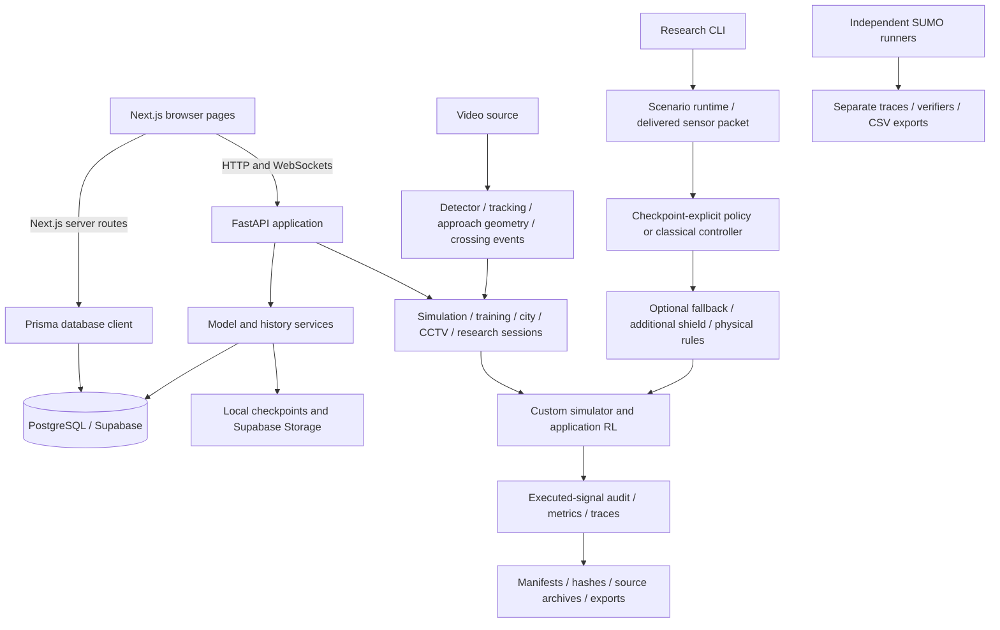

# FlowSync: application, architecture and research reference

<a id="top"></a>

Updated 2026-10-29, Asia/Kolkata. This is the maintained project reference. Code defines executable behavior; experiment manifests, source archives and frozen protocols define historical evidence. Root community/security policies retain their own administrative purpose. Other dated research documents are preserved records, not alternative current guides.

FlowSync is a simulation application and experimental traffic-control research platform. Its implementation combines established methods with project-specific integration, diagnostics and evidence tooling. **Algorithmic or architectural novelty is not established merely by that combination.** The attribution and novelty assessment in sections 14–15 distinguishes existing techniques, local adaptations and unverified historical claims.

This reference describes the actual application first. Separate experiment results begin at section 17. Camera accuracy, physical signal operation, hardware latency, public production hardening and complete application/headless parity remain unestablished. No new training, experiment or model promotion is part of this architecture update.

## Contents

- [1. Project scope and ownership](#1-project-scope-and-ownership)
- [2. Current system architecture](#2-current-system-architecture)
- [3. Frontend pages and state flow](#3-frontend-pages-and-state-flow)
- [4. API, WebSockets and service lifecycle](#4-api-websockets-and-service-lifecycle)
- [5. Custom simulation mechanics](#5-custom-simulation-mechanics)
- [6. Policy architecture and inference](#6-policy-architecture-and-inference)
- [7. Training, demonstrations and version compatibility](#7-training-demonstrations-and-version-compatibility)
- [8. Research observation and data boundary](#8-research-observation-and-data-boundary)
- [9. Supervision, shielding and physical transitions](#9-supervision-shielding-and-physical-transitions)
- [10. Camera and digital-twin workflow](#10-camera-and-digital-twin-workflow)
- [11. Model, history and persistence workflow](#11-model-history-and-persistence-workflow)
- [12. Recording, replay, telemetry and exports](#12-recording-replay-telemetry-and-exports)
- [13. Offline experiment and evidence workflow](#13-offline-experiment-and-evidence-workflow)
- [14. Technique attribution and primary references](#14-technique-attribution-and-primary-references)
- [15. Novelty assessment independent of measured performance](#15-novelty-assessment-independent-of-measured-performance)
- [16. Maintained documentation and verification boundary](#16-maintained-documentation-and-verification-boundary)
- [17. Current Status and Evidence Authority](#17-current-status-and-evidence-authority)
- [18. Current Repository and Research Organization](#18-current-repository-and-research-organization)
- [19. Audited Execution, Sensing and Controller Boundaries](#19-audited-execution-sensing-and-controller-boundaries)
- [20. Current RL Architecture, Observation Versions and Learning Repairs](#20-current-rl-architecture-observation-versions-and-learning-repairs)
- [21. Audited Training and Evaluation History](#21-audited-training-and-evaluation-history)
- [22. Action Labels, Calibration and Future-Arrival Diagnostics](#22-action-labels-calibration-and-future-arrival-diagnostics)
- [23. Upstream Demand, Spatial Pilot and Input-Use Diagnosis](#23-upstream-demand-spatial-pilot-and-input-use-diagnosis)
- [24. Teacher Alignment and Horizon Sensitivity](#24-teacher-alignment-and-horizon-sensitivity)
- [25. Reproducibility, Parent Checkpoints and Experimental Separation](#25-reproducibility-parent-checkpoints-and-experimental-separation)
- [26. Application, API, Storage and Integration Status](#26-application-api-storage-and-integration-status)
- [27. Installation, Operations, Security and Open-Source Conventions](#27-installation-operations-security-and-open-source-conventions)
- [28. Verification and Quality Gates](#28-verification-and-quality-gates)
- [29. Paper Scope, Novelty and Remaining Requirements](#29-paper-scope-novelty-and-remaining-requirements)
- [30. Evidence and Maintenance Index](#30-evidence-and-maintenance-index)
- [31. Independent SUMO Architecture and Execution Contracts](#31-independent-sumo-architecture-and-execution-contracts)
- [32. SUMO Future-Arrival Panel and Action Diagnosis](#32-sumo-future-arrival-panel-and-action-diagnosis)
- [33. Executed SUMO Classical Baselines](#33-executed-sumo-classical-baselines)
- [34. Total-Count Ablation and Waiting Distribution](#34-total-count-ablation-and-waiting-distribution)
- [35. Initial-Phase and Horizon Robustness](#35-initial-phase-and-horizon-robustness)
- [36. Paper Evidence Map and Reporting Boundaries](#36-paper-evidence-map-and-reporting-boundaries)

## 1. Project scope and ownership

FlowSync has three execution paths: the interactive Next.js/FastAPI application, the audited custom-simulator research CLI, and independent SUMO diagnostics. They share selected code, but have different sensor boundaries, configurations and evidence contracts. A feature existing in one path does not make it available in another.

| Location | Owns |
| --- | --- |
| [client/src/app](client/src/app/) | Pages and server-side Next.js routes. |
| [client/src/components](client/src/components/) | Application controls, charts, research inspectors and rendered scenes. |
| [client/src/hooks](client/src/hooks/), [stores](client/src/store/), [types](client/src/types/) | HTTP/WebSocket lifecycle, frontend state and wire contracts. |
| [server/app/main.py](server/app/main.py) | API lifespan, shared application objects and route registration. |
| [server/app/simulation](server/app/simulation/) | Custom traffic motion, arrival generation, signals and city simulation. |
| [server/app/controllers](server/app/controllers/) | Controller proposals, fallback supervision, additional shield and physical FSM. |
| [server/app/rl](server/app/rl/) | Policy network, replay, agent, observations and application trainer. |
| [server/app/realworld](server/app/realworld/) | Experimental video/detection/counting and digital-twin utilities. |
| [research](research/) | Headless training/evaluation, sensor faults, bounded studies, verification and exports. |
| [results](results/) | Local experimental artifacts. Most are ignored and absent from a fresh clone. |

Work continues on `main`. Keep code fixes and documentation tasks in focused commits. Preserve existing environments, checkpoints, data and source archives.

## 2. Current system architecture



The arrows describe implemented ownership and message flow, not an asserted common numerical runtime. The interactive research WebSocket still has a legacy session loop. It does not use all repaired scenario/sensor/replay semantics of `research/experiments/engine.py`. SUMO runs outside the web service and is not an application simulator switch.

## 3. Frontend pages and state flow

| Page | Function and current boundary |
| --- | --- |
| `/`, `/dashboard` | Project entry and application/database summaries. Persistence requires configured backend/database services. |
| `/simulation` | Interactive single-junction simulation, controls, scenarios, training/model interactions and telemetry. Uses application contracts. |
| `/city` | Separate multi-intersection visualization and comparison flow. No validated city-level learned contribution follows. |
| `/realworld` | Experimental video, counting, ROI and digital-twin controls. No physical traffic-cabinet actuation. |
| `/research` | Backend controller availability and recorded application-run catalog. No embedded publication benchmark table. |
| `/research/experiment`, `/research/compare` | Legacy live-session visualization and classical comparisons. Checkpoint-free learned control is rejected. |
| `/research/replay`, `/research/runs/[id]` | Recorded application bundle replay/details. Offline SUMO gzip traces use their dedicated tools rather than this format. |

React components render hooks/store data. TanStack Query handles application data fetching; Zustand stores maintain live simulation/research state. Research history is bounded at 300 frames for live charts. A stored replay may have its own full frame array. React Three Fiber/Three.js render the scene; geometry/interpolation is presentation, not an independent dynamics engine.

Backend packets are the authority for controller availability, frame identity and measurements. Research export helpers use actual frame fields, preserve zero values and leave missing measurements/provenance unknown. CSV escapes quoted labels and spreadsheet formula prefixes; LaTeX escapes identifiers and contains only the recorded controller row. Export before a single-run frame arrives is disabled. Changing the current UI selection cannot relabel an older frame's exported controller, scenario or seed.

## 4. API, WebSockets and service lifecycle

FastAPI registers simulation, training, metrics, analytics, CCTV and research routers and WebSocket endpoints. The detailed route inventory is in section 26. Next.js `/api/episodes`, `/api/models`, `/api/simulations` and `/api/metrics` execute server-side database access through Prisma. Browser calls to FastAPI use `NEXT_PUBLIC_FASTAPI_HTTP_URL` and `NEXT_PUBLIC_FASTAPI_WS_URL`.

At startup, the backend creates separate simulation and training agents/environments, a trainer, and city objects. Startup attempts to load application-compatible v6/v4 checkpoints from the configured model service. Missing cloud configuration or a failed load is not evidence that trained weights are present. Model identity must come from actual loaded checkpoint metadata, not an episode label.

WebSocket hooks connect, process frames and dispatch explicit start/pause/resume/stop/speed/replay commands. The research hook shares a connection across consumers. An acknowledged start/frame updates execution state and frame identity. Reconnects, queued commands and timeout messages are application behavior, not research replication guarantees.

`GET /research/runtime` exposes `interactive_legacy`, simulation-only scope, available live controllers and lack of audited headless parity/checkpoint integration. `GET /research/controllers` supplies `available_live` and an unavailability reason per controller. Both single and paired live sessions reject unsupported learned controllers before constructing a model or starting an environment. Unknown scenarios and noise presets fail explicitly. The application training/model flow is separate and retains its version restrictions.

The old `/research/summary` now returns `historical_invalid` with empty benchmark/statistical objects. Original retired files remain preserved. A successful file read from `results/final` cannot validate old checkpoint-free comparisons.

## 5. Custom simulation mechanics

The actual custom simulator uses normalized lane positions, simplified spacing/signal/turn rules and discrete time. [Vehicle.tick](server/app/simulation/vehicle.py) switches between fixed normalized free speed `0.12` and stopped motion, incrementing waiting when movement is blocked. [Intersection.tick](server/app/simulation/intersection.py) determines permission and spacing and advances those vehicles. This is **not an implementation of the IDM acceleration differential equation**. Earlier physical acceleration/deceleration constants and calibrated-microscopic claims are withdrawn.

Four phases map to `0=NS straight/right`, `1=EW straight/right`, `2=NS left`, `3=EW left` in [traffic_signal.py](server/app/simulation/traffic_signal.py). Right-turn and left-yield rules are simplified. App emergency/scenario hooks do not provide validated emergency or pedestrian safety. The independent SUMO network instead has two straight-only phases and cannot share these four-action labels without an explicit adapter.

The spawner creates requested traffic under declared profiles and retains entry backlog when insertion is blocked. Backlog visibility differs by experiment and sensor configuration. Historical movement counts can include vehicles already past the stop line; the explicitly upstream getter has different semantics. Source/runtime configuration must identify which is used. Incident capacity is represented by a discharge-headway surrogate, not a calibrated incident traffic model.

## 6. Policy architecture and inference

The shared dueling network has two 256-unit feature layers, LayerNorm and ReLU, then 128-unit value/advantage heads producing one value and four advantages. The masked combination is described in section 20. It is a project adaptation of established dueling architecture, not a newly invented DQN family.

Inference encodes the checkpoint's observation version, supplies a valid-action mask, evaluates Q values without training gradients and selects an allowed action. D3QN uses a two-second policy hold cadence within 0.1-second simulation ticks. Checkpoint loading records metadata and SHA-256 and sets evaluation mode. The research runner requires a trained checkpoint unless an explicit mechanics-only untrained override is given.

Inputs are numeric traffic features rather than raw CCTV pixels. Observation widths 28/36/48/64 are versioned sensor encodings, detailed in section 20. A 14-dimensional camera-state builder is a separate application utility and is not the later research policy's automatic input contract.

## 7. Training, demonstrations and version compatibility

The agent uses Double-DQN targets, prioritized replay, importance weights, Smooth L1 TD loss, Adam and an optional demonstration margin term. The application trainer is [server/app/rl/trainer.py](server/app/rl/trainer.py); the audited headless trainer is [research/training/train_policy.py](research/training/train_policy.py). They are different collection/integration paths.

Demonstrations are transitions collected from a teacher such as Max-Pressure. Imitation updates teach teacher actions; TD warmup fits value targets; online RL subsequently gathers and learns from its own trajectories. Checkpoint metadata and logs distinguish these stages. Teacher-assisted training is related to DQfD; this repository does not claim a faithful reproduction of its complete algorithm.

Research v5 fixes repeated switch charging and stores completed decision-to-decision macro transitions, dropping the incomplete final transition. The application path retains v4 reward/replay differences. Variable-duration discounting uses the elapsed decision interval. Input/reward compatibility must be checked together; matching network dimensions alone is insufficient. No automatic website migration or research-checkpoint promotion occurred.

## 8. Research observation and data boundary

The headless custom path executes scenario/demand → simulator → delivered synthetic sensor packet → observed context/features → controller proposal → optional fallback → optional shield → physical transition → executed lamps. Truth is permitted for rewards and evaluation metrics. It must not replace noisy delivered controller inputs.

The observed context supplies delivered movement/outgoing counts, masks, forecasts, frame age/availability and phase-service timers. Spatial v9 adds delivered upstream movement counts and matched zero-spatial controls. Temporal v8 adds history and matched zero-history controls. Expansion starts new input columns at zero so initial parent Q values match; that is an initialization/control technique rather than evidence of a new representation theory.

Faults include binomial misses, positive/ghost counts, bursts, jitter, swaps, latency and packet drops. Spatial faults partition delivered counts under documented assumptions. These are synthetic stress models, not empirically fitted CCTV error distributions. All experiment decisions must be tied to their frozen source/configuration and sensor adapter.

## 9. Supervision, shielding and physical transitions

FlowSync-UQ wraps D3QN with observed-feature uncertainty, hysteretic authority selection and an optional additional rule shield. The supervisor uses distinct enter/recover thresholds and dwell/recovery rules to reduce authority oscillation. Max-Pressure supplies the fallback proposal. A score indicating sensor error does not directly estimate whether fallback improves traffic control.

The additional shield enforces configured service/timing rules; the physical FSM enforces green/clearance transitions separately. Bare D3QN still has physical minimum-green and clearance. Removing the shield is therefore not an ablation that removes all physical safeguards. Phase-service timers differ from individual accumulated vehicle waiting.

The default uncertainty score is a weighted heuristic sigmoid. The fitted research calibration standardizes seven features and uses constrained logistic regression to predict synthetic count-error events. It does not validate the historical universal `T=1.2` temperature-scaling claim or a camera-accuracy probability. Thresholds and calibration hashes are experiment-specific. The actual fitted code is [calibrate_uncertainty.py](research/calibration/calibrate_uncertainty.py).

Rule checks, test coverage and finite lamp audits do not amount to formal synthesis/model checking of an all-state safety specification. They do not establish collision freedom, pedestrian safety or real cabinet readiness. The generic shielding literature is related work; its theorems are not inherited by this implementation.

## 10. Camera and digital-twin workflow

The actual orchestrator is [cctv_pipeline.py](server/app/realworld/pipeline/cctv_pipeline.py). It extracts a frame, runs Ultralytics YOLO detection in a worker thread, updates tracks, assigns exclusive image-direction proxies, smooths counts, annotates and broadcasts/logs the result. Configured pipeline rate is separate from measured end-to-end latency. Stream resolution and latest-frame buffering do not guarantee zero capture/network/decoding delay.

The default detector family is YOLOv8n, with local production/pretrained paths and optional upstream weight fallback. This is third-party software/model use, not a FlowSync detector architecture. Record actual weight identity, dataset/model provenance and upstream licensing separately from this repository's source license.

[VehicleTracker.update](server/app/realworld/pipeline/vehicle_tracker.py) greedily associates nearest previous centroids within an 80-pixel distance and prunes tracks after three seconds. It does **not** execute ByteTrack's two-stage association, despite legacy comments. ByteTrack is related work only until its implementation is actually wired. Likewise, detector IDs or time since first sighting do not automatically provide calibrated individual stopped waiting.

Without a supplied geometry configuration, the counting path uses bottom-centre locations and assigns the dominant displacement from the image centre to at most one direction. Centre/diagonal ties and invalid locations remain unassigned. This repairs the historical counter's two-to-four assignments per box. With a supplied configuration, the pipeline assigns boxes to explicitly configured approach regions instead (section 10.1). The legacy `*_straight` keys remain compatibility slots for approach totals, not measured turning movements. Legacy ROI/homography utilities exist separately; the current orchestrator does not apply a homography. Smoothed/last-good image-proxy counts and confidence heuristics remain estimates. Configured region occupancy uses current detections without last-good imputation.

`CCTVFrame.observation_contract` reports detected, assigned and unassigned box counts, unavailable movement information and missing control inputs. The current pipeline has no loaded control-policy inference path or observed signal feedback. It emits empty observations/Q values and null phase, policy confidence and waiting measurements. The former queue-times-2.5 waiting estimate has been removed. The frontend displays these limitations instead of a default green, numerical Q vector or apparent policy confidence.

First track sightings retain `turn:null` and explicit provenance: image-direction proxy, unobserved turn and processing-cadence timestamp proxy. Track IDs no longer generate fictional turns. Empty recordings remain empty. [arrival_contract.py](server/app/realworld/digital_twin/arrival_contract.py) checks required replay fields and rejects these incomplete sightings before simulation state changes. The recorder publishes `replay_inputs_complete` and a reason; the UI disables replay and automatic count injection for incomplete sessions. Field completeness does not establish measured-camera validity for legacy or manually supplied events. The digital twin remains experimental simulation, not calibrated equivalence to a real intersection. Recorded footage and ground-truth traffic labels were not supplied for validation. Section 36.7 records the synthetic contract and frozen-model diagnostic.

### 10.1 Optional camera approach geometry

The camera pipeline accepts `camera_geometry_v1` configurations through the **Approach geometry** JSON-file input on `/realworld`. This is user-supplied image geometry, not automatic calibration or an accuracy certificate. [calibration.py](server/app/realworld/models/calibration.py) defines immutable validated configurations; [camera_geometry.py](server/app/realworld/pipeline/camera_geometry.py) applies them. This path does not call the legacy `ROIManager`, whose first-match overlapping-region behavior is unsuitable for explicit ambiguity reporting.

Each configuration binds a camera ID to the exact source path/URL and reference frame dimensions. It defines one to four named approaches, each with a strictly convex polygon of 3–16 distinct normalized `(x,y)` vertices in boundary order and a two-point stop line on one boundary edge. Coordinates use the original image origin at top left, with x increasing rightward and y downward. The polygon must describe the upstream road area; mathematical validation cannot establish that the user selected the correct road or stop line. Clockwise and counterclockwise ordering are accepted. Concave/self-crossing/zero-area polygons, overlapping interiors, duplicate approach names, nonfinite/out-of-range coordinates and degenerate/off-boundary stop lines are rejected. Shared region edges are permitted; detections on a shared boundary remain ambiguous and unassigned. No homography, world-distance estimate or inferred intersection orientation is introduced.

Workflow:

1. Select/upload the intended video. Copy the exact **Source** displayed below the calibration input.
2. Define upstream polygons and stop-line endpoints on a reference frame, normalize coordinates by its width/height, and save the JSON. The example below is synthetic; replace every geometry/source/dimension value using the intended camera. There is no graphical polygon editor yet.
3. Import the JSON. `POST /cctv/calibration/validate` validates it and returns canonical JSON, a SHA-256 identity and source. Invalid input blocks Start. Changing the source requires removing or reloading the configuration.
4. Start processing. `/ws/cctv` accepts `start_processing.payload.calibration_json` and validates it again before replacing an active session. Source and decoded video dimensions must match. Configured polygons and orange stop lines are overlaid on the video for review.
5. Inspect configured approach counts and unassigned/ambiguous boxes. Completed/stopped sessions retain the exact configuration and hash; each frame and track-sighting event records the hash. Restarting processing creates a new session ID instead of overwriting the previous session.

```json
{
  "schema_version": "camera_geometry_v1",
  "camera_id": "example_camera",
  "source": "REPLACE_WITH_EXACT_SELECTED_SOURCE",
  "frame_width": 1000,
  "frame_height": 1000,
  "approaches": [
    {
      "approach": "north",
      "vertices": [[0.1, 0.1], [0.4, 0.1], [0.4, 0.6], [0.1, 0.6]],
      "stop_line": [[0.1, 0.6], [0.4, 0.6]]
    }
  ]
}
```

Assignment uses the detected box's bottom centre. Only a unique containing region receives one count; outside/invalid points and shared-boundary ambiguity receive none. A frame-size mismatch or unavailable detector assigns no boxes and emits an explicit unavailable status. There is no fallback to image-direction guesses or retained counts in this configured path. Unconfigured approaches are absent from `geometry_observation.approach_counts` and displayed as unavailable, not measured zero. Normalized geometry is nevertheless bound to exact dimensions to prevent silent reuse after resizing/cropping; a moved camera or same-size crop cannot be detected by this check and requires operator review. Geometry comparisons use a numerical tolerance of `1e-9` in normalized coordinates, not a physical localization-error bound.

`CCTVFrame.geometry_observation` carries status, configured approaches, approach counts, assigned/unassigned/ambiguous counts and `calibration_sha256`. `observation_contract.count_semantics` becomes `configured_approach_region`; movement availability remains false and control remains unavailable. Legacy twelve-slot counts place each approach total in its `*_straight` compatibility slot for existing charts/recorders. This does **not** observe straight-going vehicles. Occupancy includes moving vehicles in the region; it does not itself measure a stopped queue, intended turns or discharge rates. Stop lines constrain and visualize the region boundary; recorded-video crossing inference is a separate output described in section 10.2. First track sightings keep unknown turns and processing-cadence timing, so they remain ineligible for calibrated replay. Signal feedback and trained camera-policy integration are still missing.

This is an engineering prerequisite for a labeled-video study, not a new controller or algorithmic novelty claim. Source matching and hashes establish configuration identity, not geographic truth or camera accuracy. Preserve source-access credentials separately where possible; recorded configuration includes the source string. Real recorded-camera labels, movement counts, phase observations and independent error/performance measurements remain necessary.

Verification on October 29: **59 focused backend tests passed**, including 19 new geometry/API/pipeline/recorder/WebSocket tests; these overlap earlier test totals. The frontend's five tests, type checking, lint and production build pass. A Chromium workflow used a synthetic video and supplied detections through the actual upload API, geometry validation, WebSocket handler, video reader, pipeline and session recorder. Invalid geometry blocked Start. Two of five supplied boxes were assigned, three were unassigned, including one shared-boundary ambiguity. The recorded configuration/hash survived processing, replay remained incomplete, and no uncaught browser exception occurred. This checks integration, not detector accuracy, real-camera counting or controller performance. Existing dependency and chart-sizing build warnings remain. No frozen experiment artifact or trained checkpoint was modified.

### 10.2 Recorded-video stop-line crossings

[stop_line_crossings.py](server/app/realworld/pipeline/stop_line_crossings.py) adds inferred **discharge** events for configured approaches. It does not relabel first camera sightings as arrivals, infer turns or supply incoming demand to the simulator. This distinction matters: traffic crossing a stop line has already been affected by the existing signal controller. Reusing those discharges as exogenous arrivals would conflate demand with service.

For local recorded video, `VideoProcessor.source_time_s` reads `CAP_PROP_POS_MSEC` after decoding the delivered frame, converts milliseconds to seconds, and accepts only finite nonnegative, strictly advancing values (zero is permitted initially). It does not derive source timing from processing-loop count or substitute FPS when timestamps fail. OpenCV documents this property as video-file position and cautions that property behavior depends on the backend/device layers; see the [official video I/O property reference](https://docs.opencv.org/4.13.0/d4/d15/group__videoio__flags__base.html). Monotonicity is a validity check, not proof of timestamp accuracy. Live streams currently expose no suitable source clock and therefore emit an unavailable crossing status. Existing frame `timestamp_ms` remains processing wall time; first-sighting `time_s` remains a cadence proxy. Neither is used as the new crossing clock.

The crossing rule is deterministic and conservative:

- A uniquely assigned upstream detection arms a track for its configured stop line. The polygon interior determines upstream direction, independent of endpoint ordering or camera orientation.
- Consecutive processed observations of that track must move from more than two pixels upstream to more than two pixels downstream. The connecting segment must intersect the finite stop line at least two pixels from either endpoint. Small movements inside the two-pixel band do not immediately count; the upstream anchor may bridge that band for at most one second.
- An event requires at most one second between anchor and current observation and at most 80 pixels of bottom-centre displacement. These fixed engineering thresholds are not calibrated localization-error bounds or tuned performance gains. Pixel thresholds are resolution-dependent.
- A missing/duplicate track observation, skipped processed frame, invalid geometry, unavailable detector or nonadvancing/missing source time breaks pending evidence. Large gaps or displacements cannot generate a crossing. At most one event is emitted per `(track_id, approach)` during a pipeline session, suppressing boundary oscillation duplicates.

Each `StopLineCrossing` preserves track ID, approach, configuration hash, bracketing frame IDs, source-time interval, normalized intersection point, `estimated_time_s`, `turn:null` and `event_semantics:"inferred_stop_line_discharge"`. The estimate linearly interpolates the two observed bottom-centre positions. It is not an exact camera exposure/crossing timestamp, confidence interval, physical ground-contact measurement or motion-model validation. Bracketing frames can span an intermediate neutral-band observation.

`CCTVFrame.crossing_observation` reports availability, current decoder position, the fixed thresholds, cumulative per-approach counts, events emitted on that frame and the last event for display. The UI shows these under **Stop-line crossings**, including the last event's time interval. Unavailable states retain explicitly labeled historical session totals; they do not assert that zero vehicles crossed during a missing observation. The recorder stores the events separately as `stop_line_crossings` in the session and twin-data payloads. Replay validation explicitly rejects discharge events even if someone supplies otherwise complete arrival fields. Turns, signal phase and upstream entry demand remain unknown; replay and learned signal recommendations remain unavailable.

Tracker repairs preserve the detector-unavailable flag in the tracked packet and expire stale tracks before association, preventing a nearby detection from reviving a track older than three processing-wall-clock seconds. Tracking remains the existing greedy centroid heuristic, not ByteTrack or a calibrated identity system. Identity swaps, duplicate detector boxes with different IDs, reidentification after occlusion, missed crossings at the two-hertz pipeline cadence and incorrect camera geometry can still cause errors. The maximum-gap/displacement rules deliberately abstain from some true crossings. No real-camera precision/recall or throughput accuracy is established.

The implementation uses established segment intersection, hysteresis, tracking and interpolation techniques; it is an observable-data prerequisite, not a new controller or a novelty claim. Verification includes a generated MJPEG clip with a white rectangle moving across the configured line, decoded by the real `VideoProcessor` and detected by a deterministic threshold fixture. Six source observations at 0, 0.5, 1, 1.5, 2 and 2.5 seconds produce one inferred crossing, estimated at 1.25 seconds within the [1, 1.5] observation interval, without wall-clock sleeps. The recording retains that event while replay remains incomplete. This is a controlled integration fixture, not a YOLO benchmark or a real traffic result. Reproduce the committed behavior tests with:

```bash
PYTHONDONTWRITEBYTECODE=1 OMP_NUM_THREADS=1 MKL_NUM_THREADS=1 \
  server/venv/bin/python -m pytest server/tests/realworld/test_stop_line_crossings.py \
  --no-cov -p no:cacheprovider -q
```

Crossing verification on October 29: **78 focused backend tests passed**, including 19 crossing/timing/tracker tests; counts overlap the earlier calibration suite. Five frontend tests, TypeScript, lint and the production build passed. A Chromium check exercised video upload, geometry validation, actual decoding/tracking, crossing display and recording with the synthetic clip and threshold detector. It displayed and saved one crossing estimated at 1.25 seconds in [1, 1.5], kept replay incomplete, and raised no uncaught browser exception. Existing dependency and chart-sizing build warnings remain. No real footage, YOLO accuracy, hardware latency, signal actuation or traffic-delay improvement was evaluated.

### 10.3 Crossing evaluation against labeled video

[evaluate_crossings.py](research/cv/evaluate_crossings.py) compares recorded discharge events with separately supplied annotations. It requires a saved session, the original video bytes, an annotation JSON and a matching-protocol JSON. Local-file recording now fingerprints the video with SHA-256 when opening it; `SessionRecorder` saves that value as `source_video_sha256`. Live sources have no file fingerprint. Old sessions without this identity are rejected by this evaluator: do not retrofit a hash and present it as original capture provenance. Hashing at opening binds recorded metadata to those bytes, but does not continuously attest that a file remained immutable during processing. Source files must be kept unchanged.

Annotations identify the video hash and calibration hash, declare `origin` (`human` or `synthetic_fixture`), a data role (`calibration`, `development` or `held_out`), labeling method and time resolution. A role is an annotator declaration; software cannot establish that a supposedly held-out clip was never inspected. Every label needs a unique event ID, approach and time in the same video-position coordinate system used by the pipeline. Labels must come from reviewing the video independently of predictions, not copying exported events. Field validation cannot certify annotation correctness or independence.

Specify exhaustive, nonoverlapping **[start, end)** windows per approach. Every real crossing in each window must be labeled, including crossings during detector/timing outages. Windows must fit within the recorded source-time extent and configured approaches. Unlabeled time is not assumed to contain no crossings. Predictions outside scored windows are retained as unscored indices. The report exposes available/unavailable crossing-frame counts and the largest gap between available source timestamps. `scored_approach_seconds` sums window duration across approaches and is not unique wall-clock duration or a count of independent samples.

Matching operates separately within each approach/window, using the protocol's fixed absolute time tolerance. It maximizes the number of one-to-one matches, then minimizes total absolute timing error, with deterministic tie handling. The implementation uses a sorted dynamic program; a two-million-cell budget per window bounds computation. Declare shorter windows before evaluation if needed. The tolerance and window choices should be frozen before examining results, with labeling resolution justified separately. Saving/hashing a protocol does not itself prove preregistration.

Outputs include matched prediction/annotation IDs, every unmatched event, per-window and aggregate TP/FP/FN, precision, recall, F1, matched-event timing MAE and signed bias. A positive bias means the predicted crossing is later. Ratios with zero denominators are `null`; timing metrics are `null` without matches. Timing error is conditional on successful matching and must be read alongside misses and extras. A wrong approach becomes a miss/extra only where both relevant approaches are exhaustively scored. Time/approach matching in dense traffic does not establish vehicle identity, detector-box precision, tracking IDF1 or turn accuracy.

Before scoring, the evaluator reconstructs cumulative counts and the session-level event list from frame events, checks duplicate track/approach events, calibration identity and bracketing frame times, and rejects inconsistencies. It also requires the video hash to agree with both session and annotations. It does not independently rerun detection or establish the accuracy of recorded geometry. Every report copies the exact session, annotations and protocol, records their hashes, saves the evaluator and model-schema sources, and records Python/Pydantic versions. Output directories must be new. Verification recomputes matching and checks inputs, report and archived/current source identity; historical reports require their saved code/runtime. The original video is hashed but not copied into the report directory.

Example protocol (the tolerance is illustrative, not a tuned or validated recommendation):

```json
{"schema_version":"crossing_evaluation_v1","protocol_id":"clip-study-01","match_tolerance_s":0.25}
```

Start annotations as a **draft**, replace hashes/extent/method from the actual study, add independently reviewed events, and only mark `exhaustive:true` once review is complete. The following draft deliberately fails evaluation:

```json
{
  "schema_version": "crossing_annotations_v1",
  "video_sha256": "REPLACE_WITH_RECORDED_VIDEO_HASH",
  "calibration_sha256": "REPLACE_WITH_RECORDED_CALIBRATION_HASH",
  "origin": "human",
  "split": "development",
  "annotation_method": "REPLACE_WITH_REVIEW_METHOD_AND_ANNOTATOR_RECORD",
  "time_resolution_s": 0.04,
  "windows": [{"window_id":"north-01","approach":"north","start_s":0,"end_s":30,"exhaustive":false}],
  "events": []
}
```

An event has the shape `{"event_id":"vehicle-001","approach":"north","time_s":12.4}`; its time must be labeled, not inferred from this example. Session paths are under `data/sessions` relative to the backend working directory. With actual files prepared, run from the repository root:

```bash
PYTHONDONTWRITEBYTECODE=1 server/venv/bin/python -m research.cv.evaluate_crossings \
  --session /path/to/session.json --video /path/to/unchanged-clip.mp4 \
  --annotations /path/to/annotations.json --protocol /path/to/protocol.json \
  --output results/crossing_evaluation/clip_study_01

PYTHONDONTWRITEBYTECODE=1 server/venv/bin/python -m research.cv.evaluate_crossings \
  --verify results/crossing_evaluation/clip_study_01 --video /path/to/unchanged-clip.mp4
```

The final local mechanics check is `results/crossing_evaluation/synthetic_final_20261029/`, with source fixture files in `results/crossing_evaluation/fixture_20261029/`. The earlier `synthetic_20261029/` report remains a development snapshot. A generated rectangle trajectory and analytic crossing label were specified before inference. The actual decoder, threshold detector fixture, tracker, crossing pipeline and recorder produced one match, no misses/extras and zero matched timing error. CLI verification reconstructs the final report. These numbers describe one deliberately simple synthetic fixture; they are **not** camera precision/recall evidence or a new independent traffic experiment. `annotation_origin:synthetic_fixture`, `publication_ready:false` and `policy_promoted:false` remain explicit. No labeled real footage has been supplied, and no model was trained or promoted. These local artifacts remain outside Git under the existing results policy.

Evaluation verification on October 29: **99 focused backend tests passed**, including exhaustive small-panel matching comparisons, greedy-matching counterexamples, empty denominators, wrong video/configuration hashes, inconsistent stored events, incomplete/overlapping windows, out-of-window predictions, output overwrite prevention and report tampering. A complete detector outage with valid decoder timestamps retains the labeled window and records its events as misses; it is not silently excluded. Tests also cover actual video decoding, fingerprinted recording and evaluator integration. The CLI report verifier passed. These tests overlap earlier totals. No frontend files changed in this evaluation step, and no new frontend build or real-camera trial is claimed.

**Legacy CV evidence correction.** [validate_perception_quality.py](research/cv/validate_perception_quality.py) previously drew random values around hard-coded regime scores and described them as 1,000 manually annotated real-world frames. It now fails explicitly before writing any report. Its historical outputs cannot support measured perception or ByteTrack claims. [validation_tool.py](research/cv/validation_tool.py) previously treated equal aggregate counts as object matches, returned an unmeasured 0.35-second arrival error and substituted correlation 0.70 when insufficient data existed. It now returns only supplied paired-count errors and a computed correlation when eligible supplied confidences/data exist; object precision/recall/F1, lane-assignment accuracy and arrival timing are `null`. Missing correlation is `null` rather than invented. The count helper assumes omitted movement keys are zero and is not an exhaustive camera annotation protocol. Existing saved files were preserved. Use the new event evaluator for crossing labels; broader detection/tracking validation still needs corresponding labeled boxes and identities.

## 11. Model, history and persistence workflow

FastAPI model/history services use Supabase API/Storage and local `server/models` checkpoints. Next.js server routes use Prisma/PostgreSQL for application views. `model-checkpoints` is the configured checkpoint bucket, not an automatically provisioned public dataset. Credentials remain private and server-only secrets must never enter `NEXT_PUBLIC_` variables.

Training emits episode progress and checkpoints; saving metadata or uploading a file is distinct from successfully loading it into inference. Model ID, checkpoint episode, observation/reward version and file hash identify what ran. Original selected parents and their lineage remain fixed for controlled research. Website episode labels, latest timestamps and a best-model label cannot replace that identity.

Database migrations/reset utilities affect user data and are not part of routine verification. A fresh checkout lacks the local historical checkpoints/results. It must not silently substitute random weights for missing trained evidence.

## 12. Recording, replay, telemetry and exports

Interactive run bundles use metadata/metrics JSON and trajectory JSONL. Replay reads recorded frames and supports pacing, pause and seek without recreating physics. A replay confirms access to stored telemetry, not an independent rerun. Its original runtime/model identity may be missing or historical and must remain unverified where absent.

The provenance drawer and snapshot exporter now use one shared helper, [research-data.ts](client/src/lib/research-data.ts). They export the frame's own IDs and canonical metric fields. Only a 64-hex checkpoint SHA-256 is presented as a hash. Legacy model-name strings are not promoted to hashes. No fabricated commit, timestamp, CRN trace or comparison baseline is added.

Paired rendering consumes actual phase, FSM, mean waiting, queue integral, throughput and vehicles. Missing p95, per-direction queues, service rate and camera confidence are not synthesized from those fields. Application backend camera latency/track-confidence placeholders have been removed and report unknown when no measurement exists. Classical telemetry identifies the actual controller and sends no invented Q-value vector; the Q panel shows that no learned values are reported. Light rendering understands backend `GREEN/YELLOW/RED` and historical clearance labels.

## 13. Offline experiment and evidence workflow

Headless tools freeze configuration, scenarios, source/checkpoint identities, controls, endpoint and seed roles before collecting outcomes. Output directories preserve metrics, events, traces and source archives. Verifiers reconstruct saved structures, arithmetic and physical rules; evidence exporters produce data-derived tables/figures. A process exit code or complete coverage is not a passing performance screen.

Independent SUMO uses an isolated pinned environment, generated network and TraCI stepping. The custom policy is not transferred automatically. Source replay replaces a snapshot method that failed continuation equality in the tested setup. Whole-run classical/component studies and their provenance contracts are documented in sections 31–35. These completed collections are closed.

## 14. Technique attribution and primary references

Primary sources below were checked on 2026-10-25. This is implementation attribution and targeted related-work checking, not an exhaustive systematic novelty review. A conceptual method citation does not prove code was copied from that source; no complete line-by-line external code-origin audit has been established.

| Technique / implementation | Source to acknowledge | What FlowSync actually uses or adapts |
| --- | --- | --- |
| Deep Q-learning, replay and target network; `dqn_agent.py`, `dqn_network.py` | Mnih et al., [Playing Atari with Deep Reinforcement Learning, 2013](https://arxiv.org/abs/1312.5602). | Foundational DQN design. FlowSync uses numeric traffic inputs and fully connected networks rather than that paper's pixel pipeline. |
| Double-DQN targets; `dqn_agent.py` | Van Hasselt, Guez and Silver, [Deep Reinforcement Learning with Double Q-learning, AAAI 2016](https://arxiv.org/abs/1509.06461). | Online masked action selection with target-network evaluation. Established method. |
| Dueling value/advantage architecture; `dqn_network.py` | Wang et al., [Dueling Network Architectures for Deep Reinforcement Learning, ICML 2016](https://proceedings.mlr.press/v48/wangf16.html). | Value/advantage heads; local implementation adds valid-action centering and traffic encodings. The combination does not establish new dueling theory. |
| Priority replay and importance weighting; `replay_buffer.py` | Schaul et al., [Prioritized Experience Replay, ICLR 2016](https://arxiv.org/abs/1511.05952). | Sum-tree proportional replay, priorities and bias-correction weights. Project defaults are not universal values prescribed by the paper. |
| Demonstration replay, imitation/margin warm start | Hester et al., [Deep Q-learning from Demonstrations, AAAI 2018](https://research.google/pubs/deep-q-learning-from-demonstrations/). | Related demonstration-assisted TD and margin learning. Teacher-generated data and this loss schedule are local adaptations, not full DQfD replication. |
| Queue-differential pressure; `max_pressure.py`, SUMO policies | Varaiya, [Max pressure control of a network of signalized intersections, 2013, author publication record](https://people.eecs.berkeley.edu/~varaiya/publications.html). | A declared movement/destination pressure variant with finite timing and sensor constraints. No automatic inheritance of a network stability theorem. |
| Spatial running/queued demand and pressure representations | Zhang et al., [Expression might be enough, ICML 2022](https://proceedings.mlr.press/v162/zhang22ah.html). | Close prior work defining Advanced-MP/Advanced-XLight. FlowSync's upstream counts/zero-input controls are not faithful implementations of those methods. |
| Safety shielding as a research concept | Alshiekh et al., [Safe Reinforcement Learning via Shielding, AAAI 2018](https://ojs.aaai.org/index.php/AAAI/article/view/11797). | Related intervention concept. FlowSync's programmed rules/FSM are not the paper's synthesized temporal-logic shield or its guarantee. |
| Confidence calibration and temperature scaling | Guo et al., [On Calibration of Modern Neural Networks, ICML 2017](https://proceedings.mlr.press/v70/guo17a.html). | Calibration terminology/related work. Current fitted synthetic-error calibration is multifeature logistic regression, not demonstrated classifier temperature scaling. |
| Camera object detection | [Ultralytics YOLOv8 documentation](https://docs.ultralytics.com/models/yolov8/). | Uses Ultralytics inference/training/export APIs and external weights. Ultralytics states there is no formal YOLOv8 research paper; do not invent one. |
| Multi-object tracking comparison | Zhang et al., [ByteTrack, ECCV 2022](https://arxiv.org/abs/2110.06864). | Related method only. Current tracker uses centroid distance and cannot be described as ByteTrack. |
| External microscopic simulation | Lopez et al., [Microscopic Traffic Simulation using SUMO, ITSC 2018, official citation](https://sumo.dlr.de/docs/Publications.html). | SUMO/TraCI/sumolib 1.24.0 in independent studies. Krauss driving belongs to SUMO, not FlowSync's custom simulator. |

The software stack also needs acknowledgement where relevant: [Next.js](https://nextjs.org/docs), [React](https://react.dev/), [FastAPI](https://fastapi.tiangolo.com/), [PyTorch](https://pytorch.org/docs/stable/index.html), [React Three Fiber](https://r3f.docs.pmnd.rs/), [Zustand](https://zustand.docs.pmnd.rs/), [Prisma](https://www.prisma.io/docs) and [Supabase](https://supabase.com/docs) are existing frameworks/services. REST, WebSockets, finite-state machines, smoothing, hysteresis, seeded paired comparison and file hashes are established engineering techniques. Their use is legitimate with accurate attribution and applicable licenses, but is not a new algorithm claim.

Legacy comments mention FPA-DQN, “3DQN 2025”, “3DQN-PER”, Webster and NEMA without enough verified derivation to claim faithful implementations. The present code supports a fixed schedule, a gap-out controller and the RL mechanisms above. Those ambiguous references remain unverified historical leads. Do not cite invented bibliographic details or present those names as certification. Dataset/weight/dependency licenses remain separate from academic method citations and the repository's MIT source license.

## 15. Novelty assessment independent of measured performance

| Item | Current assessment |
| --- | --- |
| D3QN, PER, demonstrations and masked inference | Established mechanisms assembled/adapted for traffic. No first-use or new network-family claim. |
| UQ-triggered fallback, dwell/recovery and rule guards | Existing broad ideas. FlowSync implements a specific observed-feature integration; novelty of that integration is unestablished. |
| Next.js/FastAPI/3D dashboard and storage architecture | Project engineering and product functionality. A useful application architecture does not by itself supply research novelty. |
| Versioned observation controls, strict provenance, saved-state audits and paired branching | Concrete repository-specific implementation work that can support a reproducible systems/empirical description. Whether the exact contribution is distinct enough for a venue still requires comparison. |
| Separation of numerical sensitivity, action change, future-stable advantage and full-run benefit | A candidate empirical framing and tool workflow. These distinctions are not claimed as newly discovered concepts. |
| Camera-to-signal cyber-physical operation | Proposed future integration, not demonstrated operation or a present contribution. |

The architecture is a legitimate implementation of identifiable components, with the compatibility gaps described here. It cannot be certified novel by naming the combination FlowSync-UQ. Existing related-work records in `research/docs/papers/` include RESCO, LibSignal and close traffic-control methods. A full-text uncertainty-gated DQN lead remains unresolved. A defensible paper must identify a precise distinction, acknowledge these precedents and support that distinction with implementation/evidence. Neither attractive workflow diagrams nor removing unfavorable results creates novelty.

## 16. Maintained documentation and verification boundary

`CONTENT.md` is the sole maintained application/architecture/research reference. README is a short entry point. CONTRIBUTING, SECURITY, CODE_OF_CONDUCT, LICENSE and CITATION retain their native community, legal or citation functions. Dated protocols, audits, outcomes and manuscripts remain immutable evidence records where required by verifiers and saved source hashes. Their old links/commands are historical and do not create current launch instructions.

Redundant setup, architecture, package README and index guides are consolidated here. Setup/configuration/operations are in section 27; repository ownership/command discovery in section 18; scientific status and evidence limits in sections 17–36. Optional detector utilities are `scripts/download_datasets.py`, `merge_datasets.py`, `train_yolo.py`, `validate_model.py`, `export_model.py` and `calibrate_flow.py`. The Colab notebook is optional detector training, not traffic-policy training. Weights, datasets, secrets and notebook outputs require separate provenance/access.

The frontend now has behavior tests for real snapshot identity, missing data, genuine SHA-256 versus legacy labels, safe CSV/LaTeX and backend controller availability. Backend tests cover live learned-control rejection, strict scenarios, runtime metadata, retired summaries and a successful two-tick classical stream. These are engineering checks, not new control experiments. Remaining integration work includes migrating learned live research control to a checkpoint-aware observed runtime, complete socket/persistence/model lifecycle browser tests and independent camera/simulator validation. No complete production or end-to-end parity claim follows from this update. The final verification scope is recorded in section 28.

---

<a id="17-current-status-and-evidence-authority"></a>
## 17. Current Status and Evidence Authority

### 17.1 What the project currently establishes

FlowSync combines a Next.js application, FastAPI services, simulation and RL components, and a separately audited headless research workflow. The implemented research contribution so far is experimental infrastructure and a reproducible record of controller evaluations, implementation repairs and failed learning hypotheses. The original objective remains a learned controller with a reproducible advantage over strong classical control and a distinct, defensible research contribution. That objective is **not achieved**.

The scope is simulation only. No measured intersection counts/timings or recorded camera footage have been supplied for independent validation. The custom simulator, synthetic perception faults and simulated lamp audits cannot establish field accuracy, hardware latency, collision safety or readiness to operate a traffic cabinet.

| Topic | Current evidence status |
| --- | --- |
| Learned policies versus Fixed | Audited comparisons show lower mean stopped delay in the reported panels. This does not establish an advantage over stronger classical methods. |
| Learned policies versus Max-Pressure | Reliable superiority remains unestablished across the audited experiments. |
| FlowSync-UQ versus its shielded D3QN policy | No reliable added control benefit established, including when fallback actually activates. |
| Online RL after warm start | Often degrades or fails to improve the frozen parents. More episodes have not resolved this. |
| Extra temporal/spatial inputs | Implemented with matched controls; both completed pilots fail their continuation screens. |
| Upstream-only pressure teacher | Implemented, but the targeted teacher prerequisite and horizon diagnostic fail to justify replacement/training. |
| Independent SUMO action labels | Six-state, 204-branch panel is complete. Four states have both delay-gain signs across future arrivals; single-future and mean-eight selectors choose the same one-state benefit. No added averaging or learned-policy benefit. |
| Executed SUMO classical control | Forty-five-run comparison establishes a stronger pressure reference in the tested setup. Removing outgoing subtraction worsens mean/tail waiting while raising completed trips. |
| SUMO phase/horizon robustness | Twenty-four runs on six further traffic seeds retain the aggregate waiting/throughput trade-off under both starting greens and 180/360-second measurements. This component series is closed. |
| Simulated signal behavior | Zero measured conflict/clearance violations on specified audited samples; coverage is finite and experiment-specific. |
| Real cameras, edge devices and real signal operation | Tooling/proposals exist; corresponding validation and operational readiness are unestablished. |
| Research/UI equivalence | Shared components and selected tests exist; complete end-to-end equivalence remains open. |
| Publication/novelty | Dated writing assets and evidence exports exist. No justified readiness percentage, accepted novelty claim or superiority paper result. |
| Model promotion | No recent candidate automatically promoted, uploaded to Supabase or installed as a website default. |

### 17.2 Evidence hierarchy and historical material

Read the [current research status](research/RESEARCH_STATUS.md) and [evaluation audit](research/EVALUATION_AUDIT.md) before using an older table or launch instruction. For a particular experiment, read its frozen protocol, recorded manifest/configuration/checkpoint/source hashes, raw measurements and matching results note together. A summary is useful for navigation; its filename does not certify its claims.

`results/final/`, `results/tables/`, the original manuscript assets and the superseded design narrative contain historical material that predates the audited fixes. Preserve them for traceability, but do not cite their numbers as validated research. The corrected experiments below are distinct panels; their means must not be pooled merely because each reports seconds.

The custom-simulator input-use, teacher-alignment and horizon diagnostics are complete. Subsequent independent SUMO branch, classical, component and robustness studies are also complete, as detailed in sections 31–35. The last planned component study is closed. A chronological note proposing one of these investigations is not a current instruction to run it again. Completed outcomes supersede historical “ready to run” text.

<a id="18-current-repository-and-research-organization"></a>
## 18. Current Repository and Research Organization

### 18.1 Top-level ownership

| Location | Current responsibility |
| --- | --- |
| `client/` | Next.js pages, API routes, components, hooks, Zustand stores, types and Prisma schema. |
| `server/app/` | FastAPI application, HTTP/WebSocket handlers, services, simulation, controllers, RL and experimental camera tooling. |
| `server/tests/` | Backend and headless research regression tests. |
| `research/` | Maintained headless commands, shared execution/sensing, bounded pilots, diagnostics and research documentation. |
| `results/` | Local experiment outputs, raw metrics, checkpoints/provenance references, traces and generated evidence. Most artifacts are ignored and absent from a fresh clone. |
| `CONTENT.md` | Maintained setup, architecture, workflow, attribution, evidence and limits. Redundant guide directories are removed. |
| `scripts/` | Repository checks and remaining project utilities; the old all-in-one reproduction command is retired. |
| `.github/workflows/`, `Makefile` | Automated checks and common developer commands. |
| Root community files | README, contribution/security/conduct guidance, software citation metadata and license. |

The architecture, setup, frontend/backend ownership and artifact policy are consolidated in this reference. Frozen experiment records retain their own provenance and do not override current application instructions.

### 18.2 Research packages after cleanup

The formerly flat research scripts have been grouped by responsibility. Maintained Python tools use package imports and module entry points. The root package contains discovery rather than a large collection of standalone experiment scripts.

| Package | Contents and role |
| --- | --- |
| [training](research/training/) | Research training, parent initialization/expansion, randomized demand and lineage support. |
| [evaluation](research/evaluation/) | Checkpoint-explicit replicate evaluation, development validation and selection support. |
| [audits](research/audits/) | Training/replay drift, observation/action/input use, label stability, teacher/horizon diagnostics and saved SUMO evidence verification. |
| [pilots](research/pilots/) | Preparation, bounded controlled experiments, SUMO collection runners and fixed-endpoint comparators. |
| [pilots/launchers](research/pilots/launchers/) | Saved shell recipes; completed failed recipes remain historical, not recommended jobs. |
| [datasets](research/datasets/) | Action-label collection code. Generated datasets stay under `results/`. |
| [policies](research/policies/) | Research correction models, additional observed-input baselines and pure SUMO count policies. |
| [experiments](research/experiments/) | Custom execution engine, observed-state runtime, paired branching and shield adapter; separate SUMO classical/component runtimes. |
| [noise](research/noise/) and [observation](research/observation/) | Synthetic delivery/fault boundary and observation support. |
| [calibration](research/calibration/) and [uncertainty](research/uncertainty/) | Fitting/calibration, uncertainty estimation and fallback-benefit experiments. |
| [scenarios](research/scenarios/) and [manifests](research/manifests/) | Scenario files, schema/loader and declared experimental input lists. |
| [analysis](research/analysis/) | Statistical summaries, grouped feature/model comparisons, SUMO trace/axis/endpoint measurements and reporting. |
| [evidence](research/evidence/) | Provenance-checked tables/figures, teacher/SUMO exports, manuscript numerical auditing and closed-study CSV export. |
| [profiling](research/profiling/) and [cv](research/cv/) | Profiling, camera input audits and labeled crossing evaluation; optional dependencies may be required. The legacy random CV report generator is disabled. |
| [legacy](research/legacy/) | Earlier exploratory runners/configuration and deliberately retired figure entry points. |
| [docs](#30-evidence-and-maintenance-index) | Protocols, results, audits, workflow guides and paper drafts in separate indexed collections. |

Dated documents retain their original filenames under `research/docs/{protocols,results,audits,guides,papers}/`. The cleanup relocated 64 research files into packages and grouped the research records; it also consolidated duplicated/outdated project guides and removed unused starter assets and duplicate package-manager configuration. Recorded results, checkpoints, data and source archives were preserved.

### 18.3 Command discovery and archived paths

Run maintained commands from the repository root using `python -m research` or a full module path. The discovery command displays help without loading Torch, optional vision packages or a model. Its aliases are:

| Alias after `python -m research` | Maintained module |
| --- | --- |
| `train` | `research.training.train_policy` |
| `evaluate` | `research.evaluation.evaluate_replicates` |
| `validate` | `research.evaluation.evaluate_validation` |
| `audit-training` | `research.audits.audit_training_results` |
| `audit-spatial` | `research.audits.audit_spatial_inputs` |
| `verify-spatial` | `research.audits.verify_spatial_input_audit` |
| `compare-spatial` | `research.pilots.compare_spatial_pilot` |
| `compare-temporal` | `research.pilots.compare_temporal_pilot` |
| `compare-updates` | `research.pilots.compare_update_pressure_pilot` |
| `export-paper` | `research.evidence.build_paper_evidence` |
| `export-teachers` | `research.evidence.export_teacher_evidence` |

Other tools remain available through their full module names, such as `research.audits.audit_teacher_alignment`. Scenario IDs resolve through the shared manifest loader relative to its source location; they no longer depend on an incidental current directory. Package initializers avoid starting experiments or loading optional dependencies.

Saved source ZIPs retain the original layout, commands and hashes used when an experiment ran. Reorganization does not rewrite those archives. An exact live-source verification can legitimately reject the reorganized implementation; reproduce against the archived source and recorded environment when exact provenance is required. Updating a path in maintained documentation is different from changing frozen evidence.

<a id="19-audited-execution-sensing-and-controller-boundaries"></a>
## 19. Audited Execution, Sensing and Controller Boundaries

### 19.1 What an audited decision executes

The research path is: scenario/demand → simulation → delivered synthetic sensor packet → observed controller features/context → policy proposal → optional uncertainty fallback → optional additional shield → shared physical signal transition rules → executed lamps. A separate signal audit samples executed state after each simulation tick. Truth can score outcomes and training rewards; it must not secretly replace faulty observations in masks, pressure, forecasts or adaptive decisions.

The main implementations are [engine.py](research/experiments/engine.py), [runtime.py](research/experiments/runtime.py), [fault_injector.py](research/noise/fault_injector.py) and the [controller package](server/app/controllers/). Learned proposals respect their trained decision interval, rather than being recomputed at every 0.1-second simulator tick. The reference decision interval is two seconds; actual macro-actions can span physical transitions.

The **additional shield** is distinct from the **physical FSM**. Bare D3QN still retains minimum-green and clearance enforcement. Disabling a shield in an ablation does not allow arbitrary incompatible lamps or remove common physical transition time. Intervention counters, blocked proposals, fallback activations and executed signal violations describe different events and must be reported separately.

### 19.2 Confirmed evaluation defects and repairs

The original 2,040-run headless experiment ran successfully but constructed randomly initialized learned controllers rather than loading the intended trained policy. Its saved outputs remain at `results/headless/final_20_seed/` and `results/headless.zip`; learned-policy performance conclusions from that experiment are invalid.

The subsequent audited path repairs the following:

1. **Checkpoint authority:** Require an explicit compatible checkpoint, seed before construction, load strictly, enter inference mode and record metadata/SHA-256. Omit plain DQN unless supplied its own compatible trained weights.
2. **Decision cadence:** Match the trained two-second decision schedule instead of querying the policy every simulator tick.
3. **Executed demand:** Apply incident capacity changes, direction-specific bursts and approach-specific turns. Reject unsupported configurations and hash what actually executed. Incidents use a discharge-headway surrogate rather than a validated physical road blockage.
4. **Observed inputs:** Rebuild masks, movement pressure, forecasts and adaptive context from delivered measurements. Fixed remains sensor-independent by design.
5. **Fault realism within the synthetic model:** Use binomial missed detections, packet latency/drop behavior, corrupted outgoing/arrival counts and realized-fault telemetry. Correct uncertainty residual units and propagate observable age.
6. **Authority and timing:** Expose fallback/shield ablations, isolate hidden watchdog authority, correct phase timer indices/intervention counters, measure actual green and preserve minimum-green priority.
7. **Execution evidence:** Audit executed conflicts/clearance on each tick; preserve coverage counts, events, optional trajectories, configuration/source/checkpoint provenance and paired arrival hashes.

### 19.3 Current classical-controller meaning

Max-Pressure is a deterministic queue-balancing controller, requiring no RL training. In this implementation, movement pressure is the positive part of normalized incoming demand minus the associated outgoing count:

$$P_m=\max\left(0,\frac{q_{\mathrm{in},m}}{C_{\mathrm{in}}}-\frac{q_{\mathrm{out},d(m)}}{C_{\mathrm{out}}}\right),\qquad P_p=\sum_{m\in\mathcal M_p}P_m.$$

It chooses a phase with highest summed pressure, preserving the current phase on a positive tie or when every pressure is zero. If switching is unavailable, it holds. The common physical/shield rules still apply. In the audited path its incoming/outgoing context comes from delivered sensing. See [max_pressure.py](server/app/controllers/max_pressure.py).

The phase indices are **0 = north/south straight, 1 = east/west straight, 2 = north/south left, 3 = east/west left**. The original section 4 action table has a different historical ordering and must not be used to decode current checkpoints or traces. Right turns and permissive movement handling follow simulator rules; four actions do not imply twelve separately protected movements.

Greedy responds to observed demand; Actuated uses its configured demand/timing logic; Fixed follows its configured schedule. The repository's names/metadata do not certify compliance with Webster/NEMA engineering designs. The implemented Max-Pressure is not Advanced-MP, Advanced-XLight or switching-curve MP. The additional upstream-only variant changes delivered incoming-demand semantics; it is not a faithful reproduction of those research baselines.

### 19.4 Fault and safety interpretation

The fault injector exposes 13 presets and supports missed detections, bursts, false positives/jitter, lane swaps, latency and drops with corresponding delivered outgoing/arrival context. Their names and parameters are read from the actual executed configuration. Synthetic scenarios are not calibrated real-camera error distributions.

Zero measured lamp conflict/clearance violations describe sampled simulated states under the implemented audit. They do not measure collisions, pedestrian safety, cabinet faults or all possible trajectories. Phase-service starvation counters describe time since service of a phase; they do not directly bound every vehicle's accumulated waiting time. A shield can protect service/tails while increasing mean delay through additional switches and clearance losses.

<a id="20-current-rl-architecture-observation-versions-and-learning-repairs"></a>
## 20. Current RL Architecture, Observation Versions and Learning Repairs

### 20.1 Source ownership and network

The shared RL implementation is under [server/app/rl](server/app/rl/), including `dqn_agent.py`, `dqn_network.py`, `replay_buffer.py`, `observations.py`, `hyperparams.py` and the application `trainer.py`. Research collection/training lives separately in [research/training/train_policy.py](research/training/train_policy.py).

The dueling network maps the checkpoint's input width through **256 → LayerNorm → ReLU → 256 → LayerNorm → ReLU**. Each value/advantage head has a 128-unit hidden layer; outputs are one state value and four action advantages. With a validity mask it centers advantages over valid actions:

$$Q(s,a)=V(s)+A(s,a)-\frac{\sum_{b\in\mathcal V(s)}A(s,b)}{|\mathcal V(s)|}.$$

Without a supplied mask the network retains a backward-compatible all-action mean. Training/inference callers must supply the correct mask; network shape alone does not establish the correct semantics. The shared agent uses masked Double-DQN targets, prioritized replay, importance-weighted TD loss and a demonstration margin term. Target synchronization copies weights explicitly; the old universal Polyak-update description does not describe this path.

Shared defaults include gamma 0.99 per two-second reference interval, batch size 128, replay capacity 100,000, PER alpha 0.6 and priority epsilon 0.01. Shared `HyperParams` uses learning rate 3e-4 and maximum green 40 seconds. A recorded research run may explicitly override these settings, including learning rate, updates per episode, episode horizon and target synchronization. Do not infer a saved experiment's settings from today's defaults or the old equation catalog.

### 20.2 Current observation schema

| Version | Dimensions | Added information / control |
| --- | ---: | --- |
| `v6_28dim_smdp` | 28 | Historical base sensor features. |
| `v7_36dim_observed` | 36 | v6 plus four delivered outgoing counts and four phase-service timers. |
| `v8_64dim_temporal` | 64 | v7 plus lagged delivered counts, frame age and availability flags. |
| `v8_64dim_zero_history` | 64 | Same architecture/delivery as temporal; zero only its added 28 inputs. |
| `v9_48dim_spatial` | 48 | v7 plus twelve delivered upstream movement-count features. |
| `v9_48dim_zero_spatial` | 48 | Same architecture/delivery as spatial; zero only its added twelve inputs. |

The base 28 features are movement counts at indices 0–11; current phase one-hot at 12–15; elapsed-phase time, transition flag, aggregate pressure and maximum phase-service timer at 16–19; and eight EWMA forecast features at 20–27. Counts use `tanh(count / 15)`, rather than the old fixed-capacity division. The audited runtime reconstructs the base features from delivered sensing rather than handing a clean environment observation to a noisy controller.

v7 encodes outgoing counts with the same tanh scale and clips phase-service times after division by 45 seconds. v8 uses delivered count lags at ten and thirty ticks (one and three seconds at 10 Hz), normalized age and lag/age availability flags. History resets every episode, uses delivered packets each tick and does not interpolate a missing lag. v9 features occupy indices 36–47 in canonical movement order. [observations.py](server/app/rl/observations.py) defines the exact version/schema contract and strict validation.

Temporal/spatial initializers expand compatible v7 parent input matrices with zero columns and retain the rest of the parameters. Both expanded arms initially reproduce parent Q values/actions. Shape/metadata changes cause checkpoint file hashes to differ even when initial outputs agree. The matched controls isolate added information at inference while keeping architecture and delivery machinery equal; they are not smaller networks.

### 20.3 Reward and replay corrections

The [learning update audit](research/docs/audits/LEARNING_UPDATE_AUDIT_20261015.md) confirms two defects repaired for the research path:

- Legacy v4 charged one physical switch three times. Research reward `v5_single_switch_delay` charges once at GREEN → YELLOW. A blocked request incurs no switch charge. Correcting reward accounting does not change the corresponding physical trajectory.
- End-of-horizon replay previously bootstrapped an incomplete macro-action using an intermediate state. The research collector now stores completed decision-to-decision transitions, counts/drops the final incomplete transition and uses the correct successor state/mask.

For a completed transition lasting $\tau$ seconds, the bootstrap multiplier is $\gamma^{\tau/\Delta_{\mathrm{decision}}}$. The online network chooses a valid next action and the target network evaluates it:

$$a^*=\arg\max_{a\in\mathcal V(s')}Q_\theta(s',a),\qquad y=r+(1-d)\gamma^{\tau/\Delta_{\mathrm{decision}}}Q_{\theta^-}(s',a^*).$$

Numerical checks cover masking, variable-duration discounts and terminal handling. Added telemetry includes reward components, dropped partial ticks, sampled demonstration fraction, importance weights, discounts, targets, raw/weighted TD losses, margin loss, gradients and weight changes. Inspected replay capacity was not exhausted; demonstration eviction did not explain those batches' degradation.

### 20.4 Demonstrations, warm start and optimizer interpretation

Demonstration collection records transitions from a teacher such as Max-Pressure. Imitation updates train action preferences; TD warmup learns values before online RL. Benefits from these stages must be separated from improvements caused by subsequent online interaction. Some selected parents came from warmup because later online learning was worse.

Negative Q values are compatible with negative delay-based returns. Falling importance-weighted loss is not proof that raw TD prediction or traffic control improves. Finite, nonzero gradients show updates occurred; they do not establish that the optimizer produces useful decisions. The later fixed-replay and input-use diagnostics make these distinctions explicit. No single causal optimizer defect has been established as the explanation for all failed learning experiments.

These research fixes and observation versions do **not** automatically migrate the website trainer/inference stack. Preserve checkpoint/reward/observation compatibility and validate that integration separately.

---

<a id="21-audited-training-and-evaluation-history"></a>
## 21. Audited Training and Evaluation History

### 21.1 Corrected reference panels

Each row below is a separate experiment. Different demand panels, episode horizons, sensing conditions and supervision invalidate direct comparisons between their absolute means. Training seeds identify policy replicates; traffic seeds identify randomized arrivals. Selection/validation outcomes are development evidence rather than independent confirmation.

| Experiment | Recorded outcome and interpretation |
| --- | --- |
| First corrected frozen evaluation | 2,000 runs, three trained replicates and twenty paired traffic seeds. Clean delay means: Max-Pressure 11.944, Greedy 12.199, D3QN 13.123, UQ 13.262, Fixed 15.786, Actuated 17.709 seconds. No strong-baseline superiority. |
| Domain-randomized training `domain_rCXu3gDe` | Three 900-episode online runs, each with 200 demos, 2,000 imitation and 500 TD warmup updates. Selected validation mean about 2.5% better than Max-Pressure; warmup selected in two seeds. Selection is not a fresh test. |
| Frozen domain evaluation | 2,000 runs. Clean means: Max-Pressure 11.781, D3QN 11.918, Greedy 12.123, UQ 12.560, Fixed 15.212, Actuated 18.165 seconds. Across all ten conditions, UQ adds about 0.559 seconds relative to D3QN. |
| Supervisor validation ablation | 540 runs. Disabling the wrapper reproduces D3QN; the shield raises mean delay while sometimes improving tails. Fallback-only worsens mixed-fault delay. |
| Shield-aware training `shield_mW0ZwjUP` | Three completed 900-episode runs. Matched shield-only validation worsens from 10.7845 to 10.8781 seconds. No promotion. |
| v5 learning pilot `pilot_v5_kbW0lsY3` | Research reward/replay repairs; selected frozen parents used in later controlled pilots. Their identities are fixed in section 25. |
| Matched-shield frozen evaluation | 2,800 runs; strongest audited frozen reference, detailed below. |

### 21.2 Strongest frozen reference: matched supervision

Artifact: `results/replicate_evaluation/matched_shield_v5_20261015`. The panel includes three selected policy replicates, twenty traffic seeds **81001–81020**, seven clean scenario templates and three additional sensing conditions. See the [matched-shield protocol](research/docs/protocols/MATCHED_SHIELD_PROTOCOL_20261015.md) and [audited manuscript scaffold](research/docs/papers/PAPER_DRAFT_AUDITED_20261016.md).

| Controller | All-condition mean stopped delay per arrived vehicle (s) |
| --- | ---: |
| Max-Pressure | 11.514 |
| Bare D3QN | 11.528 |
| Greedy | 11.725 |
| Max-Pressure + additional shield | 11.953 |
| D3QN + additional shield | 12.004 |
| Full FlowSync-UQ | 12.019 |
| Fixed | 15.496 |
| Actuated | 16.463 |

The primary matched-shield saved-delay estimate is **−0.050 seconds**, with a descriptive crossed-bootstrap 95% interval **[−0.219, 0.125]**. The UQ increment relative to shielded D3QN saves **−0.015 seconds**, interval **[−0.104, 0.071]**. Positive saved delay would favor the candidate. Neither interval establishes superiority; spanning zero also does not establish equivalence.

Fallback was active: **306 activations and 260,298 ticks across 600 UQ runs**. Its lack of added benefit cannot be attributed to a disabled component. Anti-starvation accounts for **892 of 896 D3QN shield interventions**. The uncertainty calibration detects synthetic count error; it does not estimate whether a particular backup action improves traffic.

All **4,340,000 executed signal samples** have zero measured conflict/clearance violations. This is finite simulated-lamp evidence, not collision testing or real-world safety certification.

### 21.3 Controlled learning and replay diagnostics

| Experiment | Outcome | Decision |
| --- | --- | --- |
| Intervention audit | 36 rollouts and 65 short paired branches show service-protection/efficiency trade-offs. Fallback helps some states and hurts others. | Investigate intervention benefit rather than assume every override is helpful. |
| Benefit gate | 216 source rollouts, 270 validation runs. Vetoes all 106 validation entry evaluations and exactly matches shield-only behavior. | No useful selective fallback benefit. |
| Margin release `margin_release_6usc2j0j` | Relaxing imitation margin worsens common episode-90 mean delay by 5.33%. A small selected-best gain comes from one seed. | Failed fixed-endpoint screen. |
| Expanded development validation | 330 runs. Candidate and parents both about 11.497 seconds, matched-shield Max-Pressure 11.436, bare Max-Pressure 11.245. | No established improvement. |
| Temporal pilot `temporal_v8_fc758xbz` | All six runs complete ninety episodes and 2,880 updates. Temporal endpoint delay 11.217 versus control 11.070 seconds. | Failed. |
| Training-drift audit | 72 training-only rollouts show online learning can worsen even recorded training configurations. Raw loss, gradient and weight telemetry added. | No single optimizer defect established. |
| Update pressure `update_pressure_5qyi9cmv` | Four versus 32 updates per episode. Low-update delay 10.852 seconds, control 11.109, unchanged parents 10.841. | Helps a degrading control, but fails parent/tail constraints. |
| Fixed-replay diagnostic | Fitting Q-target MAE falls 11.020 → 1.313; excluded-training-episode MAE rises 10.745 → 12.648. | Better fitting error does not establish generalization or traffic benefit. |
| Broader replay diagnostic | Excluded prediction MAE improves to 11.759 but remains worse than unchanged parents' 10.745. | Failed continuation. |

The fixed/broader replay values are **Q-target prediction errors**, not seconds of traffic delay. These findings motivate checking actual decisions and excluded data rather than extending the same training recipe. Their protocols/results are indexed in [research/docs](#30-evidence-and-maintenance-index).

<a id="22-action-labels-calibration-and-future-arrival-diagnostics"></a>
## 22. Action Labels, Calibration and Future-Arrival Diagnostics

### 22.1 Hindsight availability versus learned improvement

Most action-ranking experiments freeze the original DQN weights and fit a small research correction model. They are not new end-to-end DQN training. A simulator can reveal an alternative action that helps under one realized future without making that choice predictable from the delivered state or reliably beneficial under another future.

Branch delay savings use **vehicle-seconds** of stopped waiting over the branch horizon. They are different from full-run seconds per arrived vehicle, Q-target MAE and optimizer loss. Alternatives/futures at one gate are correlated. A positive fitting-fold result is not an excluded-probe or full-run controller win.

| Stage | Dataset or diagnostic | Measured outcome |
| --- | --- | --- |
| All-action feasibility | Eighteen training sources, 45 decision points and 135 paired forty-second branches. | Thirteen points have an alternative satisfying joint delay/throughput/endpoint-wait conditions. This is hindsight availability. |
| Action-ranking pilot | 72 label sources and 168 validation runs. | Parent 12.814 seconds; point-only correction 12.726; uncertainty-supervised primary 12.815; shielded Max-Pressure 12.979; bare Max-Pressure 12.493; Greedy 12.145. The primary fails; a favorable ablation does not replace it. |
| Bootstrap uncertainty audit | Excluded-seed alternative predictions. | Simultaneous lower-bound coverage only 24.8%. Ensemble spread is not a calibrated error bound. |
| Broader action dataset | `results/action_rank_dataset/broader_20261020T134122Z`: 648 sources, 1,944 gates, 5,707 branches. | 216 fitting, 360 calibration, 72 probe sources; all complete. 3,060,400 signal samples with zero measured violations. |
| Group calibration | Three ridge models fitted/frozen before calibration, then frozen before probe. | Joint alternative coverage 99.21%, but whole-seed coverage fails in two parents. Calibrated models make zero probe corrections. Point-only changes thirteen actions: seven qualified benefits, five harmful, one neither. Continuation fails. |
| Richer observed features | 36 fitting-only grouped fits. | Full-state delay prediction MAE 35.851 versus compact 33.342 vehicle-seconds, 7.53% worse. Harmful changed choices increase from 18/47 to 64/121. Failed. |

Broader role seeds are **95001–95006 fitting**, **95101–95110 calibration** and **95201–95202 probe**. Inspecting probe outcomes consumes them for later model decisions; they cannot become a fresh confirmation panel after tuning.

### 22.2 Unobserved future-arrival sensitivity

`results/arrival_label_stability/panel_20261021T063020Z` contains eighteen sources, 54 gates and 125 alternatives, each tested under eight additional futures. Delay gain changes sign in **75/125 alternatives**. Original choices are harmful in **108/168 future cases**, and only **3/21 original choices** qualify in at least six futures. This panel demonstrates substantial dependence of short-horizon action labels on future arrivals absent from the observed state.

The next [averaged-label experiment](research/docs/results/AVERAGED_LABEL_RESULTS_20261021.md) freezes choices using eight futures **before** evaluating eight separate futures. Artifact: `results/averaged_action_labels/panel_20261021T091742Z`. Selection, smoke and evaluation future keys are separated; full evaluation uses IDs 8–15 and the earlier mechanics smoke uses 100–107.

| Frozen hindsight choice | Changed gates / 54 | Mean branch delay saved (vehicle-seconds) | Harmful changed cases |
| --- | ---: | ---: | ---: |
| Single-future choice | 21 | −1.975 | 102/168 (60.71%) |
| Mean of eight futures | 9 | +1.071 | 28/72 (38.89%) |

Means include unchanged cases, with equal source weighting. The mean-eight choice improves the predefined label-quality screen and justifies a bounded learned-model pilot. It remains simulator hindsight with material harmful cases, not a deployable policy or established full-run gain. The experiment records 666,000 signal samples with zero measured violations.

### 22.3 Learned averaged labels and exact reproduction

`results/averaged_label_model/pilot_20261021T095353Z` completes 72 fitting and 36 excluded-probe sources, fitting six models. Fitting traffic seeds are **96301–96304** and probe seeds **96401–96402**. The mean-eight model makes **zero corrections across 72 probe gates and 576 future cases**. The single-future model changes one gate, with five good and three harmful future cases and aggregate throughput loss. The continuation screen fails.

The user-run repeat `results/averaged_label_model/pilot_20261021T114544Z` matches all **thirteen output hashes** exactly. It demonstrates deterministic reproduction, not new independent data or an improved policy. Running it again is unnecessary.

The observed-input audit reproduces exact refits and predictions and independently replays six original source/branch cases. That is not a claim that every source and future trajectory was independently rerun during postprocessing. See the [learned-model result](research/docs/results/AVERAGED_LABEL_MODEL_RESULTS_20261021.md).

### 22.4 Joint-benefit classification follow-up

`results/joint_benefit_comparison/grouped_20261021` compares twelve fitting-only whole-traffic-seed folds and 24 models. Classification acts more often but **adds 1.067 vehicle-seconds of branch delay**, with **353/616 harmful changed cases (57.31%)**. The matched regressor saves **1.165 vehicle-seconds**, with **8/48 harmful changed cases (16.67%)**.

The classifier fails. The fitting-fold regressor result does not overturn its already failed excluded-probe test. Changing an objective to obtain more actions is not useful when the extra actions worsen joint outcomes. See the [joint-benefit results](research/docs/results/JOINT_BENEFIT_RESULTS_20261021.md).

<a id="23-upstream-demand-spatial-pilot-and-input-use-diagnosis"></a>
## 23. Upstream Demand, Spatial Pilot and Input-Use Diagnosis

### 23.1 Historical counts and the unsupported empty-phase explanation

`Intersection.get_movement_queues()` historically counts non-passed vehicles that have already crossed the stop line but remain in the scene. At free speed they can remain counted for about 4.8 seconds after crossing. The added `get_upstream_movement_counts()` explicitly counts vehicles at/before the stop line while retaining the same optional backlog assumption. Old getters/defaults and checkpoint inputs were preserved.

The [upstream observation audit](research/docs/results/UPSTREAM_OBSERVATION_RESULTS_20261021.md) exactly reproduces eighteen original sources, 21,600 ticks and 314 policy gates. Discharged vehicles contribute to historical counts on **15,511 ticks**; phantom phase demand appears at **65 gates**. However, **no mask differs and no switch targets an upstream-empty phase**. The proposed empty-phase-switch explanation is unsupported.

Changing only teacher demand semantics changes Max-Pressure proposals at **80/314 gates**, from historical holds to upstream-only switches. These proposal differences do not establish better traffic: switching introduces clearance cost. Subsequent teacher diagnostics test that distinction directly.

### 23.2 Spatial sensing implementation

The v9 packet adds twelve delivered upstream movement counts to v7. Both treatment and control have 48 network inputs, checkpoint-driven sensor selection, identical delivery machinery and zero-column parent initialization. The control zeros only the extra network inputs. Missing, malformed, nonfinite or inconsistent packets fail validation; clean truth is not silently substituted under noisy sensing.

The joint count-partition adapter applies missed detections, burst loss, lane swaps and shared latency/drop behavior to aggregate/upstream information together. Upstream counts are bounded by reconstructed aggregate counts. Ghosts and positive jitter use a documented **Bernoulli(0.5) upstream-location assignment assumption**, rather than measured spatial error calibration. The aggregate fault RNG sequence is preserved: **1,300 frames across all thirteen presets** match the committed pre-change injector exactly.

Masks and the additional shield continue to use historical **delivered** demand. This experiment tests added policy information; it is not a wholesale replacement of demand semantics. An upstream-only Max-Pressure baseline reads the same delivered spatial packet and supports matched-shield evaluation. It has not won a new frozen final benchmark.

### 23.3 Mechanics smoke

`results/research_training/spatial_smoke_20261021` uses two arms, 24 paired demos and one online episode each. Each arm collects 317 transitions and performs four updates. Weights remain finite and change; added columns remain zero for control and move for spatial. Expanded initial models exactly match the parent metrics.

Across 84 evaluations and 100,800 signal samples, both trained arms average **7.7011 seconds** stopped delay versus parent **7.6738 seconds**. Zero measured signal violations and working gradients establish mechanics on that smoke, not learning superiority.

### 23.4 Completed spatial learning pilot: failed

Artifact: `results/research_training/spatial_v9_k2bg79oc/comparison.json`. Independent recomputation exactly matches the saved comparison. All six workers complete ninety online episodes, 24 demos and 360 optimizer updates, without budget stops. Both arms use policy-training seeds 101/202/303, paired randomized exogenous inputs, shield on and fallback off.

The recorded settings are learning rate 1e-4, four updates per episode, target synchronization every 25 updates, constant imitation margin weight 0.5 and 1,200 ticks per episode. This fine-tuning pilot has no imitation/TD warmup stage. Validation at initial/warmup/30/60/90 uses three existing templates, development traffic seeds **21001/21002**, and clean/mixed sensing faults. Reusing these cells is not a fresh generalization test.

The primary endpoint is episode 90 for every worker:

| Configuration | Mean delay (s) | Mean within-run p95 (s) | Mean passed vehicles |
| --- | ---: | ---: | ---: |
| Original parents | 10.841389 | 37.035417 | 89.472222 |
| Retrained zero-spatial control | 10.783722 | 39.115139 | 89.972222 |
| Spatial-input learner | 10.840583 | 37.775694 | 89.694444 |

Spatial delay is **0.5273% worse than control** and only **0.00743% better than parents**. Against control, seed 101 improves 1.904%, seed 202 worsens 0.857% and seed 303 worsens 2.706%. Lower spatial p95 than control does not offset worse p95 than parents and lower throughput than control.

The frozen screen requires at least 2% aggregate delay improvement against **both** references, no seed more than 1% worse than either, no aggregate p95/throughput loss against either, complete runs and zero measured signal violations. It fails. Completed candidates have zero measured violations, but that does not satisfy the performance requirements.

`comparison_available` and `primary_endpoint_complete` are true. `primary.continue_to_expanded_validation`, `publication_ready` and `automatic_promotion` are false. Process/comparator status zero means execution and auditing succeeded, not that the performance screen passed. **Do not rerun, expand or promote this recipe.** See [spatial results](research/docs/results/SPATIAL_INPUT_RESULTS_20261021.md).

### 23.5 Input-use and action-choice diagnosis

The bounded [spatial input audit](research/docs/audits/SPATIAL_INPUT_AUDIT_RESULTS_20261022.md), artifact `results/spatial_input_audit/pilot_20261022`, completes 27 training-configuration rollouts, 36 scheduled branch gates and 44 distinct twenty-second action branches. Sources have 1,200 ticks each. It records 41,200 lamp samples and zero measured violations. All nine selected demos reproduce their logged reward, delay and shield counts. Online sources evaluate deterministic final policies on recorded randomized training configurations; they are not replays of the original exploratory action sequences.

The spatial input columns are learned: episode-90 L2 norms are **0.489672, 0.349071 and 0.419477**, with maximum absolute weights **0.027395, 0.022301 and 0.028500** for seeds 101/202/303. Initial and control columns remain zero. Yet zeroing spatial features at the same delivered state changes **none of the episode-90 policy's 320 inspected proposals**:

| State distribution | Gates | Nonzero spatial input gates | Mean maximum absolute Q change | Mean range of valid-action Q changes | Mean valid-action margin | Proposal changes |
| --- | ---: | ---: | ---: | ---: | ---: | ---: |
| Control-policy states | 110 | 107 | 0.861657 | 0.098035 | 2.224985 | 0 |
| Spatial-policy states | 108 | 106 | 0.863911 | 0.099808 | 2.170554 | 0 |
| Teacher states | 102 | 100 | 0.623707 | 0.098285 | 2.269435 | 0 |

Most input-induced Q movement is shared across actions; relative rankings are less sensitive on this panel. These are descriptive means, not per-state bounds. Q magnitudes are not delay seconds. There are no final changed proposals for the shield to suppress. Episode 30 has a few proposal changes that survive the shield; episode 60 has none on these panels.

Different arm checkpoints still differ through their shared weights/replay. Zeroing inputs at inference cannot undo their effects on learning gradients or targets, so this diagnostic does not prove the inputs were irrelevant during training. It establishes neither universal representation adequacy nor that spatial information is useless.

At the scheduled branch gates, natural/zero-input actions coincide and their branches match. Historical/upstream teachers also coincide at all scheduled branch gates; their outcomes duplicate the same action. Across all sampled gates there are **41 teacher disagreements** (14 control, 14 spatial, thirteen teacher states), and the final spatial policy chooses the historical teacher's action in every one. None of these disagreement gates was in the preselected branch panel; its outcomes cannot assess the specific upstream-teacher substitution.

On teacher trajectories, historical-teacher agreement rises from **95/102 initial to 101/102 final gates**. This is consistent with retaining teacher choices, not a causal demonstration-loss ablation. Recorded optimizer fields are finite with nonzero gradients; declining weighted TD loss coexists with less favorable raw loss in some seeds. Each episode stores the **last** update's diagnostics, not all four updates.

Separate verification reproduces all **5,120 saved network scores**, weight analysis, teacher proposals and the report from raw records. It does not independently rerun every trajectory. No disconnected input, zero-initialization defect, inference-input mismatch or shield suppression of every changed action was reproduced. No specific optimizer repair or longer training run is justified by this audit alone. The subsequent teacher prerequisite is already complete and failed, as recorded next.

---

<a id="24-teacher-alignment-and-horizon-sensitivity"></a>
## 24. Teacher Alignment and Horizon Sensitivity

### 24.1 Fixed upstream-teacher prerequisite

After the input-use audit, a new protocol tested whether upstream-only teacher choices were actually better at the observed disagreement states. This prerequisite had to pass before any conditional teacher-training pilot. The completed result is [teacher alignment and horizon sensitivity](research/docs/results/TEACHER_ALIGNMENT_RESULTS_20261022.md); the frozen designs are the [teacher plan](research/docs/protocols/SPATIAL_TEACHER_ALIGNMENT_PLAN_20261022.md) and [separate horizon protocol](research/docs/protocols/TEACHER_HORIZON_PROTOCOL_20261022.md).

`results/teacher_alignment/pilot_20261022` exactly replays nine recorded spatial-policy training configurations, including observations, masks, Q values, teacher proposals, reward/delay/throughput, shields and arrival hashes. Seven gates qualify under the frozen first-two-disagreements/remaining-horizon rule: five from parent 101, one from 202 and one from 303. Sources with no eligible gate remain included. Choice records and future RNG keys are frozen before collection.

At all seven gates, the policy and historical teacher hold while the upstream teacher requests an immediate switch. Policy and historical-teacher branches therefore duplicate one action, rather than supplying two independent baselines. All arms retain the same continuation policy, delivered sensing, shield, macro-action schedule and physical FSM.

Two eight-future sets give 56 paired gate/future cases each and 224 distinct twenty-second action branches:

| Future set | Mean delay saved by upstream choice (vehicle-seconds) | Mean throughput gained (vehicles) | Mean endpoint maximum accumulated wait saved (s) | Joint non-harmful cases / 56 |
| --- | ---: | ---: | ---: | ---: |
| First | −6.623214 | −1.071429 | +2.791071 | 24 |
| Separate check | −5.339286 | −0.946429 | +3.016071 | 21 |

The candidate reduces endpoint maximum wait but worsens delay and throughput. Under the predefined joint condition **35/56 check cases are harmful**; this is not the same as counting only cases with strictly increased delay. Only **two of seven gates** are jointly non-harmful in at least six of eight check futures and strictly beneficial in at least one. Parent 303 has no qualifying gate. The full continuation screen fails, with `continue_to_learning_pilot: false`.

The check candidate adds **0.357143 physical switches per branch** on average. Undiscounted training reward worsens by **0.659179**, and reward/delay-gain directions disagree in only **2/56 cases**. This panel does not establish a reward-direction defect. Earlier switching and clearance cost are plausible explanations, but counts alone do not isolate their causal contribution.

All **55,600 signal samples** have zero measured violations. Frozen choices, sources, inputs/outputs and archived-source hashes verify; independent raw-outcome aggregation matches the report. This is bounded seen-training-state evidence, not a full-run controller comparison.

### 24.2 Separate fixed-prefix horizon diagnostic

After seeing the failed twenty-second prerequisite, a separate protocol asked whether a longer horizon recovers the cost of switching. The primary endpoint is fixed at sixty seconds, with no best-horizon selection. It cannot replace the failed screen or convert inspected futures into new confirmation.

`results/teacher_horizon/pilot_20261022` extends the same 224 branches to sixty seconds. Every twenty-second prefix matches exactly, including arrivals, reward components, switches and endpoint wait. All nine sources also replay exactly. The extension records **145,200 lamp samples** with zero measured violations; overlapping trajectories must not be added as independent performance/safety samples.

| Future set | Twenty-second delay saved (vehicle-seconds) | Sixty-second delay saved (vehicle-seconds) | Sixty-second throughput gained |
| --- | ---: | ---: | ---: |
| First | −6.623214 | +4.430357 | −0.196429 |
| Separate check | −5.339286 | −5.137500 | −0.428571 |
| Both, descriptive | −5.981250 | −0.353571 | −0.312500 |

The favorable first-set mean at sixty seconds does not persist in the separate set, and throughput falls in both. Every policy-replicate mean is negative in the separate set: **−3.6400, −6.7375 and −11.0250 vehicle-seconds**. Pooling both sets gives no mean delay benefit. `continue_to_training` remains false.

These are seven correlated states with unequal coverage across three policy replicates. Fifty-six future cases are not 56 independent intersections or training runs. Both future sets had already been inspected at twenty seconds when the extension was chosen. The longer-horizon result is exploratory sensitivity analysis; it supports no significance, full-run gain or generalization claim.

### 24.3 Decision and scientific interpretation

**Stop the immediate upstream-teacher alignment recipe.** Do not launch its conditional ninety-episode training plan, select only the two favorable gates, relax the failed screen or report the first future set's positive sixty-second mean as success. The original spatial policy also remains failed and unpromoted.

The reproducible finding is that additional geometric observations can move Q magnitudes without changing final actions, and fixed alternative choices at fixed observed states can change apparent benefit with arrival future and horizon. This distinguishes hindsight availability, stable action benefit, observed-input learnability and closed-loop improvement. It is a candidate methods/failure-analysis narrative, not a demonstrated breakthrough or superior learned controller.

Generated CSV/PNG/SVG evidence and hashes are in `results/paper_evidence/teacher_diagnostics_20261022`. The [dated manuscript addendum](research/docs/papers/PAPER_ADDENDUM_OBSERVATION_AND_TEACHERS_20261022.md) keeps this development evidence separate from the earlier frozen manuscript tables. Exporting a figure does not create new evaluation samples.

<a id="25-reproducibility-parent-checkpoints-and-experimental-separation"></a>
## 25. Reproducibility, Parent Checkpoints and Experimental Separation

### 25.1 Frozen policy parents

Later controlled pilots inherit the selected **v7 observations / research v5 reward** parents below, all selected under `d3qn_shield`. Paths are relative to `results/research_training/pilot_v5_kbW0lsY3/`:

| Policy-training seed | Checkpoint | SHA-256 |
| --- | --- | --- |
| 101 | `seed_101/checkpoint_warmup.pt` | `1cd49647546e2f68763524d5a26028ea4c3dfc8d0ec9e713d0a3a1119884a725` |
| 202 | `seed_202/checkpoint_50.pt` | `a91e038dbe9cdb1d2ce35a36ff40a1fa245bc4cbc8480fe9b74f22d5082d7dc4` |
| 303 | `seed_303/checkpoint_100.pt` | `e0b830b43d6023f859bae07e2e7b45f5b46393adebb20a1bd0ec951d62d1e052` |

`results/research_training/update_pressure_5qyi9cmv/batch_manifest.json` also records those selections. Retain all three parents. A best new seed/checkpoint cannot silently replace one. Expanded v9 files have different shapes/metadata and hashes despite initial output parity.

The historical 1,000-episode checkpoint is `server/models/76734963-e987-4024-aaa0-d21c048194c5/checkpoint_1000.pt`, SHA-256 `4784798d2bc2daf53804f433ae366ba74b5132b82e53291993d073cfe8ff1ea1`. It uses v6 observations/v4 reward. Its training/evaluation separation is not independently established, and it is not the parent of the latest spatial pilot. A website episode label must not be used to infer lineage.

### 25.2 Seed roles and consumed panels

| Role | Known identifiers | Interpretation |
| --- | --- | --- |
| Policy-training replicates | 101, 202, 303 | Distinct training randomness, not the paired traffic seeds. |
| Used development traffic | 21001–21005, 24001–24005, 25001/25002 | Already inspected. Latest spatial validation reuses 21001/21002. |
| Frozen domain evaluation | 61001–61020 | Already inspected final panel; cannot be reused as fresh confirmation. |
| Frozen matched-shield evaluation | 81001–81020 | Already inspected final panel; retain the original protocol/results. |
| Broader action-label roles | 95001–95006 fitting; 95101–95110 calibration; 95201–95202 probe | Roles declared before collection; inspected probes are consumed. |
| Learned averaged-label roles | 96301–96304 fitting; 96401–96402 probe | Excluded-probe result failed; selecting a new model from it consumes its independence. |
| Spatial mechanics smoke | 97301/97302 | Development/mechanics, not final confirmation. |
| SUMO future source states | 109001/109002, 109101/109102, 109201/109202 | Six consumed source states in three demand families; futures are paired within source and split by selection/check role. |
| SUMO classical/count cases | 110001–110005, 110101–110105, 110201–110205 | Fifteen consumed schedules; count ablation reuses the classical schedules and references. |
| SUMO robustness traffic | 112001/112002, 112101/112102, 112201/112202 | Six further consumed schedules, each with both starts and overlapping 180/360 s endpoints. |
| SUMO mechanics-only seeds | 108001 and feasibility futures; 109901, 110901, 112901 | Separate mechanics/repeat/prefix checks, not scientific-panel traffic replicates. |

The early 1101-series seed manifest remains application/historical metadata; it does not describe every later research panel. Earlier inspected final panels are also consumed. Fresh confirmation requires freezing development choices first and then using an independent declared test, rather than relabelling a seen template/seed.

### 25.3 Required artifact contents and metric definitions

Preserve protocol, executed configuration hashes, checkpoint identities/metadata, source hashes/archives, dependency provenance, paired arrival hashes, raw metrics, events, optional trajectories, signal-audit coverage, training logs and the full common checkpoint curve. Write new output directories. A missing local artifact is not permission to construct a randomly initialized substitute. Missing/incompatible weights or packets should fail explicitly.

The custom simulator's primary delay measure is accumulated **stopped waiting per arrived vehicle over a finite horizon**, including vehicles still present/backlogged. It is not trip travel time or delay only among discharged vehicles. The reported aggregate p95 averages within-run percentiles; it is not a percentile of one pooled vehicle population. Mean passed vehicles is a horizon count; it is not automatically vehicles/hour without the relevant duration. SUMO uses a separate explicitly requested-vehicle denominator and network-exit completion metric, detailed in section 31.5. Do not pool these measures.

Branch vehicle-seconds saved, endpoint accumulated-wait reduction, throughput change, Q-target MAE, calibrated coverage and optimizer loss have separate units/interpretations. State gates, branch alternatives, multiple futures and individual lamp frames are correlated. Do not inflate the effective sample size or add overlapping signal coverage as independent observations.

A screen must retain every training replicate, fixed endpoint, original parent, unfavorable scenario and required tail/throughput constraint. Give classical methods matched sensing and supervision. Do not replace the primary result with a winning ablation, selected checkpoint, best horizon or favorable future set. An interval spanning zero establishes neither superiority nor equivalence.

### 25.4 Safe inspection commands

The following use the existing historical environment and either show help or inspect an existing comparison; they start no training job:

```bash
PYTHONDONTWRITEBYTECODE=1 server/venv/bin/python -m research --help
PYTHONDONTWRITEBYTECODE=1 server/venv/bin/python -m research train --help
PYTHONDONTWRITEBYTECODE=1 server/venv/bin/python -m research evaluate --help
PYTHONDONTWRITEBYTECODE=1 server/venv/bin/python -m research compare-spatial \
  results/research_training/spatial_v9_k2bg79oc
```

For a fresh environment use `server/.venv/bin/python`, as described below. Help/inspection of an installed module does not establish exact reproduction of a frozen experiment under different dependencies/source. The spatial, averaged-label and upstream-teacher batches already have completed outcomes; this reference intentionally provides no new long-training command for those failed recipes.

<a id="26-application-api-storage-and-integration-status"></a>
## 26. Application, API, Storage and Integration Status

### 26.1 Application responsibilities

`client/src/app/` contains the home/dashboard, simulation, real-world, city and research pages, including experiment/comparison/replay/run-detail views. Components render simulation and explainability data; hooks and stores manage connections/history. Next.js server routes use Prisma for application data. FastAPI owns live simulation/training/city/CCTV/research sessions and model/history services.

The application and audited research trainer share components but have different integration paths. The research v5 reward/replay corrections and v7/v8/v9 encodings are not a certified website migration. UI controller labels, displayed episode totals and a successful build do not prove which weights execute or that the noisy-input boundary matches the audited runtime.

### 26.2 Current HTTP and WebSocket entry points

FastAPI registration is in [main.py](server/app/main.py); request/response details belong to the corresponding router/models. With a configured application, `/docs` exposes its OpenAPI description and `/health` provides health status. The route inventory is:

| Route family | Examples / responsibility | Implementation |
| --- | --- | --- |
| `/simulation` | Start/stop/reset, mode/scenario, status, scenario creation/deletion and grouped scenario runs. | [simulation router](server/app/routers/simulation.py) |
| `/training` | Scenarios, start/stop/status, model listing and loading. | [training router](server/app/routers/training.py) |
| `/metrics/current` | Current application metrics snapshot. | [metrics router](server/app/routers/metrics.py) |
| `/analytics` | Dashboard summary and application benchmark data. | [analytics router](server/app/routers/analytics.py) |
| `/cctv` | Upload/video/session management, twin data and detector-model status/load. | [CCTV router](server/app/routers/cctv.py) |
| `/research` | Scenarios, controllers, seeds, noise presets, summary, runs/details and table retrieval. | [research router](server/app/routers/research.py) |
| Next.js `/api/*` | Episodes, models, simulations, metrics and keep-alive application routes. | [Next.js API directory](client/src/app/api/) |

The research HTTP endpoints include `GET /research/runtime`, `/scenarios`, `/controllers`, `/seeds`, `/noise-presets`, `/summary`, `/runs`, `/runs/{experiment_id}` and `/tables/{table_name}`. Runtime metadata marks the interactive legacy boundary and live availability. The summary endpoint returns `historical_invalid` with empty benchmark/statistical objects. Historical table retrieval does not make its claims audited. Controller capabilities describe registered software, not a guarantee of loaded trained weights.

WebSockets are mounted at `/ws/simulation`, `/ws/training`, `/ws/city`, `/ws/cctv` and `/ws/research`. Research messages use a `command` field with values including `start_experiment`, `start_paired_comparison`, `pause`, `resume`, `stop`, `set_speed`, `seek` and `replay_run`. Inputs such as `scenario_id`, controller(s), seed and `noise_preset` are top-level fields in the current handler, not the old nested `type/config` example. Live/replayed research frames use `research_frame`.

Read [research_ws.py](server/app/websockets/research_ws.py) and [research types](client/src/types/research.ts) together before integrating a client. The live handler rejects unknown scenarios/noise presets and unavailable learned controllers. Its interactive runtime remains distinct from the audited headless path despite those input checks and shared modules.

### 26.3 Persistence and model identity

The [Prisma schema](client/prisma/schema.prisma) models simulations, episodes, signal states, traffic logs, RL models and performance metrics. Backend [model_service.py](server/app/services/model_service.py) and [supabase_service.py](server/app/services/supabase_service.py) participate in model/storage workflows. Checkpoints use local `server/models/` storage and the configured Supabase `model-checkpoints` bucket. Generated research artifacts are separately preserved under `results/`.

`npm ci` generates the Prisma client; it does not apply database schema changes. SQL/scenario setup under `server/data/migrations/` and Prisma schema management are separate operations. Review changes against an existing database; use a dedicated development project for setup. Do not run reset/migration utilities as part of reading or checking this reference.

Earlier user reports included Supabase HTTP/2 `RemoteProtocolError` on model queries, training apparently stuck at zero, duplicate history and inaccurate episode/model labels. Research verification does not certify every early application issue resolved. Verify end-to-end listing, training progress, save/load/reload, history deduplication and metadata/version compatibility separately. A dashboard episode count alone is insufficient: inspect model ID, actual checkpoint metadata and SHA-256.

### 26.4 Camera and city boundaries

Camera code is organized under `server/app/realworld/{pipeline,digital_twin,training,models,utils}/`. It includes stream resolution, video processing, detection/tracking, ROI/count/state construction, session recording/replay and model training/export helpers. Vision extras and weights are optional installation/data concerns, not bundled validated field assets.

The city UI and simulation modules provide a separate network application path. Neither camera/city existence nor UI explanation panels validate the audited single-intersection demand model, camera accuracy, network generalization, physical hardware operation or research/UI equality. The camera contract now prevents incomplete sightings from becoming automatic replay inputs. Recorded-camera replay with measured movements/timing, traffic calibration, shadow recommendations and operator/intersection engineering remain future validation work.

<a id="27-installation-operations-security-and-open-source-conventions"></a>
## 27. Installation, Operations, Security and Open-Source Conventions

### 27.1 Reproducible development setup

Fresh installations target **Python 3.11**, CPU Torch **2.3.1+cpu**, matching Torchvision **0.18.1+cpu**, and NumPy **>=1.26.4,<2**. YAML is an explicit core dependency because scenario loading is used by the API as well as research. These are the current installation baseline, not the dependency provenance of every historical experiment. The existing `server/venv` Python 3.14 environment is preserved for its recorded work.

Node.js **24** is selected by `.nvmrc`, with npm 10 or newer and `client/package-lock.json` as the canonical lockfile. The application engine floor is Node 20.9. Duplicate pnpm configuration/lockfiles were removed. Use the configuration below rather than creating parallel package-manager lockfiles.

For a new checkout, from the repository root:

```bash
python3.11 -m venv server/.venv
server/.venv/bin/python -m pip install -r research/requirements.txt -r server/requirements-dev.txt
cp server/.env.example server/.env
cp client/.env.example client/.env.local
npm --prefix client ci
```

Copy the templates only when setting up new private configuration; preserve existing local files. For application-only Python dependencies use `server/requirements.txt`. Research adds its analysis/reporting dependencies through `research/requirements.txt`; optional detector training/dataset/export tools use `server/requirements-vision.txt`. Footage, datasets and model weights are not bundled. Optional camera startup may obtain upstream weights; that is separate from reproducible research checkpoints.

On Windows create the environment with `py -3.11 -m venv server/.venv` and use `server\.venv\Scripts\python.exe`. The existing `server/venv` layout remains supported; cleanup did not rename/delete research environments.

### 27.2 Configuration and startup

| Private file | Variables / purpose |
| --- | --- |
| `server/.env` | `SUPABASE_URL`, `SUPABASE_SERVICE_KEY`, `CORS_ORIGINS`, optional `SIGNAL_RED_DURATION`. Secret/service-role key aliases are also recognized by backend settings. |
| `client/.env.local` | `DATABASE_URL`, `DIRECT_URL`, `NEXT_PUBLIC_SUPABASE_URL`, `NEXT_PUBLIC_SUPABASE_ANON_KEY`, `NEXT_PUBLIC_FASTAPI_HTTP_URL`, `NEXT_PUBLIC_FASTAPI_WS_URL`. |

Backend settings load `server/.env` through an absolute path. Never put a service-role/secret key or database password in a `NEXT_PUBLIC_` variable. Public frontend environment values are embedded at build time. Hosted frontends require the correct HTTPS/WSS backend URLs and explicitly configured browser origins.

Application startup requires valid private Supabase configuration. Most research tools do not. `TrafficEnv` imports API settings lazily only when application-default red duration is needed; research scenarios that supply explicit timing do not require API credentials just to construct an environment. This preserves application settings validation while separating headless mechanics from storage credentials. Application default all-red is three seconds; a research scenario's recorded timing is authoritative for its experiment.

Run the configured services in separate terminals:

```bash
server/.venv/bin/python -m uvicorn app.main:app --app-dir server --reload --port 8000
npm --prefix client run dev
```

The UI is at `http://localhost:3000`, API documentation at `http://localhost:8000/docs` and health at `http://localhost:8000/health`. Keep the repository's `research/` directory alongside `server/`: the application imports shared research sensor/controller support.

### 27.3 Containers and hosting

The backend Docker build uses the repository root as its context so it includes research imports. The image runs as a non-root user; `.dockerignore` excludes private environment files, dependencies, local data, results and checkpoints. Supply runtime configuration separately. Optional vision tools/weights require an explicitly prepared image or installation.

`docker compose up --build server` starts the backend service only; it does not provision Supabase or start the frontend. [render.yaml](render.yaml) describes backend hosting using the supported Python baseline. Deploy the frontend from `client/` with its own environment. Container/hosting configuration has been reviewed and compose configuration parsed; a full image build and deployed end-to-end application were not established by that check.

### 27.4 Security and contributor boundaries

[SECURITY.md](SECURITY.md) describes a research prototype intended for trusted development/simulation. The service includes training, file/stream, model and database operations without a complete multi-user authentication/authorization boundary. Production-style organization and CI do not make it a publicly hardened service or certified controller.

Arbitrary HTTP origin matching was removed. Defaults allow local development origins on localhost/127.0.0.1 ports 3000/3001; hosted origins must be configured through `CORS_ORIGINS`. **CORS is not authentication.** Review access control, upload/stream handling, network exposure and storage permissions before public hosting.

Treat external checkpoint/model files as untrusted and validate known provenance before loading. Keep private keys, footage and database contents out of commits, screenshots and issues. Third-party footage/datasets/weights retain their own licensing and privacy obligations. Use private vulnerability reporting when available; the repository does not promise a response-time/support period.

The root [CONTRIBUTING.md](CONTRIBUTING.md), [CODE_OF_CONDUCT.md](CODE_OF_CONDUCT.md), [CITATION.cff](CITATION.cff) and [LICENSE](LICENSE) define contribution, community, software-citation and source-license information. Software citation metadata is not a paper DOI or peer-reviewed acceptance. `.editorconfig`, centralized ignore rules and environment examples support consistent development; generated caches, secrets, checkpoints and local results remain excluded from version control.

<a id="28-verification-and-quality-gates"></a>
## 28. Verification and Quality Gates

### 28.1 Latest recorded implementation checks

The October 25 architecture/frontend update adds real application-contract checks. Frontend snapshot tests pass for absent data, frame identity, genuine checkpoint hashes, actual violation counters, escaped export formats and controller availability. The old self-comparison test labelled frontend/headless parity was replaced by real interactive-session repeatability checks with an explicit no-parity scope. Frozen research documents and SUMO source pins remain unchanged. The broad backend/research verification passed **669 tests**, with one existing Starlette/httpx deprecation warning, in the fresh Python 3.11 environment. All **five frontend behavior tests**, ESLint, TypeScript checking and the production build pass on Node 26.8.1. Node 24 remains the declared CI baseline; remote CI was not checked.

An earlier broad backend run during repository reorganization used a fresh Python 3.11.15 environment and completed **504 tests with one existing Starlette/httpx deprecation warning in 106.23 seconds**. Later SUMO/evidence additions passed **155 targeted tests in 37.90 seconds**, checked against the staged source snapshot during the feature-by-feature main-branch commits. The later run covers the added research tools and does not replace the older broad suite or rerun frontend checks. The 504/155 counts describe earlier snapshots/subsets and must not be added to the current 669 as unique coverage.

| Check | Recorded result / practical limit |
| --- | --- |
| Current full backend/research suite | 669 passed; one dependency deprecation warning. Includes the new application-contract and real-session repeatability checks. |
| Later SUMO/evidence suite | 155 targeted tests passed; one existing dependency warning. Includes observation/proposal reconstruction, physical timing, evidence tampering, partial-output preservation, phase relabelling, endpoint hierarchy and CSV export. |
| Research tool discovery | Forty maintained tool `--help` checks passed. Help checks establish imports/argument discovery, not successful expensive execution. |
| Fresh source-only checkout | Core train/evaluate/compare help works without private API credentials or local checkpoints. Missing experimental artifacts remain missing. |
| Frontend | ESLint, TypeScript checking and production build passed. Local checks used Node 26.8.1; declared fresh/CI baseline is Node 24. Font download required network. |
| Scenario/configuration preservation | Nineteen scenario/manifest JSON/YAML files remained byte-identical across organization; frozen parent identities preserved. |
| Saved spatial comparison | Recomputed result matches the saved failed screen. This is report reproduction, not new independent evaluation. |
| Shell/container metadata | Shell syntax, YAML parsing and `docker compose config --quiet` passed. Docker image execution/build was not established. |
| Source/format hygiene | Repository checks and `git diff --check` are the maintained documentation/source-layout checks. No claim that all external links or raw datasets were fetched. |
| Integration/deployment | Remote CI completion, browser/camera end-to-end flows, real hardware and physical signal operation have not been established by these local checks. |

After the final small correction to classical controller identity and absent Q-value reporting, the twelve relevant backend session/contract tests, all five frontend tests, lint and type checking pass again. The full 669-test run and production build preceded that display correction and were not repeated.

A Chromium check against the actual research router/WebSocket verifies the overview catalog, unavailable learned options, classical single-run start/stop, paired controller defaults and a 375-pixel layout without page overflow. It reports no browser exceptions in that checked flow. Cloud application startup was isolated; database, full training/model lifecycle, camera streams and all-device visual correctness were not tested. Temporary browser-check scripts/screenshots are local verification artifacts, not a new maintained guide or scientific evaluation.

Non-blocking warnings remain: the existing Starlette/httpx deprecation, Node module-format/deprecation notices and a chart size warning during static generation. Passing compilation does not certify every external service or page.

The repository checker validates maintained local Markdown paths, dependency/lock metadata, Python syntax, research imports/package ownership, shell syntax, declared protocol paths and ignored private/generated files. Local artifact links are optional in a fresh clone; the checker does not certify their numerical contents. Obsolete design claims have been removed from this maintained reference. Frozen evidence documents retain their recorded bytes and are excluded from maintained-guide link rewriting.

### 28.2 Maintained local commands and CI

The [Makefile](Makefile) provides `check-repository`, `lint`, `typecheck`, `test`, `build`, `check`, `server` and `client`. Python selection prefers `server/.venv`, then existing `server/venv`, then `python3`; override `PYTHON` explicitly when a particular environment matters. `make check` includes repository/lint/type/test checks; production build is separate.

```bash
make check-repository
make lint
make typecheck
make test
make build
```

For changes specifically affecting spatial mechanics, an existing-environment targeted check is:

```bash
PYTHONDONTWRITEBYTECODE=1 server/venv/bin/python -m pytest \
  server/tests/test_spatial_policy.py \
  server/tests/test_spatial_pilot.py \
  server/tests/test_upstream_observation.py \
  --no-cov -p no:cacheprovider -q
```

The [GitHub Actions workflow](.github/workflows/ci.yml) runs repository checks, Node 24 frontend installation/lint/type/build, and Python 3.11 backend/research tests, with frontend snapshot tests now included. It triggers on main pushes, pull requests and manual dispatch, with read-only contents permission and cancellation of superseded jobs. Placeholder frontend environment values support build checks; they are not a provisioned database or deployed service. Configuring a workflow is distinct from observing a successful remote run.

### 28.3 Repairs made during repository preparation

Repository cleanup included more than moving files: repaired missing `Optional`/`Tuple`/`Any` imports exposed by fresh imports, explicit YAML dependency, NumPy/Torch ABI alignment, separation of optional vision dependencies, lazy simulation settings, corrected source/container context and explicit CORS origins. Maintained imports, test references, launcher paths, manifest loading and protocol/source-archive resolution were updated for package organization.

The historical all-in-one reproduction command and hard-coded figure generators now refuse to produce misleading checkpoint-free results. Their files remain for explanation/provenance. No cleanup altered old checkpoints or manufactured favorable tables. Source organization, passing tests and an open-source contribution guide improve maintainability; they do not establish the scientific objective.

<a id="29-paper-scope-novelty-and-remaining-requirements"></a>
## 29. Paper Scope, Novelty and Remaining Requirements

### 29.1 Existing writing/evidence assets

The [audited manuscript scaffold](research/docs/papers/PAPER_DRAFT_AUDITED_20261016.md) and `results/paper_evidence/audited_v5_20261016/` preserve the corrected evaluation methods/tables/figures. [build_paper_evidence.py](research/evidence/build_paper_evidence.py) verifies compatible provenance before export. The [October 22 addendum](research/docs/papers/PAPER_ADDENDUM_OBSERVATION_AND_TEACHERS_20261022.md), [teacher evidence exporter](research/evidence/export_teacher_evidence.py) and `results/paper_evidence/teacher_diagnostics_20261022/` document later input-use/teacher/horizon development findings.

The [October 23 empirical draft](research/docs/papers/PAPER_DRAFT_EMPIRICAL_20261023.md), [related-work record](research/docs/papers/EMPIRICAL_RELATED_WORK_20261023.md) and [BibTeX file](research/docs/papers/empirical_references.bib) are preserved writing assets. The [numerical auditor](research/evidence/audit_empirical_manuscript.py) produced `results/paper_evidence/empirical_audit_20261023_v3/`, recording 148 reconstructed quantities across nine panels and a hash of the draft. This checks the declared numerical ledger, not every prose claim, citation, novelty or venue fit. The draft's audit predates the later whole-run classical, count-ablation and robustness results. Those results have separate reports and closure tables and must be incorporated explicitly when the paper is written. The current project task updates this reference; manuscript writing remains stopped at the user's request.

Exporters are experiment-specific. A compatible old evaluation export does not automatically ingest every later pilot, and a generated figure is not a new experiment. Historical hard-coded figure generation is disabled. Keep the frozen manuscript panel separate from later consumed development observations and unfavorable results.

### 29.2 What novelty checking has and has not established

The [source-checked novelty triage](research/docs/papers/RESEARCH_NOVELTY_TRIAGE_20261022.md) records targeted primary-source checks, not a systematic literature review. It identifies close precedent for spatial pressure/representations (Advanced-MP/Advanced-XLight), switching-aware learned pressure control, counterfactual traffic-control methods and robustness benchmarking. The repository's baseline does not reproduce those methods merely by changing an incoming-count accessor.

A particularly close uncertainty-gated DQN bibliographic lead remains **methodologically unverified** because the primary IEEE page was inaccessible during that review. Its title/index listing is not enough to characterize its full method. Retrieve and compare it before claiming novelty. Prior papers' reported gains are not FlowSync measurements, and absence of an exact phrase match would not prove a first contribution.

The accepted paper direction is a simulation-only empirical evaluation: evaluation authority matters; count-error uncertainty differs from fallback benefit; hindsight labels can be future-sensitive; richer observed features can move Q magnitudes without changing actions; and geometric demand specificity can fail to improve closed-loop control. Independent SUMO work now replicates future-sensitive labels in a bounded setup and measures a classical waiting/throughput trade-off. This is partial external-simulator evidence, with no transferred FlowSync policy or real-demand validation. Novelty and venue fit remain open. An empirical paper does not fulfill the original superior-controller objective by changing the paper's label.

### 29.3 Outstanding scientific and application requirements

| Requirement | What remains to establish |
| --- | --- |
| Reliable control gain | A fixed-endpoint, multi-training-replicate development improvement against original parents and matched strong classical control, preserving mean/tail delay, throughput and interventions. |
| Attribution | Evidence linking a specific new mechanism to useful decisions rather than imitation, warm start, baseline mismatch or selected favorable cases. |
| Useful uncertainty | Validated selective fallback/correction benefit; detecting count error or always abstaining does not establish it. |
| Strong baselines | Equally informed/supervised classical methods and faithful relevant research baselines, rather than renaming the historical Max-Pressure. |
| Independent simulator/demand validity | Bounded SUMO 1.24.0 branch and classical/component studies are complete. FlowSync policy transfer, multi-topology/network replication, distinct demand processes and validation against measured counts/timings remain open. The same three demand families and clean deterministic-driving setup limit generalization. |
| Confirmatory testing | Freeze choices and analysis after genuine development progress, then evaluate an independent uninspected panel. Consumed final/probe data cannot be reused as fresh. |
| Statistical scope | Account for policy-training and traffic randomness, correlation among branches/futures, multiple choices and finite safety coverage. |
| Website integration | Verify observation/reward/checkpoint compatibility, training/inference behavior, model identity, persistence/history and headless/UI parity end to end. |
| Real-world progression | Recorded-camera replay, measured traffic calibration, shadow recommendations, hardware timing and intersection/operator engineering validation before signal actuation. Outside the current simulation-only scope. |
| Public deployment | Authentication/authorization, storage/upload/stream hardening and operational controls appropriate to a public service. Current organization does not certify this. |

Simulator limitations include simplified motion, backlog visibility assumptions, permissive turns, missing validated pedestrian behavior and incident capacity represented through discharge headways. Zero measured lamp conflicts do not cure these limitations. No defensible publication-ready percentage or universal superiority claim follows from current evidence.

### 29.4 Current decisions under the time constraint

The completed spatial, temporal, averaged-label and immediate upstream-teacher recipes remain closed/failed. The subsequent SUMO future, classical, count-ablation and final robustness collections are also closed. Do not rerun identical batches, extend to 900/1,000 episodes, cherry-pick seeds/checkpoints, tune on previous final outcomes, loosen screens or silently replace a website default. No completed study establishes a reproducible input-delivery or reward-direction defect warranting a specific training correction.

A future learned-controller experiment needs a new evidence-based mechanism, matched controls, a declared budget, fixed endpoints and continuation criteria **before** inspection. Only a passing bounded development screen justifies expanded fresh development and a later independent final test. The completed descriptive SUMO studies had no favorable-performance gate and must not be relabelled as failed execution or successful learning. The user prefers to execute long jobs; no new long command is ready or warranted. The October 31 paper-writing deadline and acceptance of an empirical evaluation make accurate methods, complete results and limitations the available evidence direction. This reference supplies project information for that writing without editing the manuscript.

<a id="30-evidence-and-maintenance-index"></a>
## 30. Evidence and Maintenance Index

### 30.1 Source-of-truth navigation

| Question | Read / inspect |
| --- | --- |
| Current research outcome | [RESEARCH_STATUS.md](research/RESEARCH_STATUS.md) |
| Why the old evaluation is invalid | [EVALUATION_AUDIT.md](research/EVALUATION_AUDIT.md) |
| Current research commands/packages | [research README](#18-current-repository-and-research-organization), [command dispatcher](research/__main__.py) |
| Protocol/result/archive organization | [research documentation index](#30-evidence-and-maintenance-index) and its protocols/results/audits/papers indexes |
| Reward/replay mechanics | [learning audit](research/docs/audits/LEARNING_UPDATE_AUDIT_20261015.md), [research trainer](research/training/train_policy.py) |
| Observation versions and spatial delivery | [observation schema](server/app/rl/observations.py), [runtime](research/experiments/runtime.py), [spatial count adapter](research/noise/spatial_counts.py) |
| Spatial outcome and input-use findings | [spatial results](research/docs/results/SPATIAL_INPUT_RESULTS_20261021.md), [input-use audit](research/docs/audits/SPATIAL_INPUT_AUDIT_RESULTS_20261022.md) |
| Teacher/horizon findings | [teacher results](research/docs/results/TEACHER_ALIGNMENT_RESULTS_20261022.md), [teacher audit](research/audits/audit_teacher_alignment.py), [horizon audit](research/audits/audit_teacher_horizon.py) |
| SUMO topology, packets and physical execution | [mechanics](research/audits/sumo_branch_feasibility.py), [classical runtime](research/experiments/sumo_classical_runtime.py), [observed episode adapter](research/experiments/sumo_observed_episode.py), [section 31](#31-independent-sumo-architecture-and-execution-contracts) |
| SUMO future labels and one-state benefit | [future results](research/docs/results/SUMO_FUTURE_PANEL_RESULTS_20261023.md), [mechanism audit](research/docs/audits/SUMO_ACTION_MECHANISM_20261023.md), [section 32](#32-sumo-future-arrival-panel-and-action-diagnosis) |
| Executed classical/component results | [classical results](research/docs/results/SUMO_CLASSICAL_BASELINES_20261023.md), [count ablation](research/docs/results/SUMO_COUNT_ABLATION_20261023.md), [waiting attribution](research/docs/audits/SUMO_COUNT_TRADEOFF_20261023.md) |
| Final robustness and CSV evidence | [robustness results](research/docs/results/SUMO_ROBUSTNESS_20261023.md), [exporter](research/evidence/export_sumo_robustness.py), [section 35](#35-initial-phase-and-horizon-robustness) |
| App/headless split | [architecture guide](#2-current-system-architecture) |
| Installation/deployment | [setup guide](#27-installation-operations-security-and-open-source-conventions), [server README](#4-api-websockets-and-service-lifecycle), [client README](#3-frontend-pages-and-state-flow) |
| Local artifacts and missing fresh-clone weights | [artifact policy](#36-paper-evidence-map-and-reporting-boundaries) |
| Contribution/security/CI | [CONTRIBUTING.md](CONTRIBUTING.md), [SECURITY.md](SECURITY.md), [repository checker](scripts/check_repository.py), [workflow](.github/workflows/ci.yml) |
| Paper claims and limits | [paper index](#29-paper-scope-novelty-and-remaining-requirements), [novelty triage](research/docs/papers/RESEARCH_NOVELTY_TRIAGE_20261022.md) |

### 30.2 Maintaining this comprehensive reference

Keep a dated distinction between implemented behavior, measured outcomes, hypotheses and future requirements. Add completed failures as well as successes. Record experiment identity, role seeds, checkpoint/source provenance, endpoint, units and limitations with any new quantitative claim. Do not replace raw evidence with a copied summary or silently update an old frozen result.

Use portable repository-relative links in this document. Some earlier links named files that are absent or were only design references; those paths remain inline and explicitly historical, rather than being redirected to an unrelated file. Current source links above point to maintained implementations. Local ignored artifacts may be unavailable in a fresh clone; provide provenance and an artifact policy rather than pretending the source includes trained weights or footage.

This update covers the completed October 23 SUMO studies and their saved-data verification, documented on October 25, with the superseded design narrative preserved in Git history rather than current instructions. PR #7 merged repository cleanup into `main` at `fa96432`. Thirteen focused follow-up commits through `f7e05e0` added the SUMO studies, evidence tools and closure documentation on `main`; they preserved source bytes used by recorded experiments. The chore branch is historical and receives no further pushes. Earlier branch/commit lists and numeric tables remain historical snapshots. Updating this reference does not rerun training, migrate a database, promote a checkpoint, deploy a service or establish a new paper result.

---

<a id="31-independent-sumo-architecture-and-execution-contracts"></a>
## 31. Independent SUMO Architecture and Execution Contracts

### 31.1 Purpose and dependency boundary

The independent SUMO path checks selected empirical questions outside the custom simulator. It includes branch reconstruction, future-arrival sensitivity, whole-run classical comparisons, a count-information ablation and a final initial-phase/horizon study. It does not load, retrain or transfer a FlowSync checkpoint. These studies provide simulator replication of specific phenomena rather than independent validation of the learned controller.

[research/requirements-sumo.txt](research/requirements-sumo.txt) pins `eclipse-sumo==1.24.0`, `traci==1.24.0` and `sumolib==1.24.0`. Collection used an isolated Python 3.11.15 environment at `/tmp/flowsync-sumo-20261023`. This temporary path records the original machine setup; it is not a portable installation location. SUMO dependencies were not installed over the frozen application/research environment. Runners check package versions and locate `sumo` and `netconvert` beside the selected Python executable. SUMO imports occur inside collection functions, so saved-data verification does not require starting SUMO.

The research path is separate from FastAPI, the browser simulation, camera streams, Supabase and model-history storage. Its outputs are local research artifacts. No application route, website default, saved model or physical traffic signal changed because these experiments completed.

### 31.2 Modules and data flow

| Implementation | Responsibility |
| --- | --- |
| [sumo_branch_feasibility.py](research/audits/sumo_branch_feasibility.py) | Generate network/routes, integrate TraCI steps, manage external entry FIFO, execute the physical signal clock, save kinematics and audit executed lamps. |
| [run_sumo_future_panel.py](research/pilots/run_sumo_future_panel.py) | Freeze source states/futures, replay histories, execute paired first actions, freeze hindsight choices and collect excluded check futures. |
| [sumo_classical.py](research/policies/sumo_classical.py) | Validated `Counts` and `Clock`, clean count observation, pure halted/Fixed/pressure proposals. |
| [sumo_classical_runtime.py](research/experiments/sumo_classical_runtime.py) | Execute and reconstruct the original matched whole-episode classical comparison. |
| [sumo_observed_episode.py](research/experiments/sumo_observed_episode.py) | Callback-based policy execution and raw-trace verification for later component studies, reusing frozen physical stepping. |
| [sumo_total_count.py](research/policies/sumo_total_count.py) | Total-incoming-count proposal and selection of the declared policy callback. |
| [sumo_count_ablation.py](research/experiments/sumo_count_ablation.py) | Frozen case/reference contracts and source-hash anchors for the executed component test. |
| [sumo_robustness.py](research/experiments/sumo_robustness.py) | Frozen robustness jobs, both starting phases, reversible phase labels and pinned physical/policy dependencies. |
| [sumo_robustness_metrics.py](research/analysis/sumo_robustness_metrics.py) | Prefix/full endpoint measurements, axis attribution, paired comparisons and aggregation within traffic seeds. |
| [audits package](research/audits/) | Separate `verify_sumo_*` tools reconstruct saved coverage, requests, packets, proposals, signals, inventory and outcomes. |
| [analysis package](research/analysis/), [evidence package](research/evidence/) | Read-only attribution, tables, figures and provenance exports from completed collections. |

For whole-episode classical and component runs, the runtime performs the following operations:

1. Freeze requested arrivals and the experiment manifest before executing policies.
2. Every two seconds, build a clean count packet from the previous completed step's six-decimal vehicle snapshot and provide the current physical clock.
3. Obtain an absolute phase proposal from the selected policy. The policy receives no future schedule, demand-family label, vehicle IDs, entry backlog or outcome metric.
4. Pass the proposal to the shared physical rules, admit available requested vehicles from the external FIFO, apply lamps and advance SUMO by 0.1 seconds.
5. Record executed lamps, physical state, requests, insertions, active vehicles, completions, pending FIFO and waiting. Record packet/context/proposal at decision ticks.
6. Reconstruct the entire saved episode and paired summaries with the matching verifier before exporting evidence.

The future-branch panel uses the earlier raw edge halting API for continuation. The later whole-run policies use the declared snapshot count adapter. These boundaries are documented separately; exact equivalence at six-decimal speed-rounding boundaries is not assumed.

### 31.3 Network, motion, demand and sensing

The generated network has one four-arm junction, with arm nodes 200 m from its centre, one lane per incoming/outgoing edge and only straight movements. Connections are N→S, S→N, E→W and W→E. Edge speed is 13.89 m/s. Vehicles use SUMO's Krauss model with `sigma=0`, `speedFactor=1`, `speedDev=0`, length 5 m and minimum gap 2.5 m. Driving is deterministic under the fixed schedule; arrival schedules vary across seeds. This is a controlled generated topology, not a calibrated road intersection.

The same three demand families are used throughout this SUMO series:

| Family | Each N/S approach rate | Each E/W approach rate | Total expected requested rate |
| --- | ---: | ---: | ---: |
| Balanced | 0.20 vehicles/s | 0.20 vehicles/s | 0.80 vehicles/s |
| NS dominant | 0.30 vehicles/s | 0.10 vehicles/s | 0.80 vehicles/s |
| EW dominant | 0.10 vehicles/s | 0.30 vehicles/s | 0.80 vehicles/s |

For each 0.1-second tick and approach, a seeded Bernoulli draw uses probability `0.1 × approach_rate`. Full schedules are frozen and shared across paired policies. Insertion depends on available entrance space, so policies may admit vehicles at different times. At most one vehicle per approach enters per step, with a free entrance or the nearest existing vehicle at least 8 m from the start. Requests that cannot enter remain in the recorded external FIFO; their waiting remains part of evaluation.

For whole-run policies, the delivered packet has four incoming counts, four outgoing counts and four halted incoming counts in N,S,E,W order. Incoming counts include moving vehicles on incoming edges. Outgoing counts belong to downstream destination edges. Internal-junction vehicles are excluded from policy counts. A vehicle is halted below 0.1 m/s. The first packet is empty; each later packet derives from the preceding completed snapshot. There are no missed detections, ghost counts, latency/drop experiments or camera measurements in this series. Evaluation can inspect vehicle IDs, origins and backlog for conservation/attribution; the policies cannot.

### 31.4 Signal timing and policy definitions

Canonical SUMO phases are `0=NS` and `1=EW`, independent of the custom simulator's four-phase encoding. Decisions occur every 20 ticks. A switch requires at least 80 ticks of actual green, followed by 30 yellow ticks and 10 all-red ticks. Requests during clearance cannot retarget the pending transition. An independent audit counts actual lamp runs and checks conflicting permissions and minimum-green/clearance sequences. No additional FlowSync starvation shield or uncertainty fallback is attached to these SUMO comparisons.

Let `I_d`, `O_d` and `H_d` denote delivered incoming, outgoing and halted incoming counts for direction `d`. The implemented pressure scores are:

$$P_{NS}=\max(0,I_N-O_S)+\max(0,I_S-O_N),$$
$$P_{EW}=\max(0,I_E-O_W)+\max(0,I_W-O_E).$$

The positive part applies to each movement before summing. Equal normalization capacities cancel in this action comparison. This is the declared repository pressure variant, not Advanced-MP, Advanced-XLight or a proof of general throughput optimality.

| Policy | Proposal when switching is physically eligible |
| --- | --- |
| `halted` | Compare `H_N+H_S` with `H_E+H_W`. |
| `fixed` | Alternate after 30 seconds of actual green. Clearance is additional time. This is an untuned symmetric schedule, not Webster optimization or a measured field plan. |
| `max_pressure` | Compare `P_NS` with `P_EW`. |
| `total_incoming` | Compare `I_N+I_S` with `I_E+I_W`, including moving traffic and ignoring outgoing subtraction. |

Adaptive policies preserve the current phase on ties. All policies hold during minimum green and clearance. Whole-run proposals are supplied at every decision, unlike a branch intervention that changes only its initial action before resuming the common continuation.

### 31.5 Metrics, conservation and failure handling

At each step, stopped waiting is `0.1 × (active vehicles below 0.1 m/s + external pending requests)` in vehicle-seconds. Over an episode, each requested vehicle accumulates that quantity while stopped or pending. Zero-wait, completed and unfinished vehicles remain in the requested-vehicle denominator. Primary mean waiting is:

$$\bar{w}=\frac{\sum_{v\in R}w_v}{|R|},$$

where `R` contains arrivals requested before the endpoint. This is finite-horizon stopped waiting per requested vehicle, not completed-trip travel time. The p95 uses linear interpolation over all requested vehicles' accumulated waits; the maximum and endpoint maximum among active/pending vehicles are separate fields. Aggregate p95/max average within-run values rather than pooling all vehicles.

Completed trips exit the modeled SUMO network. They differ from custom-simulator vehicles counted as passed through the junction. Inventory reconstruction requires `requested = completed + active + external pending`, with unique IDs, valid per-approach FIFO and no unexplained disappearance. Prefix measurements count only requests due before the prefix endpoint. Collection rejects collisions, teleports and SUMO-side pending departures. A stopped-wait total must also equal its per-vehicle and axis/location partitions.

Runners refuse existing output directories, preserve partial/failing evidence and cannot certify truncated jobs as complete. Manifests pin versions, commands, schedules, source/protocol hashes and output hashes; source ZIPs preserve the executed implementation. `complete`, `comparison_complete` and `robustness_complete` describe coverage. They do not mean a favorable algorithm result, scientific novelty or publication readiness.

### 31.6 Branch reconstruction and feasibility limits

Snapshot-based attempts under `results/sumo_feasibility/smoke_20261023`, `smoke_20261023_r2` and `smoke_20261023_r3` failed continuation equality and remain preserved. Removing speed variation corrected one mismatch, but a deterministic-driving snapshot reload still diverged later at a junction. The exact unsaved cause was not isolated. This is a finding about the tested snapshot procedure, not all SUMO state persistence.

The accepted procedure reconstructs each branch by replaying its entire source history in a fresh simulation, then requires source-trace equality at six decimal digits before applying the alternate first action. `results/sumo_feasibility/replay_20261023` passed eighteen repeated rollouts across nine action/future combinations in 98.06 seconds. Its 16,340 signal samples contain overlapping histories and are mechanics coverage, not independent traffic or safety trials. The [preparation record](research/docs/results/SUMO_REPLICATION_PREPARATION_20261023.md) preserves failed attempts and the successful reconstruction boundary.

<a id="32-sumo-future-arrival-panel-and-action-diagnosis"></a>
## 32. SUMO Future-Arrival Panel and Action Diagnosis

### 32.1 Frozen design and experimental units

The [future-panel protocol](research/docs/protocols/SUMO_FUTURE_PANEL_20261023.md) asks whether a hold/switch advantage changes sign when the observed starting state is fixed and only future arrivals change. Source seeds are balanced `109001/109002`, NS dominant `109101/109102` and EW dominant `109201/109202`. Each supplies the first eligible two-second decision at or after 60 s and no later than 120 s, with actual green age at least 8 s. Gate selection is fixed by this rule before branch outcomes.

Every source has seventeen futures: one for the `single` selector, eight for the `mean8` selector and eight separate check futures. Each future executes both absolute phase requests for 40 seconds and then the same halted-count continuation from the next decision. Future keys derive from mode, source seed, role and index through SHA-256. Source histories, gates and schedules are frozen before branches, and every selector choice is frozen before any check outcome. The full design is **six source states × seventeen futures × two actions = 204 branches**. Its collection cap was 1,800 wall seconds.

Delay gain is baseline minus alternative stopped waiting in vehicle-seconds. Throughput gain is alternative minus baseline network exits. Endpoint gain is baseline minus alternative maximum accumulated waiting among active/pending vehicles, including their pre-gate history. A selector changes baseline only for mean delay saving >1 vehicle-second, nonnegative completed-trip gain and endpoint-wait saving ≥−1 s. `single` applies these constraints to one selection future; `mean8` applies them to the eight selection-future means. Both are simulator-hindsight selectors, not trained predictors. Check-case harm means delay gain <−1, any completed-trip loss or endpoint-wait gain <−1.

### 32.2 Completed outcome, including concentration

Artifact: `results/sumo_future_panel/full_20261023`. All 204 branches completed in **1,001.65 seconds**. The [results record](research/docs/results/SUMO_FUTURE_PANEL_RESULTS_20261023.md) reports all six gates:

| Source | Family | Gate (s) | Positive / negative / deadband delay check futures | Both selectors change baseline? | Selected mean saving (vehicle-seconds) |
| --- | --- | ---: | --- | --- | ---: |
| 109001 | Balanced | 68 | 8 / 0 / 0 | No | 0.000 |
| 109002 | Balanced | 68 | 5 / 1 / 2 | No | 0.000 |
| 109101 | NS dominant | 60 | 1 / 6 / 1 | No | 0.000 |
| 109102 | NS dominant | 68 | 8 / 0 / 0 | Yes | 47.725 |
| 109201 | EW dominant | 70 | 1 / 7 / 0 | No | 0.000 |
| 109202 | EW dominant | 70 | 3 / 5 / 0 | No | 0.000 |

Among 48 check-future alternatives, 26 save >1 vehicle-second, 19 lose >1 and three lie in the ±1 deadband. Four of six gates have both signs across futures. These are correlated continuations of six starting states, not 48 independent traffic replicates or a population frequency estimate.

The selectors make identical choices at every gate and change only `109102`. There, all eight check futures qualify, with mean delay saving 47.725 vehicle-seconds, zero completed-trip loss and 1.4 s endpoint-wait saving. Equally averaging all six sources gives **7.954167 vehicle-seconds saved, zero completed-trip gain and 0.233333 s endpoint-wait saving** for each selector. Eight changed cases qualify, none is harmful and forty retain baseline. Every aggregate saving comes from one state. Excluding that state leaves zero selected gain; this is descriptive concentration, not an alternate analysis chosen to improve the result.

This panel supports future-dependent labels and a favorable local example. It establishes **no added averaging benefit**, learned-control gain or whole-run superiority. Positive delay signs are not selected-policy successes. For example, source `109001` has eight positive delay gains but an alternative mean trip gain of −0.75 and endpoint-wait gain of −2 s, so the joint rule retains baseline.

### 32.3 Saved-state mechanism diagnosis

The [action-mechanism audit](research/docs/audits/SUMO_ACTION_MECHANISM_20261023.md), at `results/sumo_action_mechanism/audit_20261023_v2`, verifies the panel and examines every original gate. All six gates have eight seconds of green age, zero halted vehicles on the current green axis and stopped demand on the opposing axis. The halted-only continuation therefore proposes a switch. This gate pattern follows the selected setup and is not representative sampling of every decision state.

At `109102`, incoming NS/EW counts are **15/7**, with all fifteen NS vehicles moving; halted counts are **0/3**. Total counts preserve NS, as does pressure with scores **7/5**. Both shadow rules agree with the frozen hindsight selectors at all six states. The existing custom-code Max-Pressure proposal also agrees on these six clean count contexts. Shadow agreement is a same-state observation, not executed traffic performance.

Holding NS for one extra two-second decision interval at `109102` saves **60.2875 NS-origin vehicle-seconds** but costs **12.5625 EW-origin vehicle-seconds**, net **47.7250**. An alternate cohort partition assigns 38.6000 to vehicles already active/pending and 9.1250 to later requests. These are separate decompositions of the same total and cannot be added together.

The baseline starts yellow at the gate, gives EW green at +4 s and NS at +16 s; the hold branch shifts these events to +2/+6/+18 s. Both have four yellow onsets within the branch. The 40-second window contains 24/26 seconds of baseline/hold green because the endpoint truncates different parts of clearance. The observed benefit therefore cannot be attributed solely to avoiding clearance or assumed to persist in steady state. No rule bypass or generic advantage from holding everywhere is established.

### 32.4 Verification and export scope

The saved-data verifier passes for 4,040 source ticks and 81,600 branch ticks. It reconstructs hashes, partitions, histories, requests, first-action execution, physical timing, waiting and frozen choices. It independently reruns **zero traffic trajectories**. The [future evidence exporter](research/evidence/export_sumo_future_evidence.py) uses independent decimal arithmetic to reproduce gains/constraints, then writes 102 future-pair rows, six source rows, selector summaries and figures under `results/paper_evidence/sumo_future_20261023` with provenance.

These exports do not turn hindsight selection into an implementable camera policy. Scope remains six states, one topology, clean sensing, deterministic driving and forty-second branches. The panel is closed and its launcher is historical, not a command to repeat for a favorable outcome.

<a id="33-executed-sumo-classical-baselines"></a>
## 33. Executed SUMO Classical Baselines

### 33.1 Whole-run design

The [classical protocol](research/docs/protocols/SUMO_CLASSICAL_BASELINES_20261023.md) executes `halted`, `fixed` and `max_pressure` continuously under the packet/timing rules in section 31. Each run starts empty with NS green and lasts 180 s without warmup discard or drain extension. Fifteen frozen arrival schedules give **45 runs / 81,000 signal samples**. Collection completed in **467.89 seconds**, inside its 900-second cap.

Seeds are balanced `110001–110005`, NS dominant `110101–110105` and EW dominant `110201–110205`. These were new arrival realizations when frozen, in already known demand families/topology. They are now consumed development cases. The primary contrast is equal-case mean stopped waiting per requested vehicle for pressure versus halted, with Fixed and tail/throughput comparisons retained. There was no learning, parameter tuning or promotion gate.

### 33.2 Aggregate outcome and case-level exceptions

Artifact: `results/sumo_classical_panel/full_20261023`. The [completed result](research/docs/results/SUMO_CLASSICAL_BASELINES_20261023.md) records:

| Controller | Mean wait/requested vehicle (s) | Average within-run p95 (s) | Average within-run maximum (s) | Completed trips/run | Switch onsets/run |
| --- | ---: | ---: | ---: | ---: | ---: |
| Halted | 6.784512 | 17.974667 | 24.446667 | 95.133333 | 13.333333 |
| Fixed | 10.238577 | 32.036000 | 40.173333 | 98.666667 | 5.000000 |
| Max-Pressure | 5.935522 | 16.457000 | 21.833333 | 101.400000 | 12.600000 |

Pressure reduces aggregate mean waiting **12.5137% versus halted** and **42.0279% versus Fixed**, calculated from controller aggregate means. These are descriptive classical-policy differences in this setup. They are not D3QN/FlowSync-UQ gains or optimized-Fixed comparisons.

Against halted, pressure improves mean waiting in **14/15** cases, while p95 worsens in three and completed trips fall in one. Against Fixed, mean and p95 improve in all fifteen cases, while completed trips fall in four. These exceptions prevent an all-metric dominance claim. No population interval or significance test was specified for this bounded comparison.

### 33.3 Why moving counts and outgoing subtraction were tested separately

The [saved-data diagnosis](research/docs/audits/SUMO_CLASSICAL_DIAGNOSIS_20261023.md), at `results/sumo_classical_analysis/audit_20261023`, reconstructs all forty-five trajectories and fifteen first halted/pressure proposal splits. Each pair has identical history up to the first split. On that same state, total incoming counts agree with pressure in **14/15** cases. At the remaining source `110103`, incoming NS/EW counts are 6/4, halted counts are zero and destination subtraction gives pressure 3/4, so only pressure proposes EW.

Later outgoing information remains active. Across pressure trajectories, subtracting outgoing counts changes **73 of 377 eligible decisions**. Eligibility means green age at least 8 s. Counts are correlated observations from policy-specific trajectories, not independent samples. They support an executed component test; they cannot establish the traffic effect of a shadow proposal.

Pressure's mean raw integral saving versus halted is **120.080 vehicle-seconds per run**, partitioned as 107.733333 on incoming lanes and 12.346667 in external backlog. The primary mean-per-requested-vehicle saving is **0.848991 s** because each case is normalized before averaging. Those units and aggregation orders differ. Mean green time is 130.000 s for pressure and 126.933333 s for halted, but timing was not independently varied to isolate its causal effect.

### 33.4 Mechanics and saved-data audit

`results/sumo_classical_panel/smoke_20261023` contains six eighty-second runs on separate seed `110901`, with two repeats per policy. Repeated semantic traces match. Fixed starts yellow at 30/64 s and the next green at 34/68 s, verifying actual-green timing. Its 4,800 signal samples are mechanics coverage, not additional independent performance cases.

The full verifier reconstructs all delivered packets/proposals, physical states, paired schedules, entry FIFO, per-vehicle waiting, inventory and summaries. It reruns zero traffic. The completed classical panel is closed; the separately executed count ablation below supplies the component outcome that the shadow analysis could not.

<a id="34-total-count-ablation-and-waiting-distribution"></a>
## 34. Total-Count Ablation and Waiting Distribution

### 34.1 Controlled change and anchored references

The [count-ablation protocol](research/docs/protocols/SUMO_COUNT_ABLATION_20261023.md) removes outgoing subtraction from pressure while preserving incoming-count semantics, current-phase ties, physical timing, decision cadence, entry FIFO, schedules and metrics. The primary contrast is executed `total_incoming` versus executed pressure. Halted and Fixed remain secondary references. The packet is unchanged; the total-count policy ignores outgoing and halted fields.

`results/sumo_count_ablation/full_20261023` adds **15 new 180-second runs / 27,000 signal samples** in **165.20 seconds**, inside its 360-second cap. It reuses the complete classical **45 runs / 81,000 samples** rather than rerunning them. Protocol/source/report hashes anchor the references and reject substitution. These are the same fifteen consumed traffic cases, not independent confirmation.

### 34.2 Primary result and retained secondary outcomes

| Controller | Mean wait/requested vehicle (s) | Average within-run p95 (s) | Average within-run maximum (s) | Completed trips/run | Switch onsets/run |
| --- | ---: | ---: | ---: | ---: | ---: |
| Max-Pressure reference | 5.935522 | 16.457000 | 21.833333 | 101.400000 | 12.600000 |
| Total incoming | 6.362864 | 22.887667 | 41.886667 | 103.866667 | 8.933333 |

Removing outgoing subtraction raises mean waiting by **0.427342 s / 7.1997%** and average p95 by **6.430667 s / 39.0756%**, while completing **2.466667 more trips per run**. Final entry backlog is unchanged case by case; the extra exits reduce active inventory. Mean waiting worsens in **13/15** cases. P95 worsens in thirteen, ties in one and improves in one. Trips improve in ten, tie in two and fall in three. One case improves mean waiting without p95/trip loss. No favorable seed replaces the aggregate primary result.

| Family | Extra total-count mean wait vs pressure (s) | Extra average p95 (s) | Completed trips gained/run |
| --- | ---: | ---: | ---: |
| Balanced | +0.098995 | +0.829000 | +0.400000 |
| NS dominant | +0.401592 | +9.624000 | +4.200000 |
| EW dominant | +0.781441 | +8.839000 | +2.800000 |

Against halted, total counts reduce mean waiting by 0.421648 s but increase average p95 by 4.913 s and add 8.733333 trips. Against Fixed, they reduce mean waiting by 3.875713 s, reduce p95 by 9.148333 s and add 5.2 trips, with unfavorable individual tail/throughput cases preserved. These secondary gains do not overturn the primary pressure comparison. The [results note](research/docs/results/SUMO_COUNT_ABLATION_20261023.md) retains all cases and metrics.

### 34.3 Lower-demand axes bear the waiting cost

The [distribution audit](research/docs/audits/SUMO_COUNT_TRADEOFF_20261023.md) analyzes all **thirty stored total/pressure trajectories** at `results/sumo_count_analysis/audit_20261023` without traffic reruns or model fitting. Lower/higher demand roles follow the declared arrival rates, not measured outcomes. In every one of the ten asymmetric cases, total counts worsen lower-rate-axis mean and p95 waiting and improve higher-rate-axis mean and p95.

The following values average each case-axis statistic equally across those ten cases. They are not the overall panel mean or a pooled percentile:

| Axis role / policy | Mean wait/requested vehicle (s) | Average within-axis p95 (s) | Completed trips/run | Longest absence of green with stopped demand (s), averaged |
| --- | ---: | ---: | ---: | ---: |
| Lower rate / pressure | 4.480273 | 14.745000 | 24.5 | 16.39 |
| Lower rate / total | 14.725864 | 42.708000 | 22.7 | 49.70 |
| Higher rate / pressure | 6.696174 | 17.071000 | 74.6 | 16.00 |
| Higher rate / total | 4.457403 | 13.575000 | 79.9 | 16.00 |

Across all fifteen cases, **2,135 matched requested vehicles** contain 676 with lower accumulated waiting, 946 unchanged and 513 worse under total counts. There are 72 additional completions and 35 lost completions, net 37, matching the 2.466667 per-run gain. These correlated vehicles do not become 2,135 independent traffic replicates.

Absence of green with stopped demand is a phase-exposure duration. Its demand condition includes halted incoming vehicles or external entry backlog throughout the interval. It is not an individual wait timer or proof of no discharge during yellow. Fewer switches and longer lower-axis exposure coexist with the waiting harm, but this analysis does not isolate green allocation as the sole causal mechanism. Correct clearance timing alone does not establish an acceptable waiting distribution.

### 34.4 Compatibility checks and outcome decision

The separate smoke, `results/sumo_count_ablation/smoke_20261023`, ran one pressure anchor and two total-count repeats on the mechanics schedule. The pressure semantic trace matches the earlier classical smoke exactly; both total repeats match each other. The three eighty-second runs took 11.94 s and added 2,400 signal samples. The compatibility artifact at `results/sumo_count_ablation/compatibility_20261023` reconstructs every metric of all forty-five old classical runs without new traffic.

Full collection has only one new total-count run per case. Its `anchor_replay_verified:false` and `total_repeat_verified:false` flags are therefore expected; exact anchor/repeat checks ran in the smoke. They do not contradict a passing full verifier. Reused reference runs/samples must not be counted as new collection.

The primary waiting result is unfavorable to total counts, with a throughput gain retained. There was no binary performance-continuation gate. Retain pressure as the waiting-oriented reference and total counts as the component ablation, without policy promotion or threshold tuning. This collection and the subsequent robustness study are closed.

<a id="35-initial-phase-and-horizon-robustness"></a>
## 35. Initial-Phase and Horizon Robustness

### 35.1 Frozen variants, sample hierarchy and execution

The [final robustness protocol](research/docs/protocols/SUMO_ROBUSTNESS_20261023.md) tests the waiting/throughput trade-off with both initial greens and a longer horizon, leaving both policies and physical rules unchanged. Seeds are balanced `112001/112002`, NS dominant `112101/112102` and EW dominant `112201/112202`. These are new arrival realizations in known families/topology, not a new traffic process or a final learned-policy test.

Each of six schedules runs from empty under pressure and total counts, once starting NS and once EW: **24 runs × 360 s / 86,400 unique executed signal samples**. The main endpoint is 360 s; a predefined 180 s prefix is measured from the same trajectory. There is no warmup discard, drain extension or selection of the favorable endpoint. The two endpoints overlap.

The report averages starts within each seed before averaging seeds. There are **six traffic replicates, twelve paired seed/start contexts and twenty-four policy runs**. The asymmetric subset has four seeds/eight contexts. Frames, vehicles, starts and endpoints do not supply additional independent replicates. Only two seeds represent each demand family, so interpretation remains descriptive.

Artifact `results/sumo_robustness/full_20261023` completed in **379.23 seconds**, inside the 900-second cap. All coverage and saved-data checks pass, including canonical executed signals, observed proposals, inventory, axis partitions and endpoint summaries. This was the last planned component collection; `component_series_closed_on_completion:true` records closure.

### 35.2 Aggregate findings and explicit exceptions

The [full result](research/docs/results/SUMO_ROBUSTNESS_20261023.md) preserves both endpoints. Positive costs below mean total counts worsen waiting relative to pressure:

| Endpoint | Pressure mean wait (s) | Total mean wait (s) | Extra total mean wait (s) | Extra average p95 (s) | Completed trips gained/run |
| --- | ---: | ---: | ---: | ---: | ---: |
| 180 s prefix | 6.317717 | 6.689734 | +0.372018 | +5.475833 | +4.083333 |
| 360 s primary | 7.745665 | 8.083196 | +0.337531 | +7.378333 | +6.666667 |

At 360 s, total counts increase mean waiting **4.3577%** and average p95 **39.4995%**. Pressure/total average p95 values are **18.679583/26.057917 s**, and completed trips are **248.666667/255.333333**. Percentages compare aggregate controller means.

| Endpoint | Initial green | Extra total mean wait (s) | Extra average p95 (s) | Completed trips gained/run |
| --- | --- | ---: | ---: | ---: |
| 180 s | NS | +0.456894 | +5.725833 | +4.500000 |
| 180 s | EW | +0.287142 | +5.225833 | +3.666667 |
| 360 s | NS | +0.331630 | +7.292500 | +6.666667 |
| 360 s | EW | +0.343432 | +7.464167 | +6.666667 |

After averaging starts, mean waiting worsens for total counts in **five of six seeds at both endpoints**. At 360 s, p95 worsens in all six; trips improve in five and fall in one. Ten of twelve individual start contexts have worse mean waiting at each endpoint, and eleven have worse p95 at 360 s. There is no strict mean-wait sign reversal across the tested starts or endpoints.

The balanced family is an explicit exception to mean-wait dominance: its 360 s mean favors total counts by **0.246080 s**, while p95 worsens by **0.450000 s**. Seed `112002` favors total-count mean waiting by **0.656067 s** but worsens p95 by **0.200000 s** and loses **0.5 trips** after averaging starts. These outcomes remain visible. Pressure does not dominate every case and metric.

### 35.3 Distributional result under both variants

In all **eight asymmetric seed/start contexts**, at both endpoints, total counts worsen lower-rate-axis mean/p95 waiting and improve higher-rate-axis mean/p95. The following averages combine starts within each of the four asymmetric traffic seeds:

| Endpoint | Axis role | Pressure mean wait (s) | Total mean wait (s) | Extra total mean wait (s) | Completed trips gained/run |
| --- | --- | ---: | ---: | ---: | ---: |
| 180 s | Lower rate | 5.830394 | 14.726574 | +8.896180 | −2.625000 |
| 180 s | Higher rate | 7.069254 | 5.020584 | −2.048669 | +8.750000 |
| 360 s | Lower rate | 6.149682 | 17.153860 | +11.004178 | −5.500000 |
| 360 s | Higher rate | 8.439932 | 5.640937 | −2.798995 | +14.625000 |

At 360 s, lower-axis average p95 rises **18.434375→45.521250 s**, and higher-axis p95 falls **19.190000→15.503750 s**. Mean longest absence of green with stopped demand on the lower-rate axis rises **21.0875→51.3250 s**. Axis summaries average within-axis values and cannot be substituted for overall panel metrics.

The result survives the two tested initial phases and horizons in this panel. It does not establish all-horizon, all-network, noisy-sensor or steady-state behavior. Allocation/timing and waiting harm occur together, with no independent timing intervention proving a sole cause.

### 35.4 Initial-phase implementation and mechanics proof

To preserve the frozen engine, [sumo_robustness.py](research/experiments/sumo_robustness.py) uses a reversible binary phase mapping for EW startup. It maps phase, pending phase, action, policy clock and lamp-axis interpretation together. Counts, vehicle positions, IDs, requests, ages, waiting and physical lamps are not rotated. Saved traces and policy-facing context retain canonical `0=NS/1=EW` labels. The verifier checks the original executed lamps against canonical axes in addition to reconstructing the normalized trace.

`results/sumo_robustness/smoke_20261023` contains ten mechanics runs on separate seed `112901`: eight eighty-second runs for two starts/two policies/two repeats, plus two separate forty-second pressure prefix replays. It completed in 47.18 s with 7,200 signal samples. Repeats match exactly, and each separate short run equals the matching long-run prefix. The raw verifier passes in Python 3.11 and 3.14.

`results/sumo_robustness/canonical_check_20261023/report.json` independently reconstructs the saved mechanics using direct `Signal(phase=start,pending=start)` rather than the phase-label adapter. All 7,200 signal states and 360 delivered decisions match. This is saved-data reconstruction, not an independent rerun of SUMO dynamics or new safety coverage. The full report's `mechanics` entries say `smoke_only` because these repeat/prefix checks were not repeated in the twenty-four-run collection.

### 35.5 CSV closure export

The [closure exporter](research/evidence/export_sumo_robustness.py) verifies the full study before export, refuses smoke performance tables, rejects an existing output directory and forbids writing inside the frozen collection. It checks that input hashes remain unchanged through export. It runs no simulations, fits no model and writes no manuscript.

Artifact `results/sumo_robustness/closure_20261023` contains:

| CSV | Rows | Contents |
| --- | ---: | --- |
| `controller_summary.csv` | 4 | Both policies at both endpoints. |
| `comparison_summary.csv` | 2 | Paired aggregate differences and traffic/context counts. |
| `phase_summary.csv` | 4 | Both starts at both endpoints. |
| `family_summary.csv` | 6 | Every demand family at both endpoints. |
| `seed_summary.csv` | 12 | Every seed, averaging its starting contexts, at both endpoints. |
| `paired_contexts.csv` | 24 | Every seed/start comparison at both endpoints. |
| `axis_profiles.csv` | 96 | Each policy/seed/start/endpoint/axis profile. |
| `signal_exposure.csv` | 48 | Each policy/seed/start/endpoint signal allocation. |

The directory also contains exact collection report/manifest copies, exporter source and its own manifest with input/output hashes and verification scope. Blank lower/higher role fields for balanced demand mean not applicable, not zero. Positive saved-wait fields in CSV favor total counts; tables in this reference explicitly show extra cost where labeled. No cases or unfavorable metrics are filtered out.

**The component series is closed.** Retain pressure as the waiting-oriented baseline and total counts as a throughput/unequal-waiting ablation. No rollout expansion, DQN training, threshold tuning, checkpoint promotion, Supabase upload or application-default change follows from completion.

<a id="36-paper-evidence-map-and-reporting-boundaries"></a>
## 36. Paper Evidence Map and Reporting Boundaries

### 36.1 Evidence-backed empirical questions

The following map supports a simulation-only empirical evaluation. It is a project reference for writing, not a finished manuscript or a novelty certification.

| Question / bounded finding | Evidence and location | Limit on the claim |
| --- | --- | --- |
| Does the intended trained policy actually run? | [Evaluation audit](research/EVALUATION_AUDIT.md), strict loading/source/checkpoint manifests; sections 19–21. | The old 2,040-run checkpoint-free evaluation is invalid for learned-policy performance. Repairs establish execution authority, not a performance win. |
| Does learned control beat equally supervised strong control? | `results/replicate_evaluation/matched_shield_v5_20261015`; section 21. | Matched-shield saved delay −0.050 s, descriptive crossed-bootstrap interval [−0.219, 0.125]. Reliable superiority and equivalence are both unestablished. |
| Does uncertainty fallback add control benefit? | Same frozen reference and recorded activation/intervention audits. | UQ versus shielded D3QN saves −0.015 s, interval [−0.104, 0.071]. Count-error calibration and real fallback activation do not establish beneficial fallback decisions. |
| Do added inputs produce better control? | Spatial pilot and saved input-use/model audit; sections 23–24. | Failed fixed-endpoint screen; same-state Q sensitivity is distinct from changed actions and closed-loop gain. |
| Are hindsight action labels stable under unseen arrivals? | Custom label-stability/averaging panels in section 22 and SUMO future panel in section 32. | Signs vary in four/six SUMO gates; neither universal instability nor a population frequency follows. Futures within a gate are correlated. |
| Does future averaging supply a useful predictor/controller? | Custom excluded-probe predictor and SUMO frozen single/mean8 choices. | Custom mean-eight predictor makes zero excluded-probe corrections. SUMO selectors are identical with one favorable local source; no added averaging benefit. |
| Is halted-only control a sufficient strong reference? | Forty-five whole-run SUMO classical episodes and saved-state diagnosis; section 33. | Pressure lowers aggregate mean waiting versus halted/untuned Fixed here, with tail/throughput exceptions. This is classical evidence only. |
| What changes when outgoing subtraction is removed? | Fifteen-run executed ablation and all thirty stored total/pressure trajectories; section 34. | Mean/p95 waiting worsen while completions rise; every asymmetric case's lower-rate axis bears extra waiting. No learned mechanism is isolated. |
| Does that trade-off persist under tested starts/horizons? | Six-seed robustness, both starts and fixed endpoints; section 35. | Aggregate direction and asymmetric-axis pattern persist, with balanced/seed exceptions. Scope is small, deterministic, clean-sensing and one topology. |

The novelty records in section 29 identify related primary work and unresolved comparisons. Max-Pressure is an established baseline; engineering audits, a pressure gain over weak control or a negative ablation do not by themselves establish a new research method. Venue suitability remains a separate assessment.

### 36.2 Panels, seeds and units that must remain separate

| Evidence panel | Replication structure | Outcome units / interpretation |
| --- | --- | --- |
| Custom frozen matched-shield evaluation | Three policy-training replicates, twenty paired traffic seeds, declared scenarios/faults. | Stopped waiting per arrived vehicle; preserve the report's descriptive crossed-bootstrap method. |
| Custom development pilots/label probes | Experiment-specific training/fit/calibration/probe roles in sections 21–25. | Traffic waiting, branch vehicle-seconds, prediction MAE and optimizer loss are different metrics. |
| SUMO future panel | Six source states; seventeen futures and two actions per state; eight check futures. | Forty-second branch vehicle-seconds, network-exit gains and endpoint accumulated wait; hindsight choices. |
| SUMO classical panel | Fifteen traffic schedules, three policies, initial NS, 180 s. | Mean stopped wait/requested vehicle; equal-case averages; no training randomness. |
| SUMO count ablation | Fifteen new total-count runs on the same fifteen classical schedules. | Consumed paired development cases; reference reuse is not new replication. |
| SUMO robustness | Six further schedules; two starts/two policies; 180 s prefix and 360 s primary. | Starts averaged within seed; six traffic replicates, overlapping endpoints. |

Do not pool custom/SUMO delay means, attach the custom confidence interval to SUMO percentages, count reused references twice or treat frames/futures/vehicles as independent traffic samples. Per-axis averages and overall requested-vehicle means have different denominators. New seeds in an existing demand family establish new realizations, not measured-traffic validity or a new family.

### 36.3 Artifact inventory for writing and review

| Asset | Coverage |
| --- | --- |
| `results/paper_evidence/audited_v5_20261016/` | Provenance-checked custom frozen evaluation tables/figures. |
| `results/paper_evidence/teacher_diagnostics_20261022/` | Later custom observation/teacher/horizon diagnostics. |
| `results/paper_evidence/empirical_audit_20261023_v3/` | Numerical ledger for the preserved October 23 draft: 148 quantities across nine panels, draft hash and auditor/input/output provenance. Later whole-run SUMO studies are not automatically covered. |
| `results/paper_evidence/sumo_future_20261023/` | Independent decimal reconstruction, all future-pair/source rows, selector summaries and PNG/PDF/SVG figure. |
| `results/sumo_action_mechanism/audit_20261023_v2/` | Consumed-state inputs, waiting attribution, signal timing, figures and analysis archive. |
| `results/sumo_classical_panel/full_20261023/` and `results/sumo_classical_analysis/audit_20261023/` | All classical raw episodes, paired outcomes, first proposal splits and waiting partitions. |
| `results/sumo_count_ablation/full_20261023/` and `results/sumo_count_analysis/audit_20261023/` | New component episodes, anchored references, per-case axes, 2,135 paired-vehicle rows, signal exposure and source provenance. |
| `results/sumo_robustness/full_20261023/` and `results/sumo_robustness/closure_20261023/` | All final robustness traces/reports and eight verified CSV tables, retaining every seed/start/endpoint and exceptions. |
| `results/sumo_wait_accounting/analysis_20261027/` | Retrospective axis-weighting and disjoint-window accounting from the same robustness traces. Two 24-row CSVs, a PNG/PDF/SVG figure, exact input/output hashes and analysis source archive. No new traffic samples. See section 36.6. |
| `results/camera_boundary/final_20261027/` | Synthetic geometry contract audit and 4,104 frozen-policy evaluations of 1,368 hypothetical states. Preserved counter predecessor, full inputs/Q values/masks/proposals, ambiguity witnesses, specification and hashes. Recomputed by the audit's `--verify` mode. See section 36.7. |

Most result directories are ignored local artifacts and are absent from a fresh clone. The [artifact policy](#36-paper-evidence-map-and-reporting-boundaries) describes this boundary. Source code and Markdown summaries alone do not provide downloadable raw evidence. Artifact packaging/accessibility and final paper tables must be handled explicitly before a reproducibility claim about public availability.

The preserved empirical manuscript SHA-256 is `727f2eb184f8a84e030305e63b5621eff3888753edc6466fd9c69263101ac652`, as recorded in its v3 audit. That hash identifies one writing snapshot. It does not certify later manuscript edits, complete prose correctness or incorporation of newer experiments. Original archives, checkpoints and failed attempts remain unchanged.

### 36.4 Read-only verification commands

From the repository root, these commands reconstruct saved evidence without starting training or new traffic. The local artifact directories and anchored references must exist:

```bash
PYTHONDONTWRITEBYTECODE=1 server/venv/bin/python \
  -m research.audits.verify_sumo_future_panel \
  results/sumo_future_panel/full_20261023

PYTHONDONTWRITEBYTECODE=1 server/venv/bin/python \
  -m research.audits.verify_sumo_classical_panel \
  results/sumo_classical_panel/full_20261023

PYTHONDONTWRITEBYTECODE=1 server/venv/bin/python \
  -m research.audits.verify_sumo_count_ablation \
  results/sumo_count_ablation/full_20261023 \
  --reference results/sumo_classical_panel/full_20261023

PYTHONDONTWRITEBYTECODE=1 server/venv/bin/python \
  -m research.audits.verify_sumo_robustness \
  results/sumo_robustness/full_20261023
```

All four full verifiers passed again during this October 25 reference update. Each reports **zero independently rerun trajectories**. Saved-trace arithmetic/structural reconstruction, repeated collection traces and independent reruns of simulator dynamics are different levels of verification. The current checks establish the first, with separate mechanics repetitions recorded above; they must not be described as new independent traffic evaluations.

### 36.5 Limitations and current research decision

The combined record supports an empirical account of evaluation defects, negative learning results, future-dependent hindsight labels and observed classical waiting/throughput trade-offs. It preserves local favorable outcomes and case-level exceptions. It does not supply the originally desired superior learned controller, validated useful uncertainty supervisor, accepted novelty claim or justified publication-readiness percentage.

SUMO adds an established simulator but uses one generated straight-only topology, short finite horizons, empty starts, deterministic driving, synthetic Bernoulli demand and clean sensing. It contains no turns, pedestrian validation, network spillback study, camera errors, empirical demand calibration or FlowSync checkpoint transfer. The custom simulator's separate motion, backlog, incident-headway and permissive-turn limitations remain. Neither simulator has been validated here against supplied real intersection measurements.

Executed conflict/clearance samples establish finite simulated lamp behavior under the declared audit. They do not prove collision freedom across all conditions, formal real-world safety, acceptable individual waiting or deployable cabinet control. Hardware latency, camera accuracy and end-to-end website equivalence remain separate open requirements.

All experiments described here retain their original outcomes and scope. The SUMO component series is closed; no new long training command is warranted. Current evidence can inform the user's empirical paper by its October 31 writing deadline, while paper drafting itself remains outside this project-only task. No model is promoted and no real-world readiness claim follows.

### 36.6 How aggregate waiting combines gains and harms

The October 27 [waiting-accounting analysis](research/analysis/analyze_sumo_wait_accounting.py) addresses two remaining interpretation questions using the closed robustness collection: how demand weighting combines unequal axis outcomes, and whether lower-demand harm continues to accumulate after the first 180 seconds. This is explicitly retrospective. The earlier aggregate and axis results were already inspected before these questions were selected. No controller, threshold, demand schedule, horizon or original result was changed.

For each paired seed/start context and cumulative endpoint, let $N_a$ be the requested vehicles on axis $a$ and $W_{c,a}$ its accumulated stopped waiting under controller $c$. External entry backlog and unfinished vehicles remain included. With total incoming counts denoted $T$ and pressure denoted $P$, the identity is:

$$
\Delta\bar{w}=\frac{\sum_a(W_{T,a}-W_{P,a})}{\sum_a N_a}
=\sum_a\frac{N_a}{\sum_b N_b}\left(\frac{W_{T,a}-W_{P,a}}{N_a}\right).
$$

Positive values mean extra waiting under total counts. The script checks paired axis denominators and conservation of waiting before evaluating the identity. It uses each context's actual requested counts, not nominal 25%/75% shares or products of panel averages. Both starts are averaged within each seed, then seeds are weighted equally. The largest numerical identity residual across all 24 endpoint contexts is below $10^{-15}$ seconds. These are ordinary weighted-mean and additive-integral identities, not new algorithms or external code implementations.

At the 360 s primary endpoint, the four asymmetric seeds give the following decomposition:

| Quantity | Value | Interpretation |
| --- | ---: | --- |
| Lower-demand requested share | 25.122948% | Mean of the actual per-seed shares. The role follows configured rates, not which axis happened to receive fewer vehicles. |
| Lower-demand mean waiting cost | +11.004178 s | Extra wait per requested lower-demand vehicle. |
| Higher-demand mean waiting cost | −2.798995 s | Saving per requested higher-demand vehicle. |
| Lower-demand contribution to overall mean cost | +2.730318 s | Axis cost multiplied by its actual requested share in each context. |
| Higher-demand contribution to overall mean cost | −2.100981 s | Offsets 76.9501% of the lower-demand contribution after aggregation. |
| Overall mean cost, asymmetric subset | +0.629337 s | Sum of the two contributions. This is not the all-six-seed mean cost of about +0.3375 s. |
| Equal-axis mean cost, asymmetric subset | +4.102592 s | Alternative descriptive weighting, giving each axis half the weight. It changes the reporting objective and is not the primary metric. |

A concrete case is seed `112101`: overall mean cost is **+0.006452 s**, while lower-demand vehicles incur **+7.769014 s** and higher-demand vehicles save **2.643269 s** on average across starts. This illustrates how a nearly unchanged overall mean can coexist with appreciable subgroup harm. All six seeds, including both balanced cases and the favorable overall result for `112002`, remain in the exports and figure. This example is selected to explain cancellation, not to replace the complete panel.

The second analysis partitions accumulated waiting into the disjoint time windows 0–180 and 180–360 s. It subtracts cumulative vehicle-seconds, not endpoint means or percentiles. Dividing a window's waiting integral by its 180 s duration gives the average number of stopped active vehicles plus pending entry requests. Vehicles can contribute to both windows, and the later window includes vehicles carried over from the earlier window. This is neither mean delay among newly arriving vehicles nor a separate rollout.

| Window | Extra lower-demand waiting inventory | Higher-demand waiting inventory change | Overall change, asymmetric seeds | Overall change, all six seeds |
| --- | ---: | ---: | ---: | ---: |
| 0–180 s | +1.795764 vehicles | −1.246597 vehicles | +0.549167 vehicles | +0.323657 vehicles |
| 180–360 s | +2.738958 vehicles | −2.230903 vehicles | +0.508056 vehicles | +0.261759 vehicles |

In both windows, all eight asymmetric seed/start contexts accumulate additional lower-demand waiting and reduced higher-demand waiting under total counts. Thus the subgroup cost is not confined to waiting accumulated in the first 180 seconds. This does not exclude lasting startup effects or establish steady state. Seed `112101` is an explicit exception to overall window deterioration: its second-half overall waiting inventory improves by **0.422778 vehicles**, while its lower-demand inventory worsens by **1.496111 vehicles**. A favorable overall window can still contain lower-demand harm.

The bounded empirical finding is that the count ablation's small aggregate waiting change combines opposing axis outcomes, and the lower-demand burden also accumulates in the later half of these runs. The accounting adds interpretability to the existing waiting/throughput trade-off. It does not establish a novel controller, a population-level fairness theorem, a causal role for destination subtraction alone or superiority of learned control. There are still six traffic seeds, four asymmetric seeds, one topology and two dependent starts per seed. No significance claim or independent confirmation is added.

The command below re-verifies all original raw traces before generating a new export. It refuses existing outputs and writes outside the frozen collection. Use a new output directory to reproduce the analysis; the recorded directory is preserved.

```bash
PYTHONDONTWRITEBYTECODE=1 server/venv/bin/python \
  -m research.analysis.analyze_sumo_wait_accounting \
  results/sumo_robustness/full_20261023 \
  --output results/sumo_wait_accounting/reproduction_20261027
```

The recorded export is `results/sumo_wait_accounting/analysis_20261027/`. `endpoints.csv` retains every seed/start at both cumulative endpoints; `windows.csv` retains every seed/start in both disjoint windows. `report.json` contains the retrospective specification, hierarchical summaries, input/output hashes, source hashes and verification scope. `analysis_source.zip` preserves the analyser and its verification dependencies. `waiting_accounting.png`, `.pdf` and `.svg` show every seed. The earlier `audit_20261027` local development export is retained but is not the cited artifact. Generated results remain local artifacts under the existing ignore policy.

The complete raw robustness verifier passed again. Eleven new arithmetic/validation tests and the related robustness/count-analysis tests passed, **51 tests total**. Checks cover demand-weighting cancellation, role assignment, missing/duplicate contexts, denominator/partition corruption, non-finite input, window subtraction and output preservation. Existing dependency deprecation warnings remain. This update runs no new simulation or training and writes no manuscript. Values reconstructed from waiting integrals can differ below one microsecond from older summaries that subtract six-decimal stored means.

### 36.7 Camera information and controller recommendation ambiguity

The [camera-boundary audit](research/cv/audit_camera_boundary.py), started October 27 and documented October 28, examines a prerequisite for the real-CCTV objective: whether the camera output preserves the information needed by the existing controller. It separates implementation defects from information that a detection pipeline has never measured. These are synthetic engineering diagnostics; no CCTV footage, detector accuracy labels, traffic rollouts or cabinet commands are involved.

**Count conservation.** The historical `QuadrantCounter` from Git revision `4e1dbe5` is archived with SHA-256 `6ae867986a5379b74b7280d79cd07a91e9e5988dbf0ac9ff859a2ec59764fb57`. The diagnostic supplies one box at each of 361 bottom-centre positions on a 19×19 grid in a 1000×1000 frame, all with supplied confidence 0.99. It exercises the actual old and corrected functions:

| Number of directional assignments for one box | Historical counter: grid cases | Corrected counter: grid cases |
| --- | ---: | ---: |
| 0 | 0 | 37 |
| 1 | 0 | 324 |
| 2 | 196 | 0 |
| 3 | 140 | 0 |
| 4 | 25 | 0 |

The correction conserves assignments and exposes ambiguity instead of duplicating boxes. The 37 centre/diagonal positions remain unassigned. This does not establish correct road assignment: image directions still need camera calibration. The supplied confidence value demonstrates that downstream bookkeeping can be wrong even when every detector output carries high confidence. These are deterministic geometry cases, not independent sampled images or a measured detection-accuracy percentage. Duplicate detector boxes, occlusion and tracking errors remain separate concerns.

**Frozen-policy input sufficiency.** The diagnostic uses all three unchanged v7/v5 parents from section 25. Its finite input specification is saved before network scores are evaluated. It assumes exact approach totals, an observed current phase and hypothetical fixed non-movement features, then varies only how each approach's vehicles split between straight and left:

| Design element | Fixed specification |
| --- | --- |
| Approach order | North, south, east, west. |
| Approach-total patterns | `[2,2,2,2]`, `[8,8,2,2]`, `[2,2,8,8]`, `[8,2,4,2]`, `[0,0,6,6]`, `[6,6,0,0]`. |
| Current phase | Each of the four phases, giving 24 aggregate-input groups. |
| Turning completions | Left fraction 0, 0.5 or 1 independently per approach; remaining vehicles straight; no right turns. Duplicate completions on zero-count approaches are removed. |
| Other features | Green age 15 s, no clearance, zero downstream counts, zero service timers and forecast features. These are hypothetical supplied values, not camera estimates. |
| Encoding and masks | Shared v7 encoder; masks reconstructed from completed movement demand with current phase retained. Raw Q ranking is also reported before action exclusion. |
| Coverage | Four positive-count patterns × 81 completions, two zero-axis patterns × 9 completions, each at four phases: 1,368 input states and 4,104 policy evaluations across three parents. |

| Controller / training seed | Groups with different masked recommendations | Groups with different raw Q argmax recommendations |
| --- | ---: | ---: |
| D3QN / 101 | 24/24 | 24/24 |
| D3QN / 202 | 24/24 | 24/24 |
| D3QN / 303 | 24/24 | 24/24 |
| Max-Pressure | 24/24 | Not applicable; no neural Q function. |

For every group, `group_results` preserves a pair of input IDs witnessing a changed masked recommendation. Both witnesses are checked through the actual `D3QNController.act` path against batch scores/proposals. Raw-Q ambiguity means changes are not explained solely by excluding actions with a demand mask. The dueling centering offset is common to all actions and cannot change their raw ordering.

A simple shared witness is input `0` versus input `80`: both have exactly two vehicles per approach and current phase NS straight. When all vehicles are straight-going, all three parents choose NS straight, action 0. When all are left-turning, all choose NS left, action 2, both before and after masking. Max-Pressure also changes from 0 to 2. Approach totals alone cannot distinguish the two inputs.

Formally, if aggregation $h$ gives $h(s_1)=h(s_2)$ while the frozen controller gives $\pi(s_1)\ne\pi(s_2)$, a deterministic function of $h(s)$ alone cannot reproduce both recommendations. This is an elementary information-loss argument, not a new theorem. Our enumerated witnesses establish it for the recorded hypothetical inputs. Their occurrence frequency and dynamic reachability in real traffic have not been established. No probability distribution is assigned to completions; 24/24 is finite diagnostic coverage, not a deployment failure-rate estimate. Agreement across sampled completions would not certify robustness over all possible hidden inputs.

The practical result is a concrete deployment requirement for these frozen models: supply measured movement information, use a validated inference model with explicit uncertainty, or train/evaluate a controller for the coarser observation contract. Higher detector confidence and switching to the current pressure fallback do not recover omitted turning information. This does not show that every aggregate-input controller must fail, that calibrated video cannot identify turns, or that different proposals have different traffic performance. The audit evaluates proposals before optional shielding and physical signal execution.

**Prior work and contribution boundary.** Missing traffic observations and vision-based RL signal control are established research topics. [Mei, Li, Shi and Wei, IJCAI 2023](https://arxiv.org/html/2304.10722v2) address intersections without sensors through state and reward imputation. Their missing-data setting and learned remedies differ from this finite audit of an existing camera/model interface. [Garg, Chli and Vogiatzis, AAMAS 2022](https://www.ifaamas.org/Proceedings/aamas2022/pdfs/p454.pdf) study visual signal control with domain randomization. Their real-image section reports attention visualization without executing control actions in that experiment. We do not reproduce either method or inherit their reported results. These primary sources were checked October 27–28; this targeted comparison is not an exhaustive novelty review.

The candidate empirical contribution is the linked, reproducible diagnosis: high-confidence boxes can violate count conservation; conserved approach totals can still omit policy-relevant movements; and software contracts can prevent those unknowns from being silently turned into apparent recommendations or calibrated replay. The exclusive assignment rule, input validation, finite completion enumeration and information-loss argument are established techniques. A publication must justify the value of this combined case study against prior work; novelty, acceptance and a superior learned controller remain unestablished.

The final local artifact is `results/camera_boundary/final_20261027/`. It contains the specification, every geometry case, every hypothetical model input, masks, pressure proposals, all learned Q values/actions, witness pairs, parent checkpoint metadata/hashes, the historical counter and source archive. The earlier `audit_20261027/` export remains a development snapshot. Verification rechecks file/source hashes and exactly recomputes all geometry, inputs, network outputs and summaries in the recorded runtime. It does not rerun vehicle dynamics or evaluate real video. Commands require the preserved local parent checkpoints:

```bash
# Historical verification: run from frozen commit 05df127 with the preserved
# local results/checkpoints and Python environment available. Current calibration
# schema changes intentionally fail the historical verifier's live-source check.
PYTHONDONTWRITEBYTECODE=1 OMP_NUM_THREADS=1 MKL_NUM_THREADS=1 \
  server/venv/bin/python -m research.cv.audit_camera_boundary \
  --verify results/camera_boundary/final_20261027

# Optional reproduction into a new directory; no training or traffic rollout.
PYTHONDONTWRITEBYTECODE=1 OMP_NUM_THREADS=1 MKL_NUM_THREADS=1 \
  server/venv/bin/python -m research.cv.audit_camera_boundary \
  --output results/camera_boundary/reproduction_20261028
```

The next real-camera evidence requires a permitted recorded intersection clip with movement/stop-line geometry, labeled movement counts or trajectories, video timestamps and signal phase/timing observations. Those data have not been supplied. A held-out clip must remain separate from calibration. Initial evaluation should measure counting/assignment/freshness errors and shadow recommendations without physical actuation. Traffic-delay or optimal-control claims then require an independently validated traffic model or appropriate field study; the current synthetic diagnostic cannot supply them.

Verification on October 28: **693 backend/research tests passed**, including actual pipeline-cycle tests with supplied detections, replay rejection before worker-side mutation and input-completion/mask checks. Final review also moved rejection ahead of WebSocket task scheduling, so malformed replay cannot cancel an existing benchmark; the subsequent focused suite passed **40 tests**, including a new test through the actual WebSocket handler. These counts overlap and must not be added. Five frontend tests, TypeScript checking, lint and the production build pass. Targeted Chromium checks used the actual pipeline and recorder with synthetic supplied boxes in a temporary API harness: the unavailable-control contract appeared, unknown metrics remained unknown, incomplete replay was disabled, no simulation mutation was issued and no uncaught browser exception occurred. Incomplete sessions now avoid opening the simulation connection or rendering a misleading 3D replay. The test did not run YOLO on real footage, connect cloud storage or operate a traffic signal. Existing dependency and chart-sizing build warnings remain. The frozen-policy audit verifier reproduced all 4,104 evaluations exactly in the current runtime.

---

[Back to Top](#top)
