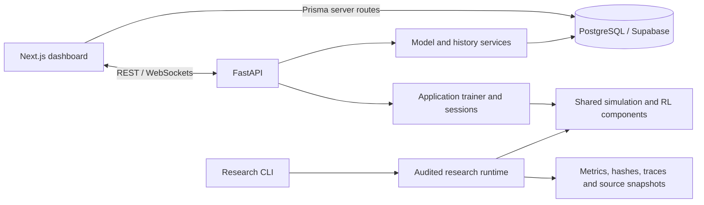

# Architecture

FlowSync has an interactive application and a separate audited headless
research workflow. They share components; end-to-end equivalence is not established.

## Application

`client/src/app/` owns pages and Next.js server routes. Hooks and Zustand stores
manage connections/state; React Three Fiber renders scenes. Prisma runs in
server routes. `server/app/main.py` owns the FastAPI lifespan, HTTP routers and
simulation/training/city/CCTV/research WebSocket registration.

`server/app/rl/trainer.py` is the application trainer. Model/history services
use Supabase plus local checkpoint storage. Camera processing is under
`server/app/realworld/`; city simulation is under `server/app/simulation/`.
These experimental modules do not establish camera accuracy, hardware
performance or readiness for physical signal operation.

## Audited research

`research/training/train_policy.py` and evaluation/audit entry points run without the
website. `research/experiments/runtime.py` builds scenarios and delivered
observations; `research/noise/` applies synthetic faults. Controller proposals
pass through optional supervision/additional shielding and the physical
signal rules. A separate audit samples executed lamp transitions.

Simulator truth may score outcomes and rewards; it must not replace noisy
controller inputs. Observation versions select the required encoding/sensor
path. Bare D3QN still has minimum-green and clearance enforcement; bypassing
the additional shield does not remove the physical transition rules.

Research reward/replay fixes and v7/v8/v9 inputs do not automatically migrate
website training/inference. Preserve those version boundaries. See
[research status](../research/RESEARCH_STATUS.md).

## Repository conventions

- Application code belongs in `client/src/` and `server/app/`.
- Shared research support belongs in the existing research subpackages.
- Research commands use `python -m research` or their full package module path.
  Saved source snapshots retain the command paths used by their recorded runs.
- Dated protocols, findings, audits and manuscripts belong in `research/docs/`.
- Backend/research tests belong in `server/tests/`; frontend changes need frontend checks.
- Private configuration, dependencies, checkpoints and raw results stay local.
  Frozen source/configuration archives must not be rewritten by cleanup.
